# MiMoveBackgroundZeroThreads

- RVA: `0x00305810`–`0x00305AAF` (길이 `671` bytes)
- VA: `0x0000000140305810`
- 실행 섹션: `.text`
- PDB 이름 있음: `예`; PDB Function 태그: `예`
- unwind 정보 RVA: `0x000736AC`
- 디코드: `155`개 명령, `671/671` bytes 표시
- 미해석 바이트: `0` (있으면 어셈블리에 `.byte`로 보존)

> 이 문서는 커널 이미지의 기계어와 PDB 기호를 분석해 생성했습니다. 4번과 5번은 함수 원형과 자료형을 바이너리 사용 방식에서 추정한 C 해석이며 원본 소스 복구 결과는 아닙니다.

## 1. Dependencies

- 직접 호출 지점: **7**; 고유 호출 대상: **7**
- 직접 호출자로 확인된 함수: **1**
- RIP 상대 이미지 참조: **5**

### Outgoing calls
- `0x003058B4` → [ExAcquireSpinLockExclusiveAtDpcLevel](../24/ExAcquireSpinLockExclusiveAtDpcLevel_function_00248E80.md) (function, `0x00248E80`)
- `0x0030591E` → [ExReleaseSpinLockExclusiveFromDpcLevel](../24/ExReleaseSpinLockExclusiveFromDpcLevel_function_002497E0.md) (function, `0x002497E0`)
- `0x00305A10` → [KiRaiseIrqlProcessIrqlFlags](../4F/KiRaiseIrqlProcessIrqlFlags_function_004F56FC.md) (function, `0x004F56FC`)
- `0x00305A2D` → [MiProcessorParked](MiProcessorParked_function_003044A4.md) (function, `0x003044A4`)
- `0x00305A42` → [KeSetUserGroupAffinityThread](../2C/KeSetUserGroupAffinityThread_function_002CD1C4.md) (function, `0x002CD1C4`)
- `0x00305A55` → [MiSelectBestZeroingProcessor](../2C/MiSelectBestZeroingProcessor_function_002CC5E0.md) (function, `0x002CC5E0`)
- `0x00305AA4` → [KiLowerIrqlProcessIrqlFlags](../4F/KiLowerIrqlProcessIrqlFlags_function_004F5698.md) (function, `0x004F5698`)

### Direct callers
- [MmReportParkedProcessors](MmReportParkedProcessors_function_00305600.md) at `0x003056F2`

### Static image references
- `0x00305829` → RVA `0x00E38D00` (`.data`; read)
- `0x0030584E` → RVA `0x00FC6D20` (`ALMOSTRO`; read)
- `0x0030585A` → RVA `0x00FC5000` (`ALMOSTRO`; read)
- `0x0030588E` → RVA `0x00E2DBF8` (`.data`; read)
- `0x00305A74` → RVA `0x00E2DBD8` (`.data`; read)

## 2. Other-region calls and transfers

- 다른 실행 섹션으로 향하는 call: **0**
- call이 아닌 외부 분기/꼬리 이동: **2**
  - `0x00305A97` → [sub_006E07C0](../6E/Unknown_function_006E07C0.md) (`tail-transfer`)
  - `0x00305AAA` → [sub_006E07C0](../6E/Unknown_function_006E07C0.md) (`tail-transfer`)

## 3. Assembly (complete function range)

```asm
00305810  48 89 5C 24 10                  mov qword ptr [rsp + 0x10], rbx
00305815  48 89 4C 24 08                  mov qword ptr [rsp + 8], rcx
0030581A  55                              push rbp
0030581B  56                              push rsi
0030581C  57                              push rdi
0030581D  41 54                           push r12
0030581F  41 55                           push r13
00305821  41 56                           push r14
00305823  41 57                           push r15
00305825  48 83 EC 60                     sub rsp, 0x60
00305829  48 8D 05 D0 34 B3 00            lea rax, [rip + 0xb334d0]
00305830  33 FF                           xor edi, edi
00305832  41 BF 02 00 00 00               mov r15d, 2
00305838  48 3B C8                        cmp rcx, rax
0030583B  0F 84 2C 01 00 00               je 0x14030596d
00305841  44 0F 20 C5                     mov rbp, cr8
00305845  48 89 6C 24 28                  mov qword ptr [rsp + 0x28], rbp
0030584A  45 0F 22 C7                     mov cr8, r15
0030584E  39 3D CC 14 CC 00               cmp dword ptr [rip + 0xcc14cc], edi
00305854  0F 85 B0 01 00 00               jne 0x140305a0a
0030585A  66 3B 3D 9F F7 CB 00            cmp di, word ptr [rip + 0xcbf79f]
00305861  8B DF                           mov ebx, edi
00305863  0F 83 D0 00 00 00               jae 0x140305939
00305869  48 8B AC 24 A0 00 00 00         mov rbp, qword ptr [rsp + 0xa0]
00305871  8B CB                           mov ecx, ebx
00305873  48 69 F1 80 DF 00 00            imul rsi, rcx, 0xdf80
0030587A  48 03 75 10                     add rsi, qword ptr [rbp + 0x10]
0030587E  48 8B 86 80 3A 00 00            mov rax, qword ptr [rsi + 0x3a80]
00305885  48 85 C0                        test rax, rax
00305888  0F 84 CE 00 00 00               je 0x14030595c
0030588E  48 8B 05 63 83 B2 00            mov rax, qword ptr [rip + 0xb28363]
00305895  48 8D 0C 49                     lea rcx, [rcx + rcx*2]
00305899  48 C1 E1 07                     shl rcx, 7
0030589D  4C 8B B4 01 78 01 00 00         mov r14, qword ptr [rcx + rax + 0x178]
003058A5  48 8D 86 B0 3B 00 00            lea rax, [rsi + 0x3bb0]
003058AC  48 8B C8                        mov rcx, rax
003058AF  48 89 44 24 30                  mov qword ptr [rsp + 0x30], rax
003058B4  E8 C7 35 F4 FF                  call 0x140248e80
003058B9  48 8B 8E A8 3B 00 00            mov rcx, qword ptr [rsi + 0x3ba8]
003058C0  48 85 C9                        test rcx, rcx
003058C3  74 54                           je 0x140305919
003058C5  48 39 BE B8 3B 00 00            cmp qword ptr [rsi + 0x3bb8], rdi
003058CC  74 4B                           je 0x140305919
003058CE  41 8B 46 24                     mov eax, dword ptr [r14 + 0x24]
003058D2  A8 01                           test al, 1
003058D4  0F 85 8D 01 00 00               jne 0x140305a67
003058DA  41 8B 56 08                     mov edx, dword ptr [r14 + 8]
003058DE  48 8D B1 D4 01 00 00            lea rsi, [rcx + 0x1d4]
003058E5  49 8B C7                        mov rax, r15
003058E8  89 94 24 A0 00 00 00            mov dword ptr [rsp + 0xa0], edx
003058EF  48 89 44 24 20                  mov qword ptr [rsp + 0x20], rax
003058F4  39 BE 90 00 00 00               cmp dword ptr [rsi + 0x90], edi
003058FA  74 05                           je 0x140305901
003058FC  40 38 3E                        cmp byte ptr [rsi], dil
003058FF  75 7E                           jne 0x14030597f
00305901  48 81 C6 30 01 00 00            add rsi, 0x130
00305908  48 83 E8 01                     sub rax, 1
0030590C  48 89 44 24 20                  mov qword ptr [rsp + 0x20], rax
00305911  75 E1                           jne 0x1403058f4
00305913  41 BF 02 00 00 00               mov r15d, 2
00305919  48 8B 4C 24 30                  mov rcx, qword ptr [rsp + 0x30]
0030591E  E8 BD 3E F4 FF                  call 0x1402497e0
00305923  0F B7 05 D6 F6 CB 00            movzx eax, word ptr [rip + 0xcbf6d6]
0030592A  FF C3                           inc ebx
0030592C  3B D8                           cmp ebx, eax
0030592E  0F 82 3D FF FF FF               jb 0x140305871
00305934  48 8B 6C 24 28                  mov rbp, qword ptr [rsp + 0x28]
00305939  40 80 FD 11                     cmp bpl, 0x11
0030593D  0F 85 4E 01 00 00               jne 0x140305a91
00305943  48 8B 9C 24 A8 00 00 00         mov rbx, qword ptr [rsp + 0xa8]
0030594B  48 83 C4 60                     add rsp, 0x60
0030594F  41 5F                           pop r15
00305951  41 5E                           pop r14
00305953  41 5D                           pop r13
00305955  41 5C                           pop r12
00305957  5F                              pop rdi
00305958  5E                              pop rsi
00305959  5D                              pop rbp
0030595A  C3                              ret
0030595B  CC                              int3
0030595C  48 8B 86 90 3A 00 00            mov rax, qword ptr [rsi + 0x3a90]
00305963  48 85 C0                        test rax, rax
00305966  74 BB                           je 0x140305923
00305968  E9 21 FF FF FF                  jmp 0x14030588e
0030596D  48 85 D2                        test rdx, rdx
00305970  74 D1                           je 0x140305943
00305972  40 B5 11                        mov bpl, 0x11
00305975  48 89 6C 24 28                  mov qword ptr [rsp + 0x28], rbp
0030597A  E9 DB FE FF FF                  jmp 0x14030585a
0030597F  0F 57 C0                        xorps xmm0, xmm0
00305982  0F 11 44 24 50                  movups xmmword ptr [rsp + 0x50], xmm0
00305987  85 D2                           test edx, edx
00305989  0F 84 72 FF FF FF               je 0x140305901
0030598F  8B CA                           mov ecx, edx
00305991  4C 8B F7                        mov r14, rdi
00305994  48 89 8C 24 B8 00 00 00         mov qword ptr [rsp + 0xb8], rcx
0030599C  48 8B 46 6C                     mov rax, qword ptr [rsi + 0x6c]
003059A0  45 8B 7C 06 20                  mov r15d, dword ptr [r14 + rax + 0x20]
003059A5  45 85 FF                        test r15d, r15d
003059A8  74 3D                           je 0x1403059e7
003059AA  4C 8D 60 10                     lea r12, [rax + 0x10]
003059AE  4D 03 E6                        add r12, r14
003059B1  49 8B 04 24                     mov rax, qword ptr [r12]
003059B5  49 3B C4                        cmp rax, r12
003059B8  74 2D                           je 0x1403059e7
003059BA  48 8B 08                        mov rcx, qword ptr [rax]
003059BD  4C 8D A8 50 FE FF FF            lea r13, [rax - 0x1b0]
003059C4  48 89 8C 24 B0 00 00 00         mov qword ptr [rsp + 0xb0], rcx
003059CC  49 39 BD 60 01 00 00            cmp qword ptr [r13 + 0x160], rdi
003059D3  75 45                           jne 0x140305a1a
003059D5  41 83 C7 FF                     add r15d, -1
003059D9  0F 85 A1 00 00 00               jne 0x140305a80
003059DF  48 8B 8C 24 B8 00 00 00         mov rcx, qword ptr [rsp + 0xb8]
003059E7  49 83 C6 30                     add r14, 0x30
003059EB  48 83 E9 01                     sub rcx, 1
003059EF  48 89 8C 24 B8 00 00 00         mov qword ptr [rsp + 0xb8], rcx
003059F7  75 A3                           jne 0x14030599c
003059F9  48 8B 44 24 20                  mov rax, qword ptr [rsp + 0x20]
003059FE  8B 94 24 A0 00 00 00            mov edx, dword ptr [rsp + 0xa0]
00305A05  E9 F7 FE FF FF                  jmp 0x140305901
00305A0A  41 8A D7                        mov dl, r15b
00305A0D  40 8A CD                        mov cl, bpl
00305A10  E8 E7 FC 1E 00                  call 0x1404f56fc
00305A15  E9 40 FE FF FF                  jmp 0x14030585a
00305A1A  41 0F 10 85 60 01 00 00         movups xmm0, xmmword ptr [r13 + 0x160]
00305A22  48 8D 4C 24 40                  lea rcx, [rsp + 0x40]
00305A27  F3 0F 7F 44 24 40               movdqu xmmword ptr [rsp + 0x40], xmm0
00305A2D  E8 72 EA FF FF                  call 0x1403044a4
00305A32  85 C0                           test eax, eax
00305A34  74 24                           je 0x140305a5a
00305A36  49 8B 8D 48 01 00 00            mov rcx, qword ptr [r13 + 0x148]
00305A3D  48 8D 54 24 50                  lea rdx, [rsp + 0x50]
00305A42  E8 7D 77 FC FF                  call 0x1402cd1c4
00305A47  45 33 C9                        xor r9d, r9d
00305A4A  48 8D 4E E4                     lea rcx, [rsi - 0x1c]
00305A4E  49 8B D5                        mov rdx, r13
00305A51  45 8D 41 01                     lea r8d, [r9 + 1]
00305A55  E8 86 6B FC FF                  call 0x1402cc5e0
00305A5A  48 8B 8C 24 B0 00 00 00         mov rcx, qword ptr [rsp + 0xb0]
00305A62  E9 6E FF FF FF                  jmp 0x1403059d5
00305A67  40 38 B9 AC 00 00 00            cmp byte ptr [rcx + 0xac], dil
00305A6E  0F 84 66 FE FF FF               je 0x1403058da
00305A74  4C 8D 35 5D 81 B2 00            lea r14, [rip + 0xb2815d]
00305A7B  E9 5A FE FF FF                  jmp 0x1403058da
00305A80  48 8B C1                        mov rax, rcx
00305A83  49 3B CC                        cmp rcx, r12
00305A86  0F 85 2E FF FF FF               jne 0x1403059ba
00305A8C  E9 4E FF FF FF                  jmp 0x1403059df
00305A91  39 3D 89 12 CC 00               cmp dword ptr [rip + 0xcc1289], edi
00305A97  0F 84 23 AD 3D 00               je 0x1406e07c0
00305A9D  44 0F 20 C1                     mov rcx, cr8
00305AA1  40 8A D5                        mov dl, bpl
00305AA4  E8 EF FB 1E 00                  call 0x1404f5698
00305AA9  90                              nop
00305AAA  E9 11 AD 3D 00                  jmp 0x1406e07c0
```

## 4. C-style interpretation (structured pseudocode)

```c
__int64 __fastcall MiMoveBackgroundZeroThreads(__int64 a1, __int64 a2, __int64 a3, int a4)
{
    __int64 result;
    __int64 v_r12;
    __int64 v_r14;
    __int64 v_r15;
    __int64 v_rbx;
    __int64 v_rdi;
    __int64 v_rsi;
    __int64 v_rsp;
    unsigned __int64 v_stack_m68;
    unsigned __int64 v_stack_m70;
    unsigned __int64 v_stack_m78;
    unsigned __int64 v_stack_p10;
    unsigned __int64 v_stack_p20;
    unsigned __int64 v_stack_p28;
    unsigned __int64 v_stack_p40;
    unsigned __int64 v_stack_p50;
    unsigned __int64 v_stack_p8;
    unsigned int v_stack_pA0;
    unsigned __int64 v_stack_pB0;
    unsigned __int64 v_stack_pB8;

    v_stack_p10 = v_rbx;
    v_stack_p8 = a1;
    v_rsp = (v_rsp) - (96);
    v_rdi = 0;
    if (a1 == (v_rip + 11744464)) goto loc_0030596D;
    v_stack_m70 = v_cr8;
    if ((*(unsigned int *)(v_rip + 13374668)) != 0) goto loc_00305A0A;
loc_0030585A:
    if (0 >= (*(unsigned __int16 *)(v_rip + 13367199))) goto loc_00305939;
loc_00305871:
    v_rsi = (v_rsi) * (0);
    v_rsi = (v_rsi) + (*(unsigned __int64 *)(v_stack_p8 + 16));
    if (*(unsigned __int64 *)(v_rsi + 14976) == 0) goto loc_0030595C;
loc_0030588E:
    a1 = (0 + 0 * 2) << (7);
    v_stack_m68 = v_rsi + 15280;
    result = ExAcquireSpinLockExclusiveAtDpcLevel(v_rsi + 15280, a2, a3, a4);
    if (*(unsigned __int64 *)(v_rsi + 15272) == 0) goto loc_00305919;
    if ((*(unsigned __int64 *)(v_rsi + 15288)) == 0) goto loc_00305919;
    if ((((unsigned __int8)((unsigned int)(*(unsigned int *)(*(unsigned __int64 *)(a1 + *(unsigned __int64 *)(v_rip + 11699043) * 1 + 376) + 36)))) & (1)) != 0) goto loc_00305A67;
loc_003058DA:
    v_stack_p8 = (unsigned int)((unsigned int)(*(unsigned int *)(*(unsigned __int64 *)(a1 + *(unsigned __int64 *)(v_rip + 11699043) * 1 + 376) + 8)));
    v_stack_m78 = 2;
loc_003058F4:
    if ((*(unsigned int *)(*(unsigned __int64 *)(v_rsi + 15272) + 468 + 144)) == 0) goto loc_00305901;
    if ((*(unsigned __int8 *)(*(unsigned __int64 *)(v_rsi + 15272) + 468)) != 0) goto loc_0030597F;
loc_00305901:
    v_rsi = (*(unsigned __int64 *)(v_rsi + 15272) + 468) + (304);
    result = (2) - (1);
    v_stack_m78 = result;
    if (condition_is_not_equal) goto loc_003058F4;
loc_00305919:
    result = ExReleaseSpinLockExclusiveFromDpcLevel(v_stack_m68, (unsigned int)(*(unsigned int *)(*(unsigned __int64 *)(a1 + *(unsigned __int64 *)(v_rip + 11699043) * 1 + 376) + 8)), a3, a4);
loc_00305923:
    v_rbx = (unsigned int)((0) + 1);
    if (((unsigned int)(v_rbx)) < ((unsigned int)(*(unsigned __int16 *)(v_rip + 13366998)))) goto loc_00305871;
loc_00305939:
    if (((unsigned __int8)(v_stack_m70)) != 17) goto loc_00305A91;
loc_00305943:
    v_rsp = (v_rsp) + (96);
    return *(unsigned __int16 *)(v_rip + 13366998);
loc_0030595C:
    if (*(unsigned __int64 *)(v_rsi + 14992) == 0) goto loc_00305923;
    goto loc_0030588E;
loc_0030596D:
    if ((unsigned int)(*(unsigned int *)(*(unsigned __int64 *)(a1 + *(unsigned __int64 *)(v_rip + 11699043) * 1 + 376) + 8)) == 0) goto loc_00305943;
    v_stack_p28 = 17;
    goto loc_0030585A;
loc_0030597F:
    v_stack_p50 = v_xmm0;
    if ((unsigned int)((unsigned int)(*(unsigned int *)(*(unsigned __int64 *)(a1 + *(unsigned __int64 *)(v_rip + 11699043) * 1 + 376) + 8))) == 0) goto loc_00305901;
    v_stack_pB8 = (unsigned int)((unsigned int)((unsigned int)(*(unsigned int *)(*(unsigned __int64 *)(a1 + *(unsigned __int64 *)(v_rip + 11699043) * 1 + 376) + 8))));
loc_0030599C:
    if ((unsigned int)((unsigned int)(*(unsigned int *)(0 + *(unsigned __int64 *)(v_rsi + 108) * 1 + 32))) == 0) goto loc_003059E7;
    v_r12 = (*(unsigned __int64 *)(v_rsi + 108) + 16) + (0);
    if ((*(unsigned __int64 *)(v_r12)) == v_r12) goto loc_003059E7;
loc_003059BA:
    v_stack_pB0 = *(unsigned __int64 *)(*(unsigned __int64 *)(v_r12));
    if ((*(unsigned __int64 *)(*(unsigned __int64 *)(v_r12) - 432 + 352)) != 0) goto loc_00305A1A;
loc_003059D5:
    v_r15 = (unsigned int)(((unsigned int)(*(unsigned int *)(0 + *(unsigned __int64 *)(v_rsi + 108) * 1 + 32))) + (-1));
    if (condition_is_not_equal) goto loc_00305A80;
loc_003059DF:
loc_003059E7:
    v_r14 = (0) + (48);
    a1 = (v_stack_pB8) - (1);
    v_stack_pB8 = a1;
    if (condition_is_not_equal) goto loc_0030599C;
    goto loc_00305901;
loc_00305A0A:
    result = KiRaiseIrqlProcessIrqlFlags(17, (unsigned __int8)(v_r15), a3, a4);
    goto loc_0030585A;
loc_00305A1A:
    v_stack_p40 = v_xmm0;
    result = MiProcessorParked(v_stack_p40, (unsigned __int8)(v_r15), a3, a4);
    if ((unsigned int)(result) != 0) {
        a1 = *(unsigned __int64 *)(*(unsigned __int64 *)(v_r12) - 432 + 328);
        a2 = v_stack_p50;
        result = KeSetUserGroupAffinityThread(a1, a2, a3, a4);
        a4 = 0;
        a1 = v_rsi - 28;
        a2 = *(unsigned __int64 *)(v_r12) - 432;
        a3 = a4 + 1;
        result = MiSelectBestZeroingProcessor(a1, a2, a3, a4);
    }
    goto loc_003059D5;
loc_00305A67:
    if ((*(unsigned __int8 *)(v_stack_pB0 + 172)) == 0) goto loc_003058DA;
    goto loc_003058DA;
loc_00305A80:
    if (v_stack_pB0 != v_r12) goto loc_003059BA;
    goto loc_003059DF;
loc_00305A91:
    result = KiLowerIrqlProcessIrqlFlags(2, 17, a3, a4);
}
```

## 5. (Beta) C Style

```c
int64_t MiMoveBackgroundZeroThreads(int64_t Arg1, int64_t Arg2, int64_t Arg3, int32_t Arg4)
{
    int64_t result;
    int64_t local_r12;
    int64_t local_r14;
    int64_t local_r15;
    int64_t local_rbx;
    int64_t local_rdi;
    int64_t local_rsi;
    int64_t local_rsp;
    uint64_t v_stack_m68;
    uint64_t v_stack_m70;
    uint64_t v_stack_m78;
    uint64_t v_stack_p10;
    uint64_t v_stack_p20;
    uint64_t v_stack_p28;
    uint64_t v_stack_p40;
    uint64_t v_stack_p50;
    uint64_t v_stack_p8;
    uint32_t v_stack_pA0;
    uint64_t v_stack_pB0;
    uint64_t v_stack_pB8;

    v_stack_p10 = local_rbx;
    v_stack_p8 = Arg1;
    local_rsp = (local_rsp) - (96);
    local_rdi = 0;
    if (Arg1 == (v_rip + 11744464)) goto loc_0030596D;
    v_stack_m70 = v_cr8;
    if ((*(uint32_t *)(v_rip + 0xCC14CC)) != 0) goto loc_00305A0A;
loc_0030585A:
    if (0 >= (*(uint16_t *)(v_rip + 0xCBF79F))) goto loc_00305939;
loc_00305871:
    local_rsi = (local_rsi) * (0);
    local_rsi = (local_rsi) + (*(uint64_t *)(v_stack_p8 + 0x10));
    if (*(uint64_t *)(local_rsi + 0x3A80) == 0) goto loc_0030595C;
loc_0030588E:
    Arg1 = (0 + 0 * 2) << (7);
    v_stack_m68 = local_rsi + 15280;
    result = ExAcquireSpinLockExclusiveAtDpcLevel(local_rsi + 15280, Arg2, Arg3, Arg4);
    if (*(uint64_t *)(local_rsi + 0x3BA8) == 0) goto loc_00305919;
    if ((*(uint64_t *)(local_rsi + 0x3BB8)) == 0) goto loc_00305919;
    if ((((uint8_t)((uint32_t)(*(uint32_t *)(*(uint64_t *)(Arg1 + *(uint64_t *)(v_rip + 0xB28363) * 1 + 0x178) + 0x24)))) & (1)) != 0) goto loc_00305A67;
loc_003058DA:
    v_stack_p8 = (uint32_t)((uint32_t)(*(uint32_t *)(*(uint64_t *)(Arg1 + *(uint64_t *)(v_rip + 0xB28363) * 1 + 0x178) + 0x8)));
    v_stack_m78 = 2;
loc_003058F4:
    if ((*(uint32_t *)(*(uint64_t *)(local_rsi + 0x3BA8) + 0x1D4 + 0x90)) == 0) goto loc_00305901;
    if ((*(uint8_t *)(*(uint64_t *)(local_rsi + 0x3BA8) + 0x1D4)) != 0) goto loc_0030597F;
loc_00305901:
    local_rsi = (*(uint64_t *)(local_rsi + 0x3BA8) + 468) + (304);
    result = (2) - (1);
    v_stack_m78 = result;
    if (condition_is_not_equal) goto loc_003058F4;
loc_00305919:
    result = ExReleaseSpinLockExclusiveFromDpcLevel(v_stack_m68, (uint32_t)(*(uint32_t *)(*(uint64_t *)(Arg1 + *(uint64_t *)(v_rip + 0xB28363) * 1 + 0x178) + 0x8)), Arg3, Arg4);
loc_00305923:
    local_rbx = (uint32_t)((0) + 1);
    if (((uint32_t)(local_rbx)) < ((uint32_t)(*(uint16_t *)(v_rip + 0xCBF6D6)))) goto loc_00305871;
loc_00305939:
    if (((uint8_t)(v_stack_m70)) != 17) goto loc_00305A91;
loc_00305943:
    local_rsp = (local_rsp) + (96);
    return *(uint16_t *)(v_rip + 0xCBF6D6);
loc_0030595C:
    if (*(uint64_t *)(local_rsi + 0x3A90) == 0) goto loc_00305923;
    goto loc_0030588E;
loc_0030596D:
    if ((uint32_t)(*(uint32_t *)(*(uint64_t *)(Arg1 + *(uint64_t *)(v_rip + 0xB28363) * 1 + 0x178) + 0x8)) == 0) goto loc_00305943;
    v_stack_p28 = 17;
    goto loc_0030585A;
loc_0030597F:
    v_stack_p50 = v_xmm0;
    if ((uint32_t)((uint32_t)(*(uint32_t *)(*(uint64_t *)(Arg1 + *(uint64_t *)(v_rip + 0xB28363) * 1 + 0x178) + 0x8))) == 0) goto loc_00305901;
    v_stack_pB8 = (uint32_t)((uint32_t)((uint32_t)(*(uint32_t *)(*(uint64_t *)(Arg1 + *(uint64_t *)(v_rip + 0xB28363) * 1 + 0x178) + 0x8))));
loc_0030599C:
    if ((uint32_t)((uint32_t)(*(uint32_t *)(0 + *(uint64_t *)(local_rsi + 0x6C) * 1 + 0x20))) == 0) goto loc_003059E7;
    local_r12 = (*(uint64_t *)(local_rsi + 0x6C) + 16) + (0);
    if ((*(uint64_t *)(local_r12)) == local_r12) goto loc_003059E7;
loc_003059BA:
    v_stack_pB0 = *(uint64_t *)(*(uint64_t *)(local_r12));
    if ((*(uint64_t *)(*(uint64_t *)(local_r12) - 0x1B0 + 0x160)) != 0) goto loc_00305A1A;
loc_003059D5:
    local_r15 = (uint32_t)(((uint32_t)(*(uint32_t *)(0 + *(uint64_t *)(local_rsi + 0x6C) * 1 + 0x20))) + (-1));
    if (condition_is_not_equal) goto loc_00305A80;
loc_003059DF:
loc_003059E7:
    local_r14 = (0) + (48);
    Arg1 = (v_stack_pB8) - (1);
    v_stack_pB8 = Arg1;
    if (condition_is_not_equal) goto loc_0030599C;
    goto loc_00305901;
loc_00305A0A:
    result = KiRaiseIrqlProcessIrqlFlags(17, (uint8_t)(local_r15), Arg3, Arg4);
    goto loc_0030585A;
loc_00305A1A:
    v_stack_p40 = v_xmm0;
    result = MiProcessorParked(v_stack_p40, (uint8_t)(local_r15), Arg3, Arg4);
    if ((uint32_t)(result) != 0) {
        Arg1 = *(uint64_t *)(*(uint64_t *)(local_r12) - 0x1B0 + 0x148);
        Arg2 = v_stack_p50;
        result = KeSetUserGroupAffinityThread(Arg1, Arg2, Arg3, Arg4);
        Arg4 = 0;
        Arg1 = local_rsi - 28;
        Arg2 = *(uint64_t *)(local_r12) - 432;
        Arg3 = Arg4 + 1;
        result = MiSelectBestZeroingProcessor(Arg1, Arg2, Arg3, Arg4);
    }
    goto loc_003059D5;
loc_00305A67:
    if ((*(uint8_t *)(v_stack_pB0 + 0xAC)) == 0) goto loc_003058DA;
    goto loc_003058DA;
loc_00305A80:
    if (v_stack_pB0 != local_r12) goto loc_003059BA;
    goto loc_003059DF;
loc_00305A91:
    result = KiLowerIrqlProcessIrqlFlags(2, 17, Arg3, Arg4);
}
```

## 6. Execution-region graph

[열기: 2D/3D 그래프와 함수 탐색 컨트롤 패널](../../../control-panel.html?section=text&rva=0x00305810&view=graph)

- 2D 그래프는 위에서 아래로 흐르고, 3D 그래프는 빈 공간을 드래그해 회전합니다. Shift+드래그는 이동, 휠은 확대·축소, 함수 노드 선택은 대상 보고서 이동입니다.

### Static fallback

```mermaid
flowchart TD
  bb_00305810[BB_00305810]
  bb_00305841[BB_00305841]
  bb_0030585A[BB_0030585A]
  bb_00305869[BB_00305869]
  bb_00305871[BB_00305871]
  bb_0030588E[BB_0030588E]
  bb_003058C5[BB_003058C5]
  bb_003058CE[BB_003058CE]
  bb_003058DA[BB_003058DA]
  bb_003058F4[BB_003058F4]
  bb_003058FC[BB_003058FC]
  bb_00305901[BB_00305901]
  bb_00305913[BB_00305913]
  bb_00305919[BB_00305919]
  bb_00305923[BB_00305923]
  bb_00305934[BB_00305934]
  bb_00305939[BB_00305939]
  bb_00305943[BB_00305943]
  bb_0030595B[BB_0030595B]
  bb_0030595C[BB_0030595C]
  bb_00305968[BB_00305968]
  bb_0030596D[BB_0030596D]
  bb_00305972[BB_00305972]
  bb_0030597F[BB_0030597F]
  bb_0030598F[BB_0030598F]
  bb_0030599C[BB_0030599C]
  bb_003059AA[BB_003059AA]
  bb_003059BA[BB_003059BA]
  bb_003059D5[BB_003059D5]
  bb_003059DF[BB_003059DF]
  bb_003059E7[BB_003059E7]
  bb_003059F9[BB_003059F9]
  bb_00305A0A[BB_00305A0A]
  bb_00305A1A[BB_00305A1A]
  bb_00305A36[BB_00305A36]
  bb_00305A5A[BB_00305A5A]
  bb_00305A67[BB_00305A67]
  bb_00305A74[BB_00305A74]
  bb_00305A80[BB_00305A80]
  bb_00305A8C[BB_00305A8C]
  bb_00305A91[BB_00305A91]
  bb_00305A9D[BB_00305A9D]
  bb_00305810 -->|branch| bb_0030596D
  bb_00305810 -->|fallthrough| bb_00305841
  bb_00305841 -->|branch| bb_00305A0A
  bb_00305841 -->|fallthrough| bb_0030585A
  bb_0030585A -->|branch| bb_00305939
  bb_0030585A -->|fallthrough| bb_00305869
  bb_00305869 -->|flow| bb_00305871
  bb_00305871 -->|branch| bb_0030595C
  bb_00305871 -->|fallthrough| bb_0030588E
  bb_0030588E -->|branch| bb_00305919
  bb_0030588E -->|fallthrough| bb_003058C5
  bb_003058C5 -->|branch| bb_00305919
  bb_003058C5 -->|fallthrough| bb_003058CE
  bb_003058CE -->|branch| bb_00305A67
  bb_003058CE -->|fallthrough| bb_003058DA
  bb_003058DA -->|flow| bb_003058F4
  bb_003058F4 -->|branch| bb_00305901
  bb_003058F4 -->|fallthrough| bb_003058FC
  bb_003058FC -->|branch| bb_0030597F
  bb_003058FC -->|fallthrough| bb_00305901
  bb_00305901 -->|branch| bb_003058F4
  bb_00305901 -->|fallthrough| bb_00305913
  bb_00305913 -->|flow| bb_00305919
  bb_00305919 -->|flow| bb_00305923
  bb_00305923 -->|branch| bb_00305871
  bb_00305923 -->|fallthrough| bb_00305934
  bb_00305934 -->|flow| bb_00305939
  bb_00305939 -->|branch| bb_00305A91
  bb_00305939 -->|fallthrough| bb_00305943
  bb_0030595B -->|flow| bb_0030595C
  bb_0030595C -->|branch| bb_00305923
  bb_0030595C -->|fallthrough| bb_00305968
  bb_00305968 -->|branch| bb_0030588E
  bb_0030596D -->|branch| bb_00305943
  bb_0030596D -->|fallthrough| bb_00305972
  bb_00305972 -->|branch| bb_0030585A
  bb_0030597F -->|branch| bb_00305901
  bb_0030597F -->|fallthrough| bb_0030598F
  bb_0030598F -->|flow| bb_0030599C
  bb_0030599C -->|branch| bb_003059E7
  bb_0030599C -->|fallthrough| bb_003059AA
  bb_003059AA -->|branch| bb_003059E7
  bb_003059AA -->|fallthrough| bb_003059BA
  bb_003059BA -->|branch| bb_00305A1A
  bb_003059BA -->|fallthrough| bb_003059D5
  bb_003059D5 -->|branch| bb_00305A80
  bb_003059D5 -->|fallthrough| bb_003059DF
  bb_003059DF -->|flow| bb_003059E7
  bb_003059E7 -->|branch| bb_0030599C
  bb_003059E7 -->|fallthrough| bb_003059F9
  bb_003059F9 -->|branch| bb_00305901
  bb_00305A0A -->|branch| bb_0030585A
  bb_00305A1A -->|branch| bb_00305A5A
  bb_00305A1A -->|fallthrough| bb_00305A36
  bb_00305A36 -->|flow| bb_00305A5A
  bb_00305A5A -->|branch| bb_003059D5
  bb_00305A67 -->|branch| bb_003058DA
  bb_00305A67 -->|fallthrough| bb_00305A74
  bb_00305A74 -->|branch| bb_003058DA
  bb_00305A80 -->|branch| bb_003059BA
  bb_00305A80 -->|fallthrough| bb_00305A8C
  bb_00305A8C -->|branch| bb_003059DF
  bb_00305A91 -->|fallthrough| bb_00305A9D
```


