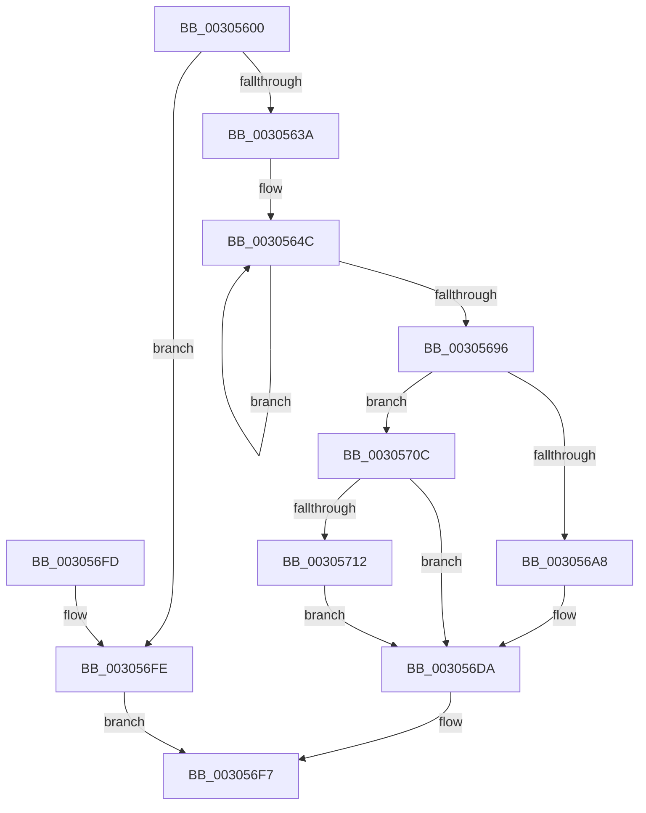

# MmReportParkedProcessors

- RVA: `0x00305600`–`0x0030571B` (길이 `283` bytes)
- VA: `0x0000000140305600`
- 실행 섹션: `.text`
- PDB 이름 있음: `예`; PDB Function 태그: `아니요`
- unwind 정보 RVA: `0x0006084C`
- 디코드: `63`개 명령, `283/283` bytes 표시
- 미해석 바이트: `0` (있으면 어셈블리에 `.byte`로 보존)

> 이 문서는 커널 이미지의 기계어와 PDB 기호를 분석해 생성했습니다. 4번과 5번은 함수 원형과 자료형을 바이너리 사용 방식에서 추정한 C 해석이며 원본 소스 복구 결과는 아닙니다.

## 1. Dependencies

- 직접 호출 지점: **6**; 고유 호출 대상: **5**
- 직접 호출자로 확인된 함수: **1**
- RIP 상대 이미지 참조: **10**

### Outgoing calls
- `0x0030560D` → [ExAcquireSpinLockExclusiveAtDpcLevel](../24/ExAcquireSpinLockExclusiveAtDpcLevel_function_00248E80.md) (function, `0x00248E80`)
- `0x00305629` → [RtlCompareMemory](../6B/RtlCompareMemory_function_006BA670.md) (function, `0x006BA670`)
- `0x003056D5` → [ExQueueWorkItem](../2F/ExQueueWorkItem_function_002F9520.md) (function, `0x002F9520`)
- `0x003056E1` → [ExReleaseSpinLockExclusiveFromDpcLevel](../24/ExReleaseSpinLockExclusiveFromDpcLevel_function_002497E0.md) (function, `0x002497E0`)
- `0x003056F2` → [MiMoveBackgroundZeroThreads](MiMoveBackgroundZeroThreads_function_00305810.md) (function, `0x00305810`)
- `0x00305705` → [ExReleaseSpinLockExclusiveFromDpcLevel](../24/ExReleaseSpinLockExclusiveFromDpcLevel_function_002497E0.md) (function, `0x002497E0`)

### Direct callers
- [PpmParkReportMask](PpmParkReportMask_function_00305190.md) at `0x00305218`

### Static image references
- `0x00305606` → RVA `0x00E2ED40` (`.data`; read)
- `0x00305612` → RVA `0x00E0C0F0` (`.data`; read)
- `0x00305622` → RVA `0x00E2ED48` (`.data`; read)
- `0x0030569C` → RVA `0x00E2EE68` (`.data`; read)
- `0x003056A8` → RVA `0x00E2EE50` (`.data`; read/write)
- `0x003056B0` → RVA `0x0047FAC0` (`MiSendParkedCoreUpdateToAllChildPartitions`; read)
- `0x003056BC` → RVA `0x00E2EE60` (`.data`; write)
- `0x003056C3` → RVA `0x00E2EE50` (`.data`; read)
- `0x003056CA` → RVA `0x00E2EE68` (`.data`; write)
- `0x003056EB` → RVA `0x00E38D00` (`.data`; read)

## 2. Other-region calls and transfers

- 다른 실행 섹션으로 향하는 call: **0**
- 별도 외부 분기/꼬리 이동을 확인하지 못했습니다.

## 3. Assembly (complete function range)

```asm
00305600  40 53                           push rbx
00305602  48 83 EC 20                     sub rsp, 0x20
00305606  48 8D 0D 33 97 B2 00            lea rcx, [rip + 0xb29733]
0030560D  E8 6E 38 F4 FF                  call 0x140248e80
00305612  48 8D 1D D7 6A B0 00            lea rbx, [rip + 0xb06ad7]
00305619  41 B8 08 01 00 00               mov r8d, 0x108
0030561F  48 8B D3                        mov rdx, rbx
00305622  48 8D 0D 1F 97 B2 00            lea rcx, [rip + 0xb2971f]
00305629  E8 42 50 3B 00                  call 0x1406ba670
0030562E  48 3D 08 01 00 00               cmp rax, 0x108
00305634  0F 84 C4 00 00 00               je 0x1403056fe
0030563A  BA 02 00 00 00                  mov edx, 2
0030563F  48 8D 0D 02 97 B2 00            lea rcx, [rip + 0xb29702]
00305646  8B C2                           mov eax, edx
00305648  44 8D 42 7E                     lea r8d, [rdx + 0x7e]
0030564C  0F 10 03                        movups xmm0, xmmword ptr [rbx]
0030564F  0F 10 4B 10                     movups xmm1, xmmword ptr [rbx + 0x10]
00305653  0F 11 01                        movups xmmword ptr [rcx], xmm0
00305656  0F 10 43 20                     movups xmm0, xmmword ptr [rbx + 0x20]
0030565A  0F 11 49 10                     movups xmmword ptr [rcx + 0x10], xmm1
0030565E  0F 10 4B 30                     movups xmm1, xmmword ptr [rbx + 0x30]
00305662  0F 11 41 20                     movups xmmword ptr [rcx + 0x20], xmm0
00305666  0F 10 43 40                     movups xmm0, xmmword ptr [rbx + 0x40]
0030566A  0F 11 49 30                     movups xmmword ptr [rcx + 0x30], xmm1
0030566E  0F 10 4B 50                     movups xmm1, xmmword ptr [rbx + 0x50]
00305672  0F 11 41 40                     movups xmmword ptr [rcx + 0x40], xmm0
00305676  0F 10 43 60                     movups xmm0, xmmword ptr [rbx + 0x60]
0030567A  0F 11 49 50                     movups xmmword ptr [rcx + 0x50], xmm1
0030567E  0F 10 4B 70                     movups xmm1, xmmword ptr [rbx + 0x70]
00305682  49 03 D8                        add rbx, r8
00305685  0F 11 41 60                     movups xmmword ptr [rcx + 0x60], xmm0
00305689  49 03 C8                        add rcx, r8
0030568C  0F 11 49 F0                     movups xmmword ptr [rcx - 0x10], xmm1
00305690  48 83 E8 01                     sub rax, 1
00305694  75 B6                           jne 0x14030564c
00305696  48 8B 03                        mov rax, qword ptr [rbx]
00305699  48 89 01                        mov qword ptr [rcx], rax
0030569C  48 8B 05 C5 97 B2 00            mov rax, qword ptr [rip + 0xb297c5]
003056A3  48 85 C0                        test rax, rax
003056A6  75 64                           jne 0x14030570c
003056A8  48 83 25 A0 97 B2 00 00         and qword ptr [rip + 0xb297a0], 0
003056B0  48 8D 05 09 A4 17 00            lea rax, [rip + 0x17a409]
003056B7  BA 01 00 00 00                  mov edx, 1
003056BC  48 89 05 9D 97 B2 00            mov qword ptr [rip + 0xb2979d], rax
003056C3  48 8D 0D 86 97 B2 00            lea rcx, [rip + 0xb29786]
003056CA  48 C7 05 93 97 B2 00 01 00 00 00  mov qword ptr [rip + 0xb29793], 1
003056D5  E8 46 3E FF FF                  call 0x1402f9520
003056DA  48 8D 0D 5F 96 B2 00            lea rcx, [rip + 0xb2965f]
003056E1  E8 FA 40 F4 FF                  call 0x1402497e0
003056E6  BA 01 00 00 00                  mov edx, 1
003056EB  48 8D 0D 0E 36 B3 00            lea rcx, [rip + 0xb3360e]
003056F2  E8 19 01 00 00                  call 0x140305810
003056F7  48 83 C4 20                     add rsp, 0x20
003056FB  5B                              pop rbx
003056FC  C3                              ret
003056FD  CC                              int3
003056FE  48 8D 0D 3B 96 B2 00            lea rcx, [rip + 0xb2963b]
00305705  E8 D6 40 F4 FF                  call 0x1402497e0
0030570A  EB EB                           jmp 0x1403056f7
0030570C  48 83 F8 01                     cmp rax, 1
00305710  75 C8                           jne 0x1403056da
00305712  48 89 15 4F 97 B2 00            mov qword ptr [rip + 0xb2974f], rdx
00305719  EB BF                           jmp 0x1403056da
```

## 4. C-style interpretation (structured pseudocode)

```c
__int64 __fastcall MmReportParkedProcessors(void)
{
    __int64 result;
    __int64 v_rbx;
    __int64 v_rsp;

    v_rsp = (v_rsp) - (32);
    result = ExAcquireSpinLockExclusiveAtDpcLevel(v_rip + 11704115, a2, a3, a4);
    result = RtlCompareMemory(v_rip + 11704095, v_rip + 11561687, 264, a4);
    if (result == 264) goto loc_003056FE;
loc_0030564C:
    *(unsigned __int64 *)(v_rip + 11704066) = v_xmm0;
    *(unsigned __int64 *)(v_rip + 11704066 + 16) = v_xmm1;
    *(unsigned __int64 *)(v_rip + 11704066 + 32) = v_xmm0;
    *(unsigned __int64 *)(v_rip + 11704066 + 48) = v_xmm1;
    *(unsigned __int64 *)(v_rip + 11704066 + 64) = v_xmm0;
    *(unsigned __int64 *)(v_rip + 11704066 + 80) = v_xmm1;
    v_rbx = (v_rip + 11561687) + (2 + 126);
    *(unsigned __int64 *)(v_rip + 11704066 + 96) = v_xmm0;
    a1 = (v_rip + 11704066) + (2 + 126);
    *(unsigned __int64 *)(a1 - 16) = v_xmm1;
    result = (2) - (1);
    if (condition_is_not_equal) goto loc_0030564C;
    *(unsigned __int64 *)(a1) = *(unsigned __int64 *)(v_rbx);
    if (*(unsigned __int64 *)(v_rip + 11704261) != 0) goto loc_0030570C;
    *(unsigned __int64 *)(v_rip + 11704221) = v_rip + 1549321;
    *(unsigned __int64 *)(v_rip + 11704211) = 1;
    result = ExQueueWorkItem(v_rip + 11704198, 1, 2 + 126, a4);
loc_003056DA:
    result = ExReleaseSpinLockExclusiveFromDpcLevel(v_rip + 11703903, 1, 2 + 126, a4);
    result = MiMoveBackgroundZeroThreads(v_rip + 11744782, 1, 2 + 126, a4);
loc_003056F7:
    v_rsp = (v_rsp) + (32);
    return result;
loc_003056FE:
    result = ExReleaseSpinLockExclusiveFromDpcLevel(v_rip + 11703867, 1, 2 + 126, a4);
    goto loc_003056F7;
loc_0030570C:
    if (result != 1) goto loc_003056DA;
    *(unsigned __int64 *)(v_rip + 11704143) = 1;
    goto loc_003056DA;
}
```

## 5. (Beta) C Style

```c
void MmReportParkedProcessors(void)
{
    int64_t result;
    int64_t local_rbx;
    int64_t local_rsp;

    local_rsp = (local_rsp) - (32);
    result = ExAcquireSpinLockExclusiveAtDpcLevel(v_rip + 11704115, a2, a3, a4);
    result = RtlCompareMemory(v_rip + 11704095, v_rip + 11561687, 264, a4);
    if (result == 264) goto loc_003056FE;
loc_0030564C:
    *(uint64_t *)(v_rip + 0xB29702) = v_xmm0;
    *(uint64_t *)(v_rip + 0xB29702 + 0x10) = v_xmm1;
    *(uint64_t *)(v_rip + 0xB29702 + 0x20) = v_xmm0;
    *(uint64_t *)(v_rip + 0xB29702 + 0x30) = v_xmm1;
    *(uint64_t *)(v_rip + 0xB29702 + 0x40) = v_xmm0;
    *(uint64_t *)(v_rip + 0xB29702 + 0x50) = v_xmm1;
    local_rbx = (v_rip + 11561687) + (2 + 126);
    *(uint64_t *)(v_rip + 0xB29702 + 0x60) = v_xmm0;
    a1 = (v_rip + 11704066) + (2 + 126);
    *(uint64_t *)(a1 - 0x10) = v_xmm1;
    result = (2) - (1);
    if (condition_is_not_equal) goto loc_0030564C;
    *(uint64_t *)(a1) = *(uint64_t *)(local_rbx);
    if (*(uint64_t *)(v_rip + 0xB297C5) != 0) goto loc_0030570C;
    *(uint64_t *)(v_rip + 0xB2979D) = v_rip + 1549321;
    *(uint64_t *)(v_rip + 0xB29793) = 1;
    result = ExQueueWorkItem(v_rip + 11704198, 1, 2 + 126, a4);
loc_003056DA:
    result = ExReleaseSpinLockExclusiveFromDpcLevel(v_rip + 11703903, 1, 2 + 126, a4);
    result = MiMoveBackgroundZeroThreads(v_rip + 11744782, 1, 2 + 126, a4);
loc_003056F7:
    local_rsp = (local_rsp) + (32);
    return result;
loc_003056FE:
    result = ExReleaseSpinLockExclusiveFromDpcLevel(v_rip + 11703867, 1, 2 + 126, a4);
    goto loc_003056F7;
loc_0030570C:
    if (result != 1) goto loc_003056DA;
    *(uint64_t *)(v_rip + 0xB2974F) = 1;
    goto loc_003056DA;
}
```

## 6. Execution-region graph

[열기: 2D/3D 그래프와 함수 탐색 컨트롤 패널](../../../control-panel.html?section=text&rva=0x00305600&view=graph)

- 2D 그래프는 위에서 아래로 흐르고, 3D 그래프는 빈 공간을 드래그해 회전합니다. Shift+드래그는 이동, 휠은 확대·축소, 함수 노드 선택은 대상 보고서 이동입니다.

### Static fallback


