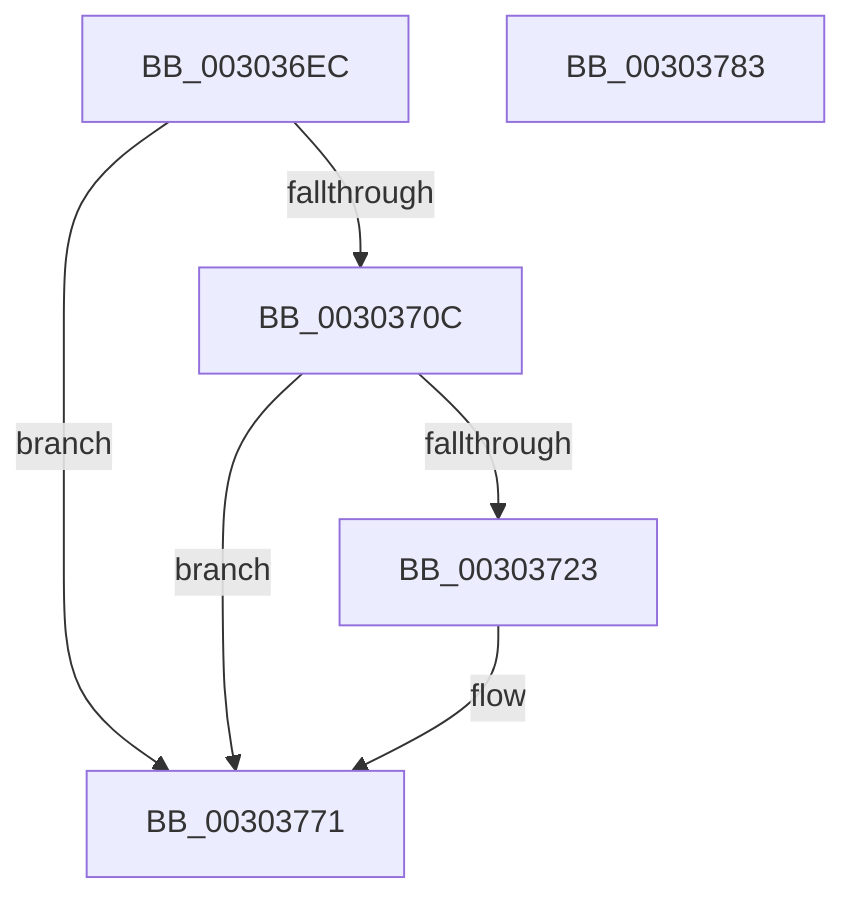

# PopDiagTraceNonAttributedCpuReferences

- RVA: `0x003036EC`–`0x00303784` (길이 `152` bytes)
- VA: `0x00000001403036EC`
- 실행 섹션: `.text`
- PDB 이름 있음: `예`; PDB Function 태그: `아니요`
- unwind 정보 RVA: `0x00073440`
- 디코드: `32`개 명령, `152/152` bytes 표시
- 미해석 바이트: `0` (있으면 어셈블리에 `.byte`로 보존)

> 이 문서는 커널 이미지의 기계어와 PDB 기호를 분석해 생성했습니다. 4번과 5번은 함수 원형과 자료형을 바이너리 사용 방식에서 추정한 C 해석이며 원본 소스 복구 결과는 아닙니다.

## 1. Dependencies

- 직접 호출 지점: **3**; 고유 호출 대상: **3**
- 직접 호출자로 확인된 함수: **1**
- RIP 상대 이미지 참조: **4**

### Outgoing calls
- `0x0030371A` → [EtwEventEnabled](../39/EtwEventEnabled_function_00392450.md) (function, `0x00392450`)
- `0x0030376C` → [EtwWriteEx](../25/EtwWriteEx_function_0025F0D0.md) (function, `0x0025F0D0`)
- `0x00303779` → [_security_check_cookie](../6A/_security_check_cookie_function_006AC640.md) (function, `0x006AC640`)

### Direct callers
- [PopUpdateNonAttributedCpuTimeReference](PopUpdateNonAttributedCpuTimeReference_function_00304720.md) at `0x003047AB`

### Static image references
- `0x003036F4` → RVA `0x00E0A740` (`.data`; read)
- `0x00303703` → RVA `0x00E67858` (`.data`; read)
- `0x0030370C` → RVA `0x00F0B408` (`.data`; read)
- `0x00303713` → RVA `0x00011008` (`.rdata`; read)

## 2. Other-region calls and transfers

- 다른 실행 섹션으로 향하는 call: **0**
- 별도 외부 분기/꼬리 이동을 확인하지 못했습니다.

## 3. Assembly (complete function range)

```asm
003036EC  89 4C 24 08                     mov dword ptr [rsp + 8], ecx
003036F0  48 83 EC 68                     sub rsp, 0x68
003036F4  48 8B 05 45 70 B0 00            mov rax, qword ptr [rip + 0xb07045]
003036FB  48 33 C4                        xor rax, rsp
003036FE  48 89 44 24 50                  mov qword ptr [rsp + 0x50], rax
00303703  80 3D 4E 41 B6 00 00            cmp byte ptr [rip + 0xb6414e], 0
0030370A  74 65                           je 0x140303771
0030370C  48 8B 0D F5 7C C0 00            mov rcx, qword ptr [rip + 0xc07cf5]
00303713  48 8D 15 EE D8 D0 FF            lea rdx, [rip - 0x2f2712]
0030371A  E8 31 ED 08 00                  call 0x140392450
0030371F  84 C0                           test al, al
00303721  74 4E                           je 0x140303771
00303723  83 64 24 4C 00                  and dword ptr [rsp + 0x4c], 0
00303728  48 8D 44 24 70                  lea rax, [rsp + 0x70]
0030372D  48 8B 0D D4 7C C0 00            mov rcx, qword ptr [rip + 0xc07cd4]
00303734  48 8D 15 CD D8 D0 FF            lea rdx, [rip - 0x2f2733]
0030373B  48 89 44 24 40                  mov qword ptr [rsp + 0x40], rax
00303740  41 B9 01 00 00 00               mov r9d, 1
00303746  48 8D 44 24 40                  lea rax, [rsp + 0x40]
0030374B  C7 44 24 48 04 00 00 00         mov dword ptr [rsp + 0x48], 4
00303753  48 89 44 24 38                  mov qword ptr [rsp + 0x38], rax
00303758  45 33 C0                        xor r8d, r8d
0030375B  44 89 4C 24 30                  mov dword ptr [rsp + 0x30], r9d
00303760  48 83 64 24 28 00               and qword ptr [rsp + 0x28], 0
00303766  48 83 64 24 20 00               and qword ptr [rsp + 0x20], 0
0030376C  E8 5F B9 F5 FF                  call 0x14025f0d0
00303771  48 8B 4C 24 50                  mov rcx, qword ptr [rsp + 0x50]
00303776  48 33 CC                        xor rcx, rsp
00303779  E8 C2 8E 3A 00                  call 0x1406ac640
0030377E  48 83 C4 68                     add rsp, 0x68
00303782  C3                              ret
00303783  CC                              int3
```

## 4. C-style interpretation (structured pseudocode)

```c
__int64 __fastcall PopDiagTraceNonAttributedCpuReferences(int a1, __int64 a2, int a3)
{
    __int64 result;
    __int64 v_rsp;
    unsigned __int64 v_stack_m18;
    unsigned int v_stack_m1C;
    unsigned int v_stack_m20;
    unsigned __int64 v_stack_m28;
    unsigned __int64 v_stack_m30;
    unsigned int v_stack_m38;
    unsigned __int64 v_stack_m40;
    unsigned __int64 v_stack_m48;
    unsigned int v_stack_p8;

    v_stack_p8 = a1;
    v_rsp = (v_rsp) - (104);
    result = (*(unsigned __int64 *)(v_rip + 11563077)) ^ (v_rsp);
    v_stack_m18 = result;
    if ((*(unsigned __int8 *)(v_rip + 11944270)) == 0) goto loc_00303771;
    result = EtwEventEnabled(*(unsigned __int64 *)(v_rip + 12614901), v_rip - 3090194, a3, a4);
    if ((unsigned __int8)(result) != 0) {
        result = v_stack_p8;
        a1 = *(unsigned __int64 *)(v_rip + 12614868);
        a2 = v_rip - 3090227;
        v_stack_m28 = result;
        a4 = 1;
        result = v_stack_m28;
        v_stack_m20 = 4;
        v_stack_m30 = result;
        a3 = 0;
        v_stack_m38 = (unsigned int)(a4);
        result = EtwWriteEx(a1, a2, a3, a4);
    }
    a1 = (v_stack_m18) ^ (v_rsp);
    result = _security_check_cookie(a1, a2, a3, a4);
    v_rsp = (v_rsp) + (104);
    return result;
}
```

## 5. (Beta) C Style

```c
int64_t PopDiagTraceNonAttributedCpuReferences(int32_t Arg1, int64_t Arg2, int32_t Arg3)
{
    int64_t result;
    int64_t local_rsp;
    uint64_t v_stack_m18;
    uint32_t v_stack_m1C;
    uint32_t v_stack_m20;
    uint64_t v_stack_m28;
    uint64_t v_stack_m30;
    uint32_t v_stack_m38;
    uint64_t v_stack_m40;
    uint64_t v_stack_m48;
    uint32_t v_stack_p8;

    v_stack_p8 = Arg1;
    local_rsp = (local_rsp) - (104);
    result = (*(uint64_t *)(v_rip + 0xB07045)) ^ (local_rsp);
    v_stack_m18 = result;
    if ((*(uint8_t *)(v_rip + 0xB6414E)) == 0) goto loc_00303771;
    result = EtwEventEnabled(*(uint64_t *)(v_rip + 0xC07CF5), v_rip - 3090194, Arg3, a4);
    if ((uint8_t)(result) != 0) {
        result = v_stack_p8;
        Arg1 = *(uint64_t *)(v_rip + 0xC07CD4);
        Arg2 = v_rip - 3090227;
        v_stack_m28 = result;
        a4 = 1;
        result = v_stack_m28;
        v_stack_m20 = 4;
        v_stack_m30 = result;
        Arg3 = 0;
        v_stack_m38 = (uint32_t)(a4);
        result = EtwWriteEx(Arg1, Arg2, Arg3, a4);
    }
    Arg1 = (v_stack_m18) ^ (local_rsp);
    result = _security_check_cookie(Arg1, Arg2, Arg3, a4);
    local_rsp = (local_rsp) + (104);
    return result;
}
```

## 6. Execution-region graph

[열기: 2D/3D 그래프와 함수 탐색 컨트롤 패널](../../../control-panel.html?section=text&rva=0x003036EC&view=graph)

- 2D 그래프는 위에서 아래로 흐르고, 3D 그래프는 빈 공간을 드래그해 회전합니다. Shift+드래그는 이동, 휠은 확대·축소, 함수 노드 선택은 대상 보고서 이동입니다.

### Static fallback


