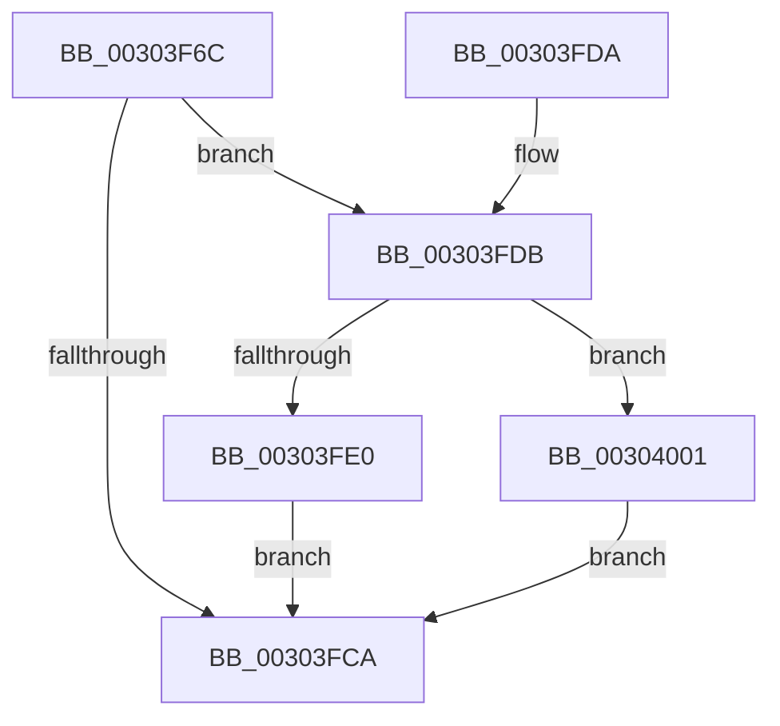

# PopFxPlatformStateAvailable

- RVA: `0x00303F6C`–`0x00304022` (길이 `182` bytes)
- VA: `0x0000000140303F6C`
- 실행 섹션: `.text`
- PDB 이름 있음: `예`; PDB Function 태그: `아니요`
- unwind 정보 RVA: `0x000734C4`
- 디코드: `50`개 명령, `182/182` bytes 표시
- 미해석 바이트: `0` (있으면 어셈블리에 `.byte`로 보존)

> 이 문서는 커널 이미지의 기계어와 PDB 기호를 분석해 생성했습니다. 4번과 5번은 함수 원형과 자료형을 바이너리 사용 방식에서 추정한 C 해석이며 원본 소스 복구 결과는 아닙니다.

## 1. Dependencies

- 직접 호출 지점: **11**; 고유 호출 대상: **8**
- 직접 호출자로 확인된 함수: **1**
- RIP 상대 이미지 참조: **2**

### Outgoing calls
- `0x00303F87` → [KeAcquireSpinLockRaiseToDpc](../20/KeAcquireSpinLockRaiseToDpc_function_00208470.md) (function, `0x00208470`)
- `0x00303FA8` → [PpmIdleCsVetoAccountingUpdateBlock](PpmIdleCsVetoAccountingUpdateBlock_function_003040B0.md) (function, `0x003040B0`)
- `0x00303FB6` → [KeReleaseSpinLock](../39/KeReleaseSpinLock_function_00392BA0.md) (function, `0x00392BA0`)
- `0x00303FE2` → [PopFxSetDripsBlockedByDeviceActivity](PopFxSetDripsBlockedByDeviceActivity_function_00304154.md) (function, `0x00304154`)
- `0x00303FE9` → [PopIdleWakeNotifyDevicesActive](PopIdleWakeNotifyDevicesActive_function_00303EC0.md) (function, `0x00303EC0`)
- `0x00303FF0` → [PopUpdateNonAttributedCpuTimeReference](PopUpdateNonAttributedCpuTimeReference_function_00304720.md) (function, `0x00304720`)
- `0x00303FFA` → [PopDeepSleepSetDisengageReason](../38/PopDeepSleepSetDisengageReason_function_0038FEC4.md) (function, `0x0038FEC4`)
- `0x00304003` → [PopFxSetDripsBlockedByDeviceActivity](PopFxSetDripsBlockedByDeviceActivity_function_00304154.md) (function, `0x00304154`)
- `0x0030400A` → [PopIdleWakeNotifyDevicesActive](PopIdleWakeNotifyDevicesActive_function_00303EC0.md) (function, `0x00303EC0`)
- `0x00304011` → [PopUpdateNonAttributedCpuTimeReference](PopUpdateNonAttributedCpuTimeReference_function_00304720.md) (function, `0x00304720`)
- `0x0030401B` → [PopDeepSleepClearDisengageReason](../39/PopDeepSleepClearDisengageReason_function_0039010C.md) (function, `0x0039010C`)

### Direct callers
- [PopPepUpdateIdleStateRefCount](../2B/PopPepUpdateIdleStateRefCount_function_002BF930.md) at `0x002BFA88`
- [PopPepUpdateIdleStateRefCount](../2B/PopPepUpdateIdleStateRefCount_function_002BF930.md) at `0x002BFB3B`

### Static image references
- `0x00303F80` → RVA `0x00F0CA68` (`.data`; read)
- `0x00303F8C` → RVA `0x00FC6AD0` (`ALMOSTRO`; read)

## 2. Other-region calls and transfers

- 다른 실행 섹션으로 향하는 call: **0**
- 별도 외부 분기/꼬리 이동을 확인하지 못했습니다.

## 3. Assembly (complete function range)

```asm
00303F6C  48 89 5C 24 08                  mov qword ptr [rsp + 8], rbx
00303F71  48 89 74 24 10                  mov qword ptr [rsp + 0x10], rsi
00303F76  57                              push rdi
00303F77  48 83 EC 20                     sub rsp, 0x20
00303F7B  8B F9                           mov edi, ecx
00303F7D  40 8A F2                        mov sil, dl
00303F80  48 8D 0D E1 8A C0 00            lea rcx, [rip + 0xc08ae1]
00303F87  E8 E4 44 F0 FF                  call 0x140208470
00303F8C  48 8B 0D 3D 2B CC 00            mov rcx, qword ptr [rip + 0xcc2b3d]
00303F93  44 8A C6                        mov r8b, sil
00303F96  4C 69 CF C0 01 00 00            imul r9, rdi, 0x1c0
00303F9D  48 83 C1 50                     add rcx, 0x50
00303FA1  B2 01                           mov dl, 1
00303FA3  49 03 C9                        add rcx, r9
00303FA6  8A D8                           mov bl, al
00303FA8  E8 03 01 00 00                  call 0x1403040b0
00303FAD  8A D3                           mov dl, bl
00303FAF  48 8D 0D B2 8A C0 00            lea rcx, [rip + 0xc08ab2]
00303FB6  E8 E5 EB 08 00                  call 0x140392ba0
00303FBB  48 8B 05 0E 2B CC 00            mov rax, qword ptr [rip + 0xcc2b0e]
00303FC2  8B 10                           mov edx, dword ptr [rax]
00303FC4  FF CA                           dec edx
00303FC6  3B FA                           cmp edi, edx
00303FC8  74 11                           je 0x140303fdb
00303FCA  48 8B 5C 24 30                  mov rbx, qword ptr [rsp + 0x30]
00303FCF  48 8B 74 24 38                  mov rsi, qword ptr [rsp + 0x38]
00303FD4  48 83 C4 20                     add rsp, 0x20
00303FD8  5F                              pop rdi
00303FD9  C3                              ret
00303FDA  CC                              int3
00303FDB  40 84 F6                        test sil, sil
00303FDE  75 21                           jne 0x140304001
00303FE0  B1 01                           mov cl, 1
00303FE2  E8 6D 01 00 00                  call 0x140304154
00303FE7  B1 01                           mov cl, 1
00303FE9  E8 D2 FE FF FF                  call 0x140303ec0
00303FEE  B1 01                           mov cl, 1
00303FF0  E8 2B 07 00 00                  call 0x140304720
00303FF5  B9 06 00 00 00                  mov ecx, 6
00303FFA  E8 C5 BE 08 00                  call 0x14038fec4
00303FFF  EB C9                           jmp 0x140303fca
00304001  33 C9                           xor ecx, ecx
00304003  E8 4C 01 00 00                  call 0x140304154
00304008  33 C9                           xor ecx, ecx
0030400A  E8 B1 FE FF FF                  call 0x140303ec0
0030400F  33 C9                           xor ecx, ecx
00304011  E8 0A 07 00 00                  call 0x140304720
00304016  B9 06 00 00 00                  mov ecx, 6
0030401B  E8 EC C0 08 00                  call 0x14039010c
00304020  EB A8                           jmp 0x140303fca
```

## 4. C-style interpretation (structured pseudocode)

```c
__int64 __fastcall PopFxPlatformStateAvailable(int a1, unsigned __int8 a2)
{
    __int64 result;
    __int64 v_rsp;
    unsigned __int64 v_stack_p10;
    unsigned __int64 v_stack_p8;

    v_stack_p8 = v_rbx;
    v_stack_p10 = v_rsi;
    v_rsp = (v_rsp) - (32);
    result = KeAcquireSpinLockRaiseToDpc(v_rip + 12618465, a2, a3, a4);
    a4 = (a4) * ((unsigned int)(a1));
    a1 = (*(unsigned __int64 *)(v_rip + 13380413)) + (80);
    a1 = (a1) + (a4);
    result = PpmIdleCsVetoAccountingUpdateBlock(a1, 1, a2, a4);
    result = KeReleaseSpinLock(v_rip + 12618418, (unsigned __int8)((unsigned __int8)(result)), a2, a4);
    a2 = (unsigned int)(((unsigned int)(*(unsigned int *)(*(unsigned __int64 *)(v_rip + 13380366)))) - 1);
    if (((unsigned int)((unsigned int)(a1))) == a2) goto loc_00303FDB;
loc_00303FCA:
    v_rsp = (v_rsp) + (32);
    return *(unsigned __int64 *)(v_rip + 13380366);
loc_00303FDB:
    if ((unsigned __int8)(v_stack_p10) != 0) goto loc_00304001;
    result = PopFxSetDripsBlockedByDeviceActivity(1, a2, a2, a4);
    result = PopIdleWakeNotifyDevicesActive(1, a2, a2, a4);
    result = PopUpdateNonAttributedCpuTimeReference(1, a2, a2, a4);
    result = PopDeepSleepSetDisengageReason(6, a2, a2, a4);
    goto loc_00303FCA;
loc_00304001:
    a1 = 0;
    result = PopFxSetDripsBlockedByDeviceActivity(a1, a2, a2, a4);
    a1 = 0;
    result = PopIdleWakeNotifyDevicesActive(a1, a2, a2, a4);
    a1 = 0;
    result = PopUpdateNonAttributedCpuTimeReference(a1, a2, a2, a4);
    result = PopDeepSleepClearDisengageReason(6, a2, a2, a4);
    goto loc_00303FCA;
}
```

## 5. (Beta) C Style

```c
int64_t PopFxPlatformStateAvailable(int32_t Arg1, uint8_t Arg2)
{
    int64_t result;
    int64_t local_rsp;
    uint64_t v_stack_p10;
    uint64_t v_stack_p8;

    v_stack_p8 = local_rbx;
    v_stack_p10 = local_rsi;
    local_rsp = (local_rsp) - (32);
    result = KeAcquireSpinLockRaiseToDpc(v_rip + 12618465, Arg2, a3, a4);
    a4 = (a4) * ((uint32_t)(Arg1));
    Arg1 = (*(uint64_t *)(v_rip + 0xCC2B3D)) + (80);
    Arg1 = (Arg1) + (a4);
    result = PpmIdleCsVetoAccountingUpdateBlock(Arg1, 1, Arg2, a4);
    result = KeReleaseSpinLock(v_rip + 12618418, (uint8_t)((uint8_t)(result)), Arg2, a4);
    Arg2 = (uint32_t)(((uint32_t)(*(uint32_t *)(*(uint64_t *)(v_rip + 0xCC2B0E)))) - 1);
    if (((uint32_t)((uint32_t)(Arg1))) == Arg2) goto loc_00303FDB;
loc_00303FCA:
    local_rsp = (local_rsp) + (32);
    return *(uint64_t *)(v_rip + 0xCC2B0E);
loc_00303FDB:
    if ((uint8_t)(v_stack_p10) != 0) goto loc_00304001;
    result = PopFxSetDripsBlockedByDeviceActivity(1, Arg2, Arg2, a4);
    result = PopIdleWakeNotifyDevicesActive(1, Arg2, Arg2, a4);
    result = PopUpdateNonAttributedCpuTimeReference(1, Arg2, Arg2, a4);
    result = PopDeepSleepSetDisengageReason(6, Arg2, Arg2, a4);
    goto loc_00303FCA;
loc_00304001:
    Arg1 = 0;
    result = PopFxSetDripsBlockedByDeviceActivity(Arg1, Arg2, Arg2, a4);
    Arg1 = 0;
    result = PopIdleWakeNotifyDevicesActive(Arg1, Arg2, Arg2, a4);
    Arg1 = 0;
    result = PopUpdateNonAttributedCpuTimeReference(Arg1, Arg2, Arg2, a4);
    result = PopDeepSleepClearDisengageReason(6, Arg2, Arg2, a4);
    goto loc_00303FCA;
}
```

## 6. Execution-region graph

[열기: 2D/3D 그래프와 함수 탐색 컨트롤 패널](../../../control-panel.html?section=text&rva=0x00303F6C&view=graph)

- 2D 그래프는 위에서 아래로 흐르고, 3D 그래프는 빈 공간을 드래그해 회전합니다. Shift+드래그는 이동, 휠은 확대·축소, 함수 노드 선택은 대상 보고서 이동입니다.

### Static fallback


