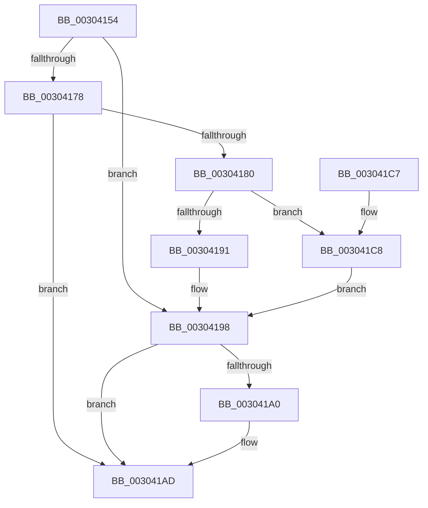

# PopFxSetDripsBlockedByDeviceActivity

- RVA: `0x00304154`–`0x003041D1` (길이 `125` bytes)
- VA: `0x0000000140304154`
- 실행 섹션: `.text`
- PDB 이름 있음: `예`; PDB Function 태그: `아니요`
- unwind 정보 RVA: `0x00060BE4`
- 디코드: `32`개 명령, `125/125` bytes 표시
- 미해석 바이트: `0` (있으면 어셈블리에 `.byte`로 보존)

> 이 문서는 커널 이미지의 기계어와 PDB 기호를 분석해 생성했습니다. 4번과 5번은 함수 원형과 자료형을 바이너리 사용 방식에서 추정한 C 해석이며 원본 소스 복구 결과는 아닙니다.

## 1. Dependencies

- 직접 호출 지점: **4**; 고유 호출 대상: **4**
- 직접 호출자로 확인된 함수: **1**
- RIP 상대 이미지 참조: **5**

### Outgoing calls
- `0x00304167` → [KeAcquireSpinLockRaiseToDpc](../20/KeAcquireSpinLockRaiseToDpc_function_00208470.md) (function, `0x00208470`)
- `0x003041A8` → [PopFxUpdateDeviceIRPhaseAccounting](PopFxUpdateDeviceIRPhaseAccounting_function_003041D8.md) (function, `0x003041D8`)
- `0x003041B7` → [KeReleaseSpinLock](../39/KeReleaseSpinLock_function_00392BA0.md) (function, `0x00392BA0`)
- `0x003041CA` → [PopFxUpdateGlobalDeviceAccountingInfo](../4B/PopFxUpdateGlobalDeviceAccountingInfo_function_004B9FBC.md) (function, `0x004B9FBC`)

### Direct callers
- [PopFxPlatformStateAvailable](PopFxPlatformStateAvailable_function_00303F6C.md) at `0x00303FE2`
- [PopFxPlatformStateAvailable](PopFxPlatformStateAvailable_function_00303F6C.md) at `0x00304003`

### Static image references
- `0x00304160` → RVA `0x00F0E570` (`.data`; read)
- `0x0030416C` → RVA `0x00F0E6C1` (`.data`; read)
- `0x00304178` → RVA `0x00F0E6C0` (`.data`; read)
- `0x00304191` → RVA `0x00F0E6C8` (`.data`; write)
- `0x003041A2` → RVA `0x00F0E6C0` (`.data`; write)

## 2. Other-region calls and transfers

- 다른 실행 섹션으로 향하는 call: **0**
- 별도 외부 분기/꼬리 이동을 확인하지 못했습니다.

## 3. Assembly (complete function range)

```asm
00304154  48 89 5C 24 08                  mov qword ptr [rsp + 8], rbx
00304159  57                              push rdi
0030415A  48 83 EC 20                     sub rsp, 0x20
0030415E  8A D9                           mov bl, cl
00304160  48 8D 0D 09 A4 C0 00            lea rcx, [rip + 0xc0a409]
00304167  E8 04 43 F0 FF                  call 0x140208470
0030416C  80 3D 4E A5 C0 00 00            cmp byte ptr [rip + 0xc0a54e], 0
00304173  40 8A F8                        mov dil, al
00304176  74 20                           je 0x140304198
00304178  38 1D 42 A5 C0 00               cmp byte ptr [rip + 0xc0a542], bl
0030417E  74 2D                           je 0x1403041ad
00304180  48 B9 08 00 00 00 80 F7 FF FF   movabs rcx, 0xfffff78000000008
0030418A  48 8B 09                        mov rcx, qword ptr [rcx]
0030418D  84 DB                           test bl, bl
0030418F  74 37                           je 0x1403041c8
00304191  48 89 0D 30 A5 C0 00            mov qword ptr [rip + 0xc0a530], rcx
00304198  38 1D 22 A5 C0 00               cmp byte ptr [rip + 0xc0a522], bl
0030419E  74 0D                           je 0x1403041ad
003041A0  8A CB                           mov cl, bl
003041A2  88 1D 18 A5 C0 00               mov byte ptr [rip + 0xc0a518], bl
003041A8  E8 2B 00 00 00                  call 0x1403041d8
003041AD  40 8A D7                        mov dl, dil
003041B0  48 8D 0D B9 A3 C0 00            lea rcx, [rip + 0xc0a3b9]
003041B7  E8 E4 E9 08 00                  call 0x140392ba0
003041BC  48 8B 5C 24 30                  mov rbx, qword ptr [rsp + 0x30]
003041C1  48 83 C4 20                     add rsp, 0x20
003041C5  5F                              pop rdi
003041C6  C3                              ret
003041C7  CC                              int3
003041C8  33 D2                           xor edx, edx
003041CA  E8 ED 5D 1B 00                  call 0x1404b9fbc
003041CF  EB C7                           jmp 0x140304198
```

## 4. C-style interpretation (structured pseudocode)

```c
__int64 __fastcall PopFxSetDripsBlockedByDeviceActivity(unsigned __int8 a1)
{
    __int64 result;
    __int64 v_rsp;
    unsigned __int64 v_stack_p8;

    v_stack_p8 = v_rbx;
    v_rsp = (v_rsp) - (32);
    result = KeAcquireSpinLockRaiseToDpc(v_rip + 12624905, a2, a3, a4);
    if ((*(unsigned __int8 *)(v_rip + 12625230)) == 0) goto loc_00304198;
    if ((*(unsigned __int8 *)(v_rip + 12625218)) == a1) goto loc_003041AD;
    if (a1 == 0) goto loc_003041C8;
    *(unsigned __int64 *)(v_rip + 12625200) = *(unsigned __int64 *)(v_rip + 12624905);
loc_00304198:
    if ((*(unsigned __int8 *)(v_rip + 12625186)) != a1) {
        a1 = a1;
        *(unsigned __int8 *)(v_rip + 12625176) = a1;
        result = PopFxUpdateDeviceIRPhaseAccounting(a1, a2, a3, a4);
    }
    result = KeReleaseSpinLock(v_rip + 12624825, (unsigned __int8)((unsigned __int8)(result)), a3, a4);
    v_rsp = (v_rsp) + (32);
    return result;
loc_003041C8:
    a2 = 0;
    result = PopFxUpdateGlobalDeviceAccountingInfo(v_rip + 12624825, a2, a3, a4);
    goto loc_00304198;
}
```

## 5. (Beta) C Style

```c
int64_t PopFxSetDripsBlockedByDeviceActivity(uint8_t Arg1)
{
    int64_t result;
    int64_t local_rsp;
    uint64_t v_stack_p8;

    v_stack_p8 = local_rbx;
    local_rsp = (local_rsp) - (32);
    result = KeAcquireSpinLockRaiseToDpc(v_rip + 12624905, a2, a3, a4);
    if ((*(uint8_t *)(v_rip + 0xC0A54E)) == 0) goto loc_00304198;
    if ((*(uint8_t *)(v_rip + 0xC0A542)) == Arg1) goto loc_003041AD;
    if (Arg1 == 0) goto loc_003041C8;
    *(uint64_t *)(v_rip + 0xC0A530) = *(uint64_t *)(v_rip + 0xC0A409);
loc_00304198:
    if ((*(uint8_t *)(v_rip + 0xC0A522)) != Arg1) {
        Arg1 = Arg1;
        *(uint8_t *)(v_rip + 0xC0A518) = Arg1;
        result = PopFxUpdateDeviceIRPhaseAccounting(Arg1, a2, a3, a4);
    }
    result = KeReleaseSpinLock(v_rip + 12624825, (uint8_t)((uint8_t)(result)), a3, a4);
    local_rsp = (local_rsp) + (32);
    return result;
loc_003041C8:
    a2 = 0;
    result = PopFxUpdateGlobalDeviceAccountingInfo(v_rip + 12624825, a2, a3, a4);
    goto loc_00304198;
}
```

## 6. Execution-region graph

[열기: 2D/3D 그래프와 함수 탐색 컨트롤 패널](../../../control-panel.html?section=text&rva=0x00304154&view=graph)

- 2D 그래프는 위에서 아래로 흐르고, 3D 그래프는 빈 공간을 드래그해 회전합니다. Shift+드래그는 이동, 휠은 확대·축소, 함수 노드 선택은 대상 보고서 이동입니다.

### Static fallback


