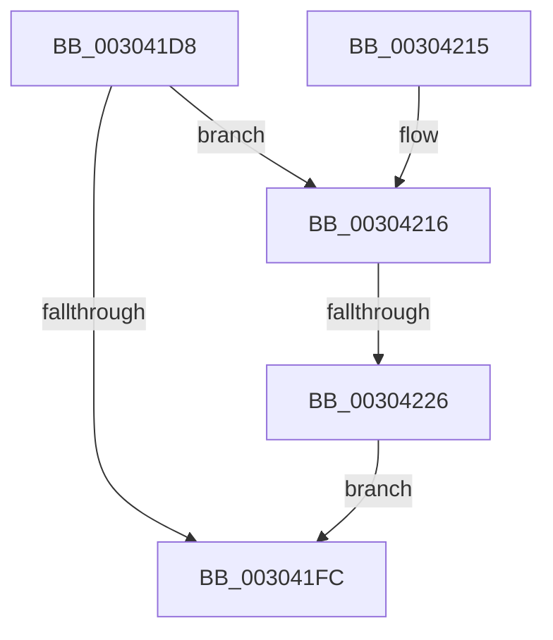

# PopFxUpdateDeviceIRPhaseAccounting

- RVA: `0x003041D8`–`0x0030422F` (길이 `87` bytes)
- VA: `0x00000001403041D8`
- 실행 섹션: `.text`
- PDB 이름 있음: `예`; PDB Function 태그: `예`
- unwind 정보 RVA: `0x0006D274`
- 디코드: `23`개 명령, `87/87` bytes 표시
- 미해석 바이트: `0` (있으면 어셈블리에 `.byte`로 보존)

> 이 문서는 커널 이미지의 기계어와 PDB 기호를 분석해 생성했습니다. 4번과 5번은 함수 원형과 자료형을 바이너리 사용 방식에서 추정한 C 해석이며 원본 소스 복구 결과는 아닙니다.

## 1. Dependencies

- 직접 호출 지점: **3**; 고유 호출 대상: **3**
- 직접 호출자로 확인된 함수: **1**
- RIP 상대 이미지 참조: **3**

### Outgoing calls
- `0x003041EC` → [KeAcquireSpinLockRaiseToDpc](../20/KeAcquireSpinLockRaiseToDpc_function_00208470.md) (function, `0x00208470`)
- `0x00304205` → [KeReleaseSpinLock](../39/KeReleaseSpinLock_function_00392BA0.md) (function, `0x00392BA0`)
- `0x00304218` → [KeQueryPerformanceCounter](../37/KeQueryPerformanceCounter_function_0037E7E0.md) (function, `0x0037E7E0`)

### Direct callers
- [PopFxSetDripsBlockedByDeviceActivity](PopFxSetDripsBlockedByDeviceActivity_function_00304154.md) at `0x003041A8`

### Static image references
- `0x003041E5` → RVA `0x00F0CA58` (`.data`; read)
- `0x003041F1` → RVA `0x00F0C7B8` (`.data`; read)
- `0x00304226` → RVA `0x00F0C7B0` (`.data`; write)

## 2. Other-region calls and transfers

- 다른 실행 섹션으로 향하는 call: **0**
- call이 아닌 외부 분기/꼬리 이동: **1**
  - `0x00304220` → [sub_006E05FA](../6E/Unknown_function_006E05FA.md) (`tail-transfer`)

## 3. Assembly (complete function range)

```asm
003041D8  48 89 5C 24 08                  mov qword ptr [rsp + 8], rbx
003041DD  57                              push rdi
003041DE  48 83 EC 20                     sub rsp, 0x20
003041E2  40 8A F9                        mov dil, cl
003041E5  48 8D 0D 6C 88 C0 00            lea rcx, [rip + 0xc0886c]
003041EC  E8 7F 42 F0 FF                  call 0x140208470
003041F1  80 3D C0 85 C0 00 00            cmp byte ptr [rip + 0xc085c0], 0
003041F8  8A D8                           mov bl, al
003041FA  75 1A                           jne 0x140304216
003041FC  8A D3                           mov dl, bl
003041FE  48 8D 0D 53 88 C0 00            lea rcx, [rip + 0xc08853]
00304205  E8 96 E9 08 00                  call 0x140392ba0
0030420A  48 8B 5C 24 30                  mov rbx, qword ptr [rsp + 0x30]
0030420F  48 83 C4 20                     add rsp, 0x20
00304213  5F                              pop rdi
00304214  C3                              ret
00304215  CC                              int3
00304216  33 C9                           xor ecx, ecx
00304218  E8 C3 A5 07 00                  call 0x14037e7e0
0030421D  40 84 FF                        test dil, dil
00304220  0F 84 D4 C3 3D 00               je 0x1406e05fa
00304226  48 89 05 83 85 C0 00            mov qword ptr [rip + 0xc08583], rax
0030422D  EB CD                           jmp 0x1403041fc
```

## 4. C-style interpretation (structured pseudocode)

```c
__int64 __fastcall PopFxUpdateDeviceIRPhaseAccounting(unsigned __int8 a1)
{
    __int64 result;
    __int64 v_rsp;
    unsigned __int64 v_stack_p8;

    v_stack_p8 = v_rbx;
    v_rsp = (v_rsp) - (32);
    result = KeAcquireSpinLockRaiseToDpc(v_rip + 12617836, a2, a3, a4);
    if ((*(unsigned __int8 *)(v_rip + 12617152)) != 0) goto loc_00304216;
loc_003041FC:
    result = KeReleaseSpinLock(v_rip + 12617811, (unsigned __int8)((unsigned __int8)(result)), a3, a4);
    v_rsp = (v_rsp) + (32);
    return result;
loc_00304216:
    a1 = 0;
    result = KeQueryPerformanceCounter(a1, (unsigned __int8)((unsigned __int8)(result)), a3, a4);
    *(unsigned __int64 *)(v_rip + 12617091) = result;
    goto loc_003041FC;
}
```

## 5. (Beta) C Style

```c
int64_t PopFxUpdateDeviceIRPhaseAccounting(uint8_t Arg1)
{
    int64_t result;
    int64_t local_rsp;
    uint64_t v_stack_p8;

    v_stack_p8 = local_rbx;
    local_rsp = (local_rsp) - (32);
    result = KeAcquireSpinLockRaiseToDpc(v_rip + 12617836, a2, a3, a4);
    if ((*(uint8_t *)(v_rip + 0xC085C0)) != 0) goto loc_00304216;
loc_003041FC:
    result = KeReleaseSpinLock(v_rip + 12617811, (uint8_t)((uint8_t)(result)), a3, a4);
    local_rsp = (local_rsp) + (32);
    return result;
loc_00304216:
    Arg1 = 0;
    result = KeQueryPerformanceCounter(Arg1, (uint8_t)((uint8_t)(result)), a3, a4);
    *(uint64_t *)(v_rip + 0xC08583) = result;
    goto loc_003041FC;
}
```

## 6. Execution-region graph

[열기: 2D/3D 그래프와 함수 탐색 컨트롤 패널](../../../control-panel.html?section=text&rva=0x003041D8&view=graph)

- 2D 그래프는 위에서 아래로 흐르고, 3D 그래프는 빈 공간을 드래그해 회전합니다. Shift+드래그는 이동, 휠은 확대·축소, 함수 노드 선택은 대상 보고서 이동입니다.

### Static fallback


