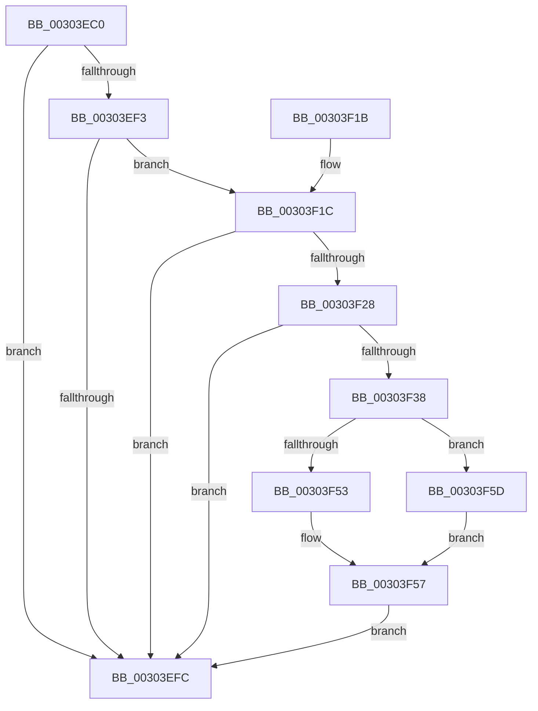

# PopIdleWakeNotifyDevicesActive

- RVA: `0x00303EC0`–`0x00303F63` (길이 `163` bytes)
- VA: `0x0000000140303EC0`
- 실행 섹션: `.text`
- PDB 이름 있음: `예`; PDB Function 태그: `아니요`
- unwind 정보 RVA: `0x000734B0`
- 디코드: `47`개 명령, `163/163` bytes 표시
- 미해석 바이트: `0` (있으면 어셈블리에 `.byte`로 보존)

> 이 문서는 커널 이미지의 기계어와 PDB 기호를 분석해 생성했습니다. 4번과 5번은 함수 원형과 자료형을 바이너리 사용 방식에서 추정한 C 해석이며 원본 소스 복구 결과는 아닙니다.

## 1. Dependencies

- 직접 호출 지점: **3**; 고유 호출 대상: **3**
- 직접 호출자로 확인된 함수: **1**
- RIP 상대 이미지 참조: **2**

### Outgoing calls
- `0x00303EDF` → [KeAcquireSpinLockRaiseToDpc](../20/KeAcquireSpinLockRaiseToDpc_function_00208470.md) (function, `0x00208470`)
- `0x00303F06` → [KeReleaseSpinLock](../39/KeReleaseSpinLock_function_00392BA0.md) (function, `0x00392BA0`)
- `0x00303F3D` → [RtlGetInterruptTimePrecise](../20/RtlGetInterruptTimePrecise_function_0020A4C0.md) (function, `0x0020A4C0`)

### Direct callers
- [PopFxPlatformStateAvailable](PopFxPlatformStateAvailable_function_00303F6C.md) at `0x00303FE9`
- [PopFxPlatformStateAvailable](PopFxPlatformStateAvailable_function_00303F6C.md) at `0x0030400A`

### Static image references
- `0x00303ED8` → RVA `0x00F08290` (`.data`; read)
- `0x00303EE4` → RVA `0x00F08280` (`.data`; read)

## 2. Other-region calls and transfers

- 다른 실행 섹션으로 향하는 call: **0**
- 별도 외부 분기/꼬리 이동을 확인하지 못했습니다.

## 3. Assembly (complete function range)

```asm
00303EC0  48 89 5C 24 08                  mov qword ptr [rsp + 8], rbx
00303EC5  48 89 74 24 18                  mov qword ptr [rsp + 0x18], rsi
00303ECA  57                              push rdi
00303ECB  48 83 EC 20                     sub rsp, 0x20
00303ECF  48 83 64 24 38 00               and qword ptr [rsp + 0x38], 0
00303ED5  0F B6 F9                        movzx edi, cl
00303ED8  48 8D 0D B1 43 C0 00            lea rcx, [rip + 0xc043b1]
00303EDF  E8 8C 45 F0 FF                  call 0x140208470
00303EE4  48 8B 1D 95 43 C0 00            mov rbx, qword ptr [rip + 0xc04395]
00303EEB  40 8A F0                        mov sil, al
00303EEE  48 85 DB                        test rbx, rbx
00303EF1  74 09                           je 0x140303efc
00303EF3  44 8B 03                        mov r8d, dword ptr [rbx]
00303EF6  41 F6 C0 10                     test r8b, 0x10
00303EFA  75 20                           jne 0x140303f1c
00303EFC  40 8A D6                        mov dl, sil
00303EFF  48 8D 0D 8A 43 C0 00            lea rcx, [rip + 0xc0438a]
00303F06  E8 95 EC 08 00                  call 0x140392ba0
00303F0B  48 8B 5C 24 30                  mov rbx, qword ptr [rsp + 0x30]
00303F10  48 8B 74 24 40                  mov rsi, qword ptr [rsp + 0x40]
00303F15  48 83 C4 20                     add rsp, 0x20
00303F19  5F                              pop rdi
00303F1A  C3                              ret
00303F1B  CC                              int3
00303F1C  41 8B C8                        mov ecx, r8d
00303F1F  8B D7                           mov edx, edi
00303F21  83 E1 01                        and ecx, 1
00303F24  3B CF                           cmp ecx, edi
00303F26  74 D4                           je 0x140303efc
00303F28  41 33 D0                        xor edx, r8d
00303F2B  83 E2 01                        and edx, 1
00303F2E  41 33 D0                        xor edx, r8d
00303F31  89 13                           mov dword ptr [rbx], edx
00303F33  F6 C2 02                        test dl, 2
00303F36  75 C4                           jne 0x140303efc
00303F38  48 8D 4C 24 38                  lea rcx, [rsp + 0x38]
00303F3D  E8 7E 65 F0 FF                  call 0x14020a4c0
00303F42  48 8B 4C 24 38                  mov rcx, qword ptr [rsp + 0x38]
00303F47  48 8B C1                        mov rax, rcx
00303F4A  48 2B 43 08                     sub rax, qword ptr [rbx + 8]
00303F4E  40 84 FF                        test dil, dil
00303F51  75 0A                           jne 0x140303f5d
00303F53  48 01 43 18                     add qword ptr [rbx + 0x18], rax
00303F57  48 89 4B 08                     mov qword ptr [rbx + 8], rcx
00303F5B  EB 9F                           jmp 0x140303efc
00303F5D  48 01 43 20                     add qword ptr [rbx + 0x20], rax
00303F61  EB F4                           jmp 0x140303f57
```

## 4. C-style interpretation (structured pseudocode)

```c
__int64 __fastcall PopIdleWakeNotifyDevicesActive(unsigned __int8 a1)
{
    __int64 result;
    __int64 v_rsp;
    unsigned __int64 v_stack_p10;
    unsigned __int64 v_stack_p18;
    unsigned __int64 v_stack_p38;
    unsigned __int64 v_stack_p8;

    v_stack_p8 = v_rbx;
    v_stack_p18 = v_rsi;
    v_rsp = (v_rsp) - (32);
    result = KeAcquireSpinLockRaiseToDpc(v_rip + 12600241, a2, a3, a4);
    if (*(unsigned __int64 *)(v_rip + 12600213) == 0) goto loc_00303EFC;
    if ((((unsigned __int8)((unsigned int)(*(unsigned int *)(*(unsigned __int64 *)(v_rip + 12600213))))) & (16)) != 0) goto loc_00303F1C;
loc_00303EFC:
    result = KeReleaseSpinLock(v_rip + 12600202, (unsigned __int8)((unsigned __int8)(result)), (unsigned int)(*(unsigned int *)(*(unsigned __int64 *)(v_rip + 12600213))), a4);
    v_rsp = (v_rsp) + (32);
    return result;
loc_00303F1C:
    a1 = (unsigned int)(((unsigned int)((unsigned int)((unsigned int)(*(unsigned int *)(*(unsigned __int64 *)(v_rip + 12600213)))))) & (1));
    if (a1 == a1) goto loc_00303EFC;
    a2 = (unsigned int)(((unsigned int)(a1)) ^ ((unsigned int)((unsigned int)(*(unsigned int *)(*(unsigned __int64 *)(v_rip + 12600213))))));
    a2 = (unsigned int)((a2) & (1));
    a2 = (unsigned int)((a2) ^ ((unsigned int)((unsigned int)(*(unsigned int *)(*(unsigned __int64 *)(v_rip + 12600213))))));
    *(unsigned int *)(v_stack_p8) = (unsigned int)(a2);
    if ((((unsigned __int8)(a2)) & (2)) != 0) goto loc_00303EFC;
    result = RtlGetInterruptTimePrecise(v_stack_p38, a2, (unsigned int)(*(unsigned int *)(*(unsigned __int64 *)(v_rip + 12600213))), a4);
    result = (v_stack_p38) - (*(unsigned __int64 *)(v_stack_p8 + 8));
    if (a1 != 0) goto loc_00303F5D;
loc_00303F57:
    *(unsigned __int64 *)(v_stack_p8 + 8) = v_stack_p38;
    goto loc_00303EFC;
loc_00303F5D:
    goto loc_00303F57;
}
```

## 5. (Beta) C Style

```c
int64_t PopIdleWakeNotifyDevicesActive(uint8_t Arg1)
{
    int64_t result;
    int64_t local_rsp;
    uint64_t v_stack_p10;
    uint64_t v_stack_p18;
    uint64_t v_stack_p38;
    uint64_t v_stack_p8;

    v_stack_p8 = local_rbx;
    v_stack_p18 = local_rsi;
    local_rsp = (local_rsp) - (32);
    result = KeAcquireSpinLockRaiseToDpc(v_rip + 12600241, a2, a3, a4);
    if (*(uint64_t *)(v_rip + 0xC04395) == 0) goto loc_00303EFC;
    if ((((uint8_t)((uint32_t)(*(uint32_t *)(*(uint64_t *)(v_rip + 0xC04395))))) & (16)) != 0) goto loc_00303F1C;
loc_00303EFC:
    result = KeReleaseSpinLock(v_rip + 12600202, (uint8_t)((uint8_t)(result)), (uint32_t)(*(uint32_t *)(*(uint64_t *)(v_rip + 0xC04395))), a4);
    local_rsp = (local_rsp) + (32);
    return result;
loc_00303F1C:
    Arg1 = (uint32_t)(((uint32_t)((uint32_t)((uint32_t)(*(uint32_t *)(*(uint64_t *)(v_rip + 0xC04395)))))) & (1));
    if (Arg1 == Arg1) goto loc_00303EFC;
    a2 = (uint32_t)(((uint32_t)(Arg1)) ^ ((uint32_t)((uint32_t)(*(uint32_t *)(*(uint64_t *)(v_rip + 0xC04395))))));
    a2 = (uint32_t)((a2) & (1));
    a2 = (uint32_t)((a2) ^ ((uint32_t)((uint32_t)(*(uint32_t *)(*(uint64_t *)(v_rip + 0xC04395))))));
    *(uint32_t *)(v_stack_p8) = (uint32_t)(a2);
    if ((((uint8_t)(a2)) & (2)) != 0) goto loc_00303EFC;
    result = RtlGetInterruptTimePrecise(v_stack_p38, a2, (uint32_t)(*(uint32_t *)(*(uint64_t *)(v_rip + 0xC04395))), a4);
    result = (v_stack_p38) - (*(uint64_t *)(v_stack_p8 + 0x8));
    if (Arg1 != 0) goto loc_00303F5D;
loc_00303F57:
    *(uint64_t *)(v_stack_p8 + 0x8) = v_stack_p38;
    goto loc_00303EFC;
loc_00303F5D:
    goto loc_00303F57;
}
```

## 6. Execution-region graph

[열기: 2D/3D 그래프와 함수 탐색 컨트롤 패널](../../../control-panel.html?section=text&rva=0x00303EC0&view=graph)

- 2D 그래프는 위에서 아래로 흐르고, 3D 그래프는 빈 공간을 드래그해 회전합니다. Shift+드래그는 이동, 휠은 확대·축소, 함수 노드 선택은 대상 보고서 이동입니다.

### Static fallback


