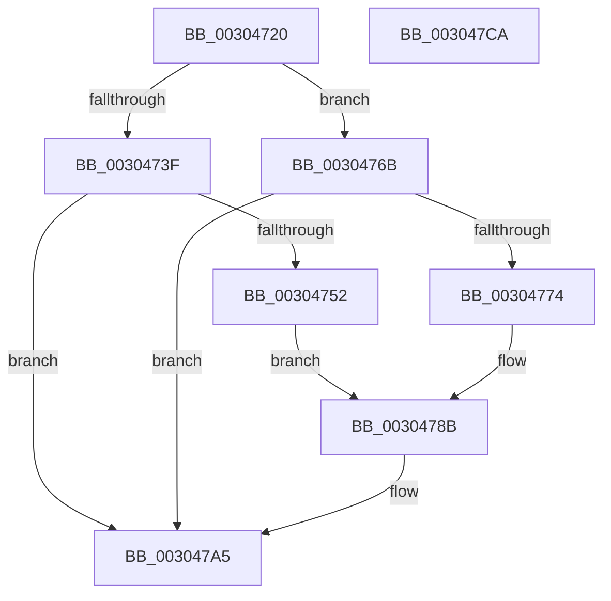

# PopUpdateNonAttributedCpuTimeReference

- RVA: `0x00304720`–`0x003047CB` (길이 `171` bytes)
- VA: `0x0000000140304720`
- 실행 섹션: `.text`
- PDB 이름 있음: `예`; PDB Function 태그: `아니요`
- unwind 정보 RVA: `0x0005CAAC`
- 디코드: `41`개 명령, `171/171` bytes 표시
- 미해석 바이트: `0` (있으면 어셈블리에 `.byte`로 보존)

> 이 문서는 커널 이미지의 기계어와 PDB 기호를 분석해 생성했습니다. 4번과 5번은 함수 원형과 자료형을 바이너리 사용 방식에서 추정한 C 해석이며 원본 소스 복구 결과는 아닙니다.

## 1. Dependencies

- 직접 호출 지점: **6**; 고유 호출 대상: **5**
- 직접 호출자로 확인된 함수: **3**
- RIP 상대 이미지 참조: **9**

### Outgoing calls
- `0x00304733` → [KeAcquireSpinLockRaiseToDpc](../20/KeAcquireSpinLockRaiseToDpc_function_00208470.md) (function, `0x00208470`)
- `0x00304762` → [PopAccumulateNonActivatedCpuTime](../4A/PopAccumulateNonActivatedCpuTime_function_004A0AA4.md) (function, `0x004A0AA4`)
- `0x00304784` → [PopAccumulateNonActivatedCpuTime](../4A/PopAccumulateNonActivatedCpuTime_function_004A0AA4.md) (function, `0x004A0AA4`)
- `0x003047A0` → [PopAccumulateNonDripsIdleCpuTime](../4A/PopAccumulateNonDripsIdleCpuTime_function_004A09B0.md) (function, `0x004A09B0`)
- `0x003047AB` → [PopDiagTraceNonAttributedCpuReferences](PopDiagTraceNonAttributedCpuReferences_function_003036EC.md) (function, `0x003036EC`)
- `0x003047BA` → [KeReleaseSpinLock](../39/KeReleaseSpinLock_function_00392BA0.md) (function, `0x00392BA0`)

### Direct callers
- [PopFxPlatformStateAvailable](PopFxPlatformStateAvailable_function_00303F6C.md) at `0x00303FF0`
- [PopFxPlatformStateAvailable](PopFxPlatformStateAvailable_function_00303F6C.md) at `0x00304011`
- [PpmUpdateIdleVeto](PpmUpdateIdleVeto_function_00304930.md) at `0x00304A6F`
- [PpmUpdateIdleVeto](PpmUpdateIdleVeto_function_00304930.md) at `0x00304AB4`
- [PopPdcIdleResiliencyCallback](../../page/A3/PopPdcIdleResiliencyCallback_function_00A31518.md) at `0x00A315D0`
- [PopPdcIdleResiliencyCallback](../../page/A3/PopPdcIdleResiliencyCallback_function_00A31518.md) at `0x00A31622`

### Static image references
- `0x0030472C` → RVA `0x00E27EC8` (`.data`; read)
- `0x0030473F` → RVA `0x00E27EC4` (`.data`; read)
- `0x00304747` → RVA `0x00E27EC4` (`.data`; write)
- `0x00304752` → RVA `0x00E27D78` (`.data`; read)
- `0x0030475B` → RVA `0x00E27D70` (`.data`; read)
- `0x0030476B` → RVA `0x00E27EC4` (`.data`; read/write)
- `0x0030478B` → RVA `0x00E27D90` (`.data`; read)
- `0x00304792` → RVA `0x00E27D88` (`.data`; read)
- `0x00304799` → RVA `0x00E27D80` (`.data`; read)

## 2. Other-region calls and transfers

- 다른 실행 섹션으로 향하는 call: **0**
- 별도 외부 분기/꼬리 이동을 확인하지 못했습니다.

## 3. Assembly (complete function range)

```asm
00304720  48 89 5C 24 08                  mov qword ptr [rsp + 8], rbx
00304725  57                              push rdi
00304726  48 83 EC 20                     sub rsp, 0x20
0030472A  8A D9                           mov bl, cl
0030472C  48 8D 0D 95 37 B2 00            lea rcx, [rip + 0xb23795]
00304733  E8 38 3D F0 FF                  call 0x140208470
00304738  40 8A F8                        mov dil, al
0030473B  84 DB                           test bl, bl
0030473D  74 2C                           je 0x14030476b
0030473F  8B 0D 7F 37 B2 00               mov ecx, dword ptr [rip + 0xb2377f]
00304745  FF C1                           inc ecx
00304747  89 0D 77 37 B2 00               mov dword ptr [rip + 0xb23777], ecx
0030474D  83 F9 01                        cmp ecx, 1
00304750  75 53                           jne 0x1403047a5
00304752  4C 8D 05 1F 36 B2 00            lea r8, [rip + 0xb2361f]
00304759  33 C9                           xor ecx, ecx
0030475B  48 8D 15 0E 36 B2 00            lea rdx, [rip + 0xb2360e]
00304762  E8 3D C3 19 00                  call 0x1404a0aa4
00304767  33 C9                           xor ecx, ecx
00304769  EB 20                           jmp 0x14030478b
0030476B  83 05 52 37 B2 00 FF            add dword ptr [rip + 0xb23752], -1
00304772  75 31                           jne 0x1403047a5
00304774  4C 8D 05 FD 35 B2 00            lea r8, [rip + 0xb235fd]
0030477B  B1 01                           mov cl, 1
0030477D  48 8D 15 EC 35 B2 00            lea rdx, [rip + 0xb235ec]
00304784  E8 1B C3 19 00                  call 0x1404a0aa4
00304789  B1 01                           mov cl, 1
0030478B  4C 8D 0D FE 35 B2 00            lea r9, [rip + 0xb235fe]
00304792  4C 8D 05 EF 35 B2 00            lea r8, [rip + 0xb235ef]
00304799  48 8D 15 E0 35 B2 00            lea rdx, [rip + 0xb235e0]
003047A0  E8 0B C2 19 00                  call 0x1404a09b0
003047A5  8B 0D 19 37 B2 00               mov ecx, dword ptr [rip + 0xb23719]
003047AB  E8 3C EF FF FF                  call 0x1403036ec
003047B0  40 8A D7                        mov dl, dil
003047B3  48 8D 0D 0E 37 B2 00            lea rcx, [rip + 0xb2370e]
003047BA  E8 E1 E3 08 00                  call 0x140392ba0
003047BF  48 8B 5C 24 30                  mov rbx, qword ptr [rsp + 0x30]
003047C4  48 83 C4 20                     add rsp, 0x20
003047C8  5F                              pop rdi
003047C9  C3                              ret
003047CA  CC                              int3
```

## 4. C-style interpretation (structured pseudocode)

```c
__int64 __fastcall PopUpdateNonAttributedCpuTimeReference(unsigned __int8 a1)
{
    __int64 result;
    __int64 v_rsp;
    unsigned __int64 v_stack_p8;

    v_stack_p8 = v_rbx;
    v_rsp = (v_rsp) - (32);
    result = KeAcquireSpinLockRaiseToDpc(v_rip + 11679637, a2, a3, a4);
    if (a1 == 0) goto loc_0030476B;
    a1 = (unsigned int)(((unsigned int)(*(unsigned int *)(v_rip + 11679615))) + 1);
    *(unsigned int *)(v_rip + 11679607) = a1;
    if (a1 != 1) goto loc_003047A5;
    a1 = 0;
    result = PopAccumulateNonActivatedCpuTime(a1, v_rip + 11679246, v_rip + 11679263, a4);
    a1 = 0;
    goto loc_0030478B;
loc_0030476B:
    if (condition_is_not_equal) goto loc_003047A5;
    result = PopAccumulateNonActivatedCpuTime(1, v_rip + 11679212, v_rip + 11679229, a4);
loc_0030478B:
    result = PopAccumulateNonDripsIdleCpuTime(1, v_rip + 11679200, v_rip + 11679215, v_rip + 11679230);
loc_003047A5:
    result = PopDiagTraceNonAttributedCpuReferences((unsigned int)(*(unsigned int *)(v_rip + 11679513)), v_rip + 11679200, v_rip + 11679215, v_rip + 11679230);
    result = KeReleaseSpinLock(v_rip + 11679502, (unsigned __int8)((unsigned __int8)(result)), v_rip + 11679215, v_rip + 11679230);
    v_rsp = (v_rsp) + (32);
    return result;
}
```

## 5. (Beta) C Style

```c
int64_t PopUpdateNonAttributedCpuTimeReference(uint8_t Arg1)
{
    int64_t result;
    int64_t local_rsp;
    uint64_t v_stack_p8;

    v_stack_p8 = local_rbx;
    local_rsp = (local_rsp) - (32);
    result = KeAcquireSpinLockRaiseToDpc(v_rip + 11679637, a2, a3, a4);
    if (Arg1 == 0) goto loc_0030476B;
    Arg1 = (uint32_t)(((uint32_t)(*(uint32_t *)(v_rip + 0xB2377F))) + 1);
    *(uint32_t *)(v_rip + 0xB23777) = Arg1;
    if (Arg1 != 1) goto loc_003047A5;
    Arg1 = 0;
    result = PopAccumulateNonActivatedCpuTime(Arg1, v_rip + 11679246, v_rip + 11679263, a4);
    Arg1 = 0;
    goto loc_0030478B;
loc_0030476B:
    if (condition_is_not_equal) goto loc_003047A5;
    result = PopAccumulateNonActivatedCpuTime(1, v_rip + 11679212, v_rip + 11679229, a4);
loc_0030478B:
    result = PopAccumulateNonDripsIdleCpuTime(1, v_rip + 11679200, v_rip + 11679215, v_rip + 11679230);
loc_003047A5:
    result = PopDiagTraceNonAttributedCpuReferences((uint32_t)(*(uint32_t *)(v_rip + 0xB23719)), v_rip + 11679200, v_rip + 11679215, v_rip + 11679230);
    result = KeReleaseSpinLock(v_rip + 11679502, (uint8_t)((uint8_t)(result)), v_rip + 11679215, v_rip + 11679230);
    local_rsp = (local_rsp) + (32);
    return result;
}
```

## 6. Execution-region graph

[열기: 2D/3D 그래프와 함수 탐색 컨트롤 패널](../../../control-panel.html?section=text&rva=0x00304720&view=graph)

- 2D 그래프는 위에서 아래로 흐르고, 3D 그래프는 빈 공간을 드래그해 회전합니다. Shift+드래그는 이동, 휠은 확대·축소, 함수 노드 선택은 대상 보고서 이동입니다.

### Static fallback


