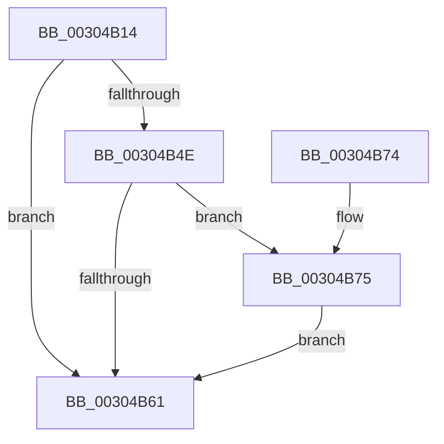

# PpmEventPlatformVetoRequest

- RVA: `0x00304B14`–`0x00304BDB` (길이 `199` bytes)
- VA: `0x0000000140304B14`
- 실행 섹션: `.text`
- PDB 이름 있음: `예`; PDB Function 태그: `아니요`
- unwind 정보 RVA: `0x00073594`
- 디코드: `45`개 명령, `199/199` bytes 표시
- 미해석 바이트: `0` (있으면 어셈블리에 `.byte`로 보존)

> 이 문서는 커널 이미지의 기계어와 PDB 기호를 분석해 생성했습니다. 4번과 5번은 함수 원형과 자료형을 바이너리 사용 방식에서 추정한 C 해석이며 원본 소스 복구 결과는 아닙니다.

## 1. Dependencies

- 직접 호출 지점: **3**; 고유 호출 대상: **3**
- 직접 호출자로 확인된 함수: **1**
- RIP 상대 이미지 참조: **5**

### Outgoing calls
- `0x00304B58` → [EtwEventEnabled](../39/EtwEventEnabled_function_00392450.md) (function, `0x00392450`)
- `0x00304B69` → [_security_check_cookie](../6A/_security_check_cookie_function_006AC640.md) (function, `0x006AC640`)
- `0x00304BD4` → [EtwWriteEx](../25/EtwWriteEx_function_0025F0D0.md) (function, `0x0025F0D0`)

### Direct callers
- [PpmUpdatePlatformIdleVeto](PpmUpdatePlatformIdleVeto_function_003047E0.md) at `0x0030487C`

### Static image references
- `0x00304B21` → RVA `0x00E0A740` (`.data`; read)
- `0x00304B33` → RVA `0x00011028` (`.rdata`; read)
- `0x00304B3A` → RVA `0x00011018` (`.rdata`; read)
- `0x00304B45` → RVA `0x00E67A39` (`.data`; read)
- `0x00304B4E` → RVA `0x00F083E8` (`.data`; read)

## 2. Other-region calls and transfers

- 다른 실행 섹션으로 향하는 call: **0**
- 별도 외부 분기/꼬리 이동을 확인하지 못했습니다.

## 3. Assembly (complete function range)

```asm
00304B14  89 54 24 10                     mov dword ptr [rsp + 0x10], edx
00304B18  89 4C 24 08                     mov dword ptr [rsp + 8], ecx
00304B1C  53                              push rbx
00304B1D  48 83 EC 70                     sub rsp, 0x70
00304B21  48 8B 05 18 5C B0 00            mov rax, qword ptr [rip + 0xb05c18]
00304B28  48 33 C4                        xor rax, rsp
00304B2B  48 89 44 24 60                  mov qword ptr [rsp + 0x60], rax
00304B30  45 84 C0                        test r8b, r8b
00304B33  48 8D 05 EE C4 D0 FF            lea rax, [rip - 0x2f3b12]
00304B3A  48 8D 1D D7 C4 D0 FF            lea rbx, [rip - 0x2f3b29]
00304B41  48 0F 45 D8                     cmovne rbx, rax
00304B45  80 3D ED 2E B6 00 00            cmp byte ptr [rip + 0xb62eed], 0
00304B4C  74 13                           je 0x140304b61
00304B4E  48 8B 0D 93 38 C0 00            mov rcx, qword ptr [rip + 0xc03893]
00304B55  48 8B D3                        mov rdx, rbx
00304B58  E8 F3 D8 08 00                  call 0x140392450
00304B5D  84 C0                           test al, al
00304B5F  75 14                           jne 0x140304b75
00304B61  48 8B 4C 24 60                  mov rcx, qword ptr [rsp + 0x60]
00304B66  48 33 CC                        xor rcx, rsp
00304B69  E8 D2 7A 3A 00                  call 0x1406ac640
00304B6E  48 83 C4 70                     add rsp, 0x70
00304B72  5B                              pop rbx
00304B73  C3                              ret
00304B74  CC                              int3
00304B75  83 64 24 4C 00                  and dword ptr [rsp + 0x4c], 0
00304B7A  48 8D 84 24 80 00 00 00         lea rax, [rsp + 0x80]
00304B82  83 64 24 5C 00                  and dword ptr [rsp + 0x5c], 0
00304B87  B9 04 00 00 00                  mov ecx, 4
00304B8C  48 89 44 24 40                  mov qword ptr [rsp + 0x40], rax
00304B91  45 33 C9                        xor r9d, r9d
00304B94  48 8D 84 24 88 00 00 00         lea rax, [rsp + 0x88]
00304B9C  89 4C 24 48                     mov dword ptr [rsp + 0x48], ecx
00304BA0  48 89 44 24 50                  mov qword ptr [rsp + 0x50], rax
00304BA5  45 33 C0                        xor r8d, r8d
00304BA8  48 8D 44 24 40                  lea rax, [rsp + 0x40]
00304BAD  89 4C 24 58                     mov dword ptr [rsp + 0x58], ecx
00304BB1  48 8B 0D 30 38 C0 00            mov rcx, qword ptr [rip + 0xc03830]
00304BB8  48 8B D3                        mov rdx, rbx
00304BBB  48 89 44 24 38                  mov qword ptr [rsp + 0x38], rax
00304BC0  C7 44 24 30 02 00 00 00         mov dword ptr [rsp + 0x30], 2
00304BC8  48 83 64 24 28 00               and qword ptr [rsp + 0x28], 0
00304BCE  48 83 64 24 20 00               and qword ptr [rsp + 0x20], 0
00304BD4  E8 F7 A4 F5 FF                  call 0x14025f0d0
00304BD9  EB 86                           jmp 0x140304b61
```

## 4. C-style interpretation (structured pseudocode)

```c
__int64 __fastcall PpmEventPlatformVetoRequest(int a1, int a2, int a3, int a4)
{
    __int64 result;
    __int64 v_rbx;
    __int64 v_rsp;
    unsigned __int64 v_stack_m18;
    unsigned int v_stack_p10;
    unsigned __int64 v_stack_p20;
    unsigned __int64 v_stack_p28;
    unsigned int v_stack_p30;
    unsigned __int64 v_stack_p38;
    unsigned __int64 v_stack_p40;
    unsigned int v_stack_p48;
    unsigned int v_stack_p4C;
    unsigned __int64 v_stack_p50;
    unsigned int v_stack_p58;
    unsigned int v_stack_p5C;
    unsigned int v_stack_p8;
    unsigned __int64 v_stack_p80;
    unsigned __int64 v_stack_p88;

    v_stack_p10 = a2;
    v_stack_p8 = a1;
    v_rsp = (v_rsp) - (112);
    result = (*(unsigned __int64 *)(v_rip + 11557912)) ^ (v_rsp);
    v_stack_m18 = result;
    v_rbx = v_rip - 3095337;
    if ((unsigned __int8)(a3) != 0) { v_rbx = v_rip - 3095314; }
    if ((*(unsigned __int8 *)(v_rip + 11939565)) == 0) goto loc_00304B61;
    result = EtwEventEnabled(*(unsigned __int64 *)(v_rip + 12597395), v_rbx, a3, a4);
    if ((unsigned __int8)(result) != 0) goto loc_00304B75;
loc_00304B61:
    a1 = (v_stack_m18) ^ (v_rsp);
    result = _security_check_cookie(a1, v_rbx, a3, a4);
    v_rsp = (v_rsp) + (112);
    return result;
loc_00304B75:
    v_stack_p40 = v_stack_p80;
    a4 = 0;
    v_stack_p48 = 4;
    v_stack_p50 = v_stack_p88;
    a3 = 0;
    v_stack_p58 = 4;
    v_stack_p38 = v_stack_p40;
    v_stack_p30 = 2;
    result = EtwWriteEx(*(unsigned __int64 *)(v_rip + 12597296), v_rbx, a3, a4);
    goto loc_00304B61;
}
```

## 5. (Beta) C Style

```c
int64_t PpmEventPlatformVetoRequest(int32_t Arg1, int32_t Arg2, int32_t Arg3, int32_t Arg4)
{
    int64_t result;
    int64_t local_rbx;
    int64_t local_rsp;
    uint64_t v_stack_m18;
    uint32_t v_stack_p10;
    uint64_t v_stack_p20;
    uint64_t v_stack_p28;
    uint32_t v_stack_p30;
    uint64_t v_stack_p38;
    uint64_t v_stack_p40;
    uint32_t v_stack_p48;
    uint32_t v_stack_p4C;
    uint64_t v_stack_p50;
    uint32_t v_stack_p58;
    uint32_t v_stack_p5C;
    uint32_t v_stack_p8;
    uint64_t v_stack_p80;
    uint64_t v_stack_p88;

    v_stack_p10 = Arg2;
    v_stack_p8 = Arg1;
    local_rsp = (local_rsp) - (112);
    result = (*(uint64_t *)(v_rip + 0xB05C18)) ^ (local_rsp);
    v_stack_m18 = result;
    local_rbx = v_rip - 3095337;
    if ((uint8_t)(Arg3) != 0) { local_rbx = v_rip - 3095314; }
    if ((*(uint8_t *)(v_rip + 0xB62EED)) == 0) goto loc_00304B61;
    result = EtwEventEnabled(*(uint64_t *)(v_rip + 0xC03893), local_rbx, Arg3, Arg4);
    if ((uint8_t)(result) != 0) goto loc_00304B75;
loc_00304B61:
    Arg1 = (v_stack_m18) ^ (local_rsp);
    result = _security_check_cookie(Arg1, local_rbx, Arg3, Arg4);
    local_rsp = (local_rsp) + (112);
    return result;
loc_00304B75:
    v_stack_p40 = v_stack_p80;
    Arg4 = 0;
    v_stack_p48 = 4;
    v_stack_p50 = v_stack_p88;
    Arg3 = 0;
    v_stack_p58 = 4;
    v_stack_p38 = v_stack_p40;
    v_stack_p30 = 2;
    result = EtwWriteEx(*(uint64_t *)(v_rip + 0xC03830), local_rbx, Arg3, Arg4);
    goto loc_00304B61;
}
```

## 6. Execution-region graph

[열기: 2D/3D 그래프와 함수 탐색 컨트롤 패널](../../../control-panel.html?section=text&rva=0x00304B14&view=graph)

- 2D 그래프는 위에서 아래로 흐르고, 3D 그래프는 빈 공간을 드래그해 회전합니다. Shift+드래그는 이동, 휠은 확대·축소, 함수 노드 선택은 대상 보고서 이동입니다.

### Static fallback


