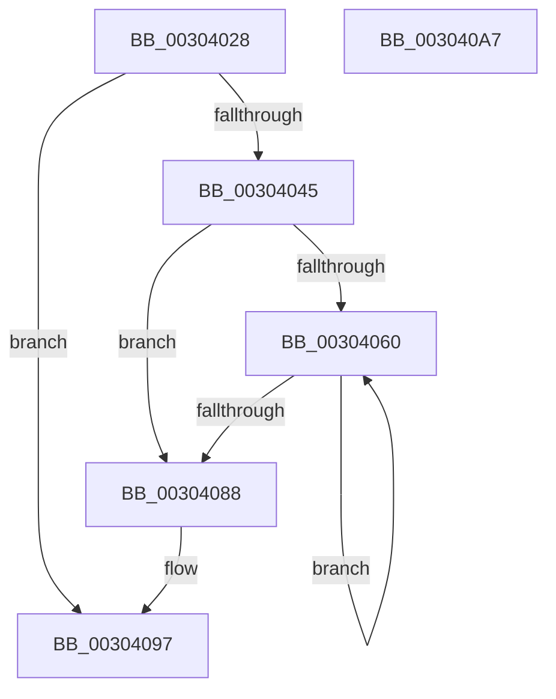

# PpmIdleCsVetoAccountingResiliencyUpdate

- RVA: `0x00304028`–`0x003040A8` (길이 `128` bytes)
- VA: `0x0000000140304028`
- 실행 섹션: `.text`
- PDB 이름 있음: `예`; PDB Function 태그: `아니요`
- unwind 정보 RVA: `0x00060BC4`
- 디코드: `34`개 명령, `128/128` bytes 표시
- 미해석 바이트: `0` (있으면 어셈블리에 `.byte`로 보존)

> 이 문서는 커널 이미지의 기계어와 PDB 기호를 분석해 생성했습니다. 4번과 5번은 함수 원형과 자료형을 바이너리 사용 방식에서 추정한 C 해석이며 원본 소스 복구 결과는 아닙니다.

## 1. Dependencies

- 직접 호출 지점: **3**; 고유 호출 대상: **3**
- 직접 호출자로 확인된 함수: **1**
- RIP 상대 이미지 참조: **2**

### Outgoing calls
- `0x0030404C` → [KeAcquireSpinLockRaiseToDpc](../20/KeAcquireSpinLockRaiseToDpc_function_00208470.md) (function, `0x00208470`)
- `0x00304075` → [PpmIdleCsVetoAccountingUpdateBlock](PpmIdleCsVetoAccountingUpdateBlock_function_003040B0.md) (function, `0x003040B0`)
- `0x00304092` → [KeReleaseSpinLock](../39/KeReleaseSpinLock_function_00392BA0.md) (function, `0x00392BA0`)

### Direct callers
- [PopPdcIdleResiliencyCallback](../../page/A3/PopPdcIdleResiliencyCallback_function_00A31518.md) at `0x00A315C9`
- [PopPdcIdleResiliencyCallback](../../page/A3/PopPdcIdleResiliencyCallback_function_00A31518.md) at `0x00A3161B`

### Static image references
- `0x0030403C` → RVA `0x00FC6AD0` (`ALMOSTRO`; read)
- `0x00304045` → RVA `0x00F0CA68` (`.data`; read)

## 2. Other-region calls and transfers

- 다른 실행 섹션으로 향하는 call: **0**
- 별도 외부 분기/꼬리 이동을 확인하지 못했습니다.

## 3. Assembly (complete function range)

```asm
00304028  48 89 5C 24 08                  mov qword ptr [rsp + 8], rbx
0030402D  48 89 74 24 10                  mov qword ptr [rsp + 0x10], rsi
00304032  57                              push rdi
00304033  48 83 EC 20                     sub rsp, 0x20
00304037  33 DB                           xor ebx, ebx
00304039  40 8A F1                        mov sil, cl
0030403C  48 39 1D 8D 2A CC 00            cmp qword ptr [rip + 0xcc2a8d], rbx
00304043  74 52                           je 0x140304097
00304045  48 8D 0D 1C 8A C0 00            lea rcx, [rip + 0xc08a1c]
0030404C  E8 1F 44 F0 FF                  call 0x140208470
00304051  4C 8B 0D 78 2A CC 00            mov r9, qword ptr [rip + 0xcc2a78]
00304058  40 8A F8                        mov dil, al
0030405B  41 39 19                        cmp dword ptr [r9], ebx
0030405E  76 28                           jbe 0x140304088
00304060  8B D3                           mov edx, ebx
00304062  49 8D 49 50                     lea rcx, [r9 + 0x50]
00304066  4C 69 C2 C0 01 00 00            imul r8, rdx, 0x1c0
0030406D  B2 02                           mov dl, 2
0030406F  49 03 C8                        add rcx, r8
00304072  44 8A C6                        mov r8b, sil
00304075  E8 36 00 00 00                  call 0x1403040b0
0030407A  4C 8B 0D 4F 2A CC 00            mov r9, qword ptr [rip + 0xcc2a4f]
00304081  FF C3                           inc ebx
00304083  41 3B 19                        cmp ebx, dword ptr [r9]
00304086  72 D8                           jb 0x140304060
00304088  40 8A D7                        mov dl, dil
0030408B  48 8D 0D D6 89 C0 00            lea rcx, [rip + 0xc089d6]
00304092  E8 09 EB 08 00                  call 0x140392ba0
00304097  48 8B 5C 24 30                  mov rbx, qword ptr [rsp + 0x30]
0030409C  48 8B 74 24 38                  mov rsi, qword ptr [rsp + 0x38]
003040A1  48 83 C4 20                     add rsp, 0x20
003040A5  5F                              pop rdi
003040A6  C3                              ret
003040A7  CC                              int3
```

## 4. C-style interpretation (structured pseudocode)

```c
__int64 __fastcall PpmIdleCsVetoAccountingResiliencyUpdate(unsigned __int8 a1)
{
    __int64 result;
    __int64 v_rbx;
    __int64 v_rsp;
    unsigned __int64 v_stack_p10;
    unsigned __int64 v_stack_p8;

    v_stack_p8 = v_rbx;
    v_stack_p10 = v_rsi;
    v_rsp = (v_rsp) - (32);
    v_rbx = 0;
    if ((*(unsigned __int64 *)(v_rip + 13380237)) == 0) goto loc_00304097;
    result = KeAcquireSpinLockRaiseToDpc(v_rip + 12618268, a2, a3, a4);
    if ((*(unsigned int *)(*(unsigned __int64 *)(v_rip + 13380216))) <= 0) goto loc_00304088;
loc_00304060:
    a3 = (a3) * (0);
    a1 = (*(unsigned __int64 *)(v_rip + 13380216) + 80) + (a3);
    result = PpmIdleCsVetoAccountingUpdateBlock(a1, 2, a1, *(unsigned __int64 *)(v_rip + 13380216));
    v_rbx = (unsigned int)((v_rbx) + 1);
    if (((unsigned int)(v_rbx)) < (*(unsigned int *)(*(unsigned __int64 *)(v_rip + 13380175)))) goto loc_00304060;
loc_00304088:
    result = KeReleaseSpinLock(v_rip + 12618198, (unsigned __int8)((unsigned __int8)(result)), a1, *(unsigned __int64 *)(v_rip + 13380175));
loc_00304097:
    v_rsp = (v_rsp) + (32);
    return result;
}
```

## 5. (Beta) C Style

```c
int64_t PpmIdleCsVetoAccountingResiliencyUpdate(uint8_t Arg1)
{
    int64_t result;
    int64_t local_rbx;
    int64_t local_rsp;
    uint64_t v_stack_p10;
    uint64_t v_stack_p8;

    v_stack_p8 = local_rbx;
    v_stack_p10 = local_rsi;
    local_rsp = (local_rsp) - (32);
    local_rbx = 0;
    if ((*(uint64_t *)(v_rip + 0xCC2A8D)) == 0) goto loc_00304097;
    result = KeAcquireSpinLockRaiseToDpc(v_rip + 12618268, a2, a3, a4);
    if ((*(uint32_t *)(*(uint64_t *)(v_rip + 0xCC2A78))) <= 0) goto loc_00304088;
loc_00304060:
    a3 = (a3) * (0);
    Arg1 = (*(uint64_t *)(v_rip + 0xCC2A78) + 80) + (a3);
    result = PpmIdleCsVetoAccountingUpdateBlock(Arg1, 2, Arg1, *(uint64_t *)(v_rip + 0xCC2A78));
    local_rbx = (uint32_t)((local_rbx) + 1);
    if (((uint32_t)(local_rbx)) < (*(uint32_t *)(*(uint64_t *)(v_rip + 0xCC2A4F)))) goto loc_00304060;
loc_00304088:
    result = KeReleaseSpinLock(v_rip + 12618198, (uint8_t)((uint8_t)(result)), Arg1, *(uint64_t *)(v_rip + 0xCC2A4F));
loc_00304097:
    local_rsp = (local_rsp) + (32);
    return result;
}
```

## 6. Execution-region graph

[열기: 2D/3D 그래프와 함수 탐색 컨트롤 패널](../../../control-panel.html?section=text&rva=0x00304028&view=graph)

- 2D 그래프는 위에서 아래로 흐르고, 3D 그래프는 빈 공간을 드래그해 회전합니다. Shift+드래그는 이동, 휠은 확대·축소, 함수 노드 선택은 대상 보고서 이동입니다.

### Static fallback


