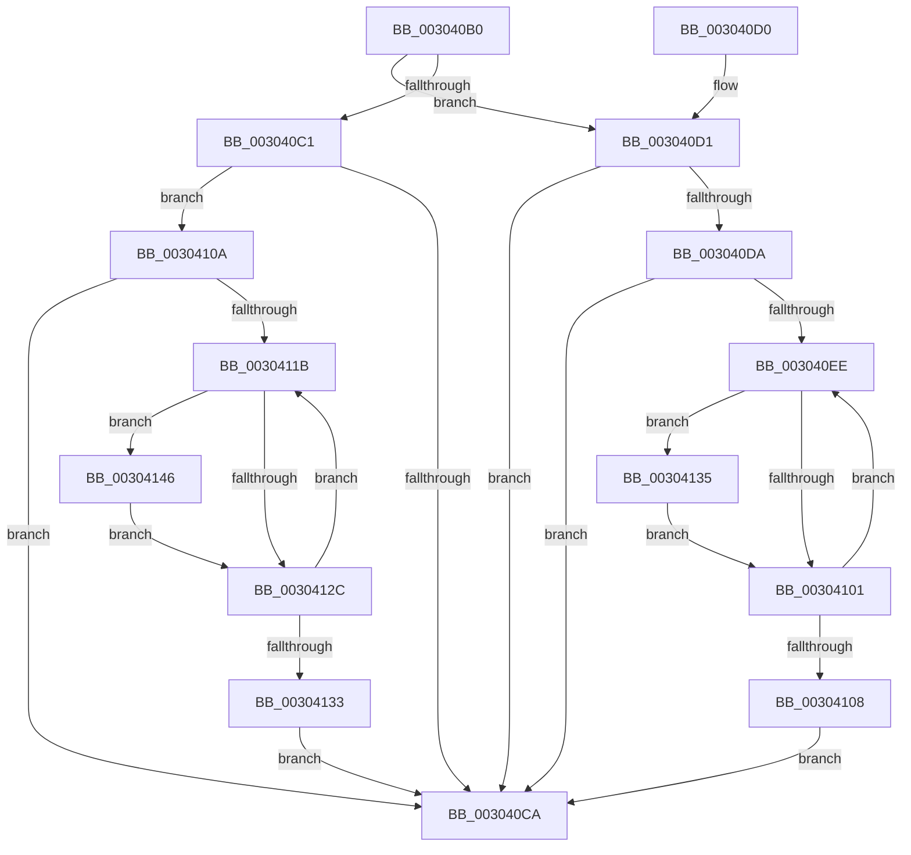

# PpmIdleCsVetoAccountingUpdateBlock

- RVA: `0x003040B0`–`0x0030414C` (길이 `156` bytes)
- VA: `0x00000001403040B0`
- 실행 섹션: `.text`
- PDB 이름 있음: `예`; PDB Function 태그: `아니요`
- unwind 정보 RVA: `0x000734D8`
- 디코드: `55`개 명령, `156/156` bytes 표시
- 미해석 바이트: `0` (있으면 어셈블리에 `.byte`로 보존)

> 이 문서는 커널 이미지의 기계어와 PDB 기호를 분석해 생성했습니다. 4번과 5번은 함수 원형과 자료형을 바이너리 사용 방식에서 추정한 C 해석이며 원본 소스 복구 결과는 아닙니다.

## 1. Dependencies

- 직접 호출 지점: **2**; 고유 호출 대상: **1**
- 직접 호출자로 확인된 함수: **4**
- RIP 상대 이미지 참조: **0**

### Outgoing calls
- `0x003040DF` → [RtlGetInterruptTimePrecise](../20/RtlGetInterruptTimePrecise_function_0020A4C0.md) (function, `0x0020A4C0`)
- `0x0030410F` → [RtlGetInterruptTimePrecise](../20/RtlGetInterruptTimePrecise_function_0020A4C0.md) (function, `0x0020A4C0`)

### Direct callers
- [PpmIdleStartCsVetoAccounting](PpmIdleStartCsVetoAccounting_function_0030326C.md) at `0x003032D2`
- [PopFxPlatformStateAvailable](PopFxPlatformStateAvailable_function_00303F6C.md) at `0x00303FA8`
- [PpmIdleCsVetoAccountingResiliencyUpdate](PpmIdleCsVetoAccountingResiliencyUpdate_function_00304028.md) at `0x00304075`
- [PpmIdleCaptureCsVetoAccounting](../43/PpmIdleCaptureCsVetoAccounting_function_0043B6CC.md) at `0x0043B818`

### Static image references
- 디코드된 RIP-relative 메모리 참조가 없습니다.

## 2. Other-region calls and transfers

- 다른 실행 섹션으로 향하는 call: **0**
- 별도 외부 분기/꼬리 이동을 확인하지 못했습니다.

## 3. Assembly (complete function range)

```asm
003040B0  40 53                           push rbx
003040B2  48 83 EC 20                     sub rsp, 0x20
003040B6  8A 41 18                        mov al, byte ptr [rcx + 0x18]
003040B9  48 8B D9                        mov rbx, rcx
003040BC  45 84 C0                        test r8b, r8b
003040BF  74 10                           je 0x1403040d1
003040C1  F6 D2                           not dl
003040C3  22 D0                           and dl, al
003040C5  88 51 18                        mov byte ptr [rcx + 0x18], dl
003040C8  74 40                           je 0x14030410a
003040CA  48 83 C4 20                     add rsp, 0x20
003040CE  5B                              pop rbx
003040CF  C3                              ret
003040D0  CC                              int3
003040D1  0A C2                           or al, dl
003040D3  88 41 18                        mov byte ptr [rcx + 0x18], al
003040D6  3A C2                           cmp al, dl
003040D8  75 F0                           jne 0x1403040ca
003040DA  48 8D 4C 24 48                  lea rcx, [rsp + 0x48]
003040DF  E8 DC 63 F0 FF                  call 0x14020a4c0
003040E4  33 C9                           xor ecx, ecx
003040E6  4C 8B C8                        mov r9, rax
003040E9  39 4B 1C                        cmp dword ptr [rbx + 0x1c], ecx
003040EC  76 DC                           jbe 0x1403040ca
003040EE  8B D1                           mov edx, ecx
003040F0  48 C1 E2 06                     shl rdx, 6
003040F4  48 03 53 20                     add rdx, qword ptr [rbx + 0x20]
003040F8  4C 8B 42 30                     mov r8, qword ptr [rdx + 0x30]
003040FC  4D 85 C0                        test r8, r8
003040FF  75 34                           jne 0x140304135
00304101  FF C1                           inc ecx
00304103  3B 4B 1C                        cmp ecx, dword ptr [rbx + 0x1c]
00304106  72 E6                           jb 0x1403040ee
00304108  EB C0                           jmp 0x1403040ca
0030410A  48 8D 4C 24 48                  lea rcx, [rsp + 0x48]
0030410F  E8 AC 63 F0 FF                  call 0x14020a4c0
00304114  33 D2                           xor edx, edx
00304116  39 53 1C                        cmp dword ptr [rbx + 0x1c], edx
00304119  76 AF                           jbe 0x1403040ca
0030411B  8B CA                           mov ecx, edx
0030411D  48 C1 E1 06                     shl rcx, 6
00304121  48 03 4B 20                     add rcx, qword ptr [rbx + 0x20]
00304125  48 83 79 20 00                  cmp qword ptr [rcx + 0x20], 0
0030412A  75 1A                           jne 0x140304146
0030412C  FF C2                           inc edx
0030412E  3B 53 1C                        cmp edx, dword ptr [rbx + 0x1c]
00304131  72 E8                           jb 0x14030411b
00304133  EB 95                           jmp 0x1403040ca
00304135  49 8B C1                        mov rax, r9
00304138  49 2B C0                        sub rax, r8
0030413B  48 01 42 38                     add qword ptr [rdx + 0x38], rax
0030413F  48 83 62 30 00                  and qword ptr [rdx + 0x30], 0
00304144  EB BB                           jmp 0x140304101
00304146  48 89 41 30                     mov qword ptr [rcx + 0x30], rax
0030414A  EB E0                           jmp 0x14030412c
```

## 4. C-style interpretation (structured pseudocode)

```c
__int64 __fastcall PpmIdleCsVetoAccountingUpdateBlock(__int64 a1, unsigned __int8 a2, unsigned __int8 a3)
{
    __int64 result;
    __int64 v_rsp;
    unsigned __int64 v_stack_p48;

    v_rsp = (v_rsp) - (32);
    if (a3 == 0) goto loc_003040D1;
    a2 = (unsigned __int8)(~(a2));
    a2 = (unsigned __int8)((a2) & ((unsigned __int8)(*(unsigned __int8 *)(a1 + 24))));
    *(unsigned __int8 *)(a1 + 24) = a2;
    if (condition_is_equal) goto loc_0030410A;
loc_003040CA:
    v_rsp = (v_rsp) + (32);
    return *(unsigned __int8 *)(a1 + 24);
loc_003040D1:
    result = (unsigned __int8)((*(unsigned __int8 *)(a1 + 24)) | (a2));
    *(unsigned __int8 *)(a1 + 24) = (unsigned __int8)(result);
    if (((unsigned __int8)(result)) != a2) goto loc_003040CA;
    result = RtlGetInterruptTimePrecise(v_stack_p48, a2, a3, a4);
    a1 = 0;
    if ((*(unsigned int *)(a1 + 28)) <= 0) goto loc_003040CA;
loc_003040EE:
    a2 = (0) << (6);
    a2 = (a2) + (*(unsigned __int64 *)(a1 + 32));
    if (*(unsigned __int64 *)(a2 + 48) != 0) goto loc_00304135;
loc_00304101:
    a1 = (unsigned int)((a1) + 1);
    if (((unsigned int)(a1)) < (*(unsigned int *)(a1 + 28))) goto loc_003040EE;
    goto loc_003040CA;
loc_0030410A:
    result = RtlGetInterruptTimePrecise(v_stack_p48, a2, *(unsigned __int64 *)(a2 + 48), result);
    a2 = 0;
    if ((*(unsigned int *)(a1 + 28)) <= 0) goto loc_003040CA;
loc_0030411B:
    a1 = (0) << (6);
    a1 = (a1) + (*(unsigned __int64 *)(a1 + 32));
    if ((*(unsigned __int64 *)(a1 + 32)) != 0) goto loc_00304146;
loc_0030412C:
    a2 = (unsigned int)((a2) + 1);
    if (a2 < (*(unsigned int *)(a1 + 28))) goto loc_0030411B;
    goto loc_003040CA;
loc_00304135:
    result = (result) - (*(unsigned __int64 *)(a2 + 48));
    goto loc_00304101;
loc_00304146:
    *(unsigned __int64 *)(a1 + 48) = result;
    goto loc_0030412C;
}
```

## 5. (Beta) C Style

```c
int64_t PpmIdleCsVetoAccountingUpdateBlock(void *Arg1, uint8_t Arg2, uint8_t Arg3)
{
    uint8_t *arg1 = (uint8_t *)Arg1;

    int64_t result;
    int64_t local_rsp;
    uint64_t v_stack_p48;

    local_rsp = (local_rsp) - (32);
    if (Arg3 == 0) goto loc_003040D1;
    Arg2 = (uint8_t)(~(Arg2));
    Arg2 = (uint8_t)((Arg2) & ((uint8_t)(*(uint8_t *)(arg1 + 0x18))));
    *(uint8_t *)(arg1 + 0x18) = Arg2;
    if (condition_is_equal) goto loc_0030410A;
loc_003040CA:
    local_rsp = (local_rsp) + (32);
    return *(uint8_t *)(arg1 + 0x18);
loc_003040D1:
    result = (uint8_t)((*(uint8_t *)(arg1 + 0x18)) | (Arg2));
    *(uint8_t *)(arg1 + 0x18) = (uint8_t)(result);
    if (((uint8_t)(result)) != Arg2) goto loc_003040CA;
    result = RtlGetInterruptTimePrecise(v_stack_p48, Arg2, Arg3, a4);
    Arg1 = 0;
    if ((*(uint32_t *)(arg1 + 0x1C)) <= 0) goto loc_003040CA;
loc_003040EE:
    Arg2 = (0) << (6);
    Arg2 = (Arg2) + (*(uint64_t *)(arg1 + 0x20));
    if (*(uint64_t *)(Arg2 + 0x30) != 0) goto loc_00304135;
loc_00304101:
    Arg1 = (uint32_t)((Arg1) + 1);
    if (((uint32_t)(Arg1)) < (*(uint32_t *)(arg1 + 0x1C))) goto loc_003040EE;
    goto loc_003040CA;
loc_0030410A:
    result = RtlGetInterruptTimePrecise(v_stack_p48, Arg2, *(uint64_t *)(Arg2 + 0x30), result);
    Arg2 = 0;
    if ((*(uint32_t *)(arg1 + 0x1C)) <= 0) goto loc_003040CA;
loc_0030411B:
    Arg1 = (0) << (6);
    Arg1 = (Arg1) + (*(uint64_t *)(arg1 + 0x20));
    if ((*(uint64_t *)(arg1 + 0x20)) != 0) goto loc_00304146;
loc_0030412C:
    Arg2 = (uint32_t)((Arg2) + 1);
    if (Arg2 < (*(uint32_t *)(arg1 + 0x1C))) goto loc_0030411B;
    goto loc_003040CA;
loc_00304135:
    result = (result) - (*(uint64_t *)(Arg2 + 0x30));
    goto loc_00304101;
loc_00304146:
    *(uint64_t *)(arg1 + 0x30) = result;
    goto loc_0030412C;
}
```

### 관측된 메모리 오프셋

구조체 형식이 확인되지 않은 접근은 인자 기준의 오프셋으로만 기록했습니다.

| 기준 인자 | 오프셋 표현 | 폭 (bit) | 접근 |
|---|---:|---:|---|
| `Arg1` | `+ 0x18` | `8` | `R` |
| `Arg1` | `+ 0x18` | `8` | `W` |
| `Arg1` | `+ 0x1C` | `32` | `R` |
| `Arg1` | `+ 0x20` | `64` | `R` |

## 6. Execution-region graph

[열기: 2D/3D 그래프와 함수 탐색 컨트롤 패널](../../../control-panel.html?section=text&rva=0x003040B0&view=graph)

- 2D 그래프는 위에서 아래로 흐르고, 3D 그래프는 빈 공간을 드래그해 회전합니다. Shift+드래그는 이동, 휠은 확대·축소, 함수 노드 선택은 대상 보고서 이동입니다.

### Static fallback


