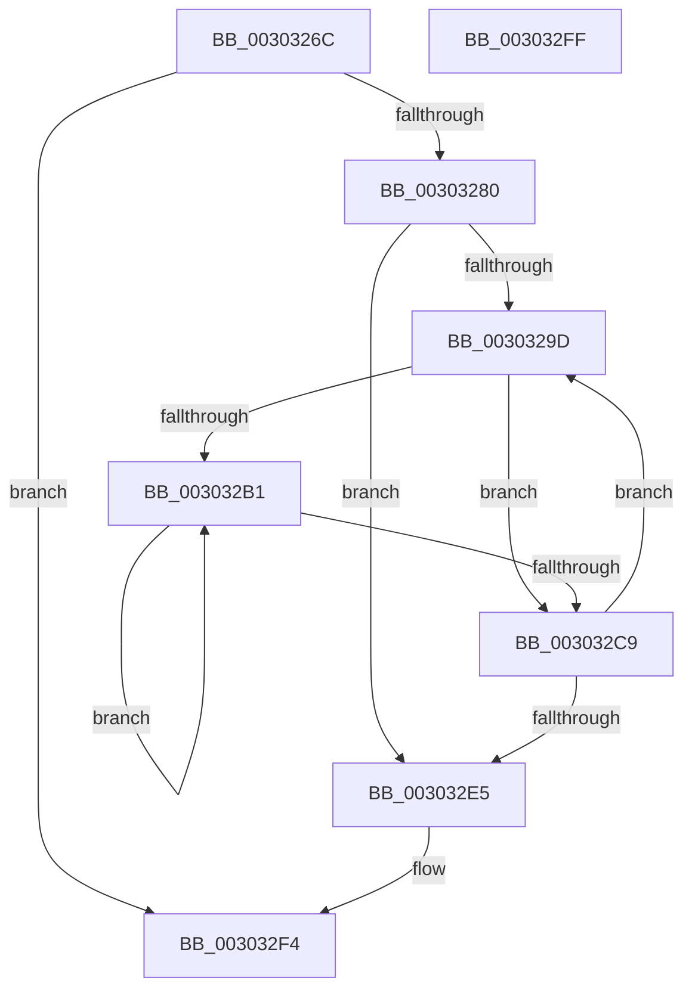

# PpmIdleStartCsVetoAccounting

- RVA: `0x0030326C`–`0x00303300` (길이 `148` bytes)
- VA: `0x000000014030326C`
- 실행 섹션: `.text`
- PDB 이름 있음: `예`; PDB Function 태그: `아니요`
- unwind 정보 RVA: `0x0005CAAC`
- 디코드: `41`개 명령, `148/148` bytes 표시
- 미해석 바이트: `0` (있으면 어셈블리에 `.byte`로 보존)

> 이 문서는 커널 이미지의 기계어와 PDB 기호를 분석해 생성했습니다. 4번과 5번은 함수 원형과 자료형을 바이너리 사용 방식에서 추정한 C 해석이며 원본 소스 복구 결과는 아닙니다.

## 1. Dependencies

- 직접 호출 지점: **3**; 고유 호출 대상: **3**
- 직접 호출자로 확인된 함수: **1**
- RIP 상대 이미지 참조: **2**

### Outgoing calls
- `0x00303287` → [KeAcquireSpinLockRaiseToDpc](../20/KeAcquireSpinLockRaiseToDpc_function_00208470.md) (function, `0x00208470`)
- `0x003032D2` → [PpmIdleCsVetoAccountingUpdateBlock](PpmIdleCsVetoAccountingUpdateBlock_function_003040B0.md) (function, `0x003040B0`)
- `0x003032EF` → [KeReleaseSpinLock](../39/KeReleaseSpinLock_function_00392BA0.md) (function, `0x00392BA0`)

### Direct callers
- [PopCaptureSleepStudyStatistics](../43/PopCaptureSleepStudyStatistics_function_004399F4.md) at `0x00439E78`

### Static image references
- `0x00303276` → RVA `0x00FC6AD0` (`ALMOSTRO`; read)
- `0x00303280` → RVA `0x00F0CA68` (`.data`; read)

## 2. Other-region calls and transfers

- 다른 실행 섹션으로 향하는 call: **0**
- 별도 외부 분기/꼬리 이동을 확인하지 못했습니다.

## 3. Assembly (complete function range)

```asm
0030326C  48 89 5C 24 08                  mov qword ptr [rsp + 8], rbx
00303271  57                              push rdi
00303272  48 83 EC 20                     sub rsp, 0x20
00303276  48 83 3D 52 38 CC 00 00         cmp qword ptr [rip + 0xcc3852], 0
0030327E  74 74                           je 0x1403032f4
00303280  48 8D 0D E1 97 C0 00            lea rcx, [rip + 0xc097e1]
00303287  E8 E4 51 F0 FF                  call 0x140208470
0030328C  4C 8B 05 3D 38 CC 00            mov r8, qword ptr [rip + 0xcc383d]
00303293  33 DB                           xor ebx, ebx
00303295  40 8A F8                        mov dil, al
00303298  41 39 18                        cmp dword ptr [r8], ebx
0030329B  76 48                           jbe 0x1403032e5
0030329D  8B CB                           mov ecx, ebx
0030329F  33 D2                           xor edx, edx
003032A1  4C 69 C9 C0 01 00 00            imul r9, rcx, 0x1c0
003032A8  4D 03 C8                        add r9, r8
003032AB  41 39 51 6C                     cmp dword ptr [r9 + 0x6c], edx
003032AF  76 18                           jbe 0x1403032c9
003032B1  49 8B 41 70                     mov rax, qword ptr [r9 + 0x70]
003032B5  8B CA                           mov ecx, edx
003032B7  FF C2                           inc edx
003032B9  48 C1 E1 06                     shl rcx, 6
003032BD  48 83 64 01 38 00               and qword ptr [rcx + rax + 0x38], 0
003032C3  41 3B 51 6C                     cmp edx, dword ptr [r9 + 0x6c]
003032C7  72 E8                           jb 0x1403032b1
003032C9  41 B0 01                        mov r8b, 1
003032CC  49 8D 49 50                     lea rcx, [r9 + 0x50]
003032D0  B2 04                           mov dl, 4
003032D2  E8 D9 0D 00 00                  call 0x1403040b0
003032D7  4C 8B 05 F2 37 CC 00            mov r8, qword ptr [rip + 0xcc37f2]
003032DE  FF C3                           inc ebx
003032E0  41 3B 18                        cmp ebx, dword ptr [r8]
003032E3  72 B8                           jb 0x14030329d
003032E5  40 8A D7                        mov dl, dil
003032E8  48 8D 0D 79 97 C0 00            lea rcx, [rip + 0xc09779]
003032EF  E8 AC F8 08 00                  call 0x140392ba0
003032F4  48 8B 5C 24 30                  mov rbx, qword ptr [rsp + 0x30]
003032F9  48 83 C4 20                     add rsp, 0x20
003032FD  5F                              pop rdi
003032FE  C3                              ret
003032FF  CC                              int3
```

## 4. C-style interpretation (structured pseudocode)

```c
__int64 __fastcall PpmIdleStartCsVetoAccounting(__int64 a1, int a2)
{
    __int64 result;
    __int64 v_rbx;
    __int64 v_rsp;
    unsigned __int64 v_stack_p8;

    v_stack_p8 = v_rbx;
    v_rsp = (v_rsp) - (32);
    if ((*(unsigned __int64 *)(v_rip + 13383762)) == 0) goto loc_003032F4;
    result = KeAcquireSpinLockRaiseToDpc(v_rip + 12621793, a2, a3, a4);
    v_rbx = 0;
    if ((*(unsigned int *)(*(unsigned __int64 *)(v_rip + 13383741))) <= 0) goto loc_003032E5;
loc_0030329D:
    a2 = 0;
    a4 = (a4) * (0);
    a4 = (a4) + (*(unsigned __int64 *)(v_rip + 13383741));
    if ((*(unsigned int *)(a4 + 108)) <= 0) goto loc_003032C9;
loc_003032B1:
    a2 = (unsigned int)((a2) + 1);
    a1 = (0) << (6);
    if (a2 < (*(unsigned int *)(a4 + 108))) goto loc_003032B1;
loc_003032C9:
    result = PpmIdleCsVetoAccountingUpdateBlock(a4 + 80, 4, 1, a4);
    v_rbx = (unsigned int)((v_rbx) + 1);
    if (((unsigned int)(v_rbx)) < (*(unsigned int *)(*(unsigned __int64 *)(v_rip + 13383666)))) goto loc_0030329D;
loc_003032E5:
    result = KeReleaseSpinLock(v_rip + 12621689, (unsigned __int8)((unsigned __int8)(result)), *(unsigned __int64 *)(v_rip + 13383666), a4);
loc_003032F4:
    v_rsp = (v_rsp) + (32);
    return result;
}
```

## 5. (Beta) C Style

```c
int64_t PpmIdleStartCsVetoAccounting(int64_t Arg1, int32_t Arg2)
{
    int64_t result;
    int64_t local_rbx;
    int64_t local_rsp;
    uint64_t v_stack_p8;

    v_stack_p8 = local_rbx;
    local_rsp = (local_rsp) - (32);
    if ((*(uint64_t *)(v_rip + 0xCC3852)) == 0) goto loc_003032F4;
    result = KeAcquireSpinLockRaiseToDpc(v_rip + 12621793, Arg2, a3, a4);
    local_rbx = 0;
    if ((*(uint32_t *)(*(uint64_t *)(v_rip + 0xCC383D))) <= 0) goto loc_003032E5;
loc_0030329D:
    Arg2 = 0;
    a4 = (a4) * (0);
    a4 = (a4) + (*(uint64_t *)(v_rip + 0xCC383D));
    if ((*(uint32_t *)(a4 + 0x6C)) <= 0) goto loc_003032C9;
loc_003032B1:
    Arg2 = (uint32_t)((Arg2) + 1);
    Arg1 = (0) << (6);
    if (Arg2 < (*(uint32_t *)(a4 + 0x6C))) goto loc_003032B1;
loc_003032C9:
    result = PpmIdleCsVetoAccountingUpdateBlock(a4 + 80, 4, 1, a4);
    local_rbx = (uint32_t)((local_rbx) + 1);
    if (((uint32_t)(local_rbx)) < (*(uint32_t *)(*(uint64_t *)(v_rip + 0xCC37F2)))) goto loc_0030329D;
loc_003032E5:
    result = KeReleaseSpinLock(v_rip + 12621689, (uint8_t)((uint8_t)(result)), *(uint64_t *)(v_rip + 0xCC37F2), a4);
loc_003032F4:
    local_rsp = (local_rsp) + (32);
    return result;
}
```

## 6. Execution-region graph

[열기: 2D/3D 그래프와 함수 탐색 컨트롤 패널](../../../control-panel.html?section=text&rva=0x0030326C&view=graph)

- 2D 그래프는 위에서 아래로 흐르고, 3D 그래프는 빈 공간을 드래그해 회전합니다. Shift+드래그는 이동, 휠은 확대·축소, 함수 노드 선택은 대상 보고서 이동입니다.

### Static fallback


