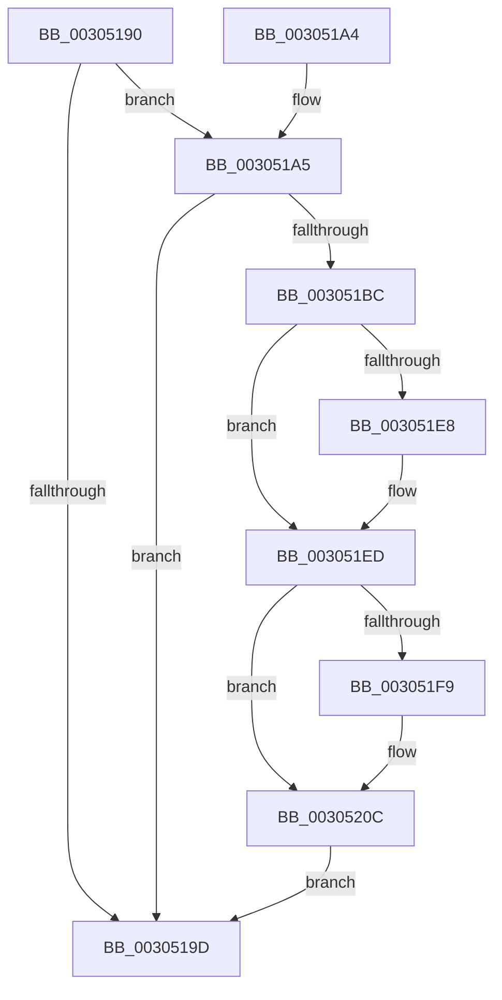

# PpmParkReportMask

- RVA: `0x00305190`–`0x00305222` (길이 `146` bytes)
- VA: `0x0000000140305190`
- 실행 섹션: `.text`
- PDB 이름 있음: `예`; PDB Function 태그: `아니요`
- unwind 정보 RVA: `0x0007362C`
- 디코드: `30`개 명령, `146/146` bytes 표시
- 미해석 바이트: `0` (있으면 어셈블리에 `.byte`로 보존)

> 이 문서는 커널 이미지의 기계어와 PDB 기호를 분석해 생성했습니다. 4번과 5번은 함수 원형과 자료형을 바이너리 사용 방식에서 추정한 C 해석이며 원본 소스 복구 결과는 아닙니다.

## 1. Dependencies

- 직접 호출 지점: **6**; 고유 호출 대상: **6**
- 직접 호출자로 확인된 함수: **0**
- RIP 상대 이미지 참조: **6**

### Outgoing calls
- `0x003051B3` → [KeIsEqualAffinityEx](KeIsEqualAffinityEx_function_00305230.md) (function, `0x00305230`)
- `0x003051D1` → [KiCopyAffinityEx](../2C/KiCopyAffinityEx_function_002CE860.md) (function, `0x002CE860`)
- `0x003051E8` → [HvlParkedVirtualProcessors](HvlParkedVirtualProcessors_function_00305724.md) (function, `0x00305724`)
- `0x00305207` → [guard_dispatch_icall](../6B/guard_dispatch_icall_function_006BAAD0.md) (function, `0x006BAAD0`)
- `0x00305213` → [KeCpuSetReportParkedProcessors](KeCpuSetReportParkedProcessors_function_003052B0.md) (function, `0x003052B0`)
- `0x00305218` → [MmReportParkedProcessors](MmReportParkedProcessors_function_00305600.md) (function, `0x00305600`)

### Direct callers
- 이 함수 시작 RVA로 연결되는 직접 call은 확인되지 않았습니다. 간접 호출은 완전히 역산할 수 없습니다.

### Static image references
- `0x00305194` → RVA `0x00F083D0` (`.data`; read)
- `0x003051A5` → RVA `0x00E0BA90` (`.data`; read)
- `0x003051AC` → RVA `0x00E0C0F0` (`.data`; read)
- `0x003051BC` → RVA `0x00E0BA92` (`.data`; read)
- `0x003051ED` → RVA `0x00F0E278` (`.data`; read)
- `0x003051F9` → RVA `0x00F0B260` (`.data`; read)

## 2. Other-region calls and transfers

- 다른 실행 섹션으로 향하는 call: **0**
- 별도 외부 분기/꼬리 이동을 확인하지 못했습니다.

## 3. Assembly (complete function range)

```asm
00305190  48 83 EC 28                     sub rsp, 0x28
00305194  83 3D 35 32 C0 00 00            cmp dword ptr [rip + 0xc03235], 0
0030519B  75 08                           jne 0x1403051a5
0030519D  B0 01                           mov al, 1
0030519F  48 83 C4 28                     add rsp, 0x28
003051A3  C3                              ret
003051A4  CC                              int3
003051A5  48 8D 15 E4 68 B0 00            lea rdx, [rip + 0xb068e4]
003051AC  48 8D 0D 3D 6F B0 00            lea rcx, [rip + 0xb06f3d]
003051B3  E8 78 00 00 00                  call 0x140305230
003051B8  85 C0                           test eax, eax
003051BA  75 E1                           jne 0x14030519d
003051BC  0F B7 15 CF 68 B0 00            movzx edx, word ptr [rip + 0xb068cf]
003051C3  4C 8D 05 26 6F B0 00            lea r8, [rip + 0xb06f26]
003051CA  48 8D 0D BF 68 B0 00            lea rcx, [rip + 0xb068bf]
003051D1  E8 8A 96 FC FF                  call 0x1402ce860
003051D6  65 48 8B 04 25 20 00 00 00      mov rax, qword ptr gs:[0x20]
003051DF  83 B8 20 89 00 00 02            cmp dword ptr [rax + 0x8920], 2
003051E6  7C 05                           jl 0x1403051ed
003051E8  E8 37 05 00 00                  call 0x140305724
003051ED  48 8B 05 84 90 C0 00            mov rax, qword ptr [rip + 0xc09084]
003051F4  48 85 C0                        test rax, rax
003051F7  74 13                           je 0x14030520c
003051F9  48 8B 0D 60 60 C0 00            mov rcx, qword ptr [rip + 0xc06060]
00305200  48 8D 15 E9 6E B0 00            lea rdx, [rip + 0xb06ee9]
00305207  E8 C4 58 3B 00                  call 0x1406baad0
0030520C  48 8D 0D DD 6E B0 00            lea rcx, [rip + 0xb06edd]
00305213  E8 98 00 00 00                  call 0x1403052b0
00305218  E8 E3 03 00 00                  call 0x140305600
0030521D  E9 7B FF FF FF                  jmp 0x14030519d
```

## 4. C-style interpretation (structured pseudocode)

```c
__int64 __fastcall PpmParkReportMask(void)
{
    __int64 result;
    __int64 v_rsp;

    v_rsp = (v_rsp) - (40);
    if ((*(unsigned int *)(v_rip + 12595765)) != 0) goto loc_003051A5;
loc_0030519D:
    v_rsp = (v_rsp) + (40);
    return 1;
loc_003051A5:
    result = KeIsEqualAffinityEx(v_rip + 11562813, v_rip + 11561188, a3, a4);
    if ((unsigned int)(result) != 0) goto loc_0030519D;
    result = KiCopyAffinityEx(v_rip + 11561151, *(unsigned __int16 *)(v_rip + 11561167), v_rip + 11562790, a4);
    result = *(unsigned __int64 *)(gs_base + (0 + 32));
    if ((*(unsigned int *)(*(unsigned __int64 *)(gs_base + (0 + 32)) + 35104)) >= 2) {
        result = HvlParkedVirtualProcessors(v_rip + 11561151, *(unsigned __int16 *)(v_rip + 11561167), v_rip + 11562790, a4);
    }
    result = *(unsigned __int64 *)(v_rip + 12619908);
    if (*(unsigned __int64 *)(v_rip + 12619908) != 0) {
        a1 = *(unsigned __int64 *)(v_rip + 12607584);
        a2 = v_rip + 11562729;
        result = guard_dispatch_icall(a1, a2, v_rip + 11562790, a4);
    }
    result = KeCpuSetReportParkedProcessors(v_rip + 11562717, a2, v_rip + 11562790, a4);
    result = MmReportParkedProcessors(v_rip + 11562717, a2, v_rip + 11562790, a4);
    goto loc_0030519D;
}
```

## 5. (Beta) C Style

```c
void PpmParkReportMask(void)
{
    int64_t result;
    int64_t local_rsp;

    local_rsp = (local_rsp) - (40);
    if ((*(uint32_t *)(v_rip + 0xC03235)) != 0) goto loc_003051A5;
loc_0030519D:
    local_rsp = (local_rsp) + (40);
    return 1;
loc_003051A5:
    result = KeIsEqualAffinityEx(v_rip + 11562813, v_rip + 11561188, a3, a4);
    if ((uint32_t)(result) != 0) goto loc_0030519D;
    result = KiCopyAffinityEx(v_rip + 11561151, *(uint16_t *)(v_rip + 0xB068CF), v_rip + 11562790, a4);
    result = *(uint64_t *)(gs_base + (0 + 0x20));
    if ((*(uint32_t *)(*(uint64_t *)(gs_base + (0 + 0x20)) + 0x8920)) >= 2) {
        result = HvlParkedVirtualProcessors(v_rip + 11561151, *(uint16_t *)(v_rip + 0xB068CF), v_rip + 11562790, a4);
    }
    result = *(uint64_t *)(v_rip + 0xC09084);
    if (*(uint64_t *)(v_rip + 0xC09084) != 0) {
        a1 = *(uint64_t *)(v_rip + 0xC06060);
        a2 = v_rip + 11562729;
        result = guard_dispatch_icall(a1, a2, v_rip + 11562790, a4);
    }
    result = KeCpuSetReportParkedProcessors(v_rip + 11562717, a2, v_rip + 11562790, a4);
    result = MmReportParkedProcessors(v_rip + 11562717, a2, v_rip + 11562790, a4);
    goto loc_0030519D;
}
```

## 6. Execution-region graph

[열기: 2D/3D 그래프와 함수 탐색 컨트롤 패널](../../../control-panel.html?section=text&rva=0x00305190&view=graph)

- 2D 그래프는 위에서 아래로 흐르고, 3D 그래프는 빈 공간을 드래그해 회전합니다. Shift+드래그는 이동, 휠은 확대·축소, 함수 노드 선택은 대상 보고서 이동입니다.

### Static fallback


