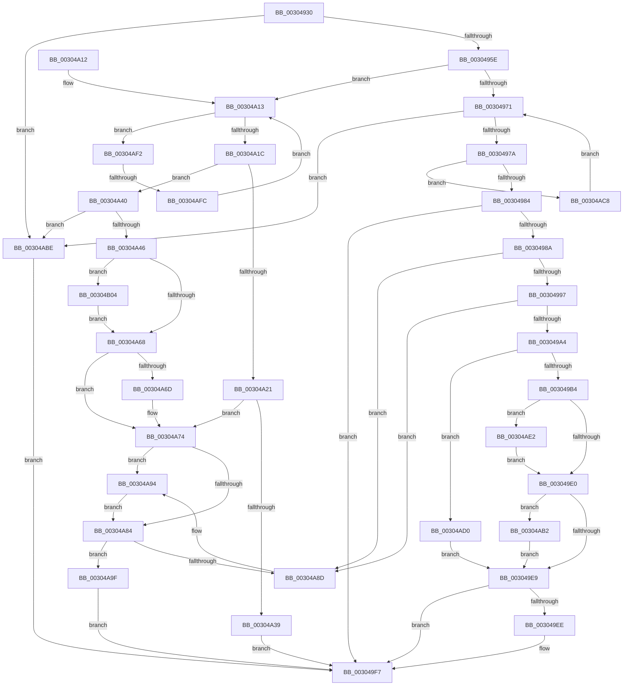

# PpmUpdateIdleVeto

- RVA: `0x00304930`–`0x00304B0D` (길이 `477` bytes)
- VA: `0x0000000140304930`
- 실행 섹션: `.text`
- PDB 이름 있음: `예`; PDB Function 태그: `예`
- unwind 정보 RVA: `0x00073568`
- 디코드: `127`개 명령, `477/477` bytes 표시
- 미해석 바이트: `0` (있으면 어셈블리에 `.byte`로 보존)

> 이 문서는 커널 이미지의 기계어와 PDB 기호를 분석해 생성했습니다. 4번과 5번은 함수 원형과 자료형을 바이너리 사용 방식에서 추정한 C 해석이며 원본 소스 복구 결과는 아닙니다.

## 1. Dependencies

- 직접 호출 지점: **6**; 고유 호출 대상: **4**
- 직접 호출자로 확인된 함수: **2**
- RIP 상대 이미지 참조: **0**

### Outgoing calls
- `0x003049BF` → [RtlGetInterruptTimePrecise](../20/RtlGetInterruptTimePrecise_function_0020A4C0.md) (function, `0x0020A4C0`)
- `0x00304A2C` → [ExAllocatePool2](../../poolcode/B8/ExAllocatePool2_function_00B820F0.md) (function, `0x00B820F0`)
- `0x00304A56` → [RtlGetInterruptTimePrecise](../20/RtlGetInterruptTimePrecise_function_0020A4C0.md) (function, `0x0020A4C0`)
- `0x00304A6F` → [PopUpdateNonAttributedCpuTimeReference](PopUpdateNonAttributedCpuTimeReference_function_00304720.md) (function, `0x00304720`)
- `0x00304AB4` → [PopUpdateNonAttributedCpuTimeReference](PopUpdateNonAttributedCpuTimeReference_function_00304720.md) (function, `0x00304720`)
- `0x00304AD8` → [ExFreePoolWithTag](../../poolcode/B8/ExFreePoolWithTag_function_00B82870.md) (function, `0x00B82870`)

### Direct callers
- [PpmUpdatePlatformIdleVeto](PpmUpdatePlatformIdleVeto_function_003047E0.md) at `0x00304867`
- [PpmUpdateProcessorIdleVeto](../5D/PpmUpdateProcessorIdleVeto_function_005D0C50.md) at `0x005D0D39`

### Static image references
- 디코드된 RIP-relative 메모리 참조가 없습니다.

## 2. Other-region calls and transfers

- 다른 실행 섹션으로 향하는 call: **2**
  - `0x00304A2C` → [ExAllocatePool2](../../poolcode/B8/ExAllocatePool2_function_00B820F0.md) (`.text` → `POOLCODE`)
  - `0x00304AD8` → [ExFreePoolWithTag](../../poolcode/B8/ExFreePoolWithTag_function_00B82870.md) (`.text` → `POOLCODE`)
- call이 아닌 외부 분기/꼬리 이동: **1**
  - `0x00304AF6` → [sub_006E0668](../6E/Unknown_function_006E0668.md) (`tail-transfer`)

## 3. Assembly (complete function range)

```asm
00304930  48 89 5C 24 08                  mov qword ptr [rsp + 8], rbx
00304935  48 89 6C 24 10                  mov qword ptr [rsp + 0x10], rbp
0030493A  48 89 74 24 18                  mov qword ptr [rsp + 0x18], rsi
0030493F  57                              push rdi
00304940  41 56                           push r14
00304942  41 57                           push r15
00304944  48 83 EC 20                     sub rsp, 0x20
00304948  33 DB                           xor ebx, ebx
0030494A  4D 8B F9                        mov r15, r9
0030494D  41 88 19                        mov byte ptr [r9], bl
00304950  49 8B E8                        mov rbp, r8
00304953  44 8B F2                        mov r14d, edx
00304956  85 D2                           test edx, edx
00304958  0F 84 60 01 00 00               je 0x140304abe
0030495E  49 8B 50 20                     mov rdx, qword ptr [r8 + 0x20]
00304962  49 8D 70 08                     lea rsi, [r8 + 8]
00304966  48 8B 3E                        mov rdi, qword ptr [rsi]
00304969  84 C9                           test cl, cl
0030496B  0F 85 A2 00 00 00               jne 0x140304a13
00304971  48 3B FE                        cmp rdi, rsi
00304974  0F 84 44 01 00 00               je 0x140304abe
0030497A  44 39 77 10                     cmp dword ptr [rdi + 0x10], r14d
0030497E  0F 85 44 01 00 00               jne 0x140304ac8
00304984  83 47 14 FF                     add dword ptr [rdi + 0x14], -1
00304988  75 6D                           jne 0x1403049f7
0030498A  48 8B 0F                        mov rcx, qword ptr [rdi]
0030498D  48 39 79 08                     cmp qword ptr [rcx + 8], rdi
00304991  0F 85 F6 00 00 00               jne 0x140304a8d
00304997  48 8B 47 08                     mov rax, qword ptr [rdi + 8]
0030499B  48 39 38                        cmp qword ptr [rax], rdi
0030499E  0F 85 E9 00 00 00               jne 0x140304a8d
003049A4  48 89 08                        mov qword ptr [rax], rcx
003049A7  48 89 41 08                     mov qword ptr [rcx + 8], rax
003049AB  48 85 D2                        test rdx, rdx
003049AE  0F 84 1C 01 00 00               je 0x140304ad0
003049B4  0F 57 C0                        xorps xmm0, xmm0
003049B7  48 8D 4C 24 58                  lea rcx, [rsp + 0x58]
003049BC  0F 11 07                        movups xmmword ptr [rdi], xmm0
003049BF  E8 FC 5A F0 FF                  call 0x14020a4c0
003049C4  48 8B C8                        mov rcx, rax
003049C7  48 2B 47 20                     sub rax, qword ptr [rdi + 0x20]
003049CB  48 01 47 28                     add qword ptr [rdi + 0x28], rax
003049CF  48 8B 47 30                     mov rax, qword ptr [rdi + 0x30]
003049D3  48 89 5F 20                     mov qword ptr [rdi + 0x20], rbx
003049D7  48 85 C0                        test rax, rax
003049DA  0F 85 02 01 00 00               jne 0x140304ae2
003049E0  38 5D 19                        cmp byte ptr [rbp + 0x19], bl
003049E3  0F 85 C9 00 00 00               jne 0x140304ab2
003049E9  48 39 36                        cmp qword ptr [rsi], rsi
003049EC  75 09                           jne 0x1403049f7
003049EE  F0 83 65 00 FE                  lock and dword ptr [rbp], 0xfffffffe
003049F3  41 C6 07 01                     mov byte ptr [r15], 1
003049F7  48 8B 6C 24 48                  mov rbp, qword ptr [rsp + 0x48]
003049FC  8B C3                           mov eax, ebx
003049FE  48 8B 5C 24 40                  mov rbx, qword ptr [rsp + 0x40]
00304A03  48 8B 74 24 50                  mov rsi, qword ptr [rsp + 0x50]
00304A08  48 83 C4 20                     add rsp, 0x20
00304A0C  41 5F                           pop r15
00304A0E  41 5E                           pop r14
00304A10  5F                              pop rdi
00304A11  C3                              ret
00304A12  CC                              int3
00304A13  48 3B FE                        cmp rdi, rsi
00304A16  0F 85 D6 00 00 00               jne 0x140304af2
00304A1C  48 85 D2                        test rdx, rdx
00304A1F  75 1F                           jne 0x140304a40
00304A21  8D 4A 40                        lea ecx, [rdx + 0x40]
00304A24  41 B8 50 50 4D 69               mov r8d, 0x694d5050
00304A2A  8B D1                           mov edx, ecx
00304A2C  E8 BF D6 87 00                  call 0x140b820f0
00304A31  48 8B F8                        mov rdi, rax
00304A34  48 85 C0                        test rax, rax
00304A37  75 3B                           jne 0x140304a74
00304A39  BB 9A 00 00 C0                  mov ebx, 0xc000009a
00304A3E  EB B7                           jmp 0x1403049f7
00304A40  45 3B 70 1C                     cmp r14d, dword ptr [r8 + 0x1c]
00304A44  77 78                           ja 0x140304abe
00304A46  41 8D 7E FF                     lea edi, [r14 - 1]
00304A4A  48 C1 E7 06                     shl rdi, 6
00304A4E  48 8D 4C 24 58                  lea rcx, [rsp + 0x58]
00304A53  48 03 FA                        add rdi, rdx
00304A56  E8 65 5A F0 FF                  call 0x14020a4c0
00304A5B  48 89 47 20                     mov qword ptr [rdi + 0x20], rax
00304A5F  38 5D 18                        cmp byte ptr [rbp + 0x18], bl
00304A62  0F 84 9C 00 00 00               je 0x140304b04
00304A68  38 5D 19                        cmp byte ptr [rbp + 0x19], bl
00304A6B  74 07                           je 0x140304a74
00304A6D  B1 01                           mov cl, 1
00304A6F  E8 AC FC FF FF                  call 0x140304720
00304A74  44 89 77 10                     mov dword ptr [rdi + 0x10], r14d
00304A78  C7 47 14 01 00 00 00            mov dword ptr [rdi + 0x14], 1
00304A7F  48 39 36                        cmp qword ptr [rsi], rsi
00304A82  74 10                           je 0x140304a94
00304A84  48 8B 46 08                     mov rax, qword ptr [rsi + 8]
00304A88  48 39 30                        cmp qword ptr [rax], rsi
00304A8B  74 12                           je 0x140304a9f
00304A8D  B9 03 00 00 00                  mov ecx, 3
00304A92  CD 29                           int 0x29
00304A94  F0 83 4D 00 01                  lock or dword ptr [rbp], 1
00304A99  41 C6 07 01                     mov byte ptr [r15], 1
00304A9D  EB E5                           jmp 0x140304a84
00304A9F  48 89 37                        mov qword ptr [rdi], rsi
00304AA2  48 89 47 08                     mov qword ptr [rdi + 8], rax
00304AA6  48 89 38                        mov qword ptr [rax], rdi
00304AA9  48 89 7E 08                     mov qword ptr [rsi + 8], rdi
00304AAD  E9 45 FF FF FF                  jmp 0x1403049f7
00304AB2  33 C9                           xor ecx, ecx
00304AB4  E8 67 FC FF FF                  call 0x140304720
00304AB9  E9 2B FF FF FF                  jmp 0x1403049e9
00304ABE  BB 0D 00 00 C0                  mov ebx, 0xc000000d
00304AC3  E9 2F FF FF FF                  jmp 0x1403049f7
00304AC8  48 8B 3F                        mov rdi, qword ptr [rdi]
00304ACB  E9 A1 FE FF FF                  jmp 0x140304971
00304AD0  BA 50 50 4D 69                  mov edx, 0x694d5050
00304AD5  48 8B CF                        mov rcx, rdi
00304AD8  E8 93 DD 87 00                  call 0x140b82870
00304ADD  E9 07 FF FF FF                  jmp 0x1403049e9
00304AE2  48 2B C8                        sub rcx, rax
00304AE5  48 89 5F 30                     mov qword ptr [rdi + 0x30], rbx
00304AE9  48 01 4F 38                     add qword ptr [rdi + 0x38], rcx
00304AED  E9 EE FE FF FF                  jmp 0x1403049e0
00304AF2  44 39 77 10                     cmp dword ptr [rdi + 0x10], r14d
00304AF6  0F 84 6C BB 3D 00               je 0x1406e0668
00304AFC  48 8B 3F                        mov rdi, qword ptr [rdi]
00304AFF  E9 0F FF FF FF                  jmp 0x140304a13
00304B04  48 89 47 30                     mov qword ptr [rdi + 0x30], rax
00304B08  E9 5B FF FF FF                  jmp 0x140304a68
```

## 4. C-style interpretation (structured pseudocode)

```c
__int64 __fastcall PpmUpdateIdleVeto(unsigned __int8 a1, int a2, __int64 a3, __int64 a4)
{
    __int64 result;
    __int64 v_rbx;
    __int64 v_rdi;
    __int64 v_rsp;
    unsigned __int64 v_stack_p10;
    unsigned __int64 v_stack_p18;
    unsigned __int64 v_stack_p20;
    unsigned __int64 v_stack_p58;
    unsigned __int64 v_stack_p8;

    v_stack_p8 = v_rbx;
    v_stack_p10 = v_rbp;
    v_stack_p18 = v_rsi;
    v_rsp = (v_rsp) - (32);
    v_rbx = 0;
    *(unsigned __int8 *)(a4) = 0;
    if (a2 == 0) goto loc_00304ABE;
    if (a1 != 0) goto loc_00304A13;
loc_00304971:
    if ((*(unsigned __int64 *)(a3 + 8)) == (a3 + 8)) goto loc_00304ABE;
    if ((*(unsigned int *)(*(unsigned __int64 *)(a3 + 8) + 16)) != ((unsigned int)((unsigned int)(a2)))) goto loc_00304AC8;
    if ((*(unsigned int *)(*(unsigned __int64 *)(a3 + 8) + 16)) != ((unsigned int)((unsigned int)(a2)))) goto loc_003049F7;
    if ((*(unsigned __int64 *)(*(unsigned __int64 *)(*(unsigned __int64 *)(a3 + 8)) + 8)) != (*(unsigned __int64 *)(a3 + 8))) goto loc_00304A8D;
    if ((*(unsigned __int64 *)(*(unsigned __int64 *)(*(unsigned __int64 *)(a3 + 8) + 8))) != (*(unsigned __int64 *)(a3 + 8))) goto loc_00304A8D;
    *(unsigned __int64 *)(*(unsigned __int64 *)(*(unsigned __int64 *)(a3 + 8) + 8)) = *(unsigned __int64 *)(*(unsigned __int64 *)(a3 + 8));
    *(unsigned __int64 *)(*(unsigned __int64 *)(*(unsigned __int64 *)(a3 + 8)) + 8) = *(unsigned __int64 *)(*(unsigned __int64 *)(a3 + 8) + 8);
    if (*(unsigned __int64 *)(a3 + 32) == 0) goto loc_00304AD0;
    *(unsigned __int64 *)(*(unsigned __int64 *)(a3 + 8)) = v_xmm0;
    result = RtlGetInterruptTimePrecise(v_stack_p20, *(unsigned __int64 *)(a3 + 32), a3, a4);
    result = (result) - (*(unsigned __int64 *)(*(unsigned __int64 *)(a3 + 8) + 32));
    *(unsigned __int64 *)(*(unsigned __int64 *)(a3 + 8) + 32) = 0;
    if (*(unsigned __int64 *)(*(unsigned __int64 *)(a3 + 8) + 48) != 0) goto loc_00304AE2;
loc_003049E0:
    if ((*(unsigned __int8 *)(a3 + 25)) != 0) goto loc_00304AB2;
loc_003049E9:
    if ((*(unsigned __int64 *)(a3 + 8)) == (a3 + 8)) {
        *(unsigned __int8 *)(a4) = 1;
    }
    v_rsp = (v_rsp) + (32);
    return 0;
loc_00304A13:
    if ((*(unsigned __int64 *)(a3 + 8)) != v_stack_p18) goto loc_00304AF2;
    if (*(unsigned __int64 *)(a3 + 32) != 0) goto loc_00304A40;
    result = ExAllocatePool2(*(unsigned __int64 *)(a3 + 32) + 64, (unsigned int)((unsigned int)(*(unsigned __int64 *)(a3 + 32) + 64)), (unsigned int)(0x694D5050ULL), a4);
    if (result != 0) goto loc_00304A74;
    goto loc_003049F7;
loc_00304A40:
    if (((unsigned int)((unsigned int)(a2))) > (*(unsigned int *)((unsigned int)(0x694D5050ULL) + 28))) goto loc_00304ABE;
    v_rdi = ((unsigned int)(a2) - 1) << (6);
    v_rdi = (v_rdi) + ((unsigned int)((unsigned int)(*(unsigned __int64 *)(a3 + 32) + 64)));
    result = RtlGetInterruptTimePrecise(v_stack_p58, (unsigned int)((unsigned int)(*(unsigned __int64 *)(a3 + 32) + 64)), (unsigned int)(0x694D5050ULL), a4);
    *(unsigned __int64 *)(v_rdi + 32) = result;
    if ((*(unsigned __int8 *)(v_stack_p10 + 24)) == ((unsigned __int8)((unsigned int)(0xC000009AULL)))) goto loc_00304B04;
loc_00304A68:
    if ((*(unsigned __int8 *)(v_stack_p10 + 25)) != ((unsigned __int8)((unsigned int)(0xC000009AULL)))) {
        a1 = 1;
        result = PopUpdateNonAttributedCpuTimeReference(a1, (unsigned int)((unsigned int)(*(unsigned __int64 *)(a3 + 32) + 64)), (unsigned int)(0x694D5050ULL), a4);
    }
    *(unsigned int *)(v_rdi + 16) = (unsigned int)((unsigned int)(a2));
    *(unsigned int *)(v_rdi + 20) = 1;
    if ((*(unsigned __int64 *)(v_stack_p18)) == v_stack_p18) goto loc_00304A94;
loc_00304A84:
    if ((*(unsigned __int64 *)(*(unsigned __int64 *)(v_stack_p18 + 8))) == v_stack_p18) goto loc_00304A9F;
loc_00304A8D:
loc_00304A94:
    *(unsigned __int8 *)(a4) = 1;
    goto loc_00304A84;
loc_00304A9F:
    *(unsigned __int64 *)(v_rdi) = v_stack_p18;
    *(unsigned __int64 *)(v_rdi + 8) = *(unsigned __int64 *)(v_stack_p18 + 8);
    *(unsigned __int64 *)(*(unsigned __int64 *)(v_stack_p18 + 8)) = v_rdi;
    *(unsigned __int64 *)(v_stack_p18 + 8) = v_rdi;
    goto loc_003049F7;
loc_00304AB2:
    a1 = 0;
    result = PopUpdateNonAttributedCpuTimeReference(a1, (unsigned int)((unsigned int)(*(unsigned __int64 *)(a3 + 32) + 64)), (unsigned int)(0x694D5050ULL), a4);
    goto loc_003049E9;
loc_00304ABE:
    goto loc_003049F7;
loc_00304AC8:
    goto loc_00304971;
loc_00304AD0:
    result = ExFreePoolWithTag(*(unsigned __int64 *)(v_rdi), (unsigned int)(0x694D5050ULL), (unsigned int)(0x694D5050ULL), a4);
    goto loc_003049E9;
loc_00304AE2:
    a1 = (*(unsigned __int64 *)(v_rdi)) - (result);
    *(unsigned __int64 *)(*(unsigned __int64 *)(v_rdi) + 48) = (unsigned int)(0xC000000DULL);
    goto loc_003049E0;
loc_00304AF2:
    goto loc_00304A13;
loc_00304B04:
    *(unsigned __int64 *)(*(unsigned __int64 *)(*(unsigned __int64 *)(v_rdi)) + 48) = result;
    goto loc_00304A68;
}
```

## 5. (Beta) C Style

```c
int64_t PpmUpdateIdleVeto(uint8_t Arg1, int32_t Arg2, void *Arg3, void *Arg4)
{
    uint8_t *arg3 = (uint8_t *)Arg3;
    uint8_t *arg4 = (uint8_t *)Arg4;

    int64_t result;
    int64_t local_rbx;
    int64_t local_rdi;
    int64_t local_rsp;
    uint64_t v_stack_p10;
    uint64_t v_stack_p18;
    uint64_t v_stack_p20;
    uint64_t v_stack_p58;
    uint64_t v_stack_p8;

    v_stack_p8 = local_rbx;
    v_stack_p10 = local_rbp;
    v_stack_p18 = local_rsi;
    local_rsp = (local_rsp) - (32);
    local_rbx = 0;
    *(uint8_t *)(arg4) = 0;
    if (Arg2 == 0) goto loc_00304ABE;
    if (Arg1 != 0) goto loc_00304A13;
loc_00304971:
    if ((*(uint64_t *)(arg3 + 0x8)) == (Arg3 + 8)) goto loc_00304ABE;
    if ((*(uint32_t *)(*(uint64_t *)(arg3 + 0x8) + 0x10)) != ((uint32_t)((uint32_t)(Arg2)))) goto loc_00304AC8;
    if ((*(uint32_t *)(*(uint64_t *)(arg3 + 0x8) + 0x10)) != ((uint32_t)((uint32_t)(Arg2)))) goto loc_003049F7;
    if ((*(uint64_t *)(*(uint64_t *)(*(uint64_t *)(arg3 + 0x8)) + 0x8)) != (*(uint64_t *)(arg3 + 0x8))) goto loc_00304A8D;
    if ((*(uint64_t *)(*(uint64_t *)(*(uint64_t *)(arg3 + 0x8) + 0x8))) != (*(uint64_t *)(arg3 + 0x8))) goto loc_00304A8D;
    *(uint64_t *)(*(uint64_t *)(*(uint64_t *)(arg3 + 0x8) + 0x8)) = *(uint64_t *)(*(uint64_t *)(arg3 + 0x8));
    *(uint64_t *)(*(uint64_t *)(*(uint64_t *)(arg3 + 0x8)) + 0x8) = *(uint64_t *)(*(uint64_t *)(arg3 + 0x8) + 0x8);
    if (*(uint64_t *)(arg3 + 0x20) == 0) goto loc_00304AD0;
    *(uint64_t *)(*(uint64_t *)(arg3 + 0x8)) = v_xmm0;
    result = RtlGetInterruptTimePrecise(v_stack_p20, *(uint64_t *)(arg3 + 0x20), Arg3, Arg4);
    result = (result) - (*(uint64_t *)(*(uint64_t *)(arg3 + 0x8) + 0x20));
    *(uint64_t *)(*(uint64_t *)(arg3 + 0x8) + 0x20) = 0;
    if (*(uint64_t *)(*(uint64_t *)(arg3 + 0x8) + 0x30) != 0) goto loc_00304AE2;
loc_003049E0:
    if ((*(uint8_t *)(arg3 + 0x19)) != 0) goto loc_00304AB2;
loc_003049E9:
    if ((*(uint64_t *)(arg3 + 0x8)) == (Arg3 + 8)) {
        *(uint8_t *)(arg4) = 1;
    }
    local_rsp = (local_rsp) + (32);
    return 0;
loc_00304A13:
    if ((*(uint64_t *)(arg3 + 0x8)) != v_stack_p18) goto loc_00304AF2;
    if (*(uint64_t *)(arg3 + 0x20) != 0) goto loc_00304A40;
    result = ExAllocatePool2(*(uint64_t *)(arg3 + 0x20) + 64, (uint32_t)((uint32_t)(*(uint64_t *)(arg3 + 0x20) + 64)), (uint32_t)(0x694D5050ULL), Arg4);
    if (result != 0) goto loc_00304A74;
    goto loc_003049F7;
loc_00304A40:
    if (((uint32_t)((uint32_t)(Arg2))) > (*(uint32_t *)((uint32_t)(0x694D5050ULL) + 0x1C))) goto loc_00304ABE;
    local_rdi = ((uint32_t)(Arg2) - 1) << (6);
    local_rdi = (local_rdi) + ((uint32_t)((uint32_t)(*(uint64_t *)(arg3 + 0x20) + 64)));
    result = RtlGetInterruptTimePrecise(v_stack_p58, (uint32_t)((uint32_t)(*(uint64_t *)(arg3 + 0x20) + 64)), (uint32_t)(0x694D5050ULL), Arg4);
    *(uint64_t *)(local_rdi + 0x20) = result;
    if ((*(uint8_t *)(v_stack_p10 + 0x18)) == ((uint8_t)((uint32_t)(0xC000009AULL)))) goto loc_00304B04;
loc_00304A68:
    if ((*(uint8_t *)(v_stack_p10 + 0x19)) != ((uint8_t)((uint32_t)(0xC000009AULL)))) {
        Arg1 = 1;
        result = PopUpdateNonAttributedCpuTimeReference(Arg1, (uint32_t)((uint32_t)(*(uint64_t *)(arg3 + 0x20) + 64)), (uint32_t)(0x694D5050ULL), Arg4);
    }
    *(uint32_t *)(local_rdi + 0x10) = (uint32_t)((uint32_t)(Arg2));
    *(uint32_t *)(local_rdi + 0x14) = 1;
    if ((*(uint64_t *)(v_stack_p18)) == v_stack_p18) goto loc_00304A94;
loc_00304A84:
    if ((*(uint64_t *)(*(uint64_t *)(v_stack_p18 + 0x8))) == v_stack_p18) goto loc_00304A9F;
loc_00304A8D:
loc_00304A94:
    *(uint8_t *)(arg4) = 1;
    goto loc_00304A84;
loc_00304A9F:
    *(uint64_t *)(local_rdi) = v_stack_p18;
    *(uint64_t *)(local_rdi + 0x8) = *(uint64_t *)(v_stack_p18 + 0x8);
    *(uint64_t *)(*(uint64_t *)(v_stack_p18 + 0x8)) = local_rdi;
    *(uint64_t *)(v_stack_p18 + 0x8) = local_rdi;
    goto loc_003049F7;
loc_00304AB2:
    Arg1 = 0;
    result = PopUpdateNonAttributedCpuTimeReference(Arg1, (uint32_t)((uint32_t)(*(uint64_t *)(arg3 + 0x20) + 64)), (uint32_t)(0x694D5050ULL), Arg4);
    goto loc_003049E9;
loc_00304ABE:
    goto loc_003049F7;
loc_00304AC8:
    goto loc_00304971;
loc_00304AD0:
    result = ExFreePoolWithTag(*(uint64_t *)(local_rdi), (uint32_t)(0x694D5050ULL), (uint32_t)(0x694D5050ULL), Arg4);
    goto loc_003049E9;
loc_00304AE2:
    Arg1 = (*(uint64_t *)(local_rdi)) - (result);
    *(uint64_t *)(*(uint64_t *)(local_rdi) + 0x30) = (uint32_t)(0xC000000DULL);
    goto loc_003049E0;
loc_00304AF2:
    goto loc_00304A13;
loc_00304B04:
    *(uint64_t *)(*(uint64_t *)(*(uint64_t *)(local_rdi)) + 0x30) = result;
    goto loc_00304A68;
}
```

### 관측된 메모리 오프셋

구조체 형식이 확인되지 않은 접근은 인자 기준의 오프셋으로만 기록했습니다.

| 기준 인자 | 오프셋 표현 | 폭 (bit) | 접근 |
|---|---:|---:|---|
| `Arg3` | `+ 0x0` | `32` | `R/W` |
| `Arg3` | `+ 0x0` | `64` | `R` |
| `Arg3` | `+ 0x8` | `64` | `R` |
| `Arg3` | `+ 0x8` | `64` | `W` |
| `Arg3` | `+ 0x18` | `8` | `R` |
| `Arg3` | `+ 0x19` | `8` | `R` |
| `Arg3` | `+ 0x1C` | `32` | `R` |
| `Arg3` | `+ 0x20` | `64` | `R` |
| `Arg4` | `+ 0x0` | `8` | `W` |

## 6. Execution-region graph

[열기: 2D/3D 그래프와 함수 탐색 컨트롤 패널](../../../control-panel.html?section=text&rva=0x00304930&view=graph)

- 2D 그래프는 위에서 아래로 흐르고, 3D 그래프는 빈 공간을 드래그해 회전합니다. Shift+드래그는 이동, 휠은 확대·축소, 함수 노드 선택은 대상 보고서 이동입니다.

### Static fallback


