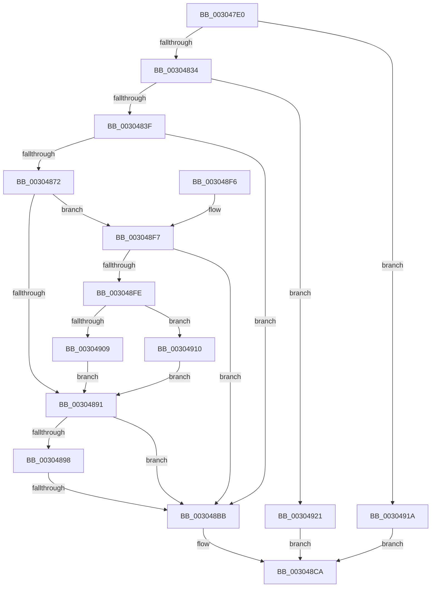

# PpmUpdatePlatformIdleVeto

- RVA: `0x003047E0`–`0x00304928` (길이 `328` bytes)
- VA: `0x00000001403047E0`
- 실행 섹션: `.text`
- PDB 이름 있음: `예`; PDB Function 태그: `예`
- unwind 정보 RVA: `0x00073534`
- 디코드: `79`개 명령, `328/328` bytes 표시
- 미해석 바이트: `0` (있으면 어셈블리에 `.byte`로 보존)

> 이 문서는 커널 이미지의 기계어와 PDB 기호를 분석해 생성했습니다. 4번과 5번은 함수 원형과 자료형을 바이너리 사용 방식에서 추정한 C 해석이며 원본 소스 복구 결과는 아닙니다.

## 1. Dependencies

- 직접 호출 지점: **9**; 고유 호출 대상: **9**
- 직접 호출자로 확인된 함수: **0**
- RIP 상대 이미지 참조: **3**

### Outgoing calls
- `0x0030481F` → [memset](../6C/memset_function_006C6C40.md) (function, `0x006C6C40`)
- `0x00304850` → [KeAcquireSpinLockRaiseToDpc](../20/KeAcquireSpinLockRaiseToDpc_function_00208470.md) (function, `0x00208470`)
- `0x00304867` → [PpmUpdateIdleVeto](PpmUpdateIdleVeto_function_00304930.md) (function, `0x00304930`)
- `0x0030487C` → [PpmEventPlatformVetoRequest](PpmEventPlatformVetoRequest_function_00304B14.md) (function, `0x00304B14`)
- `0x003048AE` → [KeCheckProcessorAffinityEx](KeCheckProcessorAffinityEx_function_00305150.md) (function, `0x00305150`)
- `0x003048C5` → [KeReleaseSpinLock](../39/KeReleaseSpinLock_function_00392BA0.md) (function, `0x00392BA0`)
- `0x003048D7` → [_security_check_cookie](../6A/_security_check_cookie_function_006AC640.md) (function, `0x006AC640`)
- `0x00304909` → [PopDeepSleepClearDisengageReason](../39/PopDeepSleepClearDisengageReason_function_0039010C.md) (function, `0x0039010C`)
- `0x00304910` → [PopDeepSleepSetDisengageReason](../38/PopDeepSleepSetDisengageReason_function_0038FEC4.md) (function, `0x0038FEC4`)

### Direct callers
- 이 함수 시작 RVA로 연결되는 직접 call은 확인되지 않았습니다. 간접 호출은 완전히 역산할 수 없습니다.

### Static image references
- `0x003047F8` → RVA `0x00E0A740` (`.data`; read)
- `0x00304824` → RVA `0x00FC6AD0` (`ALMOSTRO`; read)
- `0x00304849` → RVA `0x00F0CA68` (`.data`; read)

## 2. Other-region calls and transfers

- 다른 실행 섹션으로 향하는 call: **0**
- call이 아닌 외부 분기/꼬리 이동: **1**
  - `0x003048B5` → [sub_006E0608](../6E/Unknown_function_006E0608.md) (`tail-transfer`)

## 3. Assembly (complete function range)

```asm
003047E0  48 89 5C 24 10                  mov qword ptr [rsp + 0x10], rbx
003047E5  48 89 6C 24 18                  mov qword ptr [rsp + 0x18], rbp
003047EA  48 89 7C 24 20                  mov qword ptr [rsp + 0x20], rdi
003047EF  41 56                           push r14
003047F1  48 81 EC 50 01 00 00            sub rsp, 0x150
003047F8  48 8B 05 41 5F B0 00            mov rax, qword ptr [rip + 0xb05f41]
003047FF  48 33 C4                        xor rax, rsp
00304802  48 89 84 24 40 01 00 00         mov qword ptr [rsp + 0x140], rax
0030480A  48 8B D9                        mov rbx, rcx
0030480D  C6 44 24 20 00                  mov byte ptr [rsp + 0x20], 0
00304812  48 8D 4C 24 38                  lea rcx, [rsp + 0x38]
00304817  33 D2                           xor edx, edx
00304819  41 B8 00 01 00 00               mov r8d, 0x100
0030481F  E8 1C 24 3C 00                  call 0x1406c6c40
00304824  48 8B 0D A5 22 CC 00            mov rcx, qword ptr [rip + 0xcc22a5]
0030482B  48 85 C9                        test rcx, rcx
0030482E  0F 84 E6 00 00 00               je 0x14030491a
00304834  8B 43 04                        mov eax, dword ptr [rbx + 4]
00304837  3B 01                           cmp eax, dword ptr [rcx]
00304839  0F 83 E2 00 00 00               jae 0x140304921
0030483F  48 69 E8 C0 01 00 00            imul rbp, rax, 0x1c0
00304846  48 03 E9                        add rbp, rcx
00304849  48 8D 0D 18 82 C0 00            lea rcx, [rip + 0xc08218]
00304850  E8 1B 3C F0 FF                  call 0x140208470
00304855  8B 53 08                        mov edx, dword ptr [rbx + 8]
00304858  4C 8D 45 50                     lea r8, [rbp + 0x50]
0030485C  8A 4B 0C                        mov cl, byte ptr [rbx + 0xc]
0030485F  4C 8D 4C 24 20                  lea r9, [rsp + 0x20]
00304864  44 8A F0                        mov r14b, al
00304867  E8 C4 00 00 00                  call 0x140304930
0030486C  8B F8                           mov edi, eax
0030486E  85 C0                           test eax, eax
00304870  78 49                           js 0x1403048bb
00304872  44 8A 43 0C                     mov r8b, byte ptr [rbx + 0xc]
00304876  8B 53 08                        mov edx, dword ptr [rbx + 8]
00304879  8B 4B 04                        mov ecx, dword ptr [rbx + 4]
0030487C  E8 93 02 00 00                  call 0x140304b14
00304881  48 8B 0D 48 22 CC 00            mov rcx, qword ptr [rip + 0xcc2248]
00304888  8B 11                           mov edx, dword ptr [rcx]
0030488A  FF CA                           dec edx
0030488C  39 53 04                        cmp dword ptr [rbx + 4], edx
0030488F  74 66                           je 0x1403048f7
00304891  80 7C 24 20 00                  cmp byte ptr [rsp + 0x20], 0
00304896  74 23                           je 0x1403048bb
00304898  65 48 8B 14 25 20 00 00 00      mov rdx, qword ptr gs:[0x20]
003048A1  48 8D 9D 80 00 00 00            lea rbx, [rbp + 0x80]
003048A8  48 8B CB                        mov rcx, rbx
003048AB  8B 52 24                        mov edx, dword ptr [rdx + 0x24]
003048AE  E8 9D 08 00 00                  call 0x140305150
003048B3  85 C0                           test eax, eax
003048B5  0F 84 4D BD 3D 00               je 0x1406e0608
003048BB  41 8A D6                        mov dl, r14b
003048BE  48 8D 0D A3 81 C0 00            lea rcx, [rip + 0xc081a3]
003048C5  E8 D6 E2 08 00                  call 0x140392ba0
003048CA  8B C7                           mov eax, edi
003048CC  48 8B 8C 24 40 01 00 00         mov rcx, qword ptr [rsp + 0x140]
003048D4  48 33 CC                        xor rcx, rsp
003048D7  E8 64 7D 3A 00                  call 0x1406ac640
003048DC  4C 8D 9C 24 50 01 00 00         lea r11, [rsp + 0x150]
003048E4  49 8B 5B 18                     mov rbx, qword ptr [r11 + 0x18]
003048E8  49 8B 6B 20                     mov rbp, qword ptr [r11 + 0x20]
003048EC  49 8B 7B 28                     mov rdi, qword ptr [r11 + 0x28]
003048F0  49 8B E3                        mov rsp, r11
003048F3  41 5E                           pop r14
003048F5  C3                              ret
003048F6  CC                              int3
003048F7  80 7C 24 20 00                  cmp byte ptr [rsp + 0x20], 0
003048FC  74 BD                           je 0x1403048bb
003048FE  80 7B 0C 00                     cmp byte ptr [rbx + 0xc], 0
00304902  B9 09 00 00 00                  mov ecx, 9
00304907  75 07                           jne 0x140304910
00304909  E8 FE B7 08 00                  call 0x14039010c
0030490E  EB 81                           jmp 0x140304891
00304910  E8 AF B5 08 00                  call 0x14038fec4
00304915  E9 77 FF FF FF                  jmp 0x140304891
0030491A  BF BB 00 00 C0                  mov edi, 0xc00000bb
0030491F  EB A9                           jmp 0x1403048ca
00304921  BF 0D 00 00 C0                  mov edi, 0xc000000d
00304926  EB A2                           jmp 0x1403048ca
```

## 4. C-style interpretation (structured pseudocode)

```c
__int64 __fastcall PpmUpdatePlatformIdleVeto(__int64 a1, int a2)
{
    __int64 result;
    __int64 v_rbp;
    __int64 v_rsp;
    unsigned __int64 v_stack_m120;
    unsigned __int8 v_stack_m130;
    unsigned __int8 v_stack_m138;
    unsigned __int64 v_stack_m18;
    unsigned __int64 v_stack_m8;
    unsigned __int64 v_stack_p10;
    unsigned __int64 v_stack_p18;
    unsigned __int64 v_stack_p20;

    v_stack_p10 = v_rbx;
    v_stack_p18 = v_rbp;
    v_stack_p20 = v_rdi;
    v_rsp = (v_rsp) - (336);
    result = (*(unsigned __int64 *)(v_rip + 11558721)) ^ (v_rsp);
    v_stack_m18 = result;
    v_stack_m138 = 0;
    a2 = 0;
    result = memset(v_stack_m120, a2, 256, a4);
    if (*(unsigned __int64 *)(v_rip + 13378213) == 0) goto loc_0030491A;
    if (((unsigned int)((unsigned int)(*(unsigned int *)(a1 + 4)))) >= (*(unsigned int *)(*(unsigned __int64 *)(v_rip + 13378213)))) goto loc_00304921;
    v_rbp = (v_rbp) * ((unsigned int)(*(unsigned int *)(a1 + 4)));
    v_rbp = (v_rbp) + (*(unsigned __int64 *)(v_rip + 13378213));
    result = KeAcquireSpinLockRaiseToDpc(v_rip + 12616216, a2, 256, a4);
    result = PpmUpdateIdleVeto(*(unsigned __int8 *)(a1 + 12), (unsigned int)(*(unsigned int *)(a1 + 8)), v_rbp + 80, v_stack_m138);
    if (sign_flag) goto loc_003048BB;
    result = PpmEventPlatformVetoRequest((unsigned int)(*(unsigned int *)(a1 + 4)), (unsigned int)(*(unsigned int *)(a1 + 8)), *(unsigned __int8 *)(a1 + 12), v_stack_m138);
    a2 = (unsigned int)(((unsigned int)(*(unsigned int *)(*(unsigned __int64 *)(v_rip + 13378120)))) - 1);
    if ((*(unsigned int *)(a1 + 4)) == a2) goto loc_003048F7;
loc_00304891:
    if (v_stack_m138 == 0) goto loc_003048BB;
    result = KeCheckProcessorAffinityEx(v_rbp + 128, (unsigned int)(*(unsigned int *)(*(unsigned __int64 *)(gs_base + (0 + 32)) + 36)), *(unsigned __int8 *)(a1 + 12), v_stack_m138);
loc_003048BB:
    result = KeReleaseSpinLock(v_rip + 12616099, (unsigned __int8)((unsigned __int8)(result)), *(unsigned __int8 *)(a1 + 12), v_stack_m138);
loc_003048CA:
    a1 = (v_stack_m18) ^ (v_rsp);
    result = _security_check_cookie(a1, (unsigned __int8)((unsigned __int8)(result)), *(unsigned __int8 *)(a1 + 12), v_stack_m138);
    return result;
loc_003048F7:
    if (v_stack_m130 == 0) goto loc_003048BB;
    if ((*(unsigned __int8 *)(*(unsigned __int64 *)(v_stack_m8 + 24) + 12)) != 0) goto loc_00304910;
    result = PopDeepSleepClearDisengageReason(9, (unsigned __int8)((unsigned __int8)(result)), *(unsigned __int8 *)(a1 + 12), v_stack_m138);
    goto loc_00304891;
loc_00304910:
    result = PopDeepSleepSetDisengageReason(9, (unsigned __int8)((unsigned __int8)(result)), *(unsigned __int8 *)(a1 + 12), v_stack_m138);
    goto loc_00304891;
loc_0030491A:
    goto loc_003048CA;
loc_00304921:
    goto loc_003048CA;
}
```

## 5. (Beta) C Style

```c
int64_t PpmUpdatePlatformIdleVeto(void *Arg1, int32_t Arg2)
{
    uint8_t *arg1 = (uint8_t *)Arg1;

    int64_t result;
    int64_t local_rbp;
    int64_t local_rsp;
    uint64_t v_stack_m120;
    uint8_t v_stack_m130;
    uint8_t v_stack_m138;
    uint64_t v_stack_m18;
    uint64_t v_stack_m8;
    uint64_t v_stack_p10;
    uint64_t v_stack_p18;
    uint64_t v_stack_p20;

    v_stack_p10 = local_rbx;
    v_stack_p18 = local_rbp;
    v_stack_p20 = local_rdi;
    local_rsp = (local_rsp) - (336);
    result = (*(uint64_t *)(v_rip + 0xB05F41)) ^ (local_rsp);
    v_stack_m18 = result;
    v_stack_m138 = 0;
    Arg2 = 0;
    result = memset(v_stack_m120, Arg2, 256, a4);
    if (*(uint64_t *)(v_rip + 0xCC22A5) == 0) goto loc_0030491A;
    if (((uint32_t)((uint32_t)(*(uint32_t *)(arg1 + 0x4)))) >= (*(uint32_t *)(*(uint64_t *)(v_rip + 0xCC22A5)))) goto loc_00304921;
    local_rbp = (local_rbp) * ((uint32_t)(*(uint32_t *)(arg1 + 0x4)));
    local_rbp = (local_rbp) + (*(uint64_t *)(v_rip + 0xCC22A5));
    result = KeAcquireSpinLockRaiseToDpc(v_rip + 12616216, Arg2, 256, a4);
    result = PpmUpdateIdleVeto(*(uint8_t *)(arg1 + 0xC), (uint32_t)(*(uint32_t *)(arg1 + 0x8)), local_rbp + 80, v_stack_m138);
    if (sign_flag) goto loc_003048BB;
    result = PpmEventPlatformVetoRequest((uint32_t)(*(uint32_t *)(arg1 + 0x4)), (uint32_t)(*(uint32_t *)(arg1 + 0x8)), *(uint8_t *)(arg1 + 0xC), v_stack_m138);
    Arg2 = (uint32_t)(((uint32_t)(*(uint32_t *)(*(uint64_t *)(v_rip + 0xCC2248)))) - 1);
    if ((*(uint32_t *)(arg1 + 0x4)) == Arg2) goto loc_003048F7;
loc_00304891:
    if (v_stack_m138 == 0) goto loc_003048BB;
    result = KeCheckProcessorAffinityEx(local_rbp + 128, (uint32_t)(*(uint32_t *)(*(uint64_t *)(gs_base + (0 + 0x20)) + 0x24)), *(uint8_t *)(arg1 + 0xC), v_stack_m138);
loc_003048BB:
    result = KeReleaseSpinLock(v_rip + 12616099, (uint8_t)((uint8_t)(result)), *(uint8_t *)(arg1 + 0xC), v_stack_m138);
loc_003048CA:
    Arg1 = (v_stack_m18) ^ (local_rsp);
    result = _security_check_cookie(Arg1, (uint8_t)((uint8_t)(result)), *(uint8_t *)(arg1 + 0xC), v_stack_m138);
    return result;
loc_003048F7:
    if (v_stack_m130 == 0) goto loc_003048BB;
    if ((*(uint8_t *)(*(uint64_t *)(v_stack_m8 + 0x18) + 0xC)) != 0) goto loc_00304910;
    result = PopDeepSleepClearDisengageReason(9, (uint8_t)((uint8_t)(result)), *(uint8_t *)(arg1 + 0xC), v_stack_m138);
    goto loc_00304891;
loc_00304910:
    result = PopDeepSleepSetDisengageReason(9, (uint8_t)((uint8_t)(result)), *(uint8_t *)(arg1 + 0xC), v_stack_m138);
    goto loc_00304891;
loc_0030491A:
    goto loc_003048CA;
loc_00304921:
    goto loc_003048CA;
}
```

### 관측된 메모리 오프셋

구조체 형식이 확인되지 않은 접근은 인자 기준의 오프셋으로만 기록했습니다.

| 기준 인자 | 오프셋 표현 | 폭 (bit) | 접근 |
|---|---:|---:|---|
| `Arg1` | `+ 0x4` | `32` | `R` |
| `Arg1` | `+ 0x8` | `32` | `R` |
| `Arg1` | `+ 0xC` | `8` | `R` |

## 6. Execution-region graph

[열기: 2D/3D 그래프와 함수 탐색 컨트롤 패널](../../../control-panel.html?section=text&rva=0x003047E0&view=graph)

- 2D 그래프는 위에서 아래로 흐르고, 3D 그래프는 빈 공간을 드래그해 회전합니다. Shift+드래그는 이동, 휠은 확대·축소, 함수 노드 선택은 대상 보고서 이동입니다.

### Static fallback


