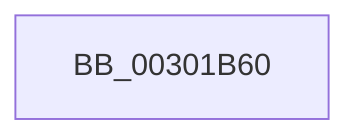

# SepFilterCheck

- RVA: `0x00301B60`–`0x00301B81` (길이 `33` bytes)
- VA: `0x0000000140301B60`
- 실행 섹션: `.text`
- PDB 이름 있음: `예`; PDB Function 태그: `아니요`
- unwind 정보 RVA: `0x000731D4`
- 디코드: `10`개 명령, `33/33` bytes 표시
- 미해석 바이트: `0` (있으면 어셈블리에 `.byte`로 보존)

> 이 문서는 커널 이미지의 기계어와 PDB 기호를 분석해 생성했습니다. 4번과 5번은 함수 원형과 자료형을 바이너리 사용 방식에서 추정한 C 해석이며 원본 소스 복구 결과는 아닙니다.

## 1. Dependencies

- 직접 호출 지점: **0**; 고유 호출 대상: **0**
- 직접 호출자로 확인된 함수: **7**
- RIP 상대 이미지 참조: **0**

### Outgoing calls
- 직접 디코드된 call 명령이 없습니다.

### Direct callers
- [SeAccessCheckWithHint](../3A/SeAccessCheckWithHint_function_003A6C30.md) at `0x003A6E06`
- [SeAccessCheckByType](../44/SeAccessCheckByType_function_00440BC8.md) at `0x004412CE`
- [SepCommonAccessCheckEx](../47/SepCommonAccessCheckEx_function_0047602C.md) at `0x004763D2`
- [sub_00947E60](../../page/94/Unknown_function_00947E60.md) at `0x00947E9D`
- [sub_009A907B](../../page/9A/Unknown_function_009A907B.md) at `0x009A90BB`
- [SeShouldCheckForAccessRightsFromParent](../../page/9C/SeShouldCheckForAccessRightsFromParent_function_009C40D0.md) at `0x009C414C`
- [SepAccessCheckAndAuditAlarm](../../page/A1/SepAccessCheckAndAuditAlarm_function_00A1AF4C.md) at `0x00A1B8A4`

### Static image references
- 디코드된 RIP-relative 메모리 참조가 없습니다.

## 2. Other-region calls and transfers

- 다른 실행 섹션으로 향하는 call: **0**
- 별도 외부 분기/꼬리 이동을 확인하지 못했습니다.

## 3. Assembly (complete function range)

```asm
00301B60  48 8B C4                        mov rax, rsp
00301B63  44 88 48 20                     mov byte ptr [rax + 0x20], r9b
00301B67  4C 89 40 18                     mov qword ptr [rax + 0x18], r8
00301B6B  53                              push rbx
00301B6C  56                              push rsi
00301B6D  57                              push rdi
00301B6E  41 57                           push r15
00301B70  48 81 EC A8 00 00 00            sub rsp, 0xa8
00301B77  48 8B 9C 24 F0 00 00 00         mov rbx, qword ptr [rsp + 0xf0]
00301B7F  33 FF                           xor edi, edi
```

## 4. C-style interpretation (structured pseudocode)

```c
__int64 __fastcall SepFilterCheck(__int64 a1, __int64 a2, __int64 a3, unsigned __int8 a4, __int64 a5)
{
    __int64 v_rdi;
    __int64 v_rsp;

    *(unsigned __int8 *)(v_rsp + 32) = a4;
    *(unsigned __int64 *)(v_rsp + 24) = a3;
    v_rsp = (v_rsp) - (168);
    v_rdi = 0;
    return v_rsp;
}
```

## 5. (Beta) C Style

```c
int64_t SepFilterCheck(int64_t Arg1, int64_t Arg2, int64_t Arg3, uint8_t Arg4, int64_t Arg5)
{
    int64_t local_rdi;
    int64_t local_rsp;

    *(uint8_t *)(local_rsp + 0x20) = Arg4;
    *(uint64_t *)(local_rsp + 0x18) = Arg3;
    local_rsp = (local_rsp) - (168);
    local_rdi = 0;
    return local_rsp;
}
```

## 6. Execution-region graph

[열기: 2D/3D 그래프와 함수 탐색 컨트롤 패널](../../../control-panel.html?section=text&rva=0x00301B60&view=graph)

- 2D 그래프는 위에서 아래로 흐르고, 3D 그래프는 빈 공간을 드래그해 회전합니다. Shift+드래그는 이동, 휠은 확대·축소, 함수 노드 선택은 대상 보고서 이동입니다.

### Static fallback


