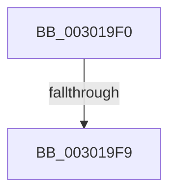

# SepFreeResourceInfo

- RVA: `0x003019F0`–`0x003019FE` (길이 `14` bytes)
- VA: `0x00000001403019F0`
- 실행 섹션: `.text`
- PDB 이름 있음: `예`; PDB Function 태그: `아니요`
- unwind 정보 RVA: `0x00073178`
- 디코드: `4`개 명령, `14/14` bytes 표시
- 미해석 바이트: `0` (있으면 어셈블리에 `.byte`로 보존)

> 이 문서는 커널 이미지의 기계어와 PDB 기호를 분석해 생성했습니다. 4번과 5번은 함수 원형과 자료형을 바이너리 사용 방식에서 추정한 C 해석이며 원본 소스 복구 결과는 아닙니다.

## 1. Dependencies

- 직접 호출 지점: **0**; 고유 호출 대상: **0**
- 직접 호출자로 확인된 함수: **4**
- RIP 상대 이미지 참조: **0**

### Outgoing calls
- 직접 디코드된 call 명령이 없습니다.

### Direct callers
- [SeAccessCheckWithHint](../3A/SeAccessCheckWithHint_function_003A6C30.md) at `0x003A74FB`
- [SeAccessCheckWithHint](../3A/SeAccessCheckWithHint_function_003A6C30.md) at `0x003A76F8`
- [SeAccessCheckByType](../44/SeAccessCheckByType_function_00440BC8.md) at `0x0044276B`
- [SepCommonAccessCheckEx](../47/SepCommonAccessCheckEx_function_0047602C.md) at `0x004769F9`
- [SepCommonAccessCheckEx](../47/SepCommonAccessCheckEx_function_0047602C.md) at `0x004770D3`
- [SepCommonAccessCheckEx](../47/SepCommonAccessCheckEx_function_0047602C.md) at `0x0047730B`
- [SepAccessCheckAndAuditAlarm](../../page/A1/SepAccessCheckAndAuditAlarm_function_00A1AF4C.md) at `0x00A1D815`

### Static image references
- 디코드된 RIP-relative 메모리 참조가 없습니다.

## 2. Other-region calls and transfers

- 다른 실행 섹션으로 향하는 call: **0**
- call이 아닌 외부 분기/꼬리 이동: **1**
  - `0x003019F3` → [sub_003019FE + 0xC8](Unknown_function_003019FE.md) (`tail-transfer`)

## 3. Assembly (complete function range)

```asm
003019F0  48 85 C9                        test rcx, rcx
003019F3  0F 84 CD 00 00 00               je 0x140301ac6
003019F9  56                              push rsi
003019FA  48 83 EC 20                     sub rsp, 0x20
```

## 4. C-style interpretation (structured pseudocode)

```c
void __fastcall SepFreeResourceInfo(__int64 a1)
{
    __int64 v_rsp;

    v_rsp = (v_rsp) - (32);
    return;
}
```

## 5. (Beta) C Style

```c
void SepFreeResourceInfo(int64_t Arg1)
{
    int64_t local_rsp;

    local_rsp = (local_rsp) - (32);
    return;
}
```

## 6. Execution-region graph

[열기: 2D/3D 그래프와 함수 탐색 컨트롤 패널](../../../control-panel.html?section=text&rva=0x003019F0&view=graph)

- 2D 그래프는 위에서 아래로 흐르고, 3D 그래프는 빈 공간을 드래그해 회전합니다. Shift+드래그는 이동, 휠은 확대·축소, 함수 노드 선택은 대상 보고서 이동입니다.

### Static fallback


