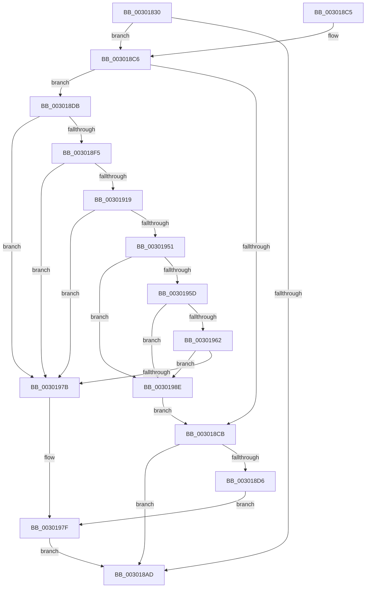

# SepGetAnonymousToken

- RVA: `0x00301830`–`0x003019E2` (길이 `434` bytes)
- VA: `0x0000000140301830`
- 실행 섹션: `.text`
- PDB 이름 있음: `예`; PDB Function 태그: `아니요`
- unwind 정보 RVA: `0x00073160`
- 디코드: `108`개 명령, `434/434` bytes 표시
- 미해석 바이트: `0` (있으면 어셈블리에 `.byte`로 보존)

> 이 문서는 커널 이미지의 기계어와 PDB 기호를 분석해 생성했습니다. 4번과 5번은 함수 원형과 자료형을 바이너리 사용 방식에서 추정한 C 해석이며 원본 소스 복구 결과는 아닙니다.

## 1. Dependencies

- 직접 호출 지점: **7**; 고유 호출 대상: **7**
- 직접 호출자로 확인된 함수: **4**
- RIP 상대 이미지 참조: **1**

### Outgoing calls
- `0x003018A2` → [SepDuplicateToken](../../page/8B/SepDuplicateToken_function_008B87EC.md) (function, `0x008B87EC`)
- `0x003018E6` → [SepSetTokenPackage](../../page/A2/SepSetTokenPackage_function_00A20CB8.md) (function, `0x00A20CB8`)
- `0x0030190E` → [SepSetTokenCapabilities](../../page/9C/SepSetTokenCapabilities_function_009C9AF4.md) (function, `0x009C9AF4`)
- `0x0030192C` → [SepSetTokenSessionById](../../page/A0/SepSetTokenSessionById_function_00A0DAE4.md) (function, `0x00A0DAE4`)
- `0x00301946` → [SepSetTokenLowboxNumber](../../page/A6/SepSetTokenLowboxNumber_function_00A64D6C.md) (function, `0x00A64D6C`)
- `0x00301970` → [AuthzBasepDuplicateSecurityAttributes](AuthzBasepDuplicateSecurityAttributes_function_003023C0.md) (function, `0x003023C0`)
- `0x00301984` → [ObfDereferenceObjectWithTag](../2F/ObfDereferenceObjectWithTag_function_002F78E0.md) (function, `0x002F78E0`)

### Direct callers
- [sub_00891E2F](../../page/89/Unknown_function_00891E2F.md) at `0x00891EFE`
- [sub_0089208C](../../page/89/Unknown_function_0089208C.md) at `0x00892093`
- [NtImpersonateAnonymousToken](../../page/A3/NtImpersonateAnonymousToken_function_00A3A150.md) at `0x00A3A21E`
- [SepCopyAnonymousTokenAndSetSilo](../../page/A3/SepCopyAnonymousTokenAndSetSilo_function_00A3A510.md) at `0x00A3A551`

### Static image references
- `0x00301867` → RVA `0x00FD9D80` (`PAGEDATA`; read)

## 2. Other-region calls and transfers

- 다른 실행 섹션으로 향하는 call: **5**
  - `0x003018A2` → [SepDuplicateToken](../../page/8B/SepDuplicateToken_function_008B87EC.md) (`.text` → `PAGE`)
  - `0x003018E6` → [SepSetTokenPackage](../../page/A2/SepSetTokenPackage_function_00A20CB8.md) (`.text` → `PAGE`)
  - `0x0030190E` → [SepSetTokenCapabilities](../../page/9C/SepSetTokenCapabilities_function_009C9AF4.md) (`.text` → `PAGE`)
  - `0x0030192C` → [SepSetTokenSessionById](../../page/A0/SepSetTokenSessionById_function_00A0DAE4.md) (`.text` → `PAGE`)
  - `0x00301946` → [SepSetTokenLowboxNumber](../../page/A6/SepSetTokenLowboxNumber_function_00A64D6C.md) (`.text` → `PAGE`)
- 별도 외부 분기/꼬리 이동을 확인하지 못했습니다.

## 3. Assembly (complete function range)

```asm
00301830  4C 8B DC                        mov r11, rsp
00301833  49 89 5B 08                     mov qword ptr [r11 + 8], rbx
00301837  49 89 73 10                     mov qword ptr [r11 + 0x10], rsi
0030183B  49 89 7B 20                     mov qword ptr [r11 + 0x20], rdi
0030183F  55                              push rbp
00301840  48 8B EC                        mov rbp, rsp
00301843  48 83 EC 70                     sub rsp, 0x70
00301847  48 83 65 20 00                  and qword ptr [rbp + 0x20], 0
0030184C  48 8D 45 20                     lea rax, [rbp + 0x20]
00301850  83 65 EC 00                     and dword ptr [rbp - 0x14], 0
00301854  48 8B F2                        mov rsi, rdx
00301857  48 83 65 D8 00                  and qword ptr [rbp - 0x28], 0
0030185C  48 8D 55 D0                     lea rdx, [rbp - 0x30]
00301860  83 65 E8 00                     and dword ptr [rbp - 0x18], 0
00301864  48 8B F9                        mov rdi, rcx
00301867  48 8B 0D 12 85 CD 00            mov rcx, qword ptr [rip + 0xcd8512]
0030186E  0F 57 C0                        xorps xmm0, xmm0
00301871  48 83 65 E0 00                  and qword ptr [rbp - 0x20], 0
00301876  41 B9 02 00 00 00               mov r9d, 2
0030187C  49 89 43 C0                     mov qword ptr [r11 - 0x40], rax
00301880  41 B0 01                        mov r8b, 1
00301883  C6 44 24 30 01                  mov byte ptr [rsp + 0x30], 1
00301888  48 C7 45 D0 30 00 00 00         mov qword ptr [rbp - 0x30], 0x30
00301890  83 65 D4 00                     and dword ptr [rbp - 0x2c], 0
00301894  C6 44 24 28 00                  mov byte ptr [rsp + 0x28], 0
00301899  45 89 4B A8                     mov dword ptr [r11 - 0x58], r9d
0030189D  F3 0F 7F 45 F0                  movdqu xmmword ptr [rbp - 0x10], xmm0
003018A2  E8 45 6F 5B 00                  call 0x1408b87ec
003018A7  8B D8                           mov ebx, eax
003018A9  85 C0                           test eax, eax
003018AB  79 19                           jns 0x1403018c6
003018AD  4C 8D 5C 24 70                  lea r11, [rsp + 0x70]
003018B2  8B C3                           mov eax, ebx
003018B4  49 8B 5B 10                     mov rbx, qword ptr [r11 + 0x10]
003018B8  49 8B 73 18                     mov rsi, qword ptr [r11 + 0x18]
003018BC  49 8B 7B 28                     mov rdi, qword ptr [r11 + 0x28]
003018C0  49 8B E3                        mov rsp, r11
003018C3  5D                              pop rbp
003018C4  C3                              ret
003018C5  CC                              int3
003018C6  48 85 FF                        test rdi, rdi
003018C9  75 10                           jne 0x1403018db
003018CB  48 8B 4D 20                     mov rcx, qword ptr [rbp + 0x20]
003018CF  48 89 0E                        mov qword ptr [rsi], rcx
003018D2  85 DB                           test ebx, ebx
003018D4  79 D7                           jns 0x1403018ad
003018D6  E9 A4 00 00 00                  jmp 0x14030197f
003018DB  48 8B 97 10 03 00 00            mov rdx, qword ptr [rdi + 0x310]
003018E2  48 8B 4D 20                     mov rcx, qword ptr [rbp + 0x20]
003018E6  E8 CD F3 71 00                  call 0x140a20cb8
003018EB  8B D8                           mov ebx, eax
003018ED  85 C0                           test eax, eax
003018EF  0F 88 86 00 00 00               js 0x14030197b
003018F5  44 8B 8F 20 03 00 00            mov r9d, dword ptr [rdi + 0x320]
003018FC  4C 8B 87 18 03 00 00            mov r8, qword ptr [rdi + 0x318]
00301903  48 8B 97 10 03 00 00            mov rdx, qword ptr [rdi + 0x310]
0030190A  48 8B 4D 20                     mov rcx, qword ptr [rbp + 0x20]
0030190E  E8 E1 81 6C 00                  call 0x1409c9af4
00301913  8B D8                           mov ebx, eax
00301915  85 C0                           test eax, eax
00301917  78 62                           js 0x14030197b
00301919  8B 57 78                        mov edx, dword ptr [rdi + 0x78]
0030191C  45 33 C9                        xor r9d, r9d
0030191F  48 8B 4D 20                     mov rcx, qword ptr [rbp + 0x20]
00301923  45 33 C0                        xor r8d, r8d
00301926  48 83 64 24 20 00               and qword ptr [rsp + 0x20], 0
0030192C  E8 B3 C1 70 00                  call 0x140a0dae4
00301931  8B 4F 78                        mov ecx, dword ptr [rdi + 0x78]
00301934  48 8B 45 20                     mov rax, qword ptr [rbp + 0x20]
00301938  89 48 78                        mov dword ptr [rax + 0x78], ecx
0030193B  48 8B 97 10 03 00 00            mov rdx, qword ptr [rdi + 0x310]
00301942  48 8B 4D 20                     mov rcx, qword ptr [rbp + 0x20]
00301946  E8 21 34 76 00                  call 0x140a64d6c
0030194B  8B D8                           mov ebx, eax
0030194D  85 C0                           test eax, eax
0030194F  78 2A                           js 0x14030197b
00301951  48 8B 8F 08 03 00 00            mov rcx, qword ptr [rdi + 0x308]
00301958  48 85 C9                        test rcx, rcx
0030195B  74 31                           je 0x14030198e
0030195D  83 39 00                        cmp dword ptr [rcx], 0
00301960  74 2C                           je 0x14030198e
00301962  48 8B 55 20                     mov rdx, qword ptr [rbp + 0x20]
00301966  45 33 C0                        xor r8d, r8d
00301969  48 8B 92 08 03 00 00            mov rdx, qword ptr [rdx + 0x308]
00301970  E8 4B 0A 00 00                  call 0x1403023c0
00301975  8B D8                           mov ebx, eax
00301977  85 C0                           test eax, eax
00301979  79 13                           jns 0x14030198e
0030197B  48 8B 4D 20                     mov rcx, qword ptr [rbp + 0x20]
0030197F  BA 44 66 6C 74                  mov edx, 0x746c6644
00301984  E8 57 5F FF FF                  call 0x1402f78e0
00301989  E9 1F FF FF FF                  jmp 0x1403018ad
0030198E  48 8B 45 20                     mov rax, qword ptr [rbp + 0x20]
00301992  48 B9 00 00 80 00 02 00 00 00   movabs rcx, 0x200800000
0030199C  48 21 48 48                     and qword ptr [rax + 0x48], rcx
003019A0  48 8B 45 20                     mov rax, qword ptr [rbp + 0x20]
003019A4  48 21 48 50                     and qword ptr [rax + 0x50], rcx
003019A8  48 8B 45 20                     mov rax, qword ptr [rbp + 0x20]
003019AC  48 21 48 40                     and qword ptr [rax + 0x40], rcx
003019B0  48 8B 45 20                     mov rax, qword ptr [rbp + 0x20]
003019B4  0F BA B0 C8 00 00 00 0D         btr dword ptr [rax + 0xc8], 0xd
003019BC  48 8B 45 20                     mov rax, qword ptr [rbp + 0x20]
003019C0  0F BA A8 C8 00 00 00 0E         bts dword ptr [rax + 0xc8], 0xe
003019C8  8B 87 C8 00 00 00               mov eax, dword ptr [rdi + 0xc8]
003019CE  48 8B 4D 20                     mov rcx, qword ptr [rbp + 0x20]
003019D2  25 00 00 38 00                  and eax, 0x380000
003019D7  09 81 C8 00 00 00               or dword ptr [rcx + 0xc8], eax
003019DD  E9 E9 FE FF FF                  jmp 0x1403018cb
```

## 4. C-style interpretation (structured pseudocode)

```c
__int64 __fastcall SepGetAnonymousToken(__int64 a1, __int64 a2)
{
    __int64 result;
    __int64 v_rsp;
    unsigned __int64 v_stack_m18;
    unsigned int v_stack_m1C;
    unsigned int v_stack_m20;
    unsigned __int64 v_stack_m28;
    unsigned __int64 v_stack_m30;
    unsigned int v_stack_m34;
    unsigned __int64 v_stack_m38;
    unsigned __int8 v_stack_m48;
    unsigned __int8 v_stack_m50;
    unsigned __int64 v_stack_m8;
    unsigned __int64 v_stack_p18;

    *(unsigned __int64 *)(v_rsp + 8) = v_rbx;
    *(unsigned __int64 *)(v_rsp + 16) = v_rsi;
    *(unsigned __int64 *)(v_rsp + 32) = v_rdi;
    v_rsp = (v_rsp) - (112);
    *(unsigned __int64 *)(v_rsp - 64) = v_stack_p18;
    v_stack_m48 = 1;
    v_stack_m38 = 48;
    v_stack_m50 = 0;
    *(unsigned int *)(v_rsp - 88) = 2;
    v_stack_m18 = v_xmm0;
    result = SepDuplicateToken(*(unsigned __int64 *)(v_rip + 13468946), v_stack_m38, 1, 2);
    if (!sign_flag) goto loc_003018C6;
loc_003018AD:
    return (unsigned int)((unsigned int)((unsigned int)((unsigned int)(result))));
loc_003018C6:
    if (*(unsigned __int64 *)(v_stack_m8 + 40) != 0) goto loc_003018DB;
loc_003018CB:
    *(unsigned __int64 *)(*(unsigned __int64 *)(v_stack_m8 + 24)) = v_stack_p18;
    if (!sign_flag) goto loc_003018AD;
    goto loc_0030197F;
loc_003018DB:
    result = SepSetTokenPackage(v_stack_p18, *(unsigned __int64 *)(*(unsigned __int64 *)(v_stack_m8 + 40) + 784), 1, 2);
    if (sign_flag) goto loc_0030197B;
    result = SepSetTokenCapabilities(v_stack_p18, *(unsigned __int64 *)(*(unsigned __int64 *)(v_stack_m8 + 40) + 784), *(unsigned __int64 *)(*(unsigned __int64 *)(v_stack_m8 + 40) + 792), (unsigned int)(*(unsigned int *)(*(unsigned __int64 *)(v_stack_m8 + 40) + 800)));
    if (sign_flag) goto loc_0030197B;
    a4 = 0;
    a3 = 0;
    result = SepSetTokenSessionById(v_stack_p18, (unsigned int)(*(unsigned int *)(*(unsigned __int64 *)(v_stack_m8 + 40) + 120)), a3, a4);
    *(unsigned int *)(v_stack_p18 + 120) = (unsigned int)((unsigned int)(*(unsigned int *)(*(unsigned __int64 *)(v_stack_m8 + 40) + 120)));
    result = SepSetTokenLowboxNumber(v_stack_p18, *(unsigned __int64 *)(*(unsigned __int64 *)(v_stack_m8 + 40) + 784), a3, a4);
    if (sign_flag) goto loc_0030197B;
    if (*(unsigned __int64 *)(*(unsigned __int64 *)(v_stack_m8 + 40) + 776) == 0) goto loc_0030198E;
    if ((*(unsigned int *)(*(unsigned __int64 *)(*(unsigned __int64 *)(v_stack_m8 + 40) + 776))) == 0) goto loc_0030198E;
    a3 = 0;
    result = AuthzBasepDuplicateSecurityAttributes(*(unsigned __int64 *)(*(unsigned __int64 *)(v_stack_m8 + 40) + 776), *(unsigned __int64 *)(v_stack_p18 + 776), a3, a4);
    if (!sign_flag) goto loc_0030198E;
loc_0030197B:
loc_0030197F:
    result = ObfDereferenceObjectWithTag(v_stack_p18, (unsigned int)(0x746C6644ULL), a3, a4);
    goto loc_003018AD;
loc_0030198E:
    result = (unsigned int)(((unsigned int)(*(unsigned int *)(*(unsigned __int64 *)(v_stack_m8 + 40) + 200))) & (0x380000ULL));
    goto loc_003018CB;
}
```

## 5. (Beta) C Style

```c
int64_t SepGetAnonymousToken(int64_t Arg1, void *Arg2)
{
    uint8_t *arg2 = (uint8_t *)Arg2;

    int64_t result;
    int64_t local_rsp;
    uint64_t v_stack_m18;
    uint32_t v_stack_m1C;
    uint32_t v_stack_m20;
    uint64_t v_stack_m28;
    uint64_t v_stack_m30;
    uint32_t v_stack_m34;
    uint64_t v_stack_m38;
    uint8_t v_stack_m48;
    uint8_t v_stack_m50;
    uint64_t v_stack_m8;
    uint64_t v_stack_p18;

    *(uint64_t *)(local_rsp + 0x8) = local_rbx;
    *(uint64_t *)(local_rsp + 0x10) = local_rsi;
    *(uint64_t *)(local_rsp + 0x20) = local_rdi;
    local_rsp = (local_rsp) - (112);
    *(uint64_t *)(local_rsp - 0x40) = v_stack_p18;
    v_stack_m48 = 1;
    v_stack_m38 = 48;
    v_stack_m50 = 0;
    *(uint32_t *)(local_rsp - 0x58) = 2;
    v_stack_m18 = v_xmm0;
    result = SepDuplicateToken(*(uint64_t *)(v_rip + 0xCD8512), v_stack_m38, 1, 2);
    if (!sign_flag) goto loc_003018C6;
loc_003018AD:
    return (uint32_t)((uint32_t)((uint32_t)((uint32_t)(result))));
loc_003018C6:
    if (*(uint64_t *)(v_stack_m8 + 0x28) != 0) goto loc_003018DB;
loc_003018CB:
    *(uint64_t *)(*(uint64_t *)(v_stack_m8 + 0x18)) = v_stack_p18;
    if (!sign_flag) goto loc_003018AD;
    goto loc_0030197F;
loc_003018DB:
    result = SepSetTokenPackage(v_stack_p18, *(uint64_t *)(*(uint64_t *)(v_stack_m8 + 0x28) + 0x310), 1, 2);
    if (sign_flag) goto loc_0030197B;
    result = SepSetTokenCapabilities(v_stack_p18, *(uint64_t *)(*(uint64_t *)(v_stack_m8 + 0x28) + 0x310), *(uint64_t *)(*(uint64_t *)(v_stack_m8 + 0x28) + 0x318), (uint32_t)(*(uint32_t *)(*(uint64_t *)(v_stack_m8 + 0x28) + 0x320)));
    if (sign_flag) goto loc_0030197B;
    a4 = 0;
    a3 = 0;
    result = SepSetTokenSessionById(v_stack_p18, (uint32_t)(*(uint32_t *)(*(uint64_t *)(v_stack_m8 + 0x28) + 0x78)), a3, a4);
    *(uint32_t *)(v_stack_p18 + 0x78) = (uint32_t)((uint32_t)(*(uint32_t *)(*(uint64_t *)(v_stack_m8 + 0x28) + 0x78)));
    result = SepSetTokenLowboxNumber(v_stack_p18, *(uint64_t *)(*(uint64_t *)(v_stack_m8 + 0x28) + 0x310), a3, a4);
    if (sign_flag) goto loc_0030197B;
    if (*(uint64_t *)(*(uint64_t *)(v_stack_m8 + 0x28) + 0x308) == 0) goto loc_0030198E;
    if ((*(uint32_t *)(*(uint64_t *)(*(uint64_t *)(v_stack_m8 + 0x28) + 0x308))) == 0) goto loc_0030198E;
    a3 = 0;
    result = AuthzBasepDuplicateSecurityAttributes(*(uint64_t *)(*(uint64_t *)(v_stack_m8 + 0x28) + 0x308), *(uint64_t *)(v_stack_p18 + 0x308), a3, a4);
    if (!sign_flag) goto loc_0030198E;
loc_0030197B:
loc_0030197F:
    result = ObfDereferenceObjectWithTag(v_stack_p18, (uint32_t)(0x746C6644ULL), a3, a4);
    goto loc_003018AD;
loc_0030198E:
    result = (uint32_t)(((uint32_t)(*(uint32_t *)(*(uint64_t *)(v_stack_m8 + 0x28) + 0xC8))) & (0x380000ULL));
    goto loc_003018CB;
}
```

### 관측된 메모리 오프셋

구조체 형식이 확인되지 않은 접근은 인자 기준의 오프셋으로만 기록했습니다.

| 기준 인자 | 오프셋 표현 | 폭 (bit) | 접근 |
|---|---:|---:|---|
| `Arg2` | `+ 0x0` | `64` | `W` |

## 6. Execution-region graph

[열기: 2D/3D 그래프와 함수 탐색 컨트롤 패널](../../../control-panel.html?section=text&rva=0x00301830&view=graph)

- 2D 그래프는 위에서 아래로 흐르고, 3D 그래프는 빈 공간을 드래그해 회전합니다. Shift+드래그는 이동, 휠은 확대·축소, 함수 노드 선택은 대상 보고서 이동입니다.

### Static fallback


