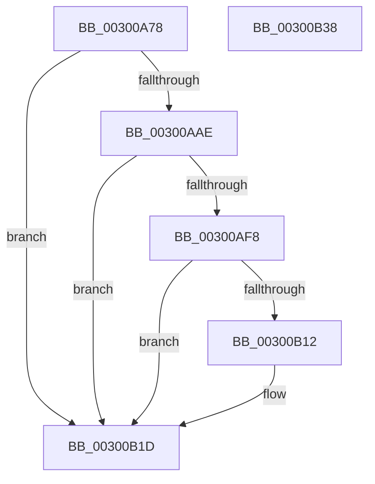

# SepGetProcUniqueLuidAndIndexFromAttributeInfo

- RVA: `0x00300A78`–`0x00300B39` (길이 `193` bytes)
- VA: `0x0000000140300A78`
- 실행 섹션: `.text`
- PDB 이름 있음: `예`; PDB Function 태그: `아니요`
- unwind 정보 RVA: `0x000730A8`
- 디코드: `52`개 명령, `193/193` bytes 표시
- 미해석 바이트: `0` (있으면 어셈블리에 `.byte`로 보존)

> 이 문서는 커널 이미지의 기계어와 PDB 기호를 분석해 생성했습니다. 4번과 5번은 함수 원형과 자료형을 바이너리 사용 방식에서 추정한 C 해석이며 원본 소스 복구 결과는 아닙니다.

## 1. Dependencies

- 직접 호출 지점: **4**; 고유 호출 대상: **3**
- 직접 호출자로 확인된 함수: **4**
- RIP 상대 이미지 참조: **5**

### Outgoing calls
- `0x00300AB9` → [memset](../6C/memset_function_006C6C40.md) (function, `0x006C6C40`)
- `0x00300AEC` → [AuthzBasepQuerySecurityAttributeAndValues](AuthzBasepQuerySecurityAttributeAndValues_function_00300090.md) (function, `0x00300090`)
- `0x00300B06` → [AuthzBasepQuerySecurityAttributeAndValues](AuthzBasepQuerySecurityAttributeAndValues_function_00300090.md) (function, `0x00300090`)
- `0x00300B28` → [_security_check_cookie](../6A/_security_check_cookie_function_006AC640.md) (function, `0x006AC640`)

### Direct callers
- [SepGetProcUniqueLuidAndIndexFromTokenEx](SepGetProcUniqueLuidAndIndexFromTokenEx_function_00300B40.md) at `0x00300BB0`
- [sub_003A7AB1](../3A/Unknown_function_003A7AB1.md) at `0x003A7AFD`
- [sub_003A7D4D](../3A/Unknown_function_003A7D4D.md) at `0x003A7D64`
- [SepValidateAndCopyGlobalEntry](../4F/SepValidateAndCopyGlobalEntry_function_004F825C.md) at `0x004F8287`

### Static image references
- `0x00300A83` → RVA `0x00E0A740` (`.data`; read)
- `0x00300A92` → RVA `0x00E67E20` (`.data`; read)
- `0x00300ABE` → RVA `0x00E08950` (`.data`; read)
- `0x00300ACF` → RVA `0x00E08952` (`.data`; read)
- `0x00300ADB` → RVA `0x00E08958` (`.data`; read)

## 2. Other-region calls and transfers

- 다른 실행 섹션으로 향하는 call: **0**
- 별도 외부 분기/꼬리 이동을 확인하지 못했습니다.

## 3. Assembly (complete function range)

```asm
00300A78  40 53                           push rbx
00300A7A  56                              push rsi
00300A7B  57                              push rdi
00300A7C  48 81 EC 80 00 00 00            sub rsp, 0x80
00300A83  48 8B 05 B6 9C B0 00            mov rax, qword ptr [rip + 0xb09cb6]
00300A8A  48 33 C4                        xor rax, rsp
00300A8D  48 89 44 24 70                  mov qword ptr [rsp + 0x70], rax
00300A92  8B 05 88 73 B6 00               mov eax, dword ptr [rip + 0xb67388]
00300A98  49 8B D8                        mov rbx, r8
00300A9B  83 E0 03                        and eax, 3
00300A9E  48 8B FA                        mov rdi, rdx
00300AA1  48 8B F1                        mov rsi, rcx
00300AA4  41 B9 25 02 00 C0               mov r9d, 0xc0000225
00300AAA  3C 03                           cmp al, 3
00300AAC  75 6F                           jne 0x140300b1d
00300AAE  33 D2                           xor edx, edx
00300AB0  48 8D 4C 24 20                  lea rcx, [rsp + 0x20]
00300AB5  44 8D 42 48                     lea r8d, [rdx + 0x48]
00300AB9  E8 82 61 3C 00                  call 0x1406c6c40
00300ABE  0F B7 05 8B 7E B0 00            movzx eax, word ptr [rip + 0xb07e8b]
00300AC5  48 8D 4C 24 20                  lea rcx, [rsp + 0x20]
00300ACA  66 89 44 24 30                  mov word ptr [rsp + 0x30], ax
00300ACF  0F B7 05 7C 7E B0 00            movzx eax, word ptr [rip + 0xb07e7c]
00300AD6  66 89 44 24 32                  mov word ptr [rsp + 0x32], ax
00300ADB  48 8B 05 76 7E B0 00            mov rax, qword ptr [rip + 0xb07e76]
00300AE2  48 89 44 24 38                  mov qword ptr [rsp + 0x38], rax
00300AE7  48 89 74 24 28                  mov qword ptr [rsp + 0x28], rsi
00300AEC  E8 9F F5 FF FF                  call 0x140300090
00300AF1  44 8B C8                        mov r9d, eax
00300AF4  85 C0                           test eax, eax
00300AF6  78 25                           js 0x140300b1d
00300AF8  48 8B 44 24 50                  mov rax, qword ptr [rsp + 0x50]
00300AFD  8B 08                           mov ecx, dword ptr [rax]
00300AFF  89 0F                           mov dword ptr [rdi], ecx
00300B01  48 8D 4C 24 20                  lea rcx, [rsp + 0x20]
00300B06  E8 85 F5 FF FF                  call 0x140300090
00300B0B  44 8B C8                        mov r9d, eax
00300B0E  85 C0                           test eax, eax
00300B10  78 0B                           js 0x140300b1d
00300B12  48 8B 44 24 50                  mov rax, qword ptr [rsp + 0x50]
00300B17  48 8B 08                        mov rcx, qword ptr [rax]
00300B1A  48 89 0B                        mov qword ptr [rbx], rcx
00300B1D  41 8B C1                        mov eax, r9d
00300B20  48 8B 4C 24 70                  mov rcx, qword ptr [rsp + 0x70]
00300B25  48 33 CC                        xor rcx, rsp
00300B28  E8 13 BB 3A 00                  call 0x1406ac640
00300B2D  48 81 C4 80 00 00 00            add rsp, 0x80
00300B34  5F                              pop rdi
00300B35  5E                              pop rsi
00300B36  5B                              pop rbx
00300B37  C3                              ret
00300B38  CC                              int3
```

## 4. C-style interpretation (structured pseudocode)

```c
__int64 __fastcall SepGetProcUniqueLuidAndIndexFromAttributeInfo(__int64 a1, __int64 a2, __int64 a3)
{
    __int64 result;
    __int64 v_rsp;
    unsigned __int64 v_stack_m28;
    unsigned __int64 v_stack_m48;
    unsigned __int64 v_stack_m60;
    unsigned __int16 v_stack_m66;
    unsigned __int16 v_stack_m68;
    unsigned __int64 v_stack_m70;
    unsigned __int64 v_stack_m78;

    v_rsp = (v_rsp) - (128);
    result = (*(unsigned __int64 *)(v_rip + 11574454)) ^ (v_rsp);
    v_stack_m28 = result;
    result = (unsigned int)(((unsigned int)(*(unsigned int *)(v_rip + 11957128))) & (3));
    if (((unsigned __int8)(result)) != 3) goto loc_00300B1D;
    a2 = 0;
    result = memset(v_stack_m78, a2, a2 + 72, (unsigned int)(0xC0000225ULL));
    v_stack_m68 = (unsigned __int16)(*(unsigned __int16 *)(v_rip + 11566731));
    v_stack_m66 = (unsigned __int16)(*(unsigned __int16 *)(v_rip + 11566716));
    v_stack_m60 = *(unsigned __int64 *)(v_rip + 11566710);
    v_stack_m70 = a1;
    result = AuthzBasepQuerySecurityAttributeAndValues(v_stack_m78, a2, a2 + 72, (unsigned int)(0xC0000225ULL));
    if (sign_flag) goto loc_00300B1D;
    *(unsigned int *)(a2) = (unsigned int)((unsigned int)(*(unsigned int *)(v_stack_m48)));
    result = AuthzBasepQuerySecurityAttributeAndValues(v_stack_m78, a2, a2 + 72, (unsigned int)((unsigned int)(result)));
    if (!(sign_flag)) {
        result = v_stack_m48;
        a1 = *(unsigned __int64 *)(result);
        *(unsigned __int64 *)(a3) = a1;
    }
    a1 = (v_stack_m28) ^ (v_rsp);
    result = _security_check_cookie(a1, a2, a2 + 72, (unsigned int)((unsigned int)(result)));
    v_rsp = (v_rsp) + (128);
    return result;
}
```

## 5. (Beta) C Style

```c
int64_t SepGetProcUniqueLuidAndIndexFromAttributeInfo(int64_t Arg1, void *Arg2, void *Arg3)
{
    uint8_t *arg2 = (uint8_t *)Arg2;
    uint8_t *arg3 = (uint8_t *)Arg3;

    int64_t result;
    int64_t local_rsp;
    uint64_t v_stack_m28;
    uint64_t v_stack_m48;
    uint64_t v_stack_m60;
    uint16_t v_stack_m66;
    uint16_t v_stack_m68;
    uint64_t v_stack_m70;
    uint64_t v_stack_m78;

    local_rsp = (local_rsp) - (128);
    result = (*(uint64_t *)(v_rip + 0xB09CB6)) ^ (local_rsp);
    v_stack_m28 = result;
    result = (uint32_t)(((uint32_t)(*(uint32_t *)(v_rip + 0xB67388))) & (3));
    if (((uint8_t)(result)) != 3) goto loc_00300B1D;
    Arg2 = 0;
    result = memset(v_stack_m78, Arg2, Arg2 + 72, (uint32_t)(0xC0000225ULL));
    v_stack_m68 = (uint16_t)(*(uint16_t *)(v_rip + 0xB07E8B));
    v_stack_m66 = (uint16_t)(*(uint16_t *)(v_rip + 0xB07E7C));
    v_stack_m60 = *(uint64_t *)(v_rip + 0xB07E76);
    v_stack_m70 = Arg1;
    result = AuthzBasepQuerySecurityAttributeAndValues(v_stack_m78, Arg2, Arg2 + 72, (uint32_t)(0xC0000225ULL));
    if (sign_flag) goto loc_00300B1D;
    *(uint32_t *)(arg2) = (uint32_t)((uint32_t)(*(uint32_t *)(v_stack_m48)));
    result = AuthzBasepQuerySecurityAttributeAndValues(v_stack_m78, Arg2, Arg2 + 72, (uint32_t)((uint32_t)(result)));
    if (!(sign_flag)) {
        result = v_stack_m48;
        Arg1 = *(uint64_t *)(result);
        *(uint64_t *)(arg3) = Arg1;
    }
    Arg1 = (v_stack_m28) ^ (local_rsp);
    result = _security_check_cookie(Arg1, Arg2, Arg2 + 72, (uint32_t)((uint32_t)(result)));
    local_rsp = (local_rsp) + (128);
    return result;
}
```

### 관측된 메모리 오프셋

구조체 형식이 확인되지 않은 접근은 인자 기준의 오프셋으로만 기록했습니다.

| 기준 인자 | 오프셋 표현 | 폭 (bit) | 접근 |
|---|---:|---:|---|
| `Arg2` | `+ 0x0` | `32` | `W` |
| `Arg3` | `+ 0x0` | `64` | `W` |

## 6. Execution-region graph

[열기: 2D/3D 그래프와 함수 탐색 컨트롤 패널](../../../control-panel.html?section=text&rva=0x00300A78&view=graph)

- 2D 그래프는 위에서 아래로 흐르고, 3D 그래프는 빈 공간을 드래그해 회전합니다. Shift+드래그는 이동, 휠은 확대·축소, 함수 노드 선택은 대상 보고서 이동입니다.

### Static fallback


