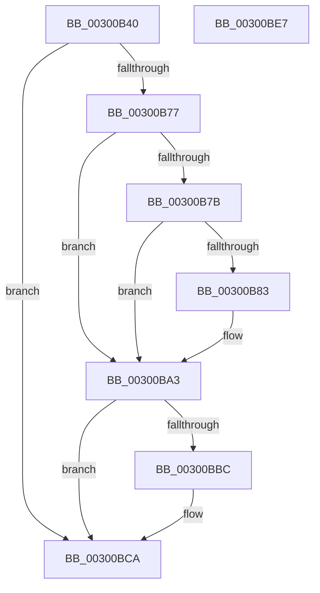

# SepGetProcUniqueLuidAndIndexFromTokenEx

- RVA: `0x00300B40`–`0x00300BE8` (길이 `168` bytes)
- VA: `0x0000000140300B40`
- 실행 섹션: `.text`
- PDB 이름 있음: `예`; PDB Function 태그: `아니요`
- unwind 정보 RVA: `0x0005E6B4`
- 디코드: `47`개 명령, `168/168` bytes 표시
- 미해석 바이트: `0` (있으면 어셈블리에 `.byte`로 보존)

> 이 문서는 커널 이미지의 기계어와 PDB 기호를 분석해 생성했습니다. 4번과 5번은 함수 원형과 자료형을 바이너리 사용 방식에서 추정한 C 해석이며 원본 소스 복구 결과는 아닙니다.

## 1. Dependencies

- 직접 호출 지점: **4**; 고유 호출 대상: **4**
- 직접 호출자로 확인된 함수: **1**
- RIP 상대 이미지 참조: **1**

### Outgoing calls
- `0x00300B9E` → [ExAcquireResourceSharedLite](../21/ExAcquireResourceSharedLite_function_00211BC0.md) (function, `0x00211BC0`)
- `0x00300BB0` → [SepGetProcUniqueLuidAndIndexFromAttributeInfo](SepGetProcUniqueLuidAndIndexFromAttributeInfo_function_00300A78.md) (function, `0x00300A78`)
- `0x00300BC0` → [ExReleaseResourceLite](../25/ExReleaseResourceLite_function_0025FA10.md) (function, `0x0025FA10`)
- `0x00300BC5` → [KeLeaveCriticalRegion](../25/KeLeaveCriticalRegion_function_0025D8B0.md) (function, `0x0025D8B0`)

### Direct callers
- [SeSetSecurityAttributesTokenEx](../60/SeSetSecurityAttributesTokenEx_function_00609C00.md) at `0x00609CBE`

### Static image references
- `0x00300B59` → RVA `0x00E67E20` (`.data`; read)

## 2. Other-region calls and transfers

- 다른 실행 섹션으로 향하는 call: **0**
- 별도 외부 분기/꼬리 이동을 확인하지 못했습니다.

## 3. Assembly (complete function range)

```asm
00300B40  48 8B C4                        mov rax, rsp
00300B43  48 89 58 08                     mov qword ptr [rax + 8], rbx
00300B47  48 89 68 10                     mov qword ptr [rax + 0x10], rbp
00300B4B  48 89 70 18                     mov qword ptr [rax + 0x18], rsi
00300B4F  48 89 78 20                     mov qword ptr [rax + 0x20], rdi
00300B53  41 56                           push r14
00300B55  48 83 EC 20                     sub rsp, 0x20
00300B59  8B 05 C1 72 B6 00               mov eax, dword ptr [rip + 0xb672c1]
00300B5F  40 32 F6                        xor sil, sil
00300B62  83 E0 03                        and eax, 3
00300B65  49 8B E9                        mov rbp, r9
00300B68  4D 8B F0                        mov r14, r8
00300B6B  48 8B DA                        mov rbx, rdx
00300B6E  BF 25 02 00 C0                  mov edi, 0xc0000225
00300B73  3C 03                           cmp al, 3
00300B75  75 53                           jne 0x140300bca
00300B77  84 C9                           test cl, cl
00300B79  75 28                           jne 0x140300ba3
00300B7B  44 0F 20 C0                     mov rax, cr8
00300B7F  3C 02                           cmp al, 2
00300B81  73 20                           jae 0x140300ba3
00300B83  65 48 8B 04 25 88 01 00 00      mov rax, qword ptr gs:[0x188]
00300B8C  40 B6 01                        mov sil, 1
00300B8F  40 8A D6                        mov dl, sil
00300B92  66 FF 88 E4 01 00 00            dec word ptr [rax + 0x1e4]
00300B99  90                              nop
00300B9A  48 8B 4B 30                     mov rcx, qword ptr [rbx + 0x30]
00300B9E  E8 1D 10 F1 FF                  call 0x140211bc0
00300BA3  48 8B 8B 08 03 00 00            mov rcx, qword ptr [rbx + 0x308]
00300BAA  4C 8B C5                        mov r8, rbp
00300BAD  49 8B D6                        mov rdx, r14
00300BB0  E8 C3 FE FF FF                  call 0x140300a78
00300BB5  8B F8                           mov edi, eax
00300BB7  40 84 F6                        test sil, sil
00300BBA  74 0E                           je 0x140300bca
00300BBC  48 8B 4B 30                     mov rcx, qword ptr [rbx + 0x30]
00300BC0  E8 4B EE F5 FF                  call 0x14025fa10
00300BC5  E8 E6 CC F5 FF                  call 0x14025d8b0
00300BCA  48 8B 5C 24 30                  mov rbx, qword ptr [rsp + 0x30]
00300BCF  8B C7                           mov eax, edi
00300BD1  48 8B 7C 24 48                  mov rdi, qword ptr [rsp + 0x48]
00300BD6  48 8B 6C 24 38                  mov rbp, qword ptr [rsp + 0x38]
00300BDB  48 8B 74 24 40                  mov rsi, qword ptr [rsp + 0x40]
00300BE0  48 83 C4 20                     add rsp, 0x20
00300BE4  41 5E                           pop r14
00300BE6  C3                              ret
00300BE7  CC                              int3
```

## 4. C-style interpretation (structured pseudocode)

```c
__int64 __fastcall SepGetProcUniqueLuidAndIndexFromTokenEx(unsigned __int8 a1, __int64 a2, __int64 a3, __int64 a4)
{
    __int64 result;
    __int64 v_rsi;
    __int64 v_rsp;
    unsigned __int64 v_stack_p10;
    unsigned __int64 v_stack_p18;
    unsigned __int64 v_stack_p20;
    unsigned __int64 v_stack_p8;

    *(unsigned __int64 *)(v_rsp + 8) = v_rbx;
    *(unsigned __int64 *)(v_rsp + 16) = v_rbp;
    *(unsigned __int64 *)(v_rsp + 24) = v_rsi;
    *(unsigned __int64 *)(v_rsp + 32) = v_rdi;
    v_rsp = (v_rsp) - (32);
    v_rsi = 0;
    result = (unsigned int)(((unsigned int)(*(unsigned int *)(v_rip + 11956929))) & (3));
    if (((unsigned __int8)(result)) != 3) goto loc_00300BCA;
    if (a1 != 0) goto loc_00300BA3;
    result = v_cr8;
    if (((unsigned __int8)(v_cr8)) < 2) {
        result = *(unsigned __int64 *)(gs_base + (0 + 392));
        v_rsi = 1;
        a2 = (unsigned __int8)(v_rsi);
        a1 = *(unsigned __int64 *)(a2 + 48);
        result = ExAcquireResourceSharedLite(a1, a2, a3, a4);
    }
    result = SepGetProcUniqueLuidAndIndexFromAttributeInfo(*(unsigned __int64 *)(a2 + 776), a3, a4, a4);
    if ((unsigned __int8)(v_rsi) != 0) {
        a1 = *(unsigned __int64 *)(a2 + 48);
        result = ExReleaseResourceLite(a1, a3, a4, a4);
        result = KeLeaveCriticalRegion(a1, a3, a4, a4);
    }
    v_rsp = (v_rsp) + (32);
    return (unsigned int)((unsigned int)((unsigned int)((unsigned int)(result))));
}
```

## 5. (Beta) C Style

```c
int64_t SepGetProcUniqueLuidAndIndexFromTokenEx(uint8_t Arg1, void *Arg2, int64_t Arg3, int64_t Arg4)
{
    uint8_t *arg2 = (uint8_t *)Arg2;

    int64_t result;
    int64_t local_rsi;
    int64_t local_rsp;
    uint64_t v_stack_p10;
    uint64_t v_stack_p18;
    uint64_t v_stack_p20;
    uint64_t v_stack_p8;

    *(uint64_t *)(local_rsp + 0x8) = local_rbx;
    *(uint64_t *)(local_rsp + 0x10) = local_rbp;
    *(uint64_t *)(local_rsp + 0x18) = local_rsi;
    *(uint64_t *)(local_rsp + 0x20) = local_rdi;
    local_rsp = (local_rsp) - (32);
    local_rsi = 0;
    result = (uint32_t)(((uint32_t)(*(uint32_t *)(v_rip + 0xB672C1))) & (3));
    if (((uint8_t)(result)) != 3) goto loc_00300BCA;
    if (Arg1 != 0) goto loc_00300BA3;
    result = v_cr8;
    if (((uint8_t)(v_cr8)) < 2) {
        result = *(uint64_t *)(gs_base + (0 + 0x188));
        local_rsi = 1;
        Arg2 = (uint8_t)(local_rsi);
        Arg1 = *(uint64_t *)(arg2 + 0x30);
        result = ExAcquireResourceSharedLite(Arg1, Arg2, Arg3, Arg4);
    }
    result = SepGetProcUniqueLuidAndIndexFromAttributeInfo(*(uint64_t *)(arg2 + 0x308), Arg3, Arg4, Arg4);
    if ((uint8_t)(local_rsi) != 0) {
        Arg1 = *(uint64_t *)(arg2 + 0x30);
        result = ExReleaseResourceLite(Arg1, Arg3, Arg4, Arg4);
        result = KeLeaveCriticalRegion(Arg1, Arg3, Arg4, Arg4);
    }
    local_rsp = (local_rsp) + (32);
    return (uint32_t)((uint32_t)((uint32_t)((uint32_t)(result))));
}
```

### 관측된 메모리 오프셋

구조체 형식이 확인되지 않은 접근은 인자 기준의 오프셋으로만 기록했습니다.

| 기준 인자 | 오프셋 표현 | 폭 (bit) | 접근 |
|---|---:|---:|---|
| `Arg2` | `+ 0x30` | `64` | `R` |
| `Arg2` | `+ 0x308` | `64` | `R` |

## 6. Execution-region graph

[열기: 2D/3D 그래프와 함수 탐색 컨트롤 패널](../../../control-panel.html?section=text&rva=0x00300B40&view=graph)

- 2D 그래프는 위에서 아래로 흐르고, 3D 그래프는 빈 공간을 드래그해 회전합니다. Shift+드래그는 이동, 휠은 확대·축소, 함수 노드 선택은 대상 보고서 이동입니다.

### Static fallback


