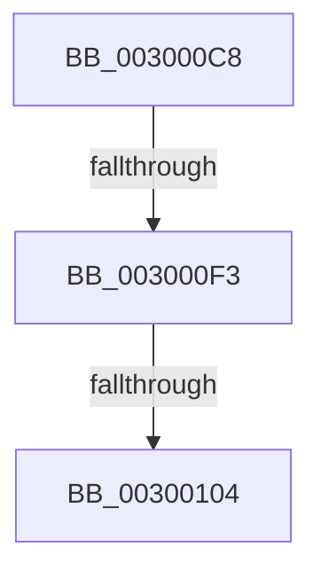

# sub_003000C8

- RVA: `0x003000C8`–`0x0030012B` (길이 `99` bytes)
- VA: `0x00000001403000C8`
- 실행 섹션: `.text`
- PDB 이름 있음: `아니요`; PDB Function 태그: `아니요`
- unwind 정보 RVA: `0x00072EF4`
- 디코드: `25`개 명령, `99/99` bytes 표시
- 미해석 바이트: `0` (있으면 어셈블리에 `.byte`로 보존)

> 이 문서는 커널 이미지의 기계어와 PDB 기호를 분석해 생성했습니다. 4번과 5번은 함수 원형과 자료형을 바이너리 사용 방식에서 추정한 C 해석이며 원본 소스 복구 결과는 아닙니다.

## 1. Dependencies

- 직접 호출 지점: **0**; 고유 호출 대상: **0**
- 직접 호출자로 확인된 함수: **0**
- RIP 상대 이미지 참조: **0**

### Outgoing calls
- 직접 디코드된 call 명령이 없습니다.

### Direct callers
- 이 함수 시작 RVA로 연결되는 직접 call은 확인되지 않았습니다. 간접 호출은 완전히 역산할 수 없습니다.

### Static image references
- 디코드된 RIP-relative 메모리 참조가 없습니다.

## 2. Other-region calls and transfers

- 다른 실행 섹션으로 향하는 call: **0**
- call이 아닌 외부 분기/꼬리 이동: **3**
  - `0x003000F1` → [sub_0030013C](Unknown_function_0030013C.md) (`tail-transfer`)
  - `0x003000FE` → [sub_003001D4 + 0x7](Unknown_function_003001D4.md) (`tail-transfer`)
  - `0x00300129` → [sub_00300164](Unknown_function_00300164.md) (`tail-transfer`)

## 3. Assembly (complete function range)

```asm
003000C8  48 89 74 24 48                  mov qword ptr [rsp + 0x48], rsi
003000CD  48 8D 75 08                     lea rsi, [rbp + 8]
003000D1  48 89 7C 24 50                  mov qword ptr [rsp + 0x50], rdi
003000D6  48 8B 3E                        mov rdi, qword ptr [rsi]
003000D9  4C 89 64 24 58                  mov qword ptr [rsp + 0x58], r12
003000DE  4C 89 74 24 28                  mov qword ptr [rsp + 0x28], r14
003000E3  45 33 F6                        xor r14d, r14d
003000E6  4C 89 7C 24 20                  mov qword ptr [rsp + 0x20], r15
003000EB  45 32 FF                        xor r15b, r15b
003000EE  48 3B FE                        cmp rdi, rsi
003000F1  75 49                           jne 0x14030013c
003000F3  48 8B 7D 20                     mov rdi, qword ptr [rbp + 0x20]
003000F7  48 83 C5 20                     add rbp, 0x20
003000FB  48 3B FD                        cmp rdi, rbp
003000FE  0F 85 D7 00 00 00               jne 0x1403001db
00300104  4C 8B 64 24 58                  mov r12, qword ptr [rsp + 0x58]
00300109  33 C9                           xor ecx, ecx
0030010B  48 8B 7C 24 50                  mov rdi, qword ptr [rsp + 0x50]
00300110  45 84 FF                        test r15b, r15b
00300113  4C 8B 7C 24 20                  mov r15, qword ptr [rsp + 0x20]
00300118  48 8B 74 24 48                  mov rsi, qword ptr [rsp + 0x48]
0030011D  49 0F 45 CE                     cmovne rcx, r14
00300121  4C 8B 74 24 28                  mov r14, qword ptr [rsp + 0x28]
00300126  48 85 C9                        test rcx, rcx
00300129  75 39                           jne 0x140300164
```

## 4. C-style interpretation (structured pseudocode)

```c
void __fastcall sub_003000C8(int a1, __int64 a2, __int64 a3, __int64 a4, __int64 a5, __int64 a6, __int64 a7, __int64 a8, __int64 a9, __int64 a10, __int64 a11)
{
    __int64 v_r14;
    __int64 v_r15;
    __int64 v_rbp;
    unsigned __int64 v_stack_p20;
    unsigned __int64 v_stack_p28;
    unsigned __int64 v_stack_p48;
    unsigned __int64 v_stack_p50;
    unsigned __int64 v_stack_p58;

    v_stack_p48 = v_rsi;
    v_stack_p50 = v_rdi;
    v_stack_p58 = v_r12;
    v_stack_p28 = v_r14;
    v_r14 = 0;
    v_stack_p20 = v_r15;
    v_r15 = 0;
    v_rbp = (v_rbp) + (32);
    a1 = 0;
    if (0 != 0) { a1 = 0; }
}
```

## 5. (Beta) C Style

```c
void sub_003000C8(int32_t Arg1, int64_t Arg2, int64_t Arg3, int64_t Arg4, int64_t Arg5, uint64_t Arg6, uint64_t Arg7, uint64_t Arg8, int64_t Arg9, int64_t Arg10, int64_t Arg11)
{
    int64_t local_r14;
    int64_t local_r15;
    int64_t local_rbp;
    uint64_t v_stack_p20;
    uint64_t v_stack_p28;
    uint64_t v_stack_p48;
    uint64_t v_stack_p50;
    uint64_t v_stack_p58;

    v_stack_p48 = local_rsi;
    v_stack_p50 = local_rdi;
    v_stack_p58 = local_r12;
    v_stack_p28 = local_r14;
    local_r14 = 0;
    v_stack_p20 = local_r15;
    local_r15 = 0;
    local_rbp = (local_rbp) + (32);
    Arg1 = 0;
    if (0 != 0) { Arg1 = 0; }
}
```

## 6. Execution-region graph

[열기: 2D/3D 그래프와 함수 탐색 컨트롤 패널](../../../control-panel.html?section=text&rva=0x003000C8&view=graph)

- 2D 그래프는 위에서 아래로 흐르고, 3D 그래프는 빈 공간을 드래그해 회전합니다. Shift+드래그는 이동, 휠은 확대·축소, 함수 노드 선택은 대상 보고서 이동입니다.

### Static fallback


