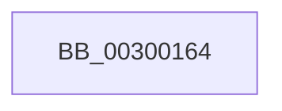

# sub_00300164

- RVA: `0x00300164`–`0x00300199` (길이 `53` bytes)
- VA: `0x0000000140300164`
- 실행 섹션: `.text`
- PDB 이름 있음: `아니요`; PDB Function 태그: `아니요`
- unwind 정보 RVA: `0x00072F64`
- 디코드: `16`개 명령, `53/53` bytes 표시
- 미해석 바이트: `0` (있으면 어셈블리에 `.byte`로 보존)

> 이 문서는 커널 이미지의 기계어와 PDB 기호를 분석해 생성했습니다. 4번과 5번은 함수 원형과 자료형을 바이너리 사용 방식에서 추정한 C 해석이며 원본 소스 복구 결과는 아닙니다.

## 1. Dependencies

- 직접 호출 지점: **0**; 고유 호출 대상: **0**
- 직접 호출자로 확인된 함수: **0**
- RIP 상대 이미지 참조: **0**

### Outgoing calls
- 직접 디코드된 call 명령이 없습니다.

### Direct callers
- 이 함수 시작 RVA로 연결되는 직접 call은 확인되지 않았습니다. 간접 호출은 완전히 역산할 수 없습니다.

### Static image references
- 디코드된 RIP-relative 메모리 참조가 없습니다.

## 2. Other-region calls and transfers

- 다른 실행 섹션으로 향하는 call: **0**
- 별도 외부 분기/꼬리 이동을 확인하지 못했습니다.

## 3. Assembly (complete function range)

```asm
00300164  8B 41 3C                        mov eax, dword ptr [rcx + 0x3c]
00300167  48 8B 51 48                     mov rdx, qword ptr [rcx + 0x48]
0030016B  89 43 28                        mov dword ptr [rbx + 0x28], eax
0030016E  0F B7 41 30                     movzx eax, word ptr [rcx + 0x30]
00300172  66 89 43 20                     mov word ptr [rbx + 0x20], ax
00300176  8B 41 34                        mov eax, dword ptr [rcx + 0x34]
00300179  89 43 24                        mov dword ptr [rbx + 0x24], eax
0030017C  48 89 4B 38                     mov qword ptr [rbx + 0x38], rcx
00300180  48 8B 6C 24 40                  mov rbp, qword ptr [rsp + 0x40]
00300185  48 8D 4A 28                     lea rcx, [rdx + 0x28]
00300189  48 89 4B 30                     mov qword ptr [rbx + 0x30], rcx
0030018D  33 C0                           xor eax, eax
0030018F  48 89 53 40                     mov qword ptr [rbx + 0x40], rdx
00300193  48 83 C4 30                     add rsp, 0x30
00300197  5B                              pop rbx
00300198  C3                              ret
```

## 4. C-style interpretation (structured pseudocode)

```c
__int64 __fastcall sub_00300164(__int64 a1, __int64 a2, __int64 a3, __int64 a4, __int64 a5, __int64 a6, __int64 a7, __int64 a8)
{
    __int64 result;
    __int64 v_rsp;

    *(unsigned int *)(v_rbx + 40) = (unsigned int)((unsigned int)(*(unsigned int *)(a1 + 60)));
    *(unsigned __int16 *)(v_rbx + 32) = (unsigned __int16)(*(unsigned __int16 *)(a1 + 48));
    *(unsigned int *)(v_rbx + 36) = (unsigned int)((unsigned int)(*(unsigned int *)(a1 + 52)));
    *(unsigned __int64 *)(v_rbx + 56) = a1;
    *(unsigned __int64 *)(v_rbx + 48) = *(unsigned __int64 *)(a1 + 72) + 40;
    result = 0;
    *(unsigned __int64 *)(v_rbx + 64) = *(unsigned __int64 *)(a1 + 72);
    v_rsp = (v_rsp) + (48);
    return result;
}
```

## 5. (Beta) C Style

```c
int64_t sub_00300164(void *Arg1, int64_t Arg2, int64_t Arg3, int64_t Arg4, uint64_t Arg5, uint64_t Arg6, uint64_t Arg7, int64_t Arg8)
{
    uint8_t *arg1 = (uint8_t *)Arg1;

    int64_t result;
    int64_t local_rsp;

    *(uint32_t *)(local_rbx + 0x28) = (uint32_t)((uint32_t)(*(uint32_t *)(arg1 + 0x3C)));
    *(uint16_t *)(local_rbx + 0x20) = (uint16_t)(*(uint16_t *)(arg1 + 0x30));
    *(uint32_t *)(local_rbx + 0x24) = (uint32_t)((uint32_t)(*(uint32_t *)(arg1 + 0x34)));
    *(void **)(local_rbx + 0x38) = Arg1;
    *(uint64_t *)(local_rbx + 0x30) = *(uint64_t *)(arg1 + 0x48) + 40;
    result = 0;
    *(uint64_t *)(local_rbx + 0x40) = *(uint64_t *)(arg1 + 0x48);
    local_rsp = (local_rsp) + (48);
    return result;
}
```

### 관측된 메모리 오프셋

구조체 형식이 확인되지 않은 접근은 인자 기준의 오프셋으로만 기록했습니다.

| 기준 인자 | 오프셋 표현 | 폭 (bit) | 접근 |
|---|---:|---:|---|
| `Arg1` | `+ 0x30` | `16` | `R` |
| `Arg1` | `+ 0x34` | `32` | `R` |
| `Arg1` | `+ 0x3C` | `32` | `R` |
| `Arg1` | `+ 0x48` | `64` | `R` |

## 6. Execution-region graph

[열기: 2D/3D 그래프와 함수 탐색 컨트롤 패널](../../../control-panel.html?section=text&rva=0x00300164&view=graph)

- 2D 그래프는 위에서 아래로 흐르고, 3D 그래프는 빈 공간을 드래그해 회전합니다. Shift+드래그는 이동, 휠은 확대·축소, 함수 노드 선택은 대상 보고서 이동입니다.

### Static fallback


