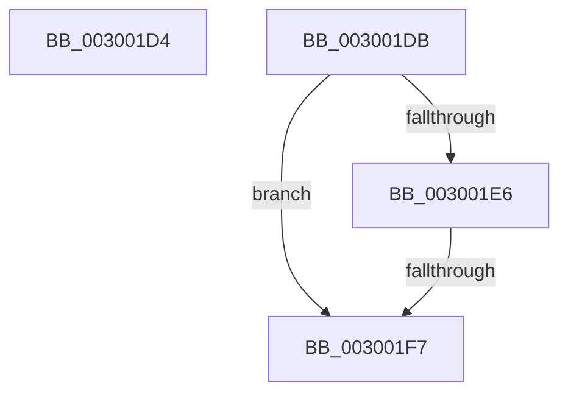

# sub_003001D4

- RVA: `0x003001D4`–`0x003001FF` (길이 `43` bytes)
- VA: `0x00000001403001D4`
- 실행 섹션: `.text`
- PDB 이름 있음: `아니요`; PDB Function 태그: `아니요`
- unwind 정보 RVA: `0x00072FE0`
- 디코드: `13`개 명령, `43/43` bytes 표시
- 미해석 바이트: `0` (있으면 어셈블리에 `.byte`로 보존)

> 이 문서는 커널 이미지의 기계어와 PDB 기호를 분석해 생성했습니다. 4번과 5번은 함수 원형과 자료형을 바이너리 사용 방식에서 추정한 C 해석이며 원본 소스 복구 결과는 아닙니다.

## 1. Dependencies

- 직접 호출 지점: **2**; 고유 호출 대상: **2**
- 직접 호출자로 확인된 함수: **0**
- RIP 상대 이미지 참조: **0**

### Outgoing calls
- `0x003001D4` → [AuthzBasepEqualUnicodeStringCaseSensitive](../3A/AuthzBasepEqualUnicodeStringCaseSensitive_function_003A8A44.md) (function, `0x003A8A44`)
- `0x003001EE` → [AuthzBasepEqualUnicodeString](../3A/AuthzBasepEqualUnicodeString_function_003A8A80.md) (function, `0x003A8A80`)

### Direct callers
- 이 함수 시작 RVA로 연결되는 직접 call은 확인되지 않았습니다. 간접 호출은 완전히 역산할 수 없습니다.

### Static image references
- 디코드된 RIP-relative 메모리 참조가 없습니다.

## 2. Other-region calls and transfers

- 다른 실행 섹션으로 향하는 call: **0**
- call이 아닌 외부 분기/꼬리 이동: **3**
  - `0x003001D9` → [sub_0030013C + 0x1F](Unknown_function_0030013C.md) (`tail-transfer`)
  - `0x003001F5` → [sub_003001A6](Unknown_function_003001A6.md) (`tail-transfer`)
  - `0x003001FA` → [sub_003000C8 + 0x33](Unknown_function_003000C8.md) (`tail-transfer`)

## 3. Assembly (complete function range)

```asm
003001D4  E8 6B 88 0A 00                  call 0x1403a8a44
003001D9  EB 80                           jmp 0x14030015b
003001DB  8B 47 28                        mov eax, dword ptr [rdi + 0x28]
003001DE  4C 8D 77 F0                     lea r14, [rdi - 0x10]
003001E2  A8 01                           test al, 1
003001E4  75 11                           jne 0x1403001f7
003001E6  49 8D 4E 20                     lea rcx, [r14 + 0x20]
003001EA  48 8D 53 10                     lea rdx, [rbx + 0x10]
003001EE  E8 8D 88 0A 00                  call 0x1403a8a80
003001F3  84 C0                           test al, al
003001F5  75 AF                           jne 0x1403001a6
003001F7  48 8B 3F                        mov rdi, qword ptr [rdi]
003001FA  E9 FC FE FF FF                  jmp 0x1403000fb
```

## 4. C-style interpretation (structured pseudocode)

```c
__int64 __fastcall sub_003001D4(void)
{
    __int64 result;

    result = AuthzBasepEqualUnicodeStringCaseSensitive(a1, a2, a3, a4);
}
```

## 5. (Beta) C Style

```c
void sub_003001D4(void)
{
    int64_t result;

    result = AuthzBasepEqualUnicodeStringCaseSensitive(a1, a2, a3, a4);
}
```

## 6. Execution-region graph

[열기: 2D/3D 그래프와 함수 탐색 컨트롤 패널](../../../control-panel.html?section=text&rva=0x003001D4&view=graph)

- 2D 그래프는 위에서 아래로 흐르고, 3D 그래프는 빈 공간을 드래그해 회전합니다. Shift+드래그는 이동, 휠은 확대·축소, 함수 노드 선택은 대상 보고서 이동입니다.

### Static fallback


