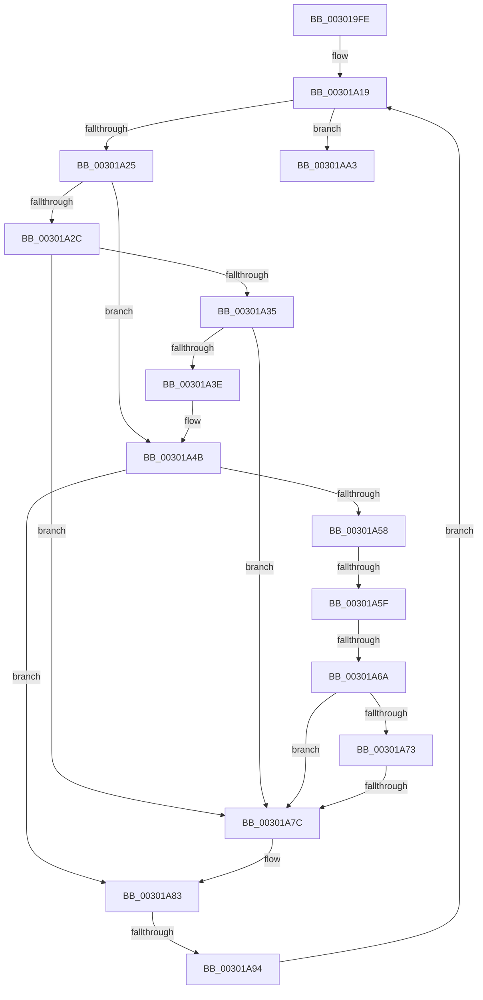

# sub_003019FE

- RVA: `0x003019FE`–`0x00301AC7` (길이 `201` bytes)
- VA: `0x00000001403019FE`
- 실행 섹션: `.text`
- PDB 이름 있음: `아니요`; PDB Function 태그: `아니요`
- unwind 정보 RVA: `0x00073180`
- 디코드: `59`개 명령, `201/201` bytes 표시
- 미해석 바이트: `0` (있으면 어셈블리에 `.byte`로 보존)

> 이 문서는 커널 이미지의 기계어와 PDB 기호를 분석해 생성했습니다. 4번과 5번은 함수 원형과 자료형을 바이너리 사용 방식에서 추정한 C 해석이며 원본 소스 복구 결과는 아닙니다.

## 1. Dependencies

- 직접 호출 지점: **2**; 고유 호출 대상: **1**
- 직접 호출자로 확인된 함수: **0**
- RIP 상대 이미지 참조: **0**

### Outgoing calls
- `0x00301A99` → [ExFreePoolWithTag](../../poolcode/B8/ExFreePoolWithTag_function_00B82870.md) (function, `0x00B82870`)
- `0x00301AA8` → [ExFreePoolWithTag](../../poolcode/B8/ExFreePoolWithTag_function_00B82870.md) (function, `0x00B82870`)

### Direct callers
- 이 함수 시작 RVA로 연결되는 직접 call은 확인되지 않았습니다. 간접 호출은 완전히 역산할 수 없습니다.

### Static image references
- 디코드된 RIP-relative 메모리 참조가 없습니다.

## 2. Other-region calls and transfers

- 다른 실행 섹션으로 향하는 call: **2**
  - `0x00301A99` → [ExFreePoolWithTag](../../poolcode/B8/ExFreePoolWithTag_function_00B82870.md) (`.text` → `POOLCODE`)
  - `0x00301AA8` → [ExFreePoolWithTag](../../poolcode/B8/ExFreePoolWithTag_function_00B82870.md) (`.text` → `POOLCODE`)
- call이 아닌 외부 분기/꼬리 이동: **4**
  - `0x00301A5D` → [sub_00301AC8](Unknown_function_00301AC8.md) (`tail-transfer`)
  - `0x00301A64` → [sub_00301AC8 + 0x42](Unknown_function_00301AC8.md) (`tail-transfer`)
  - `0x00301A7A` → [sub_00301AC8 + 0x2A](Unknown_function_00301AC8.md) (`tail-transfer`)
  - `0x00301A8E` → [sub_00301AC8 + 0x58](Unknown_function_00301AC8.md) (`tail-transfer`)

## 3. Assembly (complete function range)

```asm
003019FE  48 89 5C 24 30                  mov qword ptr [rsp + 0x30], rbx
00301A03  48 8B F1                        mov rsi, rcx
00301A06  48 89 7C 24 38                  mov qword ptr [rsp + 0x38], rdi
00301A0B  4C 89 74 24 40                  mov qword ptr [rsp + 0x40], r14
00301A10  4C 89 7C 24 48                  mov qword ptr [rsp + 0x48], r15
00301A15  4C 8D 79 08                     lea r15, [rcx + 8]
00301A19  49 8B 1F                        mov rbx, qword ptr [r15]
00301A1C  49 3B DF                        cmp rbx, r15
00301A1F  0F 84 7E 00 00 00               je 0x140301aa3
00301A25  8B 43 38                        mov eax, dword ptr [rbx + 0x38]
00301A28  A8 01                           test al, 1
00301A2A  74 1F                           je 0x140301a4b
00301A2C  48 8B 0B                        mov rcx, qword ptr [rbx]
00301A2F  48 39 59 08                     cmp qword ptr [rcx + 8], rbx
00301A33  75 47                           jne 0x140301a7c
00301A35  48 8B 43 08                     mov rax, qword ptr [rbx + 8]
00301A39  48 39 18                        cmp qword ptr [rax], rbx
00301A3C  75 3E                           jne 0x140301a7c
00301A3E  48 89 08                        mov qword ptr [rax], rcx
00301A41  48 89 41 08                     mov qword ptr [rcx + 8], rax
00301A45  83 63 38 FE                     and dword ptr [rbx + 0x38], 0xfffffffe
00301A49  FF 0E                           dec dword ptr [rsi]
00301A4B  48 8D 7B 48                     lea rdi, [rbx + 0x48]
00301A4F  90                              nop
00301A50  48 8B 0F                        mov rcx, qword ptr [rdi]
00301A53  48 3B CF                        cmp rcx, rdi
00301A56  74 2B                           je 0x140301a83
00301A58  8B 41 20                        mov eax, dword ptr [rcx + 0x20]
00301A5B  A8 02                           test al, 2
00301A5D  75 69                           jne 0x140301ac8
00301A5F  8B 41 20                        mov eax, dword ptr [rcx + 0x20]
00301A62  A8 01                           test al, 1
00301A64  0F 84 A0 00 00 00               je 0x140301b0a
00301A6A  48 8B 11                        mov rdx, qword ptr [rcx]
00301A6D  48 39 4A 08                     cmp qword ptr [rdx + 8], rcx
00301A71  75 09                           jne 0x140301a7c
00301A73  48 8B 41 08                     mov rax, qword ptr [rcx + 8]
00301A77  48 39 08                        cmp qword ptr [rax], rcx
00301A7A  74 76                           je 0x140301af2
00301A7C  B9 03 00 00 00                  mov ecx, 3
00301A81  CD 29                           int 0x29
00301A83  4C 8B 73 60                     mov r14, qword ptr [rbx + 0x60]
00301A87  48 8D 7B 60                     lea rdi, [rbx + 0x60]
00301A8B  4C 3B F7                        cmp r14, rdi
00301A8E  0F 85 8C 00 00 00               jne 0x140301b20
00301A94  33 D2                           xor edx, edx
00301A96  48 8B CB                        mov rcx, rbx
00301A99  E8 D2 0D 88 00                  call 0x140b82870
00301A9E  E9 76 FF FF FF                  jmp 0x140301a19
00301AA3  33 D2                           xor edx, edx
00301AA5  48 8B CE                        mov rcx, rsi
00301AA8  E8 C3 0D 88 00                  call 0x140b82870
00301AAD  4C 8B 74 24 40                  mov r14, qword ptr [rsp + 0x40]
00301AB2  48 8B 7C 24 38                  mov rdi, qword ptr [rsp + 0x38]
00301AB7  48 8B 5C 24 30                  mov rbx, qword ptr [rsp + 0x30]
00301ABC  4C 8B 7C 24 48                  mov r15, qword ptr [rsp + 0x48]
00301AC1  48 83 C4 20                     add rsp, 0x20
00301AC5  5E                              pop rsi
00301AC6  C3                              ret
```

## 4. C-style interpretation (structured pseudocode)

```c
__int64 __fastcall sub_003019FE(__int64 a1, __int64 a2, __int64 a3, __int64 a4, __int64 a5, __int64 a6, __int64 a7, __int64 a8, __int64 a9)
{
    __int64 result;
    __int64 v_rsp;
    unsigned __int64 v_stack_p30;
    unsigned __int64 v_stack_p38;
    unsigned __int64 v_stack_p40;
    unsigned __int64 v_stack_p48;

    v_stack_p30 = v_rbx;
    v_stack_p38 = v_rdi;
    v_stack_p40 = v_r14;
    v_stack_p48 = v_r15;
loc_00301A19:
    if ((*(unsigned __int64 *)(a1 + 8)) == (a1 + 8)) goto loc_00301AA3;
    if ((((unsigned __int8)((unsigned int)(*(unsigned int *)(*(unsigned __int64 *)(a1 + 8) + 56)))) & (1)) == 0) goto loc_00301A4B;
    if ((*(unsigned __int64 *)(*(unsigned __int64 *)(*(unsigned __int64 *)(a1 + 8)) + 8)) != (*(unsigned __int64 *)(a1 + 8))) goto loc_00301A7C;
    if ((*(unsigned __int64 *)(*(unsigned __int64 *)(*(unsigned __int64 *)(a1 + 8) + 8))) != (*(unsigned __int64 *)(a1 + 8))) goto loc_00301A7C;
    *(unsigned __int64 *)(*(unsigned __int64 *)(*(unsigned __int64 *)(a1 + 8) + 8)) = *(unsigned __int64 *)(*(unsigned __int64 *)(a1 + 8));
    *(unsigned __int64 *)(*(unsigned __int64 *)(*(unsigned __int64 *)(a1 + 8)) + 8) = *(unsigned __int64 *)(*(unsigned __int64 *)(a1 + 8) + 8);
loc_00301A4B:
    if ((*(unsigned __int64 *)(*(unsigned __int64 *)(a1 + 8) + 72)) == (*(unsigned __int64 *)(a1 + 8) + 72)) goto loc_00301A83;
    if ((*(unsigned __int64 *)(*(unsigned __int64 *)(*(unsigned __int64 *)(*(unsigned __int64 *)(a1 + 8) + 72)) + 8)) != (*(unsigned __int64 *)(*(unsigned __int64 *)(a1 + 8) + 72))) goto loc_00301A7C;
loc_00301A7C:
loc_00301A83:
    a2 = 0;
    result = ExFreePoolWithTag(*(unsigned __int64 *)(a1 + 8), a2, a3, a4);
    goto loc_00301A19;
loc_00301AA3:
    a2 = 0;
    result = ExFreePoolWithTag(a1, a2, a3, a4);
    v_rsp = (v_rsp) + (32);
    return result;
}
```

## 5. (Beta) C Style

```c
int64_t sub_003019FE(void *Arg1, int64_t Arg2, int64_t Arg3, int64_t Arg4, uint64_t Arg5, int64_t Arg6, int64_t Arg7, int64_t Arg8, int64_t Arg9)
{
    uint8_t *arg1 = (uint8_t *)Arg1;

    int64_t result;
    int64_t local_rsp;
    uint64_t v_stack_p30;
    uint64_t v_stack_p38;
    uint64_t v_stack_p40;
    uint64_t v_stack_p48;

    v_stack_p30 = local_rbx;
    v_stack_p38 = local_rdi;
    v_stack_p40 = local_r14;
    v_stack_p48 = local_r15;
loc_00301A19:
    if ((*(uint64_t *)(arg1 + 0x8)) == (Arg1 + 8)) goto loc_00301AA3;
    if ((((uint8_t)((uint32_t)(*(uint32_t *)(*(uint64_t *)(arg1 + 0x8) + 0x38)))) & (1)) == 0) goto loc_00301A4B;
    if ((*(uint64_t *)(*(uint64_t *)(*(uint64_t *)(arg1 + 0x8)) + 0x8)) != (*(uint64_t *)(arg1 + 0x8))) goto loc_00301A7C;
    if ((*(uint64_t *)(*(uint64_t *)(*(uint64_t *)(arg1 + 0x8) + 0x8))) != (*(uint64_t *)(arg1 + 0x8))) goto loc_00301A7C;
    *(uint64_t *)(*(uint64_t *)(*(uint64_t *)(arg1 + 0x8) + 0x8)) = *(uint64_t *)(*(uint64_t *)(arg1 + 0x8));
    *(uint64_t *)(*(uint64_t *)(*(uint64_t *)(arg1 + 0x8)) + 0x8) = *(uint64_t *)(*(uint64_t *)(arg1 + 0x8) + 0x8);
loc_00301A4B:
    if ((*(uint64_t *)(*(uint64_t *)(arg1 + 0x8) + 0x48)) == (*(uint64_t *)(arg1 + 0x8) + 72)) goto loc_00301A83;
    if ((*(uint64_t *)(*(uint64_t *)(*(uint64_t *)(*(uint64_t *)(arg1 + 0x8) + 0x48)) + 0x8)) != (*(uint64_t *)(*(uint64_t *)(arg1 + 0x8) + 0x48))) goto loc_00301A7C;
loc_00301A7C:
loc_00301A83:
    Arg2 = 0;
    result = ExFreePoolWithTag(*(uint64_t *)(arg1 + 0x8), Arg2, Arg3, Arg4);
    goto loc_00301A19;
loc_00301AA3:
    Arg2 = 0;
    result = ExFreePoolWithTag(Arg1, Arg2, Arg3, Arg4);
    local_rsp = (local_rsp) + (32);
    return result;
}
```

### 관측된 메모리 오프셋

구조체 형식이 확인되지 않은 접근은 인자 기준의 오프셋으로만 기록했습니다.

| 기준 인자 | 오프셋 표현 | 폭 (bit) | 접근 |
|---|---:|---:|---|
| `Arg1` | `+ 0x0` | `32` | `R/W` |
| `Arg1` | `+ 0x0` | `64` | `R` |
| `Arg1` | `+ 0x8` | `64` | `R` |

## 6. Execution-region graph

[열기: 2D/3D 그래프와 함수 탐색 컨트롤 패널](../../../control-panel.html?section=text&rva=0x003019FE&view=graph)

- 2D 그래프는 위에서 아래로 흐르고, 3D 그래프는 빈 공간을 드래그해 회전합니다. Shift+드래그는 이동, 휠은 확대·축소, 함수 노드 선택은 대상 보고서 이동입니다.

### Static fallback


