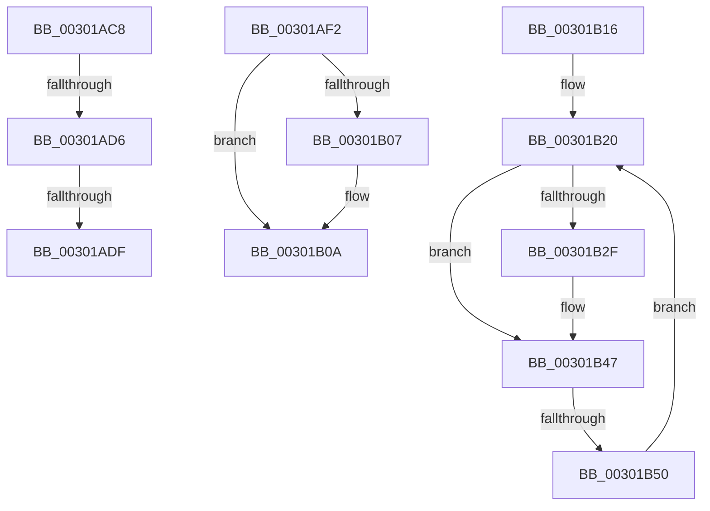

# sub_00301AC8

- RVA: `0x00301AC8`–`0x00301B52` (길이 `138` bytes)
- VA: `0x0000000140301AC8`
- 실행 섹션: `.text`
- PDB 이름 있음: `아니요`; PDB Function 태그: `아니요`
- unwind 정보 RVA: `0x000731B4`
- 디코드: `39`개 명령, `138/138` bytes 표시
- 미해석 바이트: `0` (있으면 어셈블리에 `.byte`로 보존)

> 이 문서는 커널 이미지의 기계어와 PDB 기호를 분석해 생성했습니다. 4번과 5번은 함수 원형과 자료형을 바이너리 사용 방식에서 추정한 C 해석이며 원본 소스 복구 결과는 아닙니다.

## 1. Dependencies

- 직접 호출 지점: **3**; 고유 호출 대상: **2**
- 직접 호출자로 확인된 함수: **0**
- RIP 상대 이미지 참조: **0**

### Outgoing calls
- `0x00301B0C` → [ExFreePoolWithTag](../../poolcode/B8/ExFreePoolWithTag_function_00B82870.md) (function, `0x00B82870`)
- `0x00301B38` → [AuthzBasepRemoveSecurityAttributeValueFromLists](AuthzBasepRemoveSecurityAttributeValueFromLists_function_00302E00.md) (function, `0x00302E00`)
- `0x00301B42` → [ExFreePoolWithTag](../../poolcode/B8/ExFreePoolWithTag_function_00B82870.md) (function, `0x00B82870`)

### Direct callers
- 이 함수 시작 RVA로 연결되는 직접 call은 확인되지 않았습니다. 간접 호출은 완전히 역산할 수 없습니다.

### Static image references
- 디코드된 RIP-relative 메모리 참조가 없습니다.

## 2. Other-region calls and transfers

- 다른 실행 섹션으로 향하는 call: **2**
  - `0x00301B0C` → [ExFreePoolWithTag](../../poolcode/B8/ExFreePoolWithTag_function_00B82870.md) (`.text` → `POOLCODE`)
  - `0x00301B42` → [ExFreePoolWithTag](../../poolcode/B8/ExFreePoolWithTag_function_00B82870.md) (`.text` → `POOLCODE`)
- call이 아닌 외부 분기/꼬리 이동: **5**
  - `0x00301AD4` → [sub_003019FE + 0x7E](Unknown_function_003019FE.md) (`tail-transfer`)
  - `0x00301ADD` → [sub_003019FE + 0x7E](Unknown_function_003019FE.md) (`tail-transfer`)
  - `0x00301AED` → [sub_003019FE + 0x61](Unknown_function_003019FE.md) (`tail-transfer`)
  - `0x00301B11` → [sub_003019FE + 0x52](Unknown_function_003019FE.md) (`tail-transfer`)
  - `0x00301B4A` → [sub_003019FE + 0x96](Unknown_function_003019FE.md) (`tail-transfer`)

## 3. Assembly (complete function range)

```asm
00301AC8  4C 8B 41 10                     mov r8, qword ptr [rcx + 0x10]
00301ACC  48 8D 41 10                     lea rax, [rcx + 0x10]
00301AD0  49 39 40 08                     cmp qword ptr [r8 + 8], rax
00301AD4  75 A6                           jne 0x140301a7c
00301AD6  48 8B 50 08                     mov rdx, qword ptr [rax + 8]
00301ADA  48 39 02                        cmp qword ptr [rdx], rax
00301ADD  75 9D                           jne 0x140301a7c
00301ADF  4C 89 02                        mov qword ptr [rdx], r8
00301AE2  49 89 50 08                     mov qword ptr [r8 + 8], rdx
00301AE6  83 61 20 FD                     and dword ptr [rcx + 0x20], 0xfffffffd
00301AEA  FF 4B 58                        dec dword ptr [rbx + 0x58]
00301AED  E9 6D FF FF FF                  jmp 0x140301a5f
00301AF2  48 89 10                        mov qword ptr [rax], rdx
00301AF5  48 89 42 08                     mov qword ptr [rdx + 8], rax
00301AF9  83 61 20 FE                     and dword ptr [rcx + 0x20], 0xfffffffe
00301AFD  FF 4B 3C                        dec dword ptr [rbx + 0x3c]
00301B00  8B 41 20                        mov eax, dword ptr [rcx + 0x20]
00301B03  A8 04                           test al, 4
00301B05  74 03                           je 0x140301b0a
00301B07  FF 4B 40                        dec dword ptr [rbx + 0x40]
00301B0A  33 D2                           xor edx, edx
00301B0C  E8 5F 0D 88 00                  call 0x140b82870
00301B11  E9 3A FF FF FF                  jmp 0x140301a50
00301B16  66 66 0F 1F 84 00 00 00 00 00   nop word ptr [rax + rax]
00301B20  41 8B 46 10                     mov eax, dword ptr [r14 + 0x10]
00301B24  4D 8D 5E F0                     lea r11, [r14 - 0x10]
00301B28  4D 8B 36                        mov r14, qword ptr [r14]
00301B2B  A8 01                           test al, 1
00301B2D  75 18                           jne 0x140301b47
00301B2F  45 33 C0                        xor r8d, r8d
00301B32  49 8B D3                        mov rdx, r11
00301B35  48 8B CB                        mov rcx, rbx
00301B38  E8 C3 12 00 00                  call 0x140302e00
00301B3D  49 8B CB                        mov rcx, r11
00301B40  33 D2                           xor edx, edx
00301B42  E8 29 0D 88 00                  call 0x140b82870
00301B47  4C 3B F7                        cmp r14, rdi
00301B4A  0F 84 44 FF FF FF               je 0x140301a94
00301B50  EB CE                           jmp 0x140301b20
```

## 4. C-style interpretation (structured pseudocode)

```c
__int64 __fastcall sub_00301AC8(__int64 a1)
{
    *(unsigned __int64 *)(*(unsigned __int64 *)(a1 + 16 + 8)) = *(unsigned __int64 *)(a1 + 16);
    *(unsigned __int64 *)(*(unsigned __int64 *)(a1 + 16) + 8) = *(unsigned __int64 *)(a1 + 16 + 8);
}
```

## 5. (Beta) C Style

```c
int64_t sub_00301AC8(void *Arg1)
{
    uint8_t *arg1 = (uint8_t *)Arg1;

    *(uint64_t *)(*(uint64_t *)(arg1 + 0x10 + 0x8)) = *(uint64_t *)(arg1 + 0x10);
    *(uint64_t *)(*(uint64_t *)(arg1 + 0x10) + 0x8) = *(uint64_t *)(arg1 + 0x10 + 0x8);
}
```

### 관측된 메모리 오프셋

구조체 형식이 확인되지 않은 접근은 인자 기준의 오프셋으로만 기록했습니다.

| 기준 인자 | 오프셋 표현 | 폭 (bit) | 접근 |
|---|---:|---:|---|
| `Arg1` | `+ 0x8` | `64` | `R` |
| `Arg1` | `+ 0x10` | `64` | `R` |
| `Arg1` | `+ 0x20` | `32` | `R/W` |

## 6. Execution-region graph

[열기: 2D/3D 그래프와 함수 탐색 컨트롤 패널](../../../control-panel.html?section=text&rva=0x00301AC8&view=graph)

- 2D 그래프는 위에서 아래로 흐르고, 3D 그래프는 빈 공간을 드래그해 회전합니다. Shift+드래그는 이동, 휠은 확대·축소, 함수 노드 선택은 대상 보고서 이동입니다.

### Static fallback


