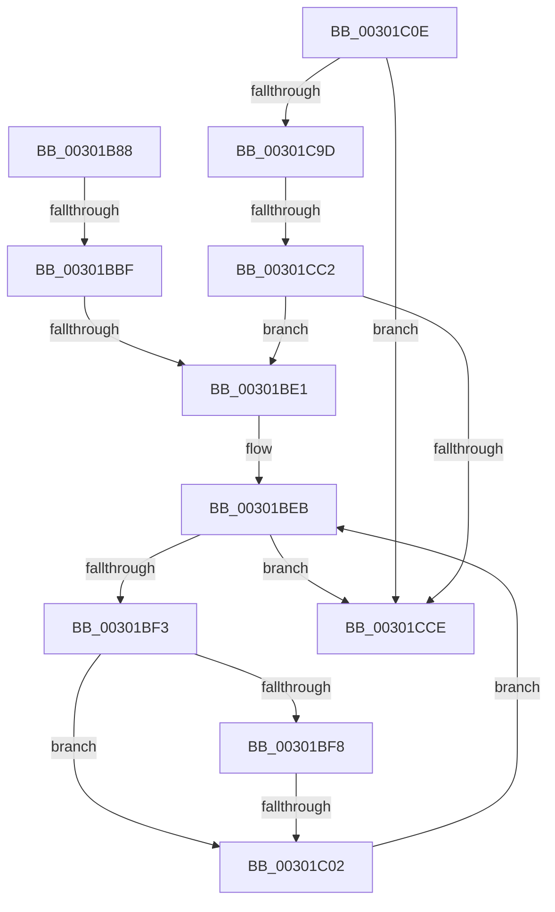

# sub_00301B88

- RVA: `0x00301B88`–`0x00301CF8` (길이 `368` bytes)
- VA: `0x0000000140301B88`
- 실행 섹션: `.text`
- PDB 이름 있음: `아니요`; PDB Function 태그: `아니요`
- unwind 정보 RVA: `0x000731F8`
- 디코드: `77`개 명령, `368/368` bytes 표시
- 미해석 바이트: `0` (있으면 어셈블리에 `.byte`로 보존)

> 이 문서는 커널 이미지의 기계어와 PDB 기호를 분석해 생성했습니다. 4번과 5번은 함수 원형과 자료형을 바이너리 사용 방식에서 추정한 C 해석이며 원본 소스 복구 결과는 아닙니다.

## 1. Dependencies

- 직접 호출 지점: **1**; 고유 호출 대상: **1**
- 직접 호출자로 확인된 함수: **0**
- RIP 상대 이미지 참조: **0**

### Outgoing calls
- `0x00301C8D` → [AuthzBasepEvaluateAceCondition](../2F/AuthzBasepEvaluateAceCondition_function_002FEBD0.md) (function, `0x002FEBD0`)

### Direct callers
- 이 함수 시작 RVA로 연결되는 직접 call은 확인되지 않았습니다. 간접 호출은 완전히 역산할 수 없습니다.

### Static image references
- 디코드된 RIP-relative 메모리 참조가 없습니다.

## 2. Other-region calls and transfers

- 다른 실행 섹션으로 향하는 call: **0**
- call이 아닌 외부 분기/꼬리 이동: **5**
  - `0x00301BB9` → [sub_00301E1A](Unknown_function_00301E1A.md) (`tail-transfer`)
  - `0x00301BDB` → [sub_00301E33](Unknown_function_00301E33.md) (`tail-transfer`)
  - `0x00301BFC` → [sub_00301E66](Unknown_function_00301E66.md) (`tail-transfer`)
  - `0x00301CBC` → [sub_00302042](Unknown_function_00302042.md) (`tail-transfer`)
  - `0x00301CF6` → [sub_00301CF8 + 0x6](Unknown_function_00301CF8.md) (`tail-transfer`)

## 3. Assembly (complete function range)

```asm
00301B88  4C 89 60 D0                     mov qword ptr [rax - 0x30], r12
00301B8C  45 32 C0                        xor r8b, r8b
00301B8F  BD FF FF FF FF                  mov ebp, 0xffffffff
00301B94  4C 89 68 C8                     mov qword ptr [rax - 0x38], r13
00301B98  89 2B                           mov dword ptr [rbx], ebp
00301B9A  44 8B FF                        mov r15d, edi
00301B9D  48 89 78 A8                     mov qword ptr [rax - 0x58], rdi
00301BA1  89 78 98                        mov dword ptr [rax - 0x68], edi
00301BA4  0F B7 41 02                     movzx eax, word ptr [rcx + 2]
00301BA8  44 88 84 24 D0 00 00 00         mov byte ptr [rsp + 0xd0], r8b
00301BB0  89 BC 24 D8 00 00 00            mov dword ptr [rsp + 0xd8], edi
00301BB7  A8 10                           test al, 0x10
00301BB9  0F 85 5B 02 00 00               jne 0x140301e1a
00301BBF  8B F7                           mov esi, edi
00301BC1  48 85 D2                        test rdx, rdx
00301BC4  4C 89 B4 24 88 00 00 00         mov qword ptr [rsp + 0x88], r14
00301BCC  4C 8D 64 24 70                  lea r12, [rsp + 0x70]
00301BD1  4C 0F 45 E2                     cmovne r12, rdx
00301BD5  45 32 ED                        xor r13b, r13b
00301BD8  48 85 F6                        test rsi, rsi
00301BDB  0F 84 52 02 00 00               je 0x140301e33
00301BE1  0F B7 56 04                     movzx edx, word ptr [rsi + 4]
00301BE5  4C 8D 76 08                     lea r14, [rsi + 8]
00301BE9  8B CF                           mov ecx, edi
00301BEB  3B CA                           cmp ecx, edx
00301BED  0F 83 DB 00 00 00               jae 0x140301cce
00301BF3  41 3B CF                        cmp ecx, r15d
00301BF6  72 0A                           jb 0x140301c02
00301BF8  41 80 3E 15                     cmp byte ptr [r14], 0x15
00301BFC  0F 84 64 02 00 00               je 0x140301e66
00301C02  41 0F B7 46 02                  movzx eax, word ptr [r14 + 2]
00301C07  FF C1                           inc ecx
00301C09  4C 03 F0                        add r14, rax
00301C0C  EB DD                           jmp 0x140301beb
00301C0E  4C 8B 88 40 02 00 00            mov r9, qword ptr [rax + 0x240]
00301C15  4C 8B 80 50 02 00 00            mov r8, qword ptr [rax + 0x250]
00301C1C  4C 8B 98 48 02 00 00            mov r11, qword ptr [rax + 0x248]
00301C23  48 8B 80 58 02 00 00            mov rax, qword ptr [rax + 0x258]
00301C2A  48 89 84 24 D8 00 00 00         mov qword ptr [rsp + 0xd8], rax
00301C32  41 0F B7 56 02                  movzx edx, word ptr [r14 + 2]
00301C37  48 8D 44 24 60                  lea rax, [rsp + 0x60]
00301C3C  0F B7 8C 24 F0 00 00 00         movzx ecx, word ptr [rsp + 0xf0]
00301C44  48 89 44 24 58                  mov qword ptr [rsp + 0x58], rax
00301C49  2B D1                           sub edx, ecx
00301C4B  48 8B 84 24 D8 00 00 00         mov rax, qword ptr [rsp + 0xd8]
00301C53  48 83 C1 08                     add rcx, 8
00301C57  C6 44 24 50 01                  mov byte ptr [rsp + 0x50], 1
00301C5C  83 EA 08                        sub edx, 8
00301C5F  C6 44 24 48 01                  mov byte ptr [rsp + 0x48], 1
00301C64  49 03 CE                        add rcx, r14
00301C67  89 54 24 40                     mov dword ptr [rsp + 0x40], edx
00301C6B  49 8B 92 08 03 00 00            mov rdx, qword ptr [r10 + 0x308]
00301C72  48 89 4C 24 38                  mov qword ptr [rsp + 0x38], rcx
00301C77  49 8B CA                        mov rcx, r10
00301C7A  48 89 44 24 30                  mov qword ptr [rsp + 0x30], rax
00301C7F  4C 89 5C 24 28                  mov qword ptr [rsp + 0x28], r11
00301C84  4C 89 44 24 20                  mov qword ptr [rsp + 0x20], r8
00301C89  4D 8B 04 24                     mov r8, qword ptr [r12]
00301C8D  E8 3E CF FF FF                  call 0x1402febd0
00301C92  89 84 24 D8 00 00 00            mov dword ptr [rsp + 0xd8], eax
00301C99  85 C0                           test eax, eax
00301C9B  78 31                           js 0x140301cce
00301C9D  83 7C 24 60 01                  cmp dword ptr [rsp + 0x60], 1
00301CA2  44 0F B6 84 24 D0 00 00 00      movzx r8d, byte ptr [rsp + 0xd0]
00301CAB  4C 8B 94 24 E0 00 00 00         mov r10, qword ptr [rsp + 0xe0]
00301CB3  44 0F B6 8C 24 E8 00 00 00      movzx r9d, byte ptr [rsp + 0xe8]
00301CBC  0F 85 80 03 00 00               jne 0x140302042
00301CC2  41 FF C7                        inc r15d
00301CC5  4D 85 F6                        test r14, r14
00301CC8  0F 85 13 FF FF FF               jne 0x140301be1
00301CCE  48 8B 7C 24 70                  mov rdi, qword ptr [rsp + 0x70]
00301CD3  44 0F B6 84 24 D0 00 00 00      movzx r8d, byte ptr [rsp + 0xd0]
00301CDC  4C 8B 94 24 E0 00 00 00         mov r10, qword ptr [rsp + 0xe0]
00301CE4  8B B4 24 D8 00 00 00            mov esi, dword ptr [rsp + 0xd8]
00301CEB  4C 8B A4 24 98 00 00 00         mov r12, qword ptr [rsp + 0x98]
00301CF3  83 FD FF                        cmp ebp, -1
00301CF6  74 06                           je 0x140301cfe
```

## 4. C-style interpretation (structured pseudocode)

```c
__int64 __fastcall sub_00301B88(__int64 a1, __int64 a2, unsigned __int8 a3, __int64 a4, __int64 a5, __int64 a6, __int64 a7, __int64 a8, __int64 a9, __int64 a10, __int64 a11, __int64 a12, __int64 a13, __int64 a14, __int64 a15, __int64 a16, __int64 a17, __int64 a18, __int64 a19, __int64 a20, __int64 a21, __int64 a22, __int64 a23, __int64 a24, __int64 a25, unsigned __int8 a26, unsigned int a27, __int64 a28)
{
    __int64 v_r13;
    __int64 v_r14;
    unsigned __int64 v_stack_p20;
    unsigned __int64 v_stack_p28;
    unsigned __int64 v_stack_p30;
    unsigned __int64 v_stack_p38;
    unsigned int v_stack_p40;
    unsigned __int8 v_stack_p48;
    unsigned __int8 v_stack_p50;
    unsigned __int64 v_stack_p58;
    unsigned __int64 v_stack_p60;
    unsigned __int64 v_stack_p88;
    unsigned __int8 v_stack_pD0;
    unsigned int v_stack_pD8;
    unsigned __int64 v_stack_pE0;
    unsigned __int8 v_stack_pE8;
    unsigned __int16 v_stack_pF0;

    *(unsigned __int64 *)(result - 48) = v_r12;
    a3 = 0;
    *(unsigned __int64 *)(result - 56) = v_r13;
    *(unsigned int *)(v_rbx) = (unsigned int)((unsigned int)(0xFFFFFFFFULL));
    *(unsigned __int64 *)(result - 88) = v_rdi;
    *(unsigned int *)(result - 104) = (unsigned int)(v_rdi);
    v_stack_pD0 = 0;
    v_stack_pD8 = (unsigned int)(v_rdi);
    v_stack_p88 = v_r14;
    if (a2 != 0) { a14 = a2; }
    v_r13 = 0;
loc_00301BE1:
loc_00301BEB:
    if (((unsigned int)((unsigned int)((unsigned int)(v_rdi)))) >= ((unsigned int)(*(unsigned __int16 *)((unsigned int)((unsigned int)(v_rdi)) + 4)))) goto loc_00301CCE;
    if (((unsigned int)((unsigned int)((unsigned int)(v_rdi)))) < ((unsigned int)((unsigned int)((unsigned int)(v_rdi))))) goto loc_00301C02;
loc_00301C02:
    a1 = (unsigned int)(((unsigned int)((unsigned int)(v_rdi))) + 1);
    v_r14 = ((unsigned int)((unsigned int)(v_rdi)) + 8) + (*(unsigned __int16 *)((unsigned int)((unsigned int)(v_rdi)) + 8 + 2));
    goto loc_00301BEB;
loc_00301CCE:
}
```

## 5. (Beta) C Style

```c
int64_t sub_00301B88(void *Arg1, int64_t Arg2, uint8_t Arg3, int64_t Arg4, uint64_t Arg5, uint64_t Arg6, uint64_t Arg7, uint64_t Arg8, uint64_t Arg9, uint64_t Arg10, uint64_t Arg11, uint64_t Arg12, uint64_t Arg13, int64_t Arg14, uint64_t Arg15, uint64_t Arg16, uint64_t Arg17, uint64_t Arg18, int64_t Arg19, uint64_t Arg20, uint64_t Arg21, uint64_t Arg22, uint64_t Arg23, uint64_t Arg24, uint64_t Arg25, uint8_t Arg26, uint32_t Arg27, int64_t Arg28)
{
    uint8_t *arg1 = (uint8_t *)Arg1;

    int64_t local_r13;
    int64_t local_r14;
    uint64_t v_stack_p20;
    uint64_t v_stack_p28;
    uint64_t v_stack_p30;
    uint64_t v_stack_p38;
    uint32_t v_stack_p40;
    uint8_t v_stack_p48;
    uint8_t v_stack_p50;
    uint64_t v_stack_p58;
    uint64_t v_stack_p60;
    uint64_t v_stack_p88;
    uint8_t v_stack_pD0;
    uint32_t v_stack_pD8;
    uint64_t v_stack_pE0;
    uint8_t v_stack_pE8;
    uint16_t v_stack_pF0;

    *(uint64_t *)(result - 0x30) = local_r12;
    Arg3 = 0;
    *(uint64_t *)(result - 0x38) = local_r13;
    *(uint32_t *)(local_rbx) = (uint32_t)((uint32_t)(0xFFFFFFFFULL));
    *(uint64_t *)(result - 0x58) = local_rdi;
    *(uint32_t *)(result - 0x68) = (uint32_t)(local_rdi);
    v_stack_pD0 = 0;
    v_stack_pD8 = (uint32_t)(local_rdi);
    v_stack_p88 = local_r14;
    if (Arg2 != 0) { Arg14 = Arg2; }
    local_r13 = 0;
loc_00301BE1:
loc_00301BEB:
    if (((uint32_t)((uint32_t)((uint32_t)(local_rdi)))) >= ((uint32_t)(*(uint16_t *)((uint32_t)((uint32_t)(local_rdi)) + 0x4)))) goto loc_00301CCE;
    if (((uint32_t)((uint32_t)((uint32_t)(local_rdi)))) < ((uint32_t)((uint32_t)((uint32_t)(local_rdi))))) goto loc_00301C02;
loc_00301C02:
    Arg1 = (uint32_t)(((uint32_t)((uint32_t)(local_rdi))) + 1);
    local_r14 = ((uint32_t)((uint32_t)(local_rdi)) + 8) + (*(uint16_t *)((uint32_t)((uint32_t)(local_rdi)) + 0x8 + 0x2));
    goto loc_00301BEB;
loc_00301CCE:
}
```

### 관측된 메모리 오프셋

구조체 형식이 확인되지 않은 접근은 인자 기준의 오프셋으로만 기록했습니다.

| 기준 인자 | 오프셋 표현 | 폭 (bit) | 접근 |
|---|---:|---:|---|
| `Arg1` | `+ 0x2` | `16` | `R` |

## 6. Execution-region graph

[열기: 2D/3D 그래프와 함수 탐색 컨트롤 패널](../../../control-panel.html?section=text&rva=0x00301B88&view=graph)

- 2D 그래프는 위에서 아래로 흐르고, 3D 그래프는 빈 공간을 드래그해 회전합니다. Shift+드래그는 이동, 휠은 확대·축소, 함수 노드 선택은 대상 보고서 이동입니다.

### Static fallback


