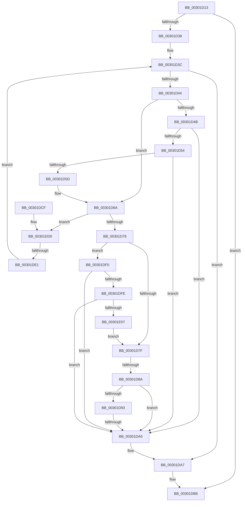

# sub_00301D13

- RVA: `0x00301D13`–`0x00301E1A` (길이 `263` bytes)
- VA: `0x0000000140301D13`
- 실행 섹션: `.text`
- PDB 이름 있음: `아니요`; PDB Function 태그: `아니요`
- unwind 정보 RVA: `0x0007322C`
- 디코드: `76`개 명령, `263/263` bytes 표시
- 미해석 바이트: `0` (있으면 어셈블리에 `.byte`로 보존)

> 이 문서는 커널 이미지의 기계어와 PDB 기호를 분석해 생성했습니다. 4번과 5번은 함수 원형과 자료형을 바이너리 사용 방식에서 추정한 C 해석이며 원본 소스 복구 결과는 아닙니다.

## 1. Dependencies

- 직접 호출 지점: **4**; 고유 호출 대상: **3**
- 직접 호출자로 확인된 함수: **0**
- RIP 상대 이미지 참조: **0**

### Outgoing calls
- `0x00301D17` → [ExReleaseResourceLite](../25/ExReleaseResourceLite_function_0025FA10.md) (function, `0x0025FA10`)
- `0x00301D25` → [KeLeaveCriticalRegionThread](../25/KeLeaveCriticalRegionThread_function_0025EFF0.md) (function, `0x0025EFF0`)
- `0x00301DAC` → [ExFreePoolWithTag](../../poolcode/B8/ExFreePoolWithTag_function_00B82870.md) (function, `0x00B82870`)
- `0x00301DE6` → [ExFreePoolWithTag](../../poolcode/B8/ExFreePoolWithTag_function_00B82870.md) (function, `0x00B82870`)

### Direct callers
- 이 함수 시작 RVA로 연결되는 직접 call은 확인되지 않았습니다. 간접 호출은 완전히 역산할 수 없습니다.

### Static image references
- 디코드된 RIP-relative 메모리 참조가 없습니다.

## 2. Other-region calls and transfers

- 다른 실행 섹션으로 향하는 call: **2**
  - `0x00301DAC` → [ExFreePoolWithTag](../../poolcode/B8/ExFreePoolWithTag_function_00B82870.md) (`.text` → `POOLCODE`)
  - `0x00301DE6` → [ExFreePoolWithTag](../../poolcode/B8/ExFreePoolWithTag_function_00B82870.md) (`.text` → `POOLCODE`)
- call이 아닌 외부 분기/꼬리 이동: **3**
  - `0x00301D84` → [sub_00301E3A + 0x18](Unknown_function_00301E3A.md) (`tail-transfer`)
  - `0x00301D9A` → [sub_00301E3A](Unknown_function_00301E3A.md) (`tail-transfer`)
  - `0x00301DDB` → [sub_00302010](Unknown_function_00302010.md) (`tail-transfer`)

## 3. Assembly (complete function range)

```asm
00301D13  49 8B 4A 30                     mov rcx, qword ptr [r10 + 0x30]
00301D17  E8 F4 DC F5 FF                  call 0x14025fa10
00301D1C  65 48 8B 0C 25 88 01 00 00      mov rcx, qword ptr gs:[0x188]
00301D25  E8 C6 D2 F5 FF                  call 0x14025eff0
00301D2A  48 8B 7C 24 70                  mov rdi, qword ptr [rsp + 0x70]
00301D2F  48 85 FF                        test rdi, rdi
00301D32  0F 84 80 00 00 00               je 0x140301db8
00301D38  4C 8D 77 08                     lea r14, [rdi + 8]
00301D3C  49 8B 1E                        mov rbx, qword ptr [r14]
00301D3F  49 3B DE                        cmp rbx, r14
00301D42  74 63                           je 0x140301da7
00301D44  8B 43 38                        mov eax, dword ptr [rbx + 0x38]
00301D47  A8 01                           test al, 1
00301D49  74 1F                           je 0x140301d6a
00301D4B  48 8B 03                        mov rax, qword ptr [rbx]
00301D4E  48 39 58 08                     cmp qword ptr [rax + 8], rbx
00301D52  75 4C                           jne 0x140301da0
00301D54  48 8B 4B 08                     mov rcx, qword ptr [rbx + 8]
00301D58  48 39 19                        cmp qword ptr [rcx], rbx
00301D5B  75 43                           jne 0x140301da0
00301D5D  48 89 01                        mov qword ptr [rcx], rax
00301D60  48 89 48 08                     mov qword ptr [rax + 8], rcx
00301D64  83 63 38 FE                     and dword ptr [rbx + 0x38], 0xfffffffe
00301D68  FF 0F                           dec dword ptr [rdi]
00301D6A  48 8D 73 48                     lea rsi, [rbx + 0x48]
00301D6E  66 90                           nop
00301D70  48 8B 0E                        mov rcx, qword ptr [rsi]
00301D73  48 3B CE                        cmp rcx, rsi
00301D76  74 58                           je 0x140301dd0
00301D78  8B 41 20                        mov eax, dword ptr [rcx + 0x20]
00301D7B  A8 02                           test al, 2
00301D7D  75 71                           jne 0x140301df0
00301D7F  8B 41 20                        mov eax, dword ptr [rcx + 0x20]
00301D82  A8 01                           test al, 1
00301D84  0F 84 C8 00 00 00               je 0x140301e52
00301D8A  48 8B 11                        mov rdx, qword ptr [rcx]
00301D8D  48 39 4A 08                     cmp qword ptr [rdx + 8], rcx
00301D91  75 0D                           jne 0x140301da0
00301D93  48 8B 41 08                     mov rax, qword ptr [rcx + 8]
00301D97  48 39 08                        cmp qword ptr [rax], rcx
00301D9A  0F 84 9A 00 00 00               je 0x140301e3a
00301DA0  B9 03 00 00 00                  mov ecx, 3
00301DA5  CD 29                           int 0x29
00301DA7  33 D2                           xor edx, edx
00301DA9  48 8B CF                        mov rcx, rdi
00301DAC  E8 BF 0A 88 00                  call 0x140b82870
00301DB1  8B B4 24 D8 00 00 00            mov esi, dword ptr [rsp + 0xd8]
00301DB8  4C 8B B4 24 88 00 00 00         mov r14, qword ptr [rsp + 0x88]
00301DC0  8B C6                           mov eax, esi
00301DC2  48 81 C4 A8 00 00 00            add rsp, 0xa8
00301DC9  41 5F                           pop r15
00301DCB  5F                              pop rdi
00301DCC  5E                              pop rsi
00301DCD  5B                              pop rbx
00301DCE  C3                              ret
00301DCF  CC                              int3
00301DD0  4C 8B 7B 60                     mov r15, qword ptr [rbx + 0x60]
00301DD4  48 8D 73 60                     lea rsi, [rbx + 0x60]
00301DD8  4C 3B FE                        cmp r15, rsi
00301DDB  0F 85 2F 02 00 00               jne 0x140302010
00301DE1  33 D2                           xor edx, edx
00301DE3  48 8B CB                        mov rcx, rbx
00301DE6  E8 85 0A 88 00                  call 0x140b82870
00301DEB  E9 4C FF FF FF                  jmp 0x140301d3c
00301DF0  4C 8B 41 10                     mov r8, qword ptr [rcx + 0x10]
00301DF4  48 8D 41 10                     lea rax, [rcx + 0x10]
00301DF8  49 39 40 08                     cmp qword ptr [r8 + 8], rax
00301DFC  75 A2                           jne 0x140301da0
00301DFE  48 8B 50 08                     mov rdx, qword ptr [rax + 8]
00301E02  48 39 02                        cmp qword ptr [rdx], rax
00301E05  75 99                           jne 0x140301da0
00301E07  4C 89 02                        mov qword ptr [rdx], r8
00301E0A  49 89 50 08                     mov qword ptr [r8 + 8], rdx
00301E0E  83 61 20 FD                     and dword ptr [rcx + 0x20], 0xfffffffd
00301E12  FF 4B 58                        dec dword ptr [rbx + 0x58]
00301E15  E9 65 FF FF FF                  jmp 0x140301d7f
```

## 4. C-style interpretation (structured pseudocode)

```c
__int64 __fastcall sub_00301D13(__int64 a1, __int64 a2, __int64 a3, __int64 a4, __int64 a5, __int64 a6, __int64 a7, __int64 a8, __int64 a9, __int64 a10, __int64 a11, __int64 a12, __int64 a13, __int64 a14, __int64 a15, __int64 a16, __int64 a17, __int64 a18, __int64 a19, __int64 a20, __int64 a21, __int64 a22, __int64 a23, __int64 a24, __int64 a25, __int64 a26, unsigned int a27)
{
    __int64 result;
    __int64 v_rsp;

    result = ExReleaseResourceLite(*(unsigned __int64 *)(v_r10 + 48), a2, a3, a4);
    result = KeLeaveCriticalRegionThread(*(unsigned __int64 *)(gs_base + (0 + 392)), a2, a3, a4);
    if (a14 == 0) goto loc_00301DB8;
loc_00301D3C:
    if ((*(unsigned __int64 *)(a14 + 8)) == (a14 + 8)) goto loc_00301DA7;
    if ((((unsigned __int8)((unsigned int)(*(unsigned int *)(*(unsigned __int64 *)(a14 + 8) + 56)))) & (1)) == 0) goto loc_00301D6A;
    if ((*(unsigned __int64 *)(*(unsigned __int64 *)(*(unsigned __int64 *)(a14 + 8)) + 8)) != (*(unsigned __int64 *)(a14 + 8))) goto loc_00301DA0;
    if ((*(unsigned __int64 *)(*(unsigned __int64 *)(*(unsigned __int64 *)(a14 + 8) + 8))) != (*(unsigned __int64 *)(a14 + 8))) goto loc_00301DA0;
    *(unsigned __int64 *)(*(unsigned __int64 *)(*(unsigned __int64 *)(a14 + 8) + 8)) = *(unsigned __int64 *)(*(unsigned __int64 *)(a14 + 8));
    *(unsigned __int64 *)(*(unsigned __int64 *)(*(unsigned __int64 *)(a14 + 8)) + 8) = *(unsigned __int64 *)(*(unsigned __int64 *)(a14 + 8) + 8);
loc_00301D6A:
    if ((*(unsigned __int64 *)(*(unsigned __int64 *)(a14 + 8) + 72)) == (*(unsigned __int64 *)(a14 + 8) + 72)) goto loc_00301DD0;
    if ((((unsigned __int8)((unsigned int)(*(unsigned int *)(*(unsigned __int64 *)(*(unsigned __int64 *)(a14 + 8) + 72) + 32)))) & (2)) != 0) goto loc_00301DF0;
loc_00301D7F:
    if ((*(unsigned __int64 *)(*(unsigned __int64 *)(*(unsigned __int64 *)(*(unsigned __int64 *)(a14 + 8) + 72)) + 8)) != (*(unsigned __int64 *)(*(unsigned __int64 *)(a14 + 8) + 72))) goto loc_00301DA0;
loc_00301DA0:
loc_00301DA7:
    a2 = 0;
    result = ExFreePoolWithTag(a14, a2, a3, a4);
loc_00301DB8:
    v_rsp = (v_rsp) + (168);
    return (unsigned int)((unsigned int)((unsigned int)(a27)));
loc_00301DD0:
    a2 = 0;
    result = ExFreePoolWithTag(*(unsigned __int64 *)(a14 + 8), a2, a3, a4);
    goto loc_00301D3C;
loc_00301DF0:
    if ((*(unsigned __int64 *)(*(unsigned __int64 *)(*(unsigned __int64 *)(a14 + 8) + 16) + 8)) != (*(unsigned __int64 *)(a14 + 8) + 16)) goto loc_00301DA0;
    if ((*(unsigned __int64 *)(*(unsigned __int64 *)(*(unsigned __int64 *)(a14 + 8) + 16 + 8))) != (*(unsigned __int64 *)(a14 + 8) + 16)) goto loc_00301DA0;
    *(unsigned __int64 *)(*(unsigned __int64 *)(*(unsigned __int64 *)(a14 + 8) + 16 + 8)) = *(unsigned __int64 *)(*(unsigned __int64 *)(a14 + 8) + 16);
    *(unsigned __int64 *)(*(unsigned __int64 *)(*(unsigned __int64 *)(a14 + 8) + 16) + 8) = *(unsigned __int64 *)(*(unsigned __int64 *)(a14 + 8) + 16 + 8);
    goto loc_00301D7F;
}
```

## 5. (Beta) C Style

```c
int64_t sub_00301D13(int64_t Arg1, int64_t Arg2, int64_t Arg3, int64_t Arg4, uint64_t Arg5, uint64_t Arg6, uint64_t Arg7, uint64_t Arg8, uint64_t Arg9, uint64_t Arg10, uint64_t Arg11, uint64_t Arg12, uint64_t Arg13, int64_t Arg14, uint64_t Arg15, uint64_t Arg16, int64_t Arg17, uint64_t Arg18, uint64_t Arg19, uint64_t Arg20, uint64_t Arg21, uint64_t Arg22, uint64_t Arg23, uint64_t Arg24, uint64_t Arg25, uint64_t Arg26, uint32_t Arg27)
{
    int64_t result;
    int64_t local_rsp;

    result = ExReleaseResourceLite(*(uint64_t *)(local_r10 + 0x30), Arg2, Arg3, Arg4);
    result = KeLeaveCriticalRegionThread(*(uint64_t *)(gs_base + (0 + 0x188)), Arg2, Arg3, Arg4);
    if (Arg14 == 0) goto loc_00301DB8;
loc_00301D3C:
    if ((*(uint64_t *)(Arg14 + 0x8)) == (Arg14 + 8)) goto loc_00301DA7;
    if ((((uint8_t)((uint32_t)(*(uint32_t *)(*(uint64_t *)(Arg14 + 0x8) + 0x38)))) & (1)) == 0) goto loc_00301D6A;
    if ((*(uint64_t *)(*(uint64_t *)(*(uint64_t *)(Arg14 + 0x8)) + 0x8)) != (*(uint64_t *)(Arg14 + 0x8))) goto loc_00301DA0;
    if ((*(uint64_t *)(*(uint64_t *)(*(uint64_t *)(Arg14 + 0x8) + 0x8))) != (*(uint64_t *)(Arg14 + 0x8))) goto loc_00301DA0;
    *(uint64_t *)(*(uint64_t *)(*(uint64_t *)(Arg14 + 0x8) + 0x8)) = *(uint64_t *)(*(uint64_t *)(Arg14 + 0x8));
    *(uint64_t *)(*(uint64_t *)(*(uint64_t *)(Arg14 + 0x8)) + 0x8) = *(uint64_t *)(*(uint64_t *)(Arg14 + 0x8) + 0x8);
loc_00301D6A:
    if ((*(uint64_t *)(*(uint64_t *)(Arg14 + 0x8) + 0x48)) == (*(uint64_t *)(Arg14 + 0x8) + 72)) goto loc_00301DD0;
    if ((((uint8_t)((uint32_t)(*(uint32_t *)(*(uint64_t *)(*(uint64_t *)(Arg14 + 0x8) + 0x48) + 0x20)))) & (2)) != 0) goto loc_00301DF0;
loc_00301D7F:
    if ((*(uint64_t *)(*(uint64_t *)(*(uint64_t *)(*(uint64_t *)(Arg14 + 0x8) + 0x48)) + 0x8)) != (*(uint64_t *)(*(uint64_t *)(Arg14 + 0x8) + 0x48))) goto loc_00301DA0;
loc_00301DA0:
loc_00301DA7:
    Arg2 = 0;
    result = ExFreePoolWithTag(Arg14, Arg2, Arg3, Arg4);
loc_00301DB8:
    local_rsp = (local_rsp) + (168);
    return (uint32_t)((uint32_t)((uint32_t)(Arg27)));
loc_00301DD0:
    Arg2 = 0;
    result = ExFreePoolWithTag(*(uint64_t *)(Arg14 + 0x8), Arg2, Arg3, Arg4);
    goto loc_00301D3C;
loc_00301DF0:
    if ((*(uint64_t *)(*(uint64_t *)(*(uint64_t *)(Arg14 + 0x8) + 0x10) + 0x8)) != (*(uint64_t *)(Arg14 + 0x8) + 16)) goto loc_00301DA0;
    if ((*(uint64_t *)(*(uint64_t *)(*(uint64_t *)(Arg14 + 0x8) + 0x10 + 0x8))) != (*(uint64_t *)(Arg14 + 0x8) + 16)) goto loc_00301DA0;
    *(uint64_t *)(*(uint64_t *)(*(uint64_t *)(Arg14 + 0x8) + 0x10 + 0x8)) = *(uint64_t *)(*(uint64_t *)(Arg14 + 0x8) + 0x10);
    *(uint64_t *)(*(uint64_t *)(*(uint64_t *)(Arg14 + 0x8) + 0x10) + 0x8) = *(uint64_t *)(*(uint64_t *)(Arg14 + 0x8) + 0x10 + 0x8);
    goto loc_00301D7F;
}
```

## 6. Execution-region graph

[열기: 2D/3D 그래프와 함수 탐색 컨트롤 패널](../../../control-panel.html?section=text&rva=0x00301D13&view=graph)

- 2D 그래프는 위에서 아래로 흐르고, 3D 그래프는 빈 공간을 드래그해 회전합니다. Shift+드래그는 이동, 휠은 확대·축소, 함수 노드 선택은 대상 보고서 이동입니다.

### Static fallback


