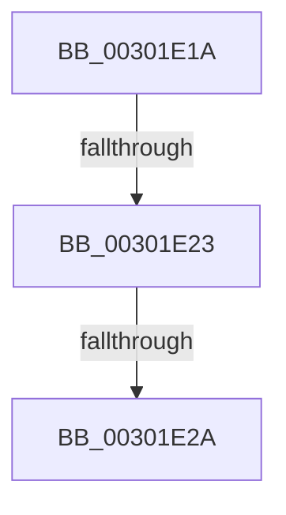

# sub_00301E1A

- RVA: `0x00301E1A`–`0x00301E33` (길이 `25` bytes)
- VA: `0x0000000140301E1A`
- 실행 섹션: `.text`
- PDB 이름 있음: `아니요`; PDB Function 태그: `아니요`
- unwind 정보 RVA: `0x00073244`
- 디코드: `7`개 명령, `25/25` bytes 표시
- 미해석 바이트: `0` (있으면 어셈블리에 `.byte`로 보존)

> 이 문서는 커널 이미지의 기계어와 PDB 기호를 분석해 생성했습니다. 4번과 5번은 함수 원형과 자료형을 바이너리 사용 방식에서 추정한 C 해석이며 원본 소스 복구 결과는 아닙니다.

## 1. Dependencies

- 직접 호출 지점: **0**; 고유 호출 대상: **0**
- 직접 호출자로 확인된 함수: **0**
- RIP 상대 이미지 참조: **0**

### Outgoing calls
- 직접 디코드된 call 명령이 없습니다.

### Direct callers
- 이 함수 시작 RVA로 연결되는 직접 call은 확인되지 않았습니다. 간접 호출은 완전히 역산할 수 없습니다.

### Static image references
- 디코드된 RIP-relative 메모리 참조가 없습니다.

## 2. Other-region calls and transfers

- 다른 실행 섹션으로 향하는 call: **0**
- call이 아닌 외부 분기/꼬리 이동: **3**
  - `0x00301E1D` → [sub_00301EC3](Unknown_function_00301EC3.md) (`tail-transfer`)
  - `0x00301E28` → [sub_00301E5E](Unknown_function_00301E5E.md) (`tail-transfer`)
  - `0x00301E2E` → [sub_00301B88 + 0x39](Unknown_function_00301B88.md) (`tail-transfer`)

## 3. Assembly (complete function range)

```asm
00301E1A  66 85 C0                        test ax, ax
00301E1D  0F 89 A0 00 00 00               jns 0x140301ec3
00301E23  8B 41 0C                        mov eax, dword ptr [rcx + 0xc]
00301E26  85 C0                           test eax, eax
00301E28  74 34                           je 0x140301e5e
00301E2A  48 8D 34 01                     lea rsi, [rcx + rax]
00301E2E  E9 8E FD FF FF                  jmp 0x140301bc1
```

## 4. C-style interpretation (structured pseudocode)

```c
__int64 __fastcall sub_00301E1A(__int64 a1)
{
}
```

## 5. (Beta) C Style

```c
int64_t sub_00301E1A(void *Arg1)
{
    uint8_t *arg1 = (uint8_t *)Arg1;

}
```

### 관측된 메모리 오프셋

구조체 형식이 확인되지 않은 접근은 인자 기준의 오프셋으로만 기록했습니다.

| 기준 인자 | 오프셋 표현 | 폭 (bit) | 접근 |
|---|---:|---:|---|
| `Arg1` | `+ 0x0 + rax*1` | `64` | `R` |
| `Arg1` | `+ 0xC` | `32` | `R` |

## 6. Execution-region graph

[열기: 2D/3D 그래프와 함수 탐색 컨트롤 패널](../../../control-panel.html?section=text&rva=0x00301E1A&view=graph)

- 2D 그래프는 위에서 아래로 흐르고, 3D 그래프는 빈 공간을 드래그해 회전합니다. Shift+드래그는 이동, 휠은 확대·축소, 함수 노드 선택은 대상 보고서 이동입니다.

### Static fallback


