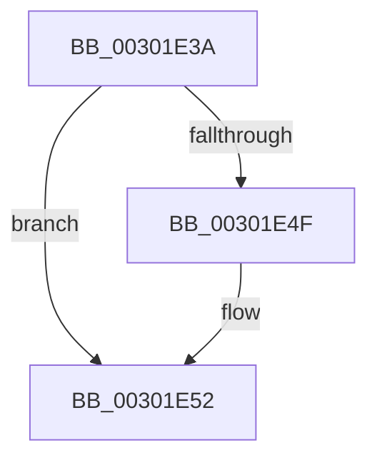

# sub_00301E3A

- RVA: `0x00301E3A`–`0x00301E5E` (길이 `36` bytes)
- VA: `0x0000000140301E3A`
- 실행 섹션: `.text`
- PDB 이름 있음: `아니요`; PDB Function 태그: `아니요`
- unwind 정보 RVA: `0x00073280`
- 디코드: `11`개 명령, `36/36` bytes 표시
- 미해석 바이트: `0` (있으면 어셈블리에 `.byte`로 보존)

> 이 문서는 커널 이미지의 기계어와 PDB 기호를 분석해 생성했습니다. 4번과 5번은 함수 원형과 자료형을 바이너리 사용 방식에서 추정한 C 해석이며 원본 소스 복구 결과는 아닙니다.

## 1. Dependencies

- 직접 호출 지점: **1**; 고유 호출 대상: **1**
- 직접 호출자로 확인된 함수: **0**
- RIP 상대 이미지 참조: **0**

### Outgoing calls
- `0x00301E54` → [ExFreePoolWithTag](../../poolcode/B8/ExFreePoolWithTag_function_00B82870.md) (function, `0x00B82870`)

### Direct callers
- 이 함수 시작 RVA로 연결되는 직접 call은 확인되지 않았습니다. 간접 호출은 완전히 역산할 수 없습니다.

### Static image references
- 디코드된 RIP-relative 메모리 참조가 없습니다.

## 2. Other-region calls and transfers

- 다른 실행 섹션으로 향하는 call: **1**
  - `0x00301E54` → [ExFreePoolWithTag](../../poolcode/B8/ExFreePoolWithTag_function_00B82870.md) (`.text` → `POOLCODE`)
- call이 아닌 외부 분기/꼬리 이동: **1**
  - `0x00301E59` → [sub_00301D13 + 0x5D](Unknown_function_00301D13.md) (`tail-transfer`)

## 3. Assembly (complete function range)

```asm
00301E3A  48 89 10                        mov qword ptr [rax], rdx
00301E3D  48 89 42 08                     mov qword ptr [rdx + 8], rax
00301E41  83 61 20 FE                     and dword ptr [rcx + 0x20], 0xfffffffe
00301E45  FF 4B 3C                        dec dword ptr [rbx + 0x3c]
00301E48  8B 41 20                        mov eax, dword ptr [rcx + 0x20]
00301E4B  A8 04                           test al, 4
00301E4D  74 03                           je 0x140301e52
00301E4F  FF 4B 40                        dec dword ptr [rbx + 0x40]
00301E52  33 D2                           xor edx, edx
00301E54  E8 17 0A 88 00                  call 0x140b82870
00301E59  E9 12 FF FF FF                  jmp 0x140301d70
```

## 4. C-style interpretation (structured pseudocode)

```c
__int64 __fastcall sub_00301E3A(__int64 a1, __int64 a2)
{
    __int64 result;

    *(unsigned __int64 *)(result) = a2;
    *(unsigned __int64 *)(a2 + 8) = result;
    if ((((unsigned __int8)((unsigned int)(*(unsigned int *)(a1 + 32)))) & (4)) != 0) {
    }
    a2 = 0;
    result = ExFreePoolWithTag(a1, a2, a3, a4);
}
```

## 5. (Beta) C Style

```c
int64_t sub_00301E3A(void *Arg1, void *Arg2)
{
    uint8_t *arg1 = (uint8_t *)Arg1;
    uint8_t *arg2 = (uint8_t *)Arg2;

    int64_t result;

    *(void **)(result) = Arg2;
    *(uint64_t *)(arg2 + 0x8) = result;
    if ((((uint8_t)((uint32_t)(*(uint32_t *)(arg1 + 0x20)))) & (4)) != 0) {
    }
    Arg2 = 0;
    result = ExFreePoolWithTag(Arg1, Arg2, a3, a4);
}
```

### 관측된 메모리 오프셋

구조체 형식이 확인되지 않은 접근은 인자 기준의 오프셋으로만 기록했습니다.

| 기준 인자 | 오프셋 표현 | 폭 (bit) | 접근 |
|---|---:|---:|---|
| `Arg1` | `+ 0x20` | `32` | `R` |
| `Arg1` | `+ 0x20` | `32` | `R/W` |
| `Arg2` | `+ 0x8` | `64` | `W` |

## 6. Execution-region graph

[열기: 2D/3D 그래프와 함수 탐색 컨트롤 패널](../../../control-panel.html?section=text&rva=0x00301E3A&view=graph)

- 2D 그래프는 위에서 아래로 흐르고, 3D 그래프는 빈 공간을 드래그해 회전합니다. Shift+드래그는 이동, 휠은 확대·축소, 함수 노드 선택은 대상 보고서 이동입니다.

### Static fallback


