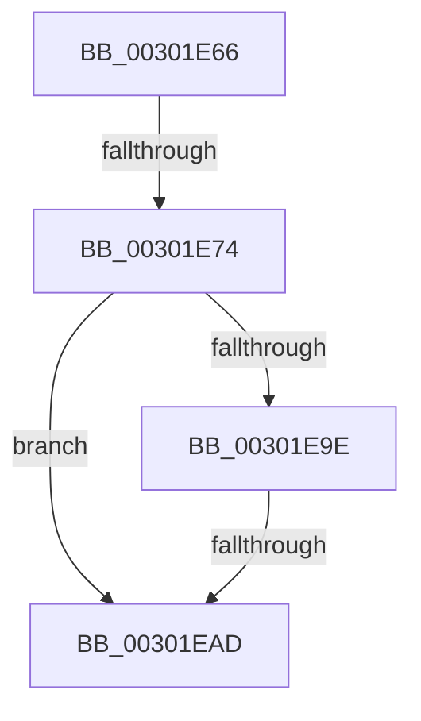

# sub_00301E66

- RVA: `0x00301E66`–`0x00301EC3` (길이 `93` bytes)
- VA: `0x0000000140301E66`
- 실행 섹션: `.text`
- PDB 이름 있음: `아니요`; PDB Function 태그: `아니요`
- unwind 정보 RVA: `0x000732B0`
- 디코드: `22`개 명령, `93/93` bytes 표시
- 미해석 바이트: `0` (있으면 어셈블리에 `.byte`로 보존)

> 이 문서는 커널 이미지의 기계어와 PDB 기호를 분석해 생성했습니다. 4번과 5번은 함수 원형과 자료형을 바이너리 사용 방식에서 추정한 C 해석이며 원본 소스 복구 결과는 아닙니다.

## 1. Dependencies

- 직접 호출 지점: **0**; 고유 호출 대상: **0**
- 직접 호출자로 확인된 함수: **0**
- RIP 상대 이미지 참조: **0**

### Outgoing calls
- 직접 디코드된 call 명령이 없습니다.

### Direct callers
- 이 함수 시작 RVA로 연결되는 직접 call은 확인되지 않았습니다. 간접 호출은 완전히 역산할 수 없습니다.

### Static image references
- 디코드된 RIP-relative 메모리 참조가 없습니다.

## 2. Other-region calls and transfers

- 다른 실행 섹션으로 향하는 call: **0**
- call이 아닌 외부 분기/꼬리 이동: **3**
  - `0x00301E6E` → [sub_00301B88 + 0x13A](Unknown_function_00301B88.md) (`tail-transfer`)
  - `0x00301EAB` → [sub_00301ECC](Unknown_function_00301ECC.md) (`tail-transfer`)
  - `0x00301EBE` → [sub_00301B88 + 0x163](Unknown_function_00301B88.md) (`tail-transfer`)

## 3. Assembly (complete function range)

```asm
00301E66  41 F6 46 01 08                  test byte ptr [r14 + 1], 8
00301E6B  44 8B F9                        mov r15d, ecx
00301E6E  0F 85 4E FE FF FF               jne 0x140301cc2
00301E74  41 0F B6 46 09                  movzx eax, byte ptr [r14 + 9]
00301E79  66 83 C0 02                     add ax, 2
00301E7D  66 C1 E0 02                     shl ax, 2
00301E81  0F B7 C8                        movzx ecx, ax
00301E84  66 89 84 24 F0 00 00 00         mov word ptr [rsp + 0xf0], ax
00301E8C  41 0F B7 46 02                  movzx eax, word ptr [r14 + 2]
00301E91  2B C1                           sub eax, ecx
00301E93  89 4C 24 68                     mov dword ptr [rsp + 0x68], ecx
00301E97  83 E8 08                        sub eax, 8
00301E9A  85 C0                           test eax, eax
00301E9C  7E 0F                           jle 0x140301ead
00301E9E  41 8B 46 04                     mov eax, dword ptr [r14 + 4]
00301EA2  89 44 24 64                     mov dword ptr [rsp + 0x64], eax
00301EA6  A9 00 00 00 FF                  test eax, 0xff000000
00301EAB  74 1F                           je 0x140301ecc
00301EAD  48 8B 7C 24 70                  mov rdi, qword ptr [rsp + 0x70]
00301EB2  BE 77 00 00 C0                  mov esi, 0xc0000077
00301EB7  89 B4 24 D8 00 00 00            mov dword ptr [rsp + 0xd8], esi
00301EBE  E9 28 FE FF FF                  jmp 0x140301ceb
```

## 4. C-style interpretation (structured pseudocode)

```c
__int64 __fastcall sub_00301E66(int a1, __int64 a2, __int64 a3, __int64 a4, __int64 a5, __int64 a6, __int64 a7, __int64 a8, __int64 a9, __int64 a10, __int64 a11, __int64 a12, __int64 a13, __int64 a14)
{
    __int64 result;
    unsigned int v_stack_p64;
    unsigned int v_stack_p68;
    unsigned int v_stack_pD8;
    unsigned __int16 v_stack_pF0;

    result = (unsigned __int16)((*(unsigned __int8 *)(v_r14 + 9)) + (2));
    result = (unsigned __int16)((result) << (2));
    v_stack_pF0 = (unsigned __int16)(result);
    result = (unsigned int)((*(unsigned __int16 *)(v_r14 + 2)) - ((unsigned int)((unsigned __int16)(result))));
    v_stack_p68 = (unsigned int)((unsigned __int16)(result));
    result = (unsigned int)((result) - (8));
    if (condition_is_less_or_equal) goto loc_00301EAD;
    v_stack_p64 = (unsigned int)((unsigned int)(*(unsigned int *)(v_r14 + 4)));
loc_00301EAD:
    v_stack_pD8 = (unsigned int)((unsigned int)(0xC0000077ULL));
}
```

## 5. (Beta) C Style

```c
int64_t sub_00301E66(int32_t Arg1, int64_t Arg2, int64_t Arg3, int64_t Arg4, uint64_t Arg5, uint64_t Arg6, uint64_t Arg7, uint64_t Arg8, uint64_t Arg9, uint64_t Arg10, uint64_t Arg11, uint64_t Arg12, uint64_t Arg13, int64_t Arg14)
{
    int64_t result;
    uint32_t v_stack_p64;
    uint32_t v_stack_p68;
    uint32_t v_stack_pD8;
    uint16_t v_stack_pF0;

    result = (uint16_t)((*(uint8_t *)(local_r14 + 0x9)) + (2));
    result = (uint16_t)((result) << (2));
    v_stack_pF0 = (uint16_t)(result);
    result = (uint32_t)((*(uint16_t *)(local_r14 + 0x2)) - ((uint32_t)((uint16_t)(result))));
    v_stack_p68 = (uint32_t)((uint16_t)(result));
    result = (uint32_t)((result) - (8));
    if (condition_is_less_or_equal) goto loc_00301EAD;
    v_stack_p64 = (uint32_t)((uint32_t)(*(uint32_t *)(local_r14 + 0x4)));
loc_00301EAD:
    v_stack_pD8 = (uint32_t)((uint32_t)(0xC0000077ULL));
}
```

## 6. Execution-region graph

[열기: 2D/3D 그래프와 함수 탐색 컨트롤 패널](../../../control-panel.html?section=text&rva=0x00301E66&view=graph)

- 2D 그래프는 위에서 아래로 흐르고, 3D 그래프는 빈 공간을 드래그해 회전합니다. Shift+드래그는 이동, 휠은 확대·축소, 함수 노드 선택은 대상 보고서 이동입니다.

### Static fallback


