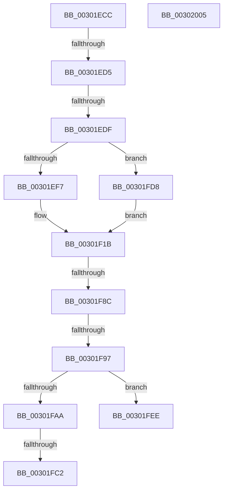

# sub_00301ECC

- RVA: `0x00301ECC`–`0x00302010` (길이 `324` bytes)
- VA: `0x0000000140301ECC`
- 실행 섹션: `.text`
- PDB 이름 있음: `아니요`; PDB Function 태그: `아니요`
- unwind 정보 RVA: `0x000732EC`
- 디코드: `60`개 명령, `324/324` bytes 표시
- 미해석 바이트: `0` (있으면 어셈블리에 `.byte`로 보존)

> 이 문서는 커널 이미지의 기계어와 PDB 기호를 분석해 생성했습니다. 4번과 5번은 함수 원형과 자료형을 바이너리 사용 방식에서 추정한 C 해석이며 원본 소스 복구 결과는 아닙니다.

## 1. Dependencies

- 직접 호출 지점: **1**; 고유 호출 대상: **1**
- 직접 호출자로 확인된 함수: **0**
- RIP 상대 이미지 참조: **0**

### Outgoing calls
- `0x00301F78` → [AuthzBasepEvaluateAceCondition](../2F/AuthzBasepEvaluateAceCondition_function_002FEBD0.md) (function, `0x002FEBD0`)

### Direct callers
- 이 함수 시작 RVA로 연결되는 직접 call은 확인되지 않았습니다. 간접 호출은 완전히 역산할 수 없습니다.

### Static image references
- 디코드된 RIP-relative 메모리 참조가 없습니다.

## 2. Other-region calls and transfers

- 다른 실행 섹션으로 향하는 call: **0**
- call이 아닌 외부 분기/꼬리 이동: **7**
  - `0x00301ECF` → [sub_00302042 + 0x21](Unknown_function_00302042.md) (`tail-transfer`)
  - `0x00301ED9` → [sub_00302042 + 0x5B](Unknown_function_00302042.md) (`tail-transfer`)
  - `0x00301F86` → [sub_00301B88 + 0x146](Unknown_function_00301B88.md) (`tail-transfer`)
  - `0x00301F91` → [sub_00302042 + 0x82](Unknown_function_00302042.md) (`tail-transfer`)
  - `0x00301FBC` → [sub_00301B88 + 0x86](Unknown_function_00301B88.md) (`tail-transfer`)
  - `0x00301FD3` → [sub_00301B88 + 0xAA](Unknown_function_00301B88.md) (`tail-transfer`)
  - `0x00302000` → [sub_00301B88 + 0x13A](Unknown_function_00301B88.md) (`tail-transfer`)

## 3. Assembly (complete function range)

```asm
00301ECC  45 84 C9                        test r9b, r9b
00301ECF  0F 85 8E 01 00 00               jne 0x140302063
00301ED5  49 39 3C 24                     cmp qword ptr [r12], rdi
00301ED9  0F 84 BE 01 00 00               je 0x14030209d
00301EDF  49 8B 82 48 04 00 00            mov rax, qword ptr [r10 + 0x448]
00301EE6  C7 44 24 60 FF FF FF FF         mov dword ptr [rsp + 0x60], 0xffffffff
00301EEE  48 85 C0                        test rax, rax
00301EF1  0F 84 E1 00 00 00               je 0x140301fd8
00301EF7  4C 8B 88 40 02 00 00            mov r9, qword ptr [rax + 0x240]
00301EFE  4C 8B 80 50 02 00 00            mov r8, qword ptr [rax + 0x250]
00301F05  4C 8B 98 48 02 00 00            mov r11, qword ptr [rax + 0x248]
00301F0C  48 8B 80 58 02 00 00            mov rax, qword ptr [rax + 0x258]
00301F13  48 89 84 24 D8 00 00 00         mov qword ptr [rsp + 0xd8], rax
00301F1B  41 0F B7 56 02                  movzx edx, word ptr [r14 + 2]
00301F20  48 8D 44 24 60                  lea rax, [rsp + 0x60]
00301F25  2B 54 24 68                     sub edx, dword ptr [rsp + 0x68]
00301F29  0F B7 8C 24 F0 00 00 00         movzx ecx, word ptr [rsp + 0xf0]
00301F31  83 EA 08                        sub edx, 8
00301F34  48 89 44 24 58                  mov qword ptr [rsp + 0x58], rax
00301F39  48 83 C1 08                     add rcx, 8
00301F3D  48 8B 84 24 D8 00 00 00         mov rax, qword ptr [rsp + 0xd8]
00301F45  49 03 CE                        add rcx, r14
00301F48  40 88 7C 24 50                  mov byte ptr [rsp + 0x50], dil
00301F4D  C6 44 24 48 01                  mov byte ptr [rsp + 0x48], 1
00301F52  89 54 24 40                     mov dword ptr [rsp + 0x40], edx
00301F56  49 8B 92 08 03 00 00            mov rdx, qword ptr [r10 + 0x308]
00301F5D  48 89 4C 24 38                  mov qword ptr [rsp + 0x38], rcx
00301F62  49 8B CA                        mov rcx, r10
00301F65  48 89 44 24 30                  mov qword ptr [rsp + 0x30], rax
00301F6A  4C 89 5C 24 28                  mov qword ptr [rsp + 0x28], r11
00301F6F  4C 89 44 24 20                  mov qword ptr [rsp + 0x20], r8
00301F74  4D 8B 04 24                     mov r8, qword ptr [r12]
00301F78  E8 53 CC FF FF                  call 0x1402febd0
00301F7D  89 84 24 D8 00 00 00            mov dword ptr [rsp + 0xd8], eax
00301F84  85 C0                           test eax, eax
00301F86  0F 88 42 FD FF FF               js 0x140301cce
00301F8C  83 7C 24 60 01                  cmp dword ptr [rsp + 0x60], 1
00301F91  0F 85 2D 01 00 00               jne 0x1403020c4
00301F97  4C 8B 94 24 E0 00 00 00         mov r10, qword ptr [rsp + 0xe0]
00301F9F  41 8B 82 C8 00 00 00            mov eax, dword ptr [r10 + 0xc8]
00301FA6  A8 10                           test al, 0x10
00301FA8  74 44                           je 0x140301fee
00301FAA  49 8B 82 48 04 00 00            mov rax, qword ptr [r10 + 0x448]
00301FB1  C7 44 24 60 FF FF FF FF         mov dword ptr [rsp + 0x60], 0xffffffff
00301FB9  48 85 C0                        test rax, rax
00301FBC  0F 85 4C FC FF FF               jne 0x140301c0e
00301FC2  4C 8B CF                        mov r9, rdi
00301FC5  48 89 BC 24 D8 00 00 00         mov qword ptr [rsp + 0xd8], rdi
00301FCD  4C 8B C7                        mov r8, rdi
00301FD0  4C 8B DF                        mov r11, rdi
00301FD3  E9 5A FC FF FF                  jmp 0x140301c32
00301FD8  4C 8B CF                        mov r9, rdi
00301FDB  48 89 BC 24 D8 00 00 00         mov qword ptr [rsp + 0xd8], rdi
00301FE3  4C 8B C7                        mov r8, rdi
00301FE6  4C 8B DF                        mov r11, rdi
00301FE9  E9 2D FF FF FF                  jmp 0x140301f1b
00301FEE  44 0F B6 84 24 D0 00 00 00      movzx r8d, byte ptr [rsp + 0xd0]
00301FF7  44 0F B6 8C 24 E8 00 00 00      movzx r9d, byte ptr [rsp + 0xe8]
00302000  E9 BD FC FF FF                  jmp 0x140301cc2
00302005  66 66 66 0F 1F 84 00 00 00 00 00  nop word ptr [rax + rax]
```

## 4. C-style interpretation (structured pseudocode)

```c
__int64 __fastcall sub_00301ECC(__int64 a1, __int64 a2, __int64 a3, unsigned __int8 a4, __int64 a5, __int64 a6, __int64 a7, __int64 a8, __int64 a9, __int64 a10, __int64 a11, unsigned int a12, unsigned int a13, __int64 a14, __int64 a15, __int64 a16, __int64 a17, __int64 a18, __int64 a19, __int64 a20, __int64 a21, __int64 a22, __int64 a23, __int64 a24, __int64 a25, unsigned __int8 a26, __int64 a27, __int64 a28, unsigned __int8 a29, unsigned __int16 a30)
{
    __int64 result;
    unsigned __int64 v_stack_p20;
    unsigned __int64 v_stack_p28;
    unsigned __int64 v_stack_p30;
    unsigned __int64 v_stack_p38;
    unsigned int v_stack_p40;
    unsigned __int8 v_stack_p48;
    unsigned __int8 v_stack_p50;
    unsigned __int64 v_stack_p58;
    unsigned int v_stack_p60;
    unsigned __int64 v_stack_pD8;

    v_stack_p60 = 0xFFFFFFFFULL;
    if (*(unsigned __int64 *)(v_r10 + 1096) == 0) goto loc_00301FD8;
    v_stack_pD8 = *(unsigned __int64 *)(*(unsigned __int64 *)(v_r10 + 1096) + 600);
loc_00301F1B:
    a2 = (unsigned int)((*(unsigned __int16 *)(v_r14 + 2)) - (a13));
    a2 = (unsigned int)((a2) - (8));
    v_stack_p58 = a12;
    a1 = (a30) + (8);
    a1 = (a1) + (v_r14);
    v_stack_p50 = (unsigned __int8)(v_rdi);
    v_stack_p48 = 1;
    v_stack_p40 = (unsigned int)(a2);
    v_stack_p38 = a1;
    v_stack_p30 = a27;
    v_stack_p28 = *(unsigned __int64 *)(*(unsigned __int64 *)(v_r10 + 1096) + 584);
    v_stack_p20 = *(unsigned __int64 *)(*(unsigned __int64 *)(v_r10 + 1096) + 592);
    result = AuthzBasepEvaluateAceCondition(v_r10, *(unsigned __int64 *)(v_r10 + 776), *(unsigned __int64 *)(v_r12), *(unsigned __int64 *)(*(unsigned __int64 *)(v_r10 + 1096) + 576));
    v_stack_pD8 = (unsigned int)(result);
    if ((((unsigned __int8)((unsigned int)(*(unsigned int *)(a28 + 200)))) & (16)) == 0) goto loc_00301FEE;
    v_stack_p60 = 0xFFFFFFFFULL;
    v_stack_pD8 = v_rdi;
loc_00301FD8:
    v_stack_pD8 = v_rdi;
    goto loc_00301F1B;
loc_00301FEE:
}
```

## 5. (Beta) C Style

```c
int64_t sub_00301ECC(int64_t Arg1, int64_t Arg2, int64_t Arg3, uint8_t Arg4, uint64_t Arg5, uint64_t Arg6, uint64_t Arg7, uint64_t Arg8, uint64_t Arg9, uint64_t Arg10, uint64_t Arg11, uint32_t Arg12, uint32_t Arg13, uint64_t Arg14, uint64_t Arg15, uint64_t Arg16, uint64_t Arg17, uint64_t Arg18, uint64_t Arg19, uint64_t Arg20, uint64_t Arg21, uint64_t Arg22, uint64_t Arg23, uint64_t Arg24, uint64_t Arg25, uint8_t Arg26, int64_t Arg27, void *Arg28, uint8_t Arg29, uint16_t Arg30)
{
    uint8_t *arg28 = (uint8_t *)Arg28;

    int64_t result;
    uint64_t v_stack_p20;
    uint64_t v_stack_p28;
    uint64_t v_stack_p30;
    uint64_t v_stack_p38;
    uint32_t v_stack_p40;
    uint8_t v_stack_p48;
    uint8_t v_stack_p50;
    uint64_t v_stack_p58;
    uint32_t v_stack_p60;
    uint64_t v_stack_pD8;

    v_stack_p60 = 0xFFFFFFFFULL;
    if (*(uint64_t *)(local_r10 + 0x448) == 0) goto loc_00301FD8;
    v_stack_pD8 = *(uint64_t *)(*(uint64_t *)(local_r10 + 0x448) + 0x258);
loc_00301F1B:
    Arg2 = (uint32_t)((*(uint16_t *)(local_r14 + 0x2)) - (Arg13));
    Arg2 = (uint32_t)((Arg2) - (8));
    v_stack_p58 = Arg12;
    Arg1 = (Arg30) + (8);
    Arg1 = (Arg1) + (local_r14);
    v_stack_p50 = (uint8_t)(local_rdi);
    v_stack_p48 = 1;
    v_stack_p40 = (uint32_t)(Arg2);
    v_stack_p38 = Arg1;
    v_stack_p30 = Arg27;
    v_stack_p28 = *(uint64_t *)(*(uint64_t *)(local_r10 + 0x448) + 0x248);
    v_stack_p20 = *(uint64_t *)(*(uint64_t *)(local_r10 + 0x448) + 0x250);
    result = AuthzBasepEvaluateAceCondition(local_r10, *(uint64_t *)(local_r10 + 0x308), *(uint64_t *)(local_r12), *(uint64_t *)(*(uint64_t *)(local_r10 + 0x448) + 0x240));
    v_stack_pD8 = (uint32_t)(result);
    if ((((uint8_t)((uint32_t)(*(uint32_t *)(arg28 + 0xC8)))) & (16)) == 0) goto loc_00301FEE;
    v_stack_p60 = 0xFFFFFFFFULL;
    v_stack_pD8 = local_rdi;
loc_00301FD8:
    v_stack_pD8 = local_rdi;
    goto loc_00301F1B;
loc_00301FEE:
}
```

### 관측된 메모리 오프셋

구조체 형식이 확인되지 않은 접근은 인자 기준의 오프셋으로만 기록했습니다.

| 기준 인자 | 오프셋 표현 | 폭 (bit) | 접근 |
|---|---:|---:|---|
| `Arg28` | `+ 0xC8` | `32` | `R` |
| `Arg28` | `+ 0x448` | `64` | `R` |

## 6. Execution-region graph

[열기: 2D/3D 그래프와 함수 탐색 컨트롤 패널](../../../control-panel.html?section=text&rva=0x00301ECC&view=graph)

- 2D 그래프는 위에서 아래로 흐르고, 3D 그래프는 빈 공간을 드래그해 회전합니다. Shift+드래그는 이동, 휠은 확대·축소, 함수 노드 선택은 대상 보고서 이동입니다.

### Static fallback


