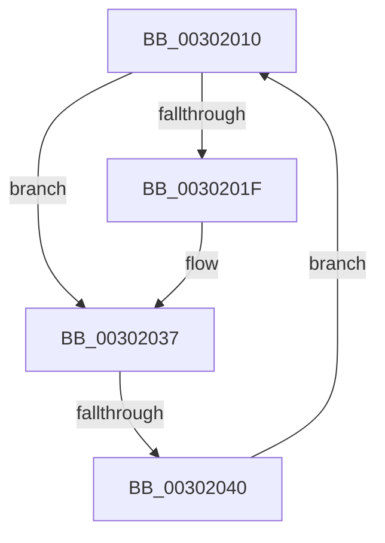

# sub_00302010

- RVA: `0x00302010`–`0x00302042` (길이 `50` bytes)
- VA: `0x0000000140302010`
- 실행 섹션: `.text`
- PDB 이름 있음: `아니요`; PDB Function 태그: `아니요`
- unwind 정보 RVA: `0x0007330C`
- 디코드: `15`개 명령, `50/50` bytes 표시
- 미해석 바이트: `0` (있으면 어셈블리에 `.byte`로 보존)

> 이 문서는 커널 이미지의 기계어와 PDB 기호를 분석해 생성했습니다. 4번과 5번은 함수 원형과 자료형을 바이너리 사용 방식에서 추정한 C 해석이며 원본 소스 복구 결과는 아닙니다.

## 1. Dependencies

- 직접 호출 지점: **2**; 고유 호출 대상: **2**
- 직접 호출자로 확인된 함수: **0**
- RIP 상대 이미지 참조: **0**

### Outgoing calls
- `0x00302028` → [AuthzBasepRemoveSecurityAttributeValueFromLists](AuthzBasepRemoveSecurityAttributeValueFromLists_function_00302E00.md) (function, `0x00302E00`)
- `0x00302032` → [ExFreePoolWithTag](../../poolcode/B8/ExFreePoolWithTag_function_00B82870.md) (function, `0x00B82870`)

### Direct callers
- 이 함수 시작 RVA로 연결되는 직접 call은 확인되지 않았습니다. 간접 호출은 완전히 역산할 수 없습니다.

### Static image references
- 디코드된 RIP-relative 메모리 참조가 없습니다.

## 2. Other-region calls and transfers

- 다른 실행 섹션으로 향하는 call: **1**
  - `0x00302032` → [ExFreePoolWithTag](../../poolcode/B8/ExFreePoolWithTag_function_00B82870.md) (`.text` → `POOLCODE`)
- call이 아닌 외부 분기/꼬리 이동: **1**
  - `0x0030203A` → [sub_00301D13 + 0xCE](Unknown_function_00301D13.md) (`tail-transfer`)

## 3. Assembly (complete function range)

```asm
00302010  41 8B 47 10                     mov eax, dword ptr [r15 + 0x10]
00302014  4D 8D 5F F0                     lea r11, [r15 - 0x10]
00302018  4D 8B 3F                        mov r15, qword ptr [r15]
0030201B  A8 01                           test al, 1
0030201D  75 18                           jne 0x140302037
0030201F  45 33 C0                        xor r8d, r8d
00302022  49 8B D3                        mov rdx, r11
00302025  48 8B CB                        mov rcx, rbx
00302028  E8 D3 0D 00 00                  call 0x140302e00
0030202D  49 8B CB                        mov rcx, r11
00302030  33 D2                           xor edx, edx
00302032  E8 39 08 88 00                  call 0x140b82870
00302037  4C 3B FE                        cmp r15, rsi
0030203A  0F 84 A1 FD FF FF               je 0x140301de1
00302040  EB CE                           jmp 0x140302010
```

## 4. C-style interpretation (structured pseudocode)

```c
__int64 __fastcall sub_00302010(__int64 a1, __int64 a2, int a3)
{
    __int64 result;

    result = (unsigned int)(*(unsigned int *)(v_r15 + 16));
    if ((((unsigned __int8)((unsigned int)(*(unsigned int *)(v_r15 + 16)))) & (1)) == 0) {
        a3 = 0;
        a2 = v_r15 - 16;
        a1 = v_rbx;
        result = AuthzBasepRemoveSecurityAttributeValueFromLists(a1, a2, a3, a4);
        a1 = v_r15 - 16;
        a2 = 0;
        result = ExFreePoolWithTag(a1, a2, a3, a4);
    }
    goto loc_00302010;
}
```

## 5. (Beta) C Style

```c
int64_t sub_00302010(int64_t Arg1, int64_t Arg2, int32_t Arg3)
{
    int64_t result;

    result = (uint32_t)(*(uint32_t *)(local_r15 + 0x10));
    if ((((uint8_t)((uint32_t)(*(uint32_t *)(local_r15 + 0x10)))) & (1)) == 0) {
        Arg3 = 0;
        Arg2 = local_r15 - 16;
        Arg1 = local_rbx;
        result = AuthzBasepRemoveSecurityAttributeValueFromLists(Arg1, Arg2, Arg3, a4);
        Arg1 = local_r15 - 16;
        Arg2 = 0;
        result = ExFreePoolWithTag(Arg1, Arg2, Arg3, a4);
    }
    goto loc_00302010;
}
```

## 6. Execution-region graph

[열기: 2D/3D 그래프와 함수 탐색 컨트롤 패널](../../../control-panel.html?section=text&rva=0x00302010&view=graph)

- 2D 그래프는 위에서 아래로 흐르고, 3D 그래프는 빈 공간을 드래그해 회전합니다. Shift+드래그는 이동, 휠은 확대·축소, 함수 노드 선택은 대상 보고서 이동입니다.

### Static fallback


