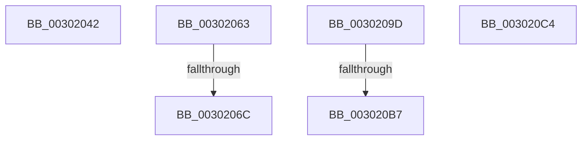

# sub_00302042

- RVA: `0x00302042`–`0x003020E5` (길이 `163` bytes)
- VA: `0x0000000140302042`
- 실행 섹션: `.text`
- PDB 이름 있음: `아니요`; PDB Function 태그: `아니요`
- unwind 정보 RVA: `0x00073320`
- 디코드: `35`개 명령, `163/163` bytes 표시
- 미해석 바이트: `0` (있으면 어셈블리에 `.byte`로 보존)

> 이 문서는 커널 이미지의 기계어와 PDB 기호를 분석해 생성했습니다. 4번과 5번은 함수 원형과 자료형을 바이너리 사용 방식에서 추정한 C 해석이며 원본 소스 복구 결과는 아닙니다.

## 1. Dependencies

- 직접 호출 지점: **2**; 고유 호출 대상: **2**
- 직접 호출자로 확인된 함수: **0**
- RIP 상대 이미지 참조: **0**

### Outgoing calls
- `0x00302083` → [ExAcquireResourceSharedLite](../21/ExAcquireResourceSharedLite_function_00211BC0.md) (function, `0x00211BC0`)
- `0x003020A3` → [AuthzBasepInitializeResourceClaimsFromSacl](AuthzBasepInitializeResourceClaimsFromSacl_function_00302E84.md) (function, `0x00302E84`)

### Direct callers
- 이 함수 시작 RVA로 연결되는 직접 call은 확인되지 않았습니다. 간접 호출은 완전히 역산할 수 없습니다.

### Static image references
- 디코드된 RIP-relative 메모리 참조가 없습니다.

## 2. Other-region calls and transfers

- 다른 실행 섹션으로 향하는 call: **0**
- call이 아닌 외부 분기/꼬리 이동: **6**
  - `0x0030205E` → [sub_00301B88 + 0x13A](Unknown_function_00301B88.md) (`tail-transfer`)
  - `0x00302066` → [sub_00301ECC + 0x9](Unknown_function_00301ECC.md) (`tail-transfer`)
  - `0x00302098` → [sub_00301ECC + 0x9](Unknown_function_00301ECC.md) (`tail-transfer`)
  - `0x003020B1` → [sub_00301B88 + 0x146](Unknown_function_00301B88.md) (`tail-transfer`)
  - `0x003020BF` → [sub_00301ECC + 0x13](Unknown_function_00301ECC.md) (`tail-transfer`)
  - `0x003020E0` → [sub_00301ECC + 0xCB](Unknown_function_00301ECC.md) (`tail-transfer`)

## 3. Assembly (complete function range)

```asm
00302042  41 F6 46 01 40                  test byte ptr [r14 + 1], 0x40
00302047  B9 01 00 00 00                  mov ecx, 1
0030204C  8B 44 24 64                     mov eax, dword ptr [rsp + 0x64]
00302050  45 0F B6 ED                     movzx r13d, r13b
00302054  44 0F 45 E9                     cmovne r13d, ecx
00302058  0F BA E8 18                     bts eax, 0x18
0030205C  23 E8                           and ebp, eax
0030205E  E9 5F FC FF FF                  jmp 0x140301cc2
00302063  45 84 C0                        test r8b, r8b
00302066  0F 85 69 FE FF FF               jne 0x140301ed5
0030206C  65 48 8B 04 25 88 01 00 00      mov rax, qword ptr gs:[0x188]
00302075  B2 01                           mov dl, 1
00302077  66 FF 88 E4 01 00 00            dec word ptr [rax + 0x1e4]
0030207E  90                              nop
0030207F  49 8B 4A 30                     mov rcx, qword ptr [r10 + 0x30]
00302083  E8 38 FB F0 FF                  call 0x140211bc0
00302088  4C 8B 94 24 E0 00 00 00         mov r10, qword ptr [rsp + 0xe0]
00302090  C6 84 24 D0 00 00 00 01         mov byte ptr [rsp + 0xd0], 1
00302098  E9 38 FE FF FF                  jmp 0x140301ed5
0030209D  49 8B D4                        mov rdx, r12
003020A0  48 8B CE                        mov rcx, rsi
003020A3  E8 DC 0D 00 00                  call 0x140302e84
003020A8  89 84 24 D8 00 00 00            mov dword ptr [rsp + 0xd8], eax
003020AF  85 C0                           test eax, eax
003020B1  0F 88 17 FC FF FF               js 0x140301cce
003020B7  4C 8B 94 24 E0 00 00 00         mov r10, qword ptr [rsp + 0xe0]
003020BF  E9 1B FE FF FF                  jmp 0x140301edf
003020C4  41 F6 46 01 40                  test byte ptr [r14 + 1], 0x40
003020C9  B8 01 00 00 00                  mov eax, 1
003020CE  45 0F B6 ED                     movzx r13d, r13b
003020D2  44 0F 45 E8                     cmovne r13d, eax
003020D6  8B 44 24 64                     mov eax, dword ptr [rsp + 0x64]
003020DA  0F BA E8 18                     bts eax, 0x18
003020DE  23 E8                           and ebp, eax
003020E0  E9 B2 FE FF FF                  jmp 0x140301f97
```

## 4. C-style interpretation (structured pseudocode)

```c
__int64 __fastcall sub_00302042(__int64 a1, __int64 a2, unsigned __int8 a3)
{
    __int64 v_r13;
    __int64 v_rbp;
    unsigned int v_stack_p64;
    unsigned __int8 v_stack_pD0;
    unsigned int v_stack_pD8;
    unsigned __int64 v_stack_pE0;

    v_r13 = (unsigned __int8)(v_r13);
    if (((*(unsigned __int8 *)(v_r14 + 1)) & (64)) != 0) { v_r13 = 1; }
    v_rbp = (unsigned int)((v_rbp) & ((unsigned int)((unsigned int)(v_stack_p64))));
}
```

## 5. (Beta) C Style

```c
int64_t sub_00302042(int64_t Arg1, int64_t Arg2, uint8_t Arg3)
{
    int64_t local_r13;
    int64_t local_rbp;
    uint32_t v_stack_p64;
    uint8_t v_stack_pD0;
    uint32_t v_stack_pD8;
    uint64_t v_stack_pE0;

    local_r13 = (uint8_t)(local_r13);
    if (((*(uint8_t *)(local_r14 + 0x1)) & (64)) != 0) { local_r13 = 1; }
    local_rbp = (uint32_t)((local_rbp) & ((uint32_t)((uint32_t)(v_stack_p64))));
}
```

## 6. Execution-region graph

[열기: 2D/3D 그래프와 함수 탐색 컨트롤 패널](../../../control-panel.html?section=text&rva=0x00302042&view=graph)

- 2D 그래프는 위에서 아래로 흐르고, 3D 그래프는 빈 공간을 드래그해 회전합니다. Shift+드래그는 이동, 휠은 확대·축소, 함수 노드 선택은 대상 보고서 이동입니다.

### Static fallback


