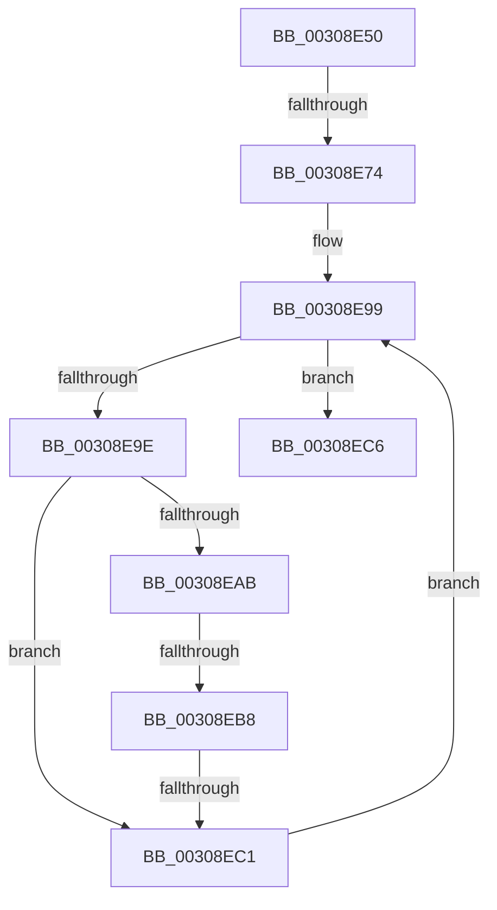

# sub_00308E50

- RVA: `0x00308E50`–`0x00308ED6` (길이 `134` bytes)
- VA: `0x0000000140308E50`
- 실행 섹션: `.text`
- PDB 이름 있음: `아니요`; PDB Function 태그: `아니요`
- unwind 정보 RVA: `0x00073AA0`
- 디코드: `33`개 명령, `134/134` bytes 표시
- 미해석 바이트: `0` (있으면 어셈블리에 `.byte`로 보존)

> 이 문서는 커널 이미지의 기계어와 PDB 기호를 분석해 생성했습니다. 4번과 5번은 함수 원형과 자료형을 바이너리 사용 방식에서 추정한 C 해석이며 원본 소스 복구 결과는 아닙니다.

## 1. Dependencies

- 직접 호출 지점: **0**; 고유 호출 대상: **0**
- 직접 호출자로 확인된 함수: **0**
- RIP 상대 이미지 참조: **1**

### Outgoing calls
- 직접 디코드된 call 명령이 없습니다.

### Direct callers
- 이 함수 시작 RVA로 연결되는 직접 call은 확인되지 않았습니다. 간접 호출은 완전히 역산할 수 없습니다.

### Static image references
- `0x00308E67` → RVA `0x00FC6D20` (`ALMOSTRO`; read)

## 2. Other-region calls and transfers

- 다른 실행 섹션으로 향하는 call: **0**
- call이 아닌 외부 분기/꼬리 이동: **3**
  - `0x00308E6E` → [sub_00308F13](Unknown_function_00308F13.md) (`tail-transfer`)
  - `0x00308EB6` → [sub_00308EE4](Unknown_function_00308EE4.md) (`tail-transfer`)
  - `0x00308EBF` → [sub_00308EE4](Unknown_function_00308EE4.md) (`tail-transfer`)

## 3. Assembly (complete function range)

```asm
00308E50  48 89 7C 24 30                  mov qword ptr [rsp + 0x30], rdi
00308E55  F0 44 09 04 24                  lock or dword ptr [rsp], r8d
00308E5A  44 0F 20 C7                     mov rdi, cr8
00308E5E  B8 0C 00 00 00                  mov eax, 0xc
00308E63  44 0F 22 C0                     mov cr8, rax
00308E67  44 39 05 B2 DE CB 00            cmp dword ptr [rip + 0xcbdeb2], r8d
00308E6E  0F 85 9F 00 00 00               jne 0x140308f13
00308E74  65 4C 8B 04 25 20 00 00 00      mov r8, qword ptr gs:[0x20]
00308E7D  48 8B 44 24 50                  mov rax, qword ptr [rsp + 0x50]
00308E82  40 88 38                        mov byte ptr [rax], dil
00308E85  49 8B 40 08                     mov rax, qword ptr [r8 + 8]
00308E89  48 8B 88 B8 00 00 00            mov rcx, qword ptr [rax + 0xb8]
00308E90  33 C0                           xor eax, eax
00308E92  48 8B 91 80 00 00 00            mov rdx, qword ptr [rcx + 0x80]
00308E99  66 3B 02                        cmp ax, word ptr [rdx]
00308E9C  73 28                           jae 0x140308ec6
00308E9E  0F B7 C8                        movzx ecx, ax
00308EA1  4C 8B 4C CA 08                  mov r9, qword ptr [rdx + rcx*8 + 8]
00308EA6  4D 85 C9                        test r9, r9
00308EA9  74 16                           je 0x140308ec1
00308EAB  41 0F B6 88 D0 00 00 00         movzx ecx, byte ptr [r8 + 0xd0]
00308EB3  66 3B C1                        cmp ax, cx
00308EB6  75 2C                           jne 0x140308ee4
00308EB8  4D 3B 88 C8 00 00 00            cmp r9, qword ptr [r8 + 0xc8]
00308EBF  75 23                           jne 0x140308ee4
00308EC1  66 FF C0                        inc ax
00308EC4  EB D3                           jmp 0x140308e99
00308EC6  48 8B 7C 24 30                  mov rdi, qword ptr [rsp + 0x30]
00308ECB  B0 01                           mov al, 1
00308ECD  C6 03 00                        mov byte ptr [rbx], 0
00308ED0  48 83 C4 20                     add rsp, 0x20
00308ED4  5B                              pop rbx
00308ED5  C3                              ret
```

## 4. C-style interpretation (structured pseudocode)

```c
__int64 __fastcall sub_00308E50(__int64 a1, __int64 a2, int a3, __int64 a4, __int64 a5, __int64 a6, __int64 a7, __int64 a8, __int64 a9, __int64 a10)
{
    __int64 result;
    __int64 v_rsp;
    unsigned int v_stack_p0;
    unsigned __int64 v_stack_p30;

    v_stack_p30 = v_rdi;
    *(unsigned __int8 *)(a10) = (unsigned __int8)(v_cr8);
    result = 0;
loc_00308E99:
    if (0 >= (*(unsigned __int16 *)(*(unsigned __int64 *)(*(unsigned __int64 *)(*(unsigned __int64 *)(*(unsigned __int64 *)(gs_base + (0 + 32)) + 8) + 184) + 128)))) goto loc_00308EC6;
    if (*(unsigned __int64 *)(*(unsigned __int64 *)(*(unsigned __int64 *)(*(unsigned __int64 *)(*(unsigned __int64 *)(gs_base + (0 + 32)) + 8) + 184) + 128) + 0 * 8 + 8) == 0) goto loc_00308EC1;
loc_00308EC1:
    result = (unsigned __int16)((result) + 1);
    goto loc_00308E99;
loc_00308EC6:
    *(unsigned __int8 *)(v_rbx) = 0;
    v_rsp = (v_rsp) + (32);
    return 1;
}
```

## 5. (Beta) C Style

```c
int64_t sub_00308E50(int64_t Arg1, int64_t Arg2, int32_t Arg3, int64_t Arg4, uint64_t Arg5, int64_t Arg6, uint64_t Arg7, uint64_t Arg8, uint64_t Arg9, void *Arg10)
{
    uint8_t *arg10 = (uint8_t *)Arg10;

    int64_t result;
    int64_t local_rsp;
    uint32_t v_stack_p0;
    uint64_t v_stack_p30;

    v_stack_p30 = local_rdi;
    *(uint8_t *)(arg10) = (uint8_t)(v_cr8);
    result = 0;
loc_00308E99:
    if (0 >= (*(uint16_t *)(*(uint64_t *)(*(uint64_t *)(*(uint64_t *)(*(uint64_t *)(gs_base + (0 + 0x20)) + 0x8) + 0xB8) + 0x80)))) goto loc_00308EC6;
    if (*(uint64_t *)(*(uint64_t *)(*(uint64_t *)(*(uint64_t *)(*(uint64_t *)(gs_base + (0 + 0x20)) + 0x8) + 0xB8) + 0x80) + 0x0 * 8 + 0x8) == 0) goto loc_00308EC1;
loc_00308EC1:
    result = (uint16_t)((result) + 1);
    goto loc_00308E99;
loc_00308EC6:
    *(uint8_t *)(local_rbx) = 0;
    local_rsp = (local_rsp) + (32);
    return 1;
}
```

### 관측된 메모리 오프셋

구조체 형식이 확인되지 않은 접근은 인자 기준의 오프셋으로만 기록했습니다.

| 기준 인자 | 오프셋 표현 | 폭 (bit) | 접근 |
|---|---:|---:|---|
| `Arg10` | `+ 0x0` | `8` | `W` |

## 6. Execution-region graph

[열기: 2D/3D 그래프와 함수 탐색 컨트롤 패널](../../../control-panel.html?section=text&rva=0x00308E50&view=graph)

- 2D 그래프는 위에서 아래로 흐르고, 3D 그래프는 빈 공간을 드래그해 회전합니다. Shift+드래그는 이동, 휠은 확대·축소, 함수 노드 선택은 대상 보고서 이동입니다.

### Static fallback


