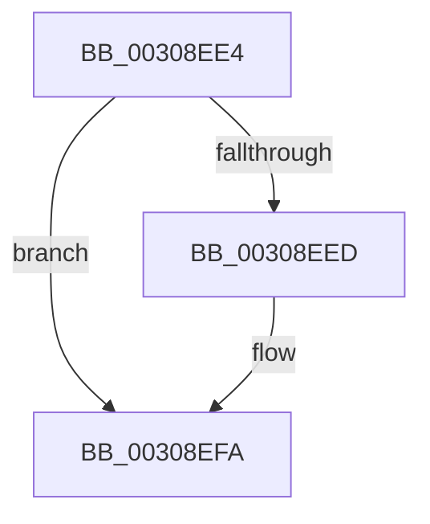

# sub_00308EE4

- RVA: `0x00308EE4`–`0x00308F12` (길이 `46` bytes)
- VA: `0x0000000140308EE4`
- 실행 섹션: `.text`
- PDB 이름 있음: `아니요`; PDB Function 태그: `아니요`
- unwind 정보 RVA: `0x00073ACC`
- 디코드: `13`개 명령, `46/46` bytes 표시
- 미해석 바이트: `0` (있으면 어셈블리에 `.byte`로 보존)

> 이 문서는 커널 이미지의 기계어와 PDB 기호를 분석해 생성했습니다. 4번과 5번은 함수 원형과 자료형을 바이너리 사용 방식에서 추정한 C 해석이며 원본 소스 복구 결과는 아닙니다.

## 1. Dependencies

- 직접 호출 지점: **1**; 고유 호출 대상: **1**
- 직접 호출자로 확인된 함수: **0**
- RIP 상대 이미지 참조: **1**

### Outgoing calls
- `0x00308EF5` → [KiLowerIrqlProcessIrqlFlags](../4F/KiLowerIrqlProcessIrqlFlags_function_004F5698.md) (function, `0x004F5698`)

### Direct callers
- 이 함수 시작 RVA로 연결되는 직접 call은 확인되지 않았습니다. 간접 호출은 완전히 역산할 수 없습니다.

### Static image references
- `0x00308EE4` → RVA `0x00FC6D20` (`ALMOSTRO`; read)

## 2. Other-region calls and transfers

- 다른 실행 섹션으로 향하는 call: **0**
- 별도 외부 분기/꼬리 이동을 확인하지 못했습니다.

## 3. Assembly (complete function range)

```asm
00308EE4  83 3D 35 DE CB 00 00            cmp dword ptr [rip + 0xcbde35], 0
00308EEB  74 0D                           je 0x140308efa
00308EED  44 0F 20 C1                     mov rcx, cr8
00308EF1  40 0F B6 D7                     movzx edx, dil
00308EF5  E8 9E C7 1E 00                  call 0x1404f5698
00308EFA  40 0F B6 C7                     movzx eax, dil
00308EFE  44 0F 22 C0                     mov cr8, rax
00308F02  48 8B 7C 24 30                  mov rdi, qword ptr [rsp + 0x30]
00308F07  32 C0                           xor al, al
00308F09  C6 03 01                        mov byte ptr [rbx], 1
00308F0C  48 83 C4 20                     add rsp, 0x20
00308F10  5B                              pop rbx
00308F11  C3                              ret
```

## 4. C-style interpretation (structured pseudocode)

```c
__int64 __fastcall sub_00308EE4(__int64 a1, __int64 a2, __int64 a3, __int64 a4, __int64 a5, __int64 a6)
{
    __int64 result;
    __int64 v_rsp;

    if ((*(unsigned int *)(v_rip + 13360693)) != 0) {
        a1 = v_cr8;
        a2 = (unsigned __int8)(v_rdi);
        result = KiLowerIrqlProcessIrqlFlags(a1, a2, a3, a4);
    }
    result = 0;
    *(unsigned __int8 *)(v_rbx) = 1;
    v_rsp = (v_rsp) + (32);
    return result;
}
```

## 5. (Beta) C Style

```c
int64_t sub_00308EE4(int64_t Arg1, int64_t Arg2, int64_t Arg3, int64_t Arg4, uint64_t Arg5, int64_t Arg6)
{
    int64_t result;
    int64_t local_rsp;

    if ((*(uint32_t *)(v_rip + 0xCBDE35)) != 0) {
        Arg1 = v_cr8;
        Arg2 = (uint8_t)(local_rdi);
        result = KiLowerIrqlProcessIrqlFlags(Arg1, Arg2, Arg3, Arg4);
    }
    result = 0;
    *(uint8_t *)(local_rbx) = 1;
    local_rsp = (local_rsp) + (32);
    return result;
}
```

## 6. Execution-region graph

[열기: 2D/3D 그래프와 함수 탐색 컨트롤 패널](../../../control-panel.html?section=text&rva=0x00308EE4&view=graph)

- 2D 그래프는 위에서 아래로 흐르고, 3D 그래프는 빈 공간을 드래그해 회전합니다. Shift+드래그는 이동, 휠은 확대·축소, 함수 노드 선택은 대상 보고서 이동입니다.

### Static fallback


