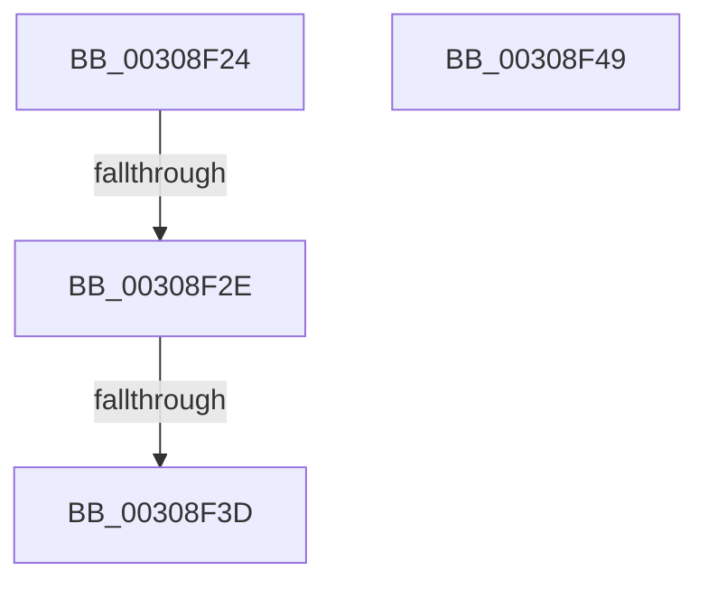

# sub_00308F24

- RVA: `0x00308F24`–`0x00308F4A` (길이 `38` bytes)
- VA: `0x0000000140308F24`
- 실행 섹션: `.text`
- PDB 이름 있음: `아니요`; PDB Function 태그: `아니요`
- unwind 정보 RVA: `0x00073B08`
- 디코드: `12`개 명령, `38/38` bytes 표시
- 미해석 바이트: `0` (있으면 어셈블리에 `.byte`로 보존)

> 이 문서는 커널 이미지의 기계어와 PDB 기호를 분석해 생성했습니다. 4번과 5번은 함수 원형과 자료형을 바이너리 사용 방식에서 추정한 C 해석이며 원본 소스 복구 결과는 아닙니다.

## 1. Dependencies

- 직접 호출 지점: **1**; 고유 호출 대상: **1**
- 직접 호출자로 확인된 함수: **0**
- RIP 상대 이미지 참조: **0**

### Outgoing calls
- `0x00308F30` → [KiIsFlushEntire](KiIsFlushEntire_function_00309498.md) (function, `0x00309498`)

### Direct callers
- 이 함수 시작 RVA로 연결되는 직접 call은 확인되지 않았습니다. 간접 호출은 완전히 역산할 수 없습니다.

### Static image references
- 디코드된 RIP-relative 메모리 참조가 없습니다.

## 2. Other-region calls and transfers

- 다른 실행 섹션으로 향하는 call: **0**
- call이 아닌 외부 분기/꼬리 이동: **2**
  - `0x00308F28` → [KiPreprocessFlushTb + 0x38](KiPreprocessFlushTb_function_00308E00.md) (`tail-transfer`)
  - `0x00308F37` → [KiPreprocessFlushTb + 0x38](KiPreprocessFlushTb_function_00308E00.md) (`tail-transfer`)

## 3. Assembly (complete function range)

```asm
00308F24  0F BA E0 17                     bt eax, 0x17
00308F28  0F 83 0A FF FF FF               jae 0x140308e38
00308F2E  8B CA                           mov ecx, edx
00308F30  E8 63 05 00 00                  call 0x140309498
00308F35  84 C0                           test al, al
00308F37  0F 84 FB FE FF FF               je 0x140308e38
00308F3D  41 C6 01 01                     mov byte ptr [r9], 1
00308F41  32 C0                           xor al, al
00308F43  48 83 C4 20                     add rsp, 0x20
00308F47  5B                              pop rbx
00308F48  C3                              ret
00308F49  CC                              int3
```

## 4. C-style interpretation (structured pseudocode)

```c
__int64 __fastcall sub_00308F24(__int64 a1, int a2, __int64 a3, __int64 a4)
{
    __int64 result;
    __int64 v_rsp;

    result = KiIsFlushEntire((unsigned int)(a2), a2, a3, a4);
    *(unsigned __int8 *)(a4) = 1;
    result = 0;
    v_rsp = (v_rsp) + (32);
    return result;
}
```

## 5. (Beta) C Style

```c
int64_t sub_00308F24(int64_t Arg1, int32_t Arg2, int64_t Arg3, int64_t Arg4)
{
    int64_t result;
    int64_t local_rsp;

    result = KiIsFlushEntire((uint32_t)(Arg2), Arg2, Arg3, Arg4);
    *(uint8_t *)(Arg4) = 1;
    result = 0;
    local_rsp = (local_rsp) + (32);
    return result;
}
```

## 6. Execution-region graph

[열기: 2D/3D 그래프와 함수 탐색 컨트롤 패널](../../../control-panel.html?section=text&rva=0x00308F24&view=graph)

- 2D 그래프는 위에서 아래로 흐르고, 3D 그래프는 빈 공간을 드래그해 회전합니다. Shift+드래그는 이동, 휠은 확대·축소, 함수 노드 선택은 대상 보고서 이동입니다.

### Static fallback


