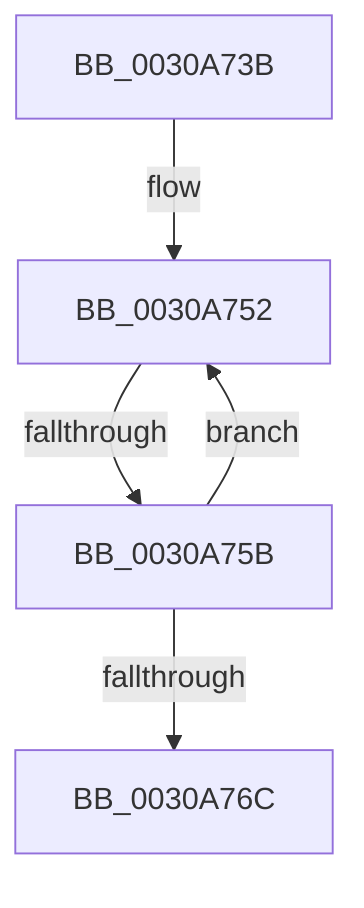

# sub_0030A73B

- RVA: `0x0030A73B`–`0x0030A776` (길이 `59` bytes)
- VA: `0x000000014030A73B`
- 실행 섹션: `.text`
- PDB 이름 있음: `아니요`; PDB Function 태그: `아니요`
- unwind 정보 RVA: `0x00073BF4`
- 디코드: `14`개 명령, `59/59` bytes 표시
- 미해석 바이트: `0` (있으면 어셈블리에 `.byte`로 보존)

> 이 문서는 커널 이미지의 기계어와 PDB 기호를 분석해 생성했습니다. 4번과 5번은 함수 원형과 자료형을 바이너리 사용 방식에서 추정한 C 해석이며 원본 소스 복구 결과는 아닙니다.

## 1. Dependencies

- 직접 호출 지점: **0**; 고유 호출 대상: **0**
- 직접 호출자로 확인된 함수: **0**
- RIP 상대 이미지 참조: **1**

### Outgoing calls
- 직접 디코드된 call 명령이 없습니다.

### Direct callers
- 이 함수 시작 RVA로 연결되는 직접 call은 확인되지 않았습니다. 간접 호출은 완전히 역산할 수 없습니다.

### Static image references
- `0x0030A740` → RVA `0x00F10E80` (`.data`; read)

## 2. Other-region calls and transfers

- 다른 실행 섹션으로 향하는 call: **0**
- call이 아닌 외부 분기/꼬리 이동: **1**
  - `0x0030A755` → [sub_0030A8B2](Unknown_function_0030A8B2.md) (`tail-transfer`)

## 3. Assembly (complete function range)

```asm
0030A73B  48 89 6C 24 30                  mov qword ptr [rsp + 0x30], rbp
0030A740  4C 8D 1D 39 67 C0 00            lea r11, [rip + 0xc06739]
0030A747  48 89 74 24 38                  mov qword ptr [rsp + 0x38], rsi
0030A74C  8B E8                           mov ebp, eax
0030A74E  49 8D 70 30                     lea rsi, [r8 + 0x30]
0030A752  4D 85 D1                        test r9, r10
0030A755  0F 85 57 01 00 00               jne 0x14030a8b2
0030A75B  4D 03 C9                        add r9, r9
0030A75E  48 83 C6 18                     add rsi, 0x18
0030A762  49 83 C3 04                     add r11, 4
0030A766  48 83 ED 01                     sub rbp, 1
0030A76A  75 E6                           jne 0x14030a752
0030A76C  48 8B 74 24 38                  mov rsi, qword ptr [rsp + 0x38]
0030A771  48 8B 6C 24 30                  mov rbp, qword ptr [rsp + 0x30]
```

## 4. C-style interpretation (structured pseudocode)

```c
void __fastcall sub_0030A73B(__int64 a1, __int64 a2, __int64 a3, __int64 a4, __int64 a5, __int64 a6, __int64 a7)
{
    __int64 v_r11;
    __int64 v_rbp;
    __int64 v_rsi;
    unsigned __int64 v_stack_p30;
    unsigned __int64 v_stack_p38;

    v_stack_p30 = v_rbp;
    v_stack_p38 = v_rsi;
loc_0030A752:
    a4 = (a4) + (a4);
    v_rsi = (a3 + 48) + (24);
    v_r11 = (v_rip + 12609337) + (4);
    v_rbp = ((unsigned int)((unsigned int)(result))) - (1);
    if (condition_is_not_equal) goto loc_0030A752;
    return;
}
```

## 5. (Beta) C Style

```c
void sub_0030A73B(int64_t Arg1, int64_t Arg2, void *Arg3, int64_t Arg4, uint64_t Arg5, int64_t Arg6, int64_t Arg7)
{
    uint8_t *arg3 = (uint8_t *)Arg3;

    int64_t local_r11;
    int64_t local_rbp;
    int64_t local_rsi;
    uint64_t v_stack_p30;
    uint64_t v_stack_p38;

    v_stack_p30 = local_rbp;
    v_stack_p38 = local_rsi;
loc_0030A752:
    Arg4 = (Arg4) + (Arg4);
    local_rsi = (Arg3 + 48) + (24);
    local_r11 = (v_rip + 12609337) + (4);
    local_rbp = ((uint32_t)((uint32_t)(result))) - (1);
    if (condition_is_not_equal) goto loc_0030A752;
    return;
}
```

### 관측된 메모리 오프셋

구조체 형식이 확인되지 않은 접근은 인자 기준의 오프셋으로만 기록했습니다.

| 기준 인자 | 오프셋 표현 | 폭 (bit) | 접근 |
|---|---:|---:|---|
| `Arg3` | `+ 0x30` | `64` | `R` |

## 6. Execution-region graph

[열기: 2D/3D 그래프와 함수 탐색 컨트롤 패널](../../../control-panel.html?section=text&rva=0x0030A73B&view=graph)

- 2D 그래프는 위에서 아래로 흐르고, 3D 그래프는 빈 공간을 드래그해 회전합니다. Shift+드래그는 이동, 휠은 확대·축소, 함수 노드 선택은 대상 보고서 이동입니다.

### Static fallback


