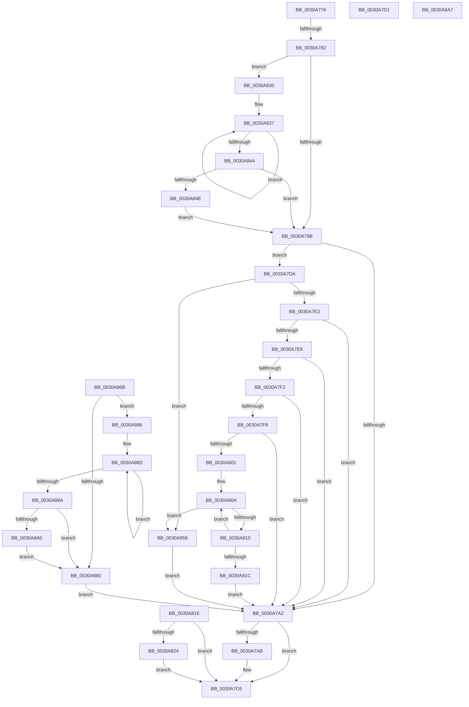

# sub_0030A776

- RVA: `0x0030A776`–`0x0030A8B2` (길이 `316` bytes)
- VA: `0x000000014030A776`
- 실행 섹션: `.text`
- PDB 이름 있음: `아니요`; PDB Function 태그: `아니요`
- unwind 정보 RVA: `0x00073C0C`
- 디코드: `83`개 명령, `316/316` bytes 표시
- 미해석 바이트: `0` (있으면 어셈블리에 `.byte`로 보존)

> 이 문서는 커널 이미지의 기계어와 PDB 기호를 분석해 생성했습니다. 4번과 5번은 함수 원형과 자료형을 바이너리 사용 방식에서 추정한 C 해석이며 원본 소스 복구 결과는 아닙니다.

## 1. Dependencies

- 직접 호출 지점: **4**; 고유 호출 대상: **3**
- 직접 호출자로 확인된 함수: **0**
- RIP 상대 이미지 참조: **1**

### Outgoing calls
- `0x0030A829` → [KiBeginCounterAccumulation](../49/KiBeginCounterAccumulation_function_0049D3F0.md) (function, `0x0049D3F0`)
- `0x0030A84E` → [KiRemoveSystemWorkPriorityKick](../26/KiRemoveSystemWorkPriorityKick_function_002631D0.md) (function, `0x002631D0`)
- `0x0030A861` → [KiInsertDeferredPreemptionApc](KiInsertDeferredPreemptionApc_function_0030A8E8.md) (function, `0x0030A8E8`)
- `0x0030A8A0` → [KiRemoveSystemWorkPriorityKick](../26/KiRemoveSystemWorkPriorityKick_function_002631D0.md) (function, `0x002631D0`)

### Direct callers
- 이 함수 시작 RVA로 연결되는 직접 call은 확인되지 않았습니다. 간접 호출은 완전히 역산할 수 없습니다.

### Static image references
- `0x0030A7A2` → RVA `0x00FC6ADE` (`ALMOSTRO`; read)

## 2. Other-region calls and transfers

- 다른 실행 섹션으로 향하는 call: **0**
- call이 아닌 외부 분기/꼬리 이동: **3**
  - `0x0030A77C` → [sub_0030A8C6](Unknown_function_0030A8C6.md) (`tail-transfer`)
  - `0x0030A7D5` → [KiBeginThreadAccountingPeriod + 0x28](KiBeginThreadAccountingPeriod_function_0030A630.md) (`tail-transfer`)
  - `0x0030A8AD` → [KiBeginThreadAccountingPeriod + 0x79](KiBeginThreadAccountingPeriod_function_0030A630.md) (`tail-transfer`)

## 3. Assembly (complete function range)

```asm
0030A776  41 8B 40 10                     mov eax, dword ptr [r8 + 0x10]
0030A77A  A8 01                           test al, 1
0030A77C  0F 85 44 01 00 00               jne 0x14030a8c6
0030A782  65 48 8B 0C 25 20 00 00 00      mov rcx, qword ptr gs:[0x20]
0030A78B  4C 8B 81 B8 8E 00 00            mov r8, qword ptr [rcx + 0x8eb8]
0030A792  4D 85 C0                        test r8, r8
0030A795  0F 85 95 00 00 00               jne 0x14030a830
0030A79B  FB                              sti
0030A79C  F6 43 02 04                     test byte ptr [rbx + 2], 4
0030A7A0  75 38                           jne 0x14030a7da
0030A7A2  80 3D 35 C3 CB 00 00            cmp byte ptr [rip + 0xcbc335], 0
0030A7A9  74 1B                           je 0x14030a7c6
0030A7AB  0F 31                           rdtsc
0030A7AD  48 C1 E2 20                     shl rdx, 0x20
0030A7B1  48 0B C2                        or rax, rdx
0030A7B4  48 C7 83 38 04 00 00 00 00 00 00  mov qword ptr [rbx + 0x438], 0
0030A7BF  48 89 83 30 04 00 00            mov qword ptr [rbx + 0x430], rax
0030A7C6  48 8B 5C 24 40                  mov rbx, qword ptr [rsp + 0x40]
0030A7CB  48 83 C4 20                     add rsp, 0x20
0030A7CF  5F                              pop rdi
0030A7D0  C3                              ret
0030A7D1  CC                              int3
0030A7D2  41 B3 01                        mov r11b, 1
0030A7D5  E9 7E FE FF FF                  jmp 0x14030a658
0030A7DA  8B 43 78                        mov eax, dword ptr [rbx + 0x78]
0030A7DD  0F BA E0 0B                     bt eax, 0xb
0030A7E1  72 75                           jb 0x14030a858
0030A7E3  0F BA E0 0A                     bt eax, 0xa
0030A7E7  72 B9                           jb 0x14030a7a2
0030A7E9  80 BB C3 00 00 00 10            cmp byte ptr [rbx + 0xc3], 0x10
0030A7F0  7D B0                           jge 0x14030a7a2
0030A7F2  0F BA E0 09                     bt eax, 9
0030A7F6  72 AA                           jb 0x14030a7a2
0030A7F8  48 8B 43 68                     mov rax, qword ptr [rbx + 0x68]
0030A7FC  48 85 C0                        test rax, rax
0030A7FF  74 A1                           je 0x14030a7a2
0030A801  8B 8F D8 00 00 00               mov ecx, dword ptr [rdi + 0xd8]
0030A807  48 03 C8                        add rcx, rax
0030A80A  F6 41 70 02                     test byte ptr [rcx + 0x70], 2
0030A80E  75 48                           jne 0x14030a858
0030A810  48 8B 89 A0 01 00 00            mov rcx, qword ptr [rcx + 0x1a0]
0030A817  48 85 C9                        test rcx, rcx
0030A81A  75 EE                           jne 0x14030a80a
0030A81C  EB 84                           jmp 0x14030a7a2
0030A81E  41 F6 C1 02                     test r9b, 2
0030A822  74 A2                           je 0x14030a7c6
0030A824  33 D2                           xor edx, edx
0030A826  48 8B CB                        mov rcx, rbx
0030A829  E8 C2 2B 19 00                  call 0x14049d3f0
0030A82E  EB 96                           jmp 0x14030a7c6
0030A830  41 0F 0D 08                     prefetchw byte ptr [r8]
0030A834  41 8B 00                        mov eax, dword ptr [r8]
0030A837  8B D0                           mov edx, eax
0030A839  0F BA F2 15                     btr edx, 0x15
0030A83D  F0 41 0F B1 10                  lock cmpxchg dword ptr [r8], edx
0030A842  75 F3                           jne 0x14030a837
0030A844  0F BA E0 15                     bt eax, 0x15
0030A848  0F 83 4D FF FF FF               jae 0x14030a79b
0030A84E  E8 7D 89 F5 FF                  call 0x1402631d0
0030A853  E9 43 FF FF FF                  jmp 0x14030a79b
0030A858  41 B0 01                        mov r8b, 1
0030A85B  48 8B D3                        mov rdx, rbx
0030A85E  48 8B CF                        mov rcx, rdi
0030A861  E8 82 00 00 00                  call 0x14030a8e8
0030A866  E9 37 FF FF FF                  jmp 0x14030a7a2
0030A86B  65 48 8B 0C 25 20 00 00 00      mov rcx, qword ptr gs:[0x20]
0030A874  4C 8B 81 B8 8E 00 00            mov r8, qword ptr [rcx + 0x8eb8]
0030A87B  4D 85 C0                        test r8, r8
0030A87E  75 06                           jne 0x14030a886
0030A880  FB                              sti
0030A881  E9 1C FF FF FF                  jmp 0x14030a7a2
0030A886  41 0F 0D 08                     prefetchw byte ptr [r8]
0030A88A  41 8B 00                        mov eax, dword ptr [r8]
0030A88D  8B D0                           mov edx, eax
0030A88F  0F BA F2 15                     btr edx, 0x15
0030A893  F0 41 0F B1 10                  lock cmpxchg dword ptr [r8], edx
0030A898  75 F3                           jne 0x14030a88d
0030A89A  0F BA E0 15                     bt eax, 0x15
0030A89E  73 E0                           jae 0x14030a880
0030A8A0  E8 2B 89 F5 FF                  call 0x1402631d0
0030A8A5  EB D9                           jmp 0x14030a880
0030A8A7  41 B8 64 00 00 00               mov r8d, 0x64
0030A8AD  E9 F7 FD FF FF                  jmp 0x14030a6a9
```

## 4. C-style interpretation (structured pseudocode)

```c
__int64 __fastcall sub_0030A776(__int64 a1, __int64 a2, __int64 a3, unsigned __int8 a4, __int64 a5, __int64 a6, __int64 a7, __int64 a8)
{
    __int64 result;
    __int64 v_rsp;

    if (*(unsigned __int64 *)(*(unsigned __int64 *)(gs_base + (0 + 32)) + 36536) != 0) goto loc_0030A830;
loc_0030A79B:
    if (((*(unsigned __int8 *)(v_rbx + 2)) & (4)) != 0) goto loc_0030A7DA;
loc_0030A7A2:
    result = (unsigned int)(*(unsigned int *)(a3 + 16));
    if ((*(unsigned __int8 *)(v_rip + 13353781)) != 0) {
        a2 = (a2) << (32);
        result = ((unsigned int)(*(unsigned int *)(a3 + 16))) | (a2);
        *(unsigned __int64 *)(v_rbx + 1080) = 0;
        *(unsigned __int64 *)(v_rbx + 1072) = result;
    }
    v_rsp = (v_rsp) + (32);
    return result;
loc_0030A7DA:
    if (condition_is_below) goto loc_0030A858;
    if (condition_is_below) goto loc_0030A7A2;
    if ((*(unsigned __int8 *)(a8 + 195)) >= 16) goto loc_0030A7A2;
    if ((*(unsigned __int8 *)(a8 + 195)) < 16) goto loc_0030A7A2;
    if (*(unsigned __int64 *)(a8 + 104) == 0) goto loc_0030A7A2;
    a1 = ((unsigned int)(*(unsigned int *)(v_rdi + 216))) + (*(unsigned __int64 *)(a8 + 104));
loc_0030A80A:
    if (((*(unsigned __int8 *)(a1 + 112)) & (2)) != 0) goto loc_0030A858;
    if (*(unsigned __int64 *)(a1 + 416) != 0) goto loc_0030A80A;
    goto loc_0030A7A2;
loc_0030A830:
loc_0030A837:
    if (*(unsigned __int64 *)(a1 + 416) != 0) goto loc_0030A837;
    if (condition_is_above_or_equal) goto loc_0030A79B;
    result = KiRemoveSystemWorkPriorityKick(*(unsigned __int64 *)(a1 + 416), (unsigned int)((unsigned int)((unsigned int)(*(unsigned int *)(*(unsigned __int64 *)(*(unsigned __int64 *)(gs_base + (0 + 32)) + 36536))))), *(unsigned __int64 *)(*(unsigned __int64 *)(gs_base + (0 + 32)) + 36536), a4);
    goto loc_0030A79B;
loc_0030A858:
    result = KiInsertDeferredPreemptionApc(v_rdi, a8, 1, a4);
    goto loc_0030A7A2;
}
```

## 5. (Beta) C Style

```c
int64_t sub_0030A776(int64_t Arg1, int64_t Arg2, void *Arg3, uint8_t Arg4, uint64_t Arg5, uint64_t Arg6, uint64_t Arg7, int64_t Arg8)
{
    uint8_t *arg3 = (uint8_t *)Arg3;

    int64_t result;
    int64_t local_rsp;

    if (*(uint64_t *)(*(uint64_t *)(gs_base + (0 + 0x20)) + 0x8EB8) != 0) goto loc_0030A830;
loc_0030A79B:
    if (((*(uint8_t *)(local_rbx + 0x2)) & (4)) != 0) goto loc_0030A7DA;
loc_0030A7A2:
    result = (uint32_t)(*(uint32_t *)(arg3 + 0x10));
    if ((*(uint8_t *)(v_rip + 0xCBC335)) != 0) {
        Arg2 = (Arg2) << (32);
        result = ((uint32_t)(*(uint32_t *)(arg3 + 0x10))) | (Arg2);
        *(uint64_t *)(local_rbx + 0x438) = 0;
        *(uint64_t *)(local_rbx + 0x430) = result;
    }
    local_rsp = (local_rsp) + (32);
    return result;
loc_0030A7DA:
    if (condition_is_below) goto loc_0030A858;
    if (condition_is_below) goto loc_0030A7A2;
    if ((*(uint8_t *)(Arg8 + 0xC3)) >= 16) goto loc_0030A7A2;
    if ((*(uint8_t *)(Arg8 + 0xC3)) < 16) goto loc_0030A7A2;
    if (*(uint64_t *)(Arg8 + 0x68) == 0) goto loc_0030A7A2;
    Arg1 = ((uint32_t)(*(uint32_t *)(local_rdi + 0xD8))) + (*(uint64_t *)(Arg8 + 0x68));
loc_0030A80A:
    if (((*(uint8_t *)(Arg1 + 0x70)) & (2)) != 0) goto loc_0030A858;
    if (*(uint64_t *)(Arg1 + 0x1A0) != 0) goto loc_0030A80A;
    goto loc_0030A7A2;
loc_0030A830:
loc_0030A837:
    if (*(uint64_t *)(Arg1 + 0x1A0) != 0) goto loc_0030A837;
    if (condition_is_above_or_equal) goto loc_0030A79B;
    result = KiRemoveSystemWorkPriorityKick(*(uint64_t *)(Arg1 + 0x1A0), (uint32_t)((uint32_t)((uint32_t)(*(uint32_t *)(*(uint64_t *)(*(uint64_t *)(gs_base + (0 + 0x20)) + 0x8EB8))))), *(uint64_t *)(*(uint64_t *)(gs_base + (0 + 0x20)) + 0x8EB8), Arg4);
    goto loc_0030A79B;
loc_0030A858:
    result = KiInsertDeferredPreemptionApc(local_rdi, Arg8, 1, Arg4);
    goto loc_0030A7A2;
}
```

### 관측된 메모리 오프셋

구조체 형식이 확인되지 않은 접근은 인자 기준의 오프셋으로만 기록했습니다.

| 기준 인자 | 오프셋 표현 | 폭 (bit) | 접근 |
|---|---:|---:|---|
| `Arg3` | `+ 0x10` | `32` | `R` |

## 6. Execution-region graph

[열기: 2D/3D 그래프와 함수 탐색 컨트롤 패널](../../../control-panel.html?section=text&rva=0x0030A776&view=graph)

- 2D 그래프는 위에서 아래로 흐르고, 3D 그래프는 빈 공간을 드래그해 회전합니다. Shift+드래그는 이동, 휠은 확대·축소, 함수 노드 선택은 대상 보고서 이동입니다.

### Static fallback


