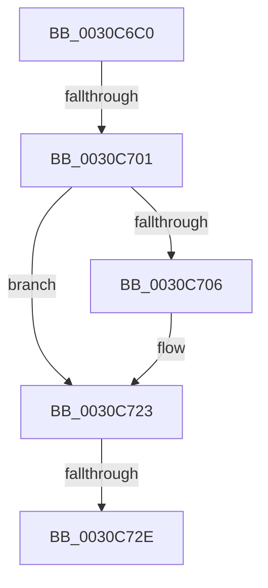

# sub_0030C6C0

- RVA: `0x0030C6C0`–`0x0030C736` (길이 `118` bytes)
- VA: `0x000000014030C6C0`
- 실행 섹션: `.text`
- PDB 이름 있음: `아니요`; PDB Function 태그: `아니요`
- unwind 정보 RVA: `0x00073D50`
- 디코드: `26`개 명령, `118/118` bytes 표시
- 미해석 바이트: `0` (있으면 어셈블리에 `.byte`로 보존)

> 이 문서는 커널 이미지의 기계어와 PDB 기호를 분석해 생성했습니다. 4번과 5번은 함수 원형과 자료형을 바이너리 사용 방식에서 추정한 C 해석이며 원본 소스 복구 결과는 아닙니다.

## 1. Dependencies

- 직접 호출 지점: **0**; 고유 호출 대상: **0**
- 직접 호출자로 확인된 함수: **0**
- RIP 상대 이미지 참조: **0**

### Outgoing calls
- 직접 디코드된 call 명령이 없습니다.

### Direct callers
- 이 함수 시작 RVA로 연결되는 직접 call은 확인되지 않았습니다. 간접 호출은 완전히 역산할 수 없습니다.

### Static image references
- 디코드된 RIP-relative 메모리 참조가 없습니다.

## 2. Other-region calls and transfers

- 다른 실행 섹션으로 향하는 call: **0**
- call이 아닌 외부 분기/꼬리 이동: **2**
  - `0x0030C6FB` → [sub_0030C88A](Unknown_function_0030C88A.md) (`tail-transfer`)
  - `0x0030C728` → [sub_0030C84E](Unknown_function_0030C84E.md) (`tail-transfer`)

## 3. Assembly (complete function range)

```asm
0030C6C0  48 89 5C 24 68                  mov qword ptr [rsp + 0x68], rbx
0030C6C5  48 8B 1A                        mov rbx, qword ptr [rdx]
0030C6C8  48 8B F9                        mov rdi, rcx
0030C6CB  48 8B CB                        mov rcx, rbx
0030C6CE  48 89 6C 24 60                  mov qword ptr [rsp + 0x60], rbp
0030C6D3  48 83 E1 FE                     and rcx, 0xfffffffffffffffe
0030C6D7  4C 89 64 24 58                  mov qword ptr [rsp + 0x58], r12
0030C6DC  83 E3 01                        and ebx, 1
0030C6DF  4C 89 B4 24 98 00 00 00         mov qword ptr [rsp + 0x98], r14
0030C6E7  48 89 5C 24 30                  mov qword ptr [rsp + 0x30], rbx
0030C6EC  45 8D 66 01                     lea r12d, [r14 + 1]
0030C6F0  45 8B C6                        mov r8d, r14d
0030C6F3  48 89 4C 24 20                  mov qword ptr [rsp + 0x20], rcx
0030C6F8  41 8B F6                        mov esi, r14d
0030C6FB  0F 84 89 01 00 00               je 0x14030c88a
0030C701  41 3B DC                        cmp ebx, r12d
0030C704  75 1D                           jne 0x14030c723
0030C706  48 8B 81 58 8E 00 00            mov rax, qword ptr [rcx + 0x8e58]
0030C70D  4C 8B 81 58 8E 00 00            mov r8, qword ptr [rcx + 0x8e58]
0030C714  49 83 C0 08                     add r8, 8
0030C718  4C 89 84 24 98 00 00 00         mov qword ptr [rsp + 0x98], r8
0030C720  0F B6 30                        movzx esi, byte ptr [rax]
0030C723  41 8B EE                        mov ebp, r14d
0030C726  85 F6                           test esi, esi
0030C728  0F 84 20 01 00 00               je 0x14030c84e
0030C72E  48 8B 9C 24 A0 00 00 00         mov rbx, qword ptr [rsp + 0xa0]
```

## 4. C-style interpretation (structured pseudocode)

```c
__int64 __fastcall sub_0030C6C0(__int64 a1, __int64 a2, __int64 a3, __int64 a4, __int64 a5, __int64 a6, __int64 a7, __int64 a8, __int64 a9, __int64 a10, __int64 a11, __int64 a12, __int64 a13, __int64 a14, __int64 a15, __int64 a16, __int64 a17, __int64 a18, __int64 a19, __int64 a20)
{
    __int64 result;
    __int64 v_rbx;
    __int64 v_rsi;
    unsigned __int64 v_stack_p20;
    unsigned __int64 v_stack_p30;
    unsigned __int64 v_stack_p58;
    unsigned __int64 v_stack_p60;
    unsigned __int64 v_stack_p68;
    unsigned __int64 v_stack_p98;

    v_stack_p68 = v_rbx;
    v_stack_p60 = v_rbp;
    a1 = (*(unsigned __int64 *)(a2)) & (-2);
    v_stack_p58 = v_r12;
    v_rbx = (unsigned int)((*(unsigned __int64 *)(a2)) & (1));
    v_stack_p98 = v_r14;
    v_stack_p30 = v_rbx;
    v_stack_p20 = a1;
    v_rsi = (unsigned int)((unsigned int)(v_r14));
    if (((unsigned int)(v_rbx)) == ((unsigned int)(v_r14 + 1))) {
        result = *(unsigned __int64 *)(a1 + 36440);
        a3 = *(unsigned __int64 *)(a1 + 36440);
        a3 = (a3) + (8);
        v_stack_p98 = a3;
        v_rsi = *(unsigned __int8 *)(result);
    }
    return result;
}
```

## 5. (Beta) C Style

```c
int64_t sub_0030C6C0(int64_t Arg1, void *Arg2, int64_t Arg3, int64_t Arg4, uint64_t Arg5, uint64_t Arg6, uint64_t Arg7, uint64_t Arg8, uint64_t Arg9, uint64_t Arg10, uint64_t Arg11, uint64_t Arg12, uint64_t Arg13, uint64_t Arg14, uint64_t Arg15, uint64_t Arg16, uint64_t Arg17, uint64_t Arg18, uint64_t Arg19, int64_t Arg20)
{
    uint8_t *arg2 = (uint8_t *)Arg2;

    int64_t result;
    int64_t local_rbx;
    int64_t local_rsi;
    uint64_t v_stack_p20;
    uint64_t v_stack_p30;
    uint64_t v_stack_p58;
    uint64_t v_stack_p60;
    uint64_t v_stack_p68;
    uint64_t v_stack_p98;

    v_stack_p68 = local_rbx;
    v_stack_p60 = local_rbp;
    Arg1 = (*(uint64_t *)(arg2)) & (-2);
    v_stack_p58 = local_r12;
    local_rbx = (uint32_t)((*(uint64_t *)(arg2)) & (1));
    v_stack_p98 = local_r14;
    v_stack_p30 = local_rbx;
    v_stack_p20 = Arg1;
    local_rsi = (uint32_t)((uint32_t)(local_r14));
    if (((uint32_t)(local_rbx)) == ((uint32_t)(local_r14 + 1))) {
        result = *(uint64_t *)(Arg1 + 0x8E58);
        Arg3 = *(uint64_t *)(Arg1 + 0x8E58);
        Arg3 = (Arg3) + (8);
        v_stack_p98 = Arg3;
        local_rsi = *(uint8_t *)(result);
    }
    return result;
}
```

### 관측된 메모리 오프셋

구조체 형식이 확인되지 않은 접근은 인자 기준의 오프셋으로만 기록했습니다.

| 기준 인자 | 오프셋 표현 | 폭 (bit) | 접근 |
|---|---:|---:|---|
| `Arg2` | `+ 0x0` | `64` | `R` |

## 6. Execution-region graph

[열기: 2D/3D 그래프와 함수 탐색 컨트롤 패널](../../../control-panel.html?section=text&rva=0x0030C6C0&view=graph)

- 2D 그래프는 위에서 아래로 흐르고, 3D 그래프는 빈 공간을 드래그해 회전합니다. Shift+드래그는 이동, 휠은 확대·축소, 함수 노드 선택은 대상 보고서 이동입니다.

### Static fallback


