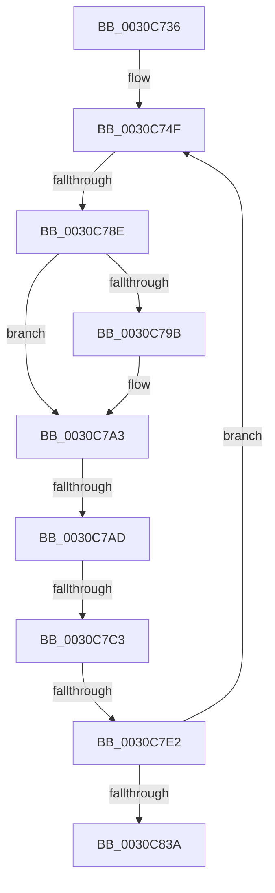

# sub_0030C736

- RVA: `0x0030C736`–`0x0030C84E` (길이 `280` bytes)
- VA: `0x000000014030C736`
- 실행 섹션: `.text`
- PDB 이름 있음: `아니요`; PDB Function 태그: `아니요`
- unwind 정보 RVA: `0x00073D6C`
- 디코드: `66`개 명령, `280/280` bytes 표시
- 미해석 바이트: `0` (있으면 어셈블리에 `.byte`로 보존)

> 이 문서는 커널 이미지의 기계어와 PDB 기호를 분석해 생성했습니다. 4번과 5번은 함수 원형과 자료형을 바이너리 사용 방식에서 추정한 C 해석이며 원본 소스 복구 결과는 아닙니다.

## 1. Dependencies

- 직접 호출 지점: **0**; 고유 호출 대상: **0**
- 직접 호출자로 확인된 함수: **0**
- RIP 상대 이미지 참조: **0**

### Outgoing calls
- 직접 디코드된 call 명령이 없습니다.

### Direct callers
- 이 함수 시작 RVA로 연결되는 직접 call은 확인되지 않았습니다. 간접 호출은 완전히 역산할 수 없습니다.

### Static image references
- 디코드된 RIP-relative 메모리 참조가 없습니다.

## 2. Other-region calls and transfers

- 다른 실행 섹션으로 향하는 call: **0**
- call이 아닌 외부 분기/꼬리 이동: **4**
  - `0x0030C788` → [sub_0030C8A6 + 0x11](Unknown_function_0030C8A6.md) (`tail-transfer`)
  - `0x0030C7A7` → [sub_0030C8A6 + 0x8](Unknown_function_0030C8A6.md) (`tail-transfer`)
  - `0x0030C7BD` → [sub_0030C8A6](Unknown_function_0030C8A6.md) (`tail-transfer`)
  - `0x0030C7DC` → [sub_0030C95E + 0x6D](Unknown_function_0030C95E.md) (`tail-transfer`)

## 3. Assembly (complete function range)

```asm
0030C736  4C 89 6C 24 50                  mov qword ptr [rsp + 0x50], r13
0030C73B  44 8B DE                        mov r11d, esi
0030C73E  4C 89 7C 24 48                  mov qword ptr [rsp + 0x48], r15
0030C743  4C 8D 7F 30                     lea r15, [rdi + 0x30]
0030C747  4C 89 9C 24 A8 00 00 00         mov qword ptr [rsp + 0xa8], r11
0030C74F  0F 57 C0                        xorps xmm0, xmm0
0030C752  33 C0                           xor eax, eax
0030C754  41 0F 11 47 E0                  movups xmmword ptr [r15 - 0x20], xmm0
0030C759  41 0F 11 47 F0                  movups xmmword ptr [r15 - 0x10], xmm0
0030C75E  49 89 07                        mov qword ptr [r15], rax
0030C761  49 C7 47 F8 FF FF FF FF         mov qword ptr [r15 - 8], 0xffffffffffffffff
0030C769  41 C6 47 04 3F                  mov byte ptr [r15 + 4], 0x3f
0030C76E  4D 8B 10                        mov r10, qword ptr [r8]
0030C771  4D 89 57 E0                     mov qword ptr [r15 - 0x20], r10
0030C775  4D 89 77 E8                     mov qword ptr [r15 - 0x18], r14
0030C779  4C 89 54 24 28                  mov qword ptr [rsp + 0x28], r10
0030C77E  49 8B 8A 48 8E 00 00            mov rcx, qword ptr [r10 + 0x8e48]
0030C785  48 85 C9                        test rcx, rcx
0030C788  0F 85 29 01 00 00               jne 0x14030c8b7
0030C78E  4D 8B 6A 10                     mov r13, qword ptr [r10 + 0x10]
0030C792  4D 89 6F F0                     mov qword ptr [r15 - 0x10], r13
0030C796  4D 85 ED                        test r13, r13
0030C799  75 08                           jne 0x14030c7a3
0030C79B  4D 8B 6A 08                     mov r13, qword ptr [r10 + 8]
0030C79F  4D 89 6F F0                     mov qword ptr [r15 - 0x10], r13
0030C7A3  4D 39 6A 10                     cmp qword ptr [r10 + 0x10], r13
0030C7A7  0F 84 01 01 00 00               je 0x14030c8ae
0030C7AD  65 48 8B 04 25 20 00 00 00      mov rax, qword ptr gs:[0x20]
0030C7B6  41 0F B6 0F                     movzx ecx, byte ptr [r15]
0030C7BA  4C 3B D0                        cmp r10, rax
0030C7BD  0F 84 E3 00 00 00               je 0x14030c8a6
0030C7C3  80 E1 FB                        and cl, 0xfb
0030C7C6  41 88 0F                        mov byte ptr [r15], cl
0030C7C9  45 32 C9                        xor r9b, r9b
0030C7CC  41 F7 45 78 00 00 40 00         test dword ptr [r13 + 0x78], 0x400000
0030C7D4  44 88 8C 24 90 00 00 00         mov byte ptr [rsp + 0x90], r9b
0030C7DC  0F 85 E9 01 00 00               jne 0x14030c9cb
0030C7E2  41 0F B6 42 23                  movzx eax, byte ptr [r10 + 0x23]
0030C7E7  41 0F B6 17                     movzx edx, byte ptr [r15]
0030C7EB  F6 D0                           not al
0030C7ED  41 22 C4                        and al, r12b
0030C7F0  80 E2 FE                        and dl, 0xfe
0030C7F3  0A D0                           or dl, al
0030C7F5  41 88 17                        mov byte ptr [r15], dl
0030C7F8  49 8B 42 38                     mov rax, qword ptr [r10 + 0x38]
0030C7FC  0F B6 08                        movzx ecx, byte ptr [rax]
0030C7FF  C0 E9 06                        shr cl, 6
0030C802  32 CA                           xor cl, dl
0030C804  80 E1 02                        and cl, 2
0030C807  32 CA                           xor cl, dl
0030C809  0F B6 C1                        movzx eax, cl
0030C80C  41 88 07                        mov byte ptr [r15], al
0030C80F  D1 E8                           shr eax, 1
0030C811  41 23 C4                        and eax, r12d
0030C814  3B C5                           cmp eax, ebp
0030C816  0F 4F E8                        cmovg ebp, eax
0030C819  49 83 C0 08                     add r8, 8
0030C81D  49 83 C7 28                     add r15, 0x28
0030C821  4C 89 84 24 98 00 00 00         mov qword ptr [rsp + 0x98], r8
0030C829  4D 2B DC                        sub r11, r12
0030C82C  4C 89 9C 24 A8 00 00 00         mov qword ptr [rsp + 0xa8], r11
0030C834  0F 85 15 FF FF FF               jne 0x14030c74f
0030C83A  4C 8B 7C 24 48                  mov r15, qword ptr [rsp + 0x48]
0030C83F  4C 8B 6C 24 50                  mov r13, qword ptr [rsp + 0x50]
0030C844  48 8B 4C 24 20                  mov rcx, qword ptr [rsp + 0x20]
0030C849  48 8B 5C 24 30                  mov rbx, qword ptr [rsp + 0x30]
```

## 4. C-style interpretation (structured pseudocode)

```c
__int64 __fastcall sub_0030C736(__int64 a1, __int64 a2, __int64 a3, unsigned __int8 a4, __int64 a5, __int64 a6, __int64 a7, __int64 a8, __int64 a9, __int64 a10)
{
    __int64 result;
    __int64 v_r11;
    __int64 v_r13;
    __int64 v_r15;
    __int64 v_rbp;
    unsigned __int64 v_stack_p20;
    unsigned __int64 v_stack_p28;
    unsigned __int64 v_stack_p48;
    unsigned __int64 v_stack_p50;
    unsigned __int8 v_stack_p90;
    unsigned __int64 v_stack_p98;
    unsigned __int64 v_stack_pA8;

    v_stack_p50 = v_r13;
    v_stack_p48 = v_r15;
    v_stack_pA8 = (unsigned int)((unsigned int)(v_rsi));
loc_0030C74F:
    result = 0;
    *(unsigned __int64 *)(v_rdi + 48 - 32) = v_xmm0;
    *(unsigned __int64 *)(v_rdi + 48 - 16) = v_xmm0;
    *(unsigned __int64 *)(v_rdi + 48) = 0;
    *(unsigned __int64 *)(v_rdi + 48 - 8) = -1;
    *(unsigned __int8 *)(v_rdi + 48 + 4) = 63;
    *(unsigned __int64 *)(v_rdi + 48 - 32) = *(unsigned __int64 *)(a3);
    *(unsigned __int64 *)(v_rdi + 48 - 24) = v_r14;
    v_stack_p28 = *(unsigned __int64 *)(a3);
    *(unsigned __int64 *)(v_rdi + 48 - 16) = *(unsigned __int64 *)(*(unsigned __int64 *)(a3) + 16);
    v_r13 = *(unsigned __int64 *)(*(unsigned __int64 *)(a3) + 16);
    if (*(unsigned __int64 *)(*(unsigned __int64 *)(a3) + 16) == 0) {
        v_r13 = *(unsigned __int64 *)(*(unsigned __int64 *)(a3) + 8);
        *(unsigned __int64 *)(v_rdi + 48 - 16) = v_r13;
    }
    a1 = (unsigned __int8)((*(unsigned __int8 *)(v_rdi + 48)) & (251));
    *(unsigned __int8 *)(v_rdi + 48) = (unsigned __int8)(a1);
    a4 = 0;
    v_stack_p90 = 0;
    result = (unsigned __int8)(~(*(unsigned __int8 *)(*(unsigned __int64 *)(a3) + 35)));
    result = (unsigned __int8)((result) & ((unsigned __int8)(v_r12)));
    a2 = (unsigned __int8)((*(unsigned __int8 *)(v_rdi + 48)) & (254));
    a2 = (unsigned __int8)((a2) | ((unsigned __int8)(result)));
    *(unsigned __int8 *)(v_rdi + 48) = (unsigned __int8)(a2);
    a1 = (unsigned __int8)((*(unsigned __int8 *)(*(unsigned __int64 *)(*(unsigned __int64 *)(a3) + 56))) >> (6));
    a1 = (unsigned __int8)((a1) ^ ((unsigned __int8)(a2)));
    a1 = (unsigned __int8)((a1) & (2));
    a1 = (unsigned __int8)((a1) ^ ((unsigned __int8)(a2)));
    *(unsigned __int8 *)(v_rdi + 48) = (unsigned __int8)((unsigned __int8)(a1));
    result = (unsigned int)(((unsigned __int8)(a1)) >> (1));
    result = (unsigned int)((result) & ((unsigned int)(v_r12)));
    if (((unsigned int)(result)) > ((unsigned int)(v_rbp))) { v_rbp = (unsigned int)(result); }
    a3 = (a3) + (8);
    v_r15 = (v_rdi + 48) + (40);
    v_stack_p98 = a3;
    v_r11 = ((unsigned int)((unsigned int)(v_rsi))) - (v_r12);
    v_stack_pA8 = v_r11;
    if (condition_is_not_equal) goto loc_0030C74F;
    return result;
}
```

## 5. (Beta) C Style

```c
int64_t sub_0030C736(int64_t Arg1, int64_t Arg2, void *Arg3, uint8_t Arg4, uint64_t Arg5, int64_t Arg6, uint64_t Arg7, uint64_t Arg8, int64_t Arg9, int64_t Arg10)
{
    uint8_t *arg3 = (uint8_t *)Arg3;

    int64_t result;
    int64_t local_r11;
    int64_t local_r13;
    int64_t local_r15;
    int64_t local_rbp;
    uint64_t v_stack_p20;
    uint64_t v_stack_p28;
    uint64_t v_stack_p48;
    uint64_t v_stack_p50;
    uint8_t v_stack_p90;
    uint64_t v_stack_p98;
    uint64_t v_stack_pA8;

    v_stack_p50 = local_r13;
    v_stack_p48 = local_r15;
    v_stack_pA8 = (uint32_t)((uint32_t)(local_rsi));
loc_0030C74F:
    result = 0;
    *(uint64_t *)(local_rdi + 0x30 - 0x20) = v_xmm0;
    *(uint64_t *)(local_rdi + 0x30 - 0x10) = v_xmm0;
    *(uint64_t *)(local_rdi + 0x30) = 0;
    *(uint64_t *)(local_rdi + 0x30 - 0x8) = -1;
    *(uint8_t *)(local_rdi + 0x30 + 0x4) = 63;
    *(uint64_t *)(local_rdi + 0x30 - 0x20) = *(uint64_t *)(arg3);
    *(uint64_t *)(local_rdi + 0x30 - 0x18) = local_r14;
    v_stack_p28 = *(uint64_t *)(arg3);
    *(uint64_t *)(local_rdi + 0x30 - 0x10) = *(uint64_t *)(*(uint64_t *)(arg3) + 0x10);
    local_r13 = *(uint64_t *)(*(uint64_t *)(arg3) + 0x10);
    if (*(uint64_t *)(*(uint64_t *)(arg3) + 0x10) == 0) {
        local_r13 = *(uint64_t *)(*(uint64_t *)(arg3) + 0x8);
        *(uint64_t *)(local_rdi + 0x30 - 0x10) = local_r13;
    }
    Arg1 = (uint8_t)((*(uint8_t *)(local_rdi + 0x30)) & (251));
    *(uint8_t *)(local_rdi + 0x30) = (uint8_t)(Arg1);
    Arg4 = 0;
    v_stack_p90 = 0;
    result = (uint8_t)(~(*(uint8_t *)(*(uint64_t *)(arg3) + 0x23)));
    result = (uint8_t)((result) & ((uint8_t)(local_r12)));
    Arg2 = (uint8_t)((*(uint8_t *)(local_rdi + 0x30)) & (254));
    Arg2 = (uint8_t)((Arg2) | ((uint8_t)(result)));
    *(uint8_t *)(local_rdi + 0x30) = (uint8_t)(Arg2);
    Arg1 = (uint8_t)((*(uint8_t *)(*(uint64_t *)(*(uint64_t *)(arg3) + 0x38))) >> (6));
    Arg1 = (uint8_t)((Arg1) ^ ((uint8_t)(Arg2)));
    Arg1 = (uint8_t)((Arg1) & (2));
    Arg1 = (uint8_t)((Arg1) ^ ((uint8_t)(Arg2)));
    *(uint8_t *)(local_rdi + 0x30) = (uint8_t)((uint8_t)(Arg1));
    result = (uint32_t)(((uint8_t)(Arg1)) >> (1));
    result = (uint32_t)((result) & ((uint32_t)(local_r12)));
    if (((uint32_t)(result)) > ((uint32_t)(local_rbp))) { local_rbp = (uint32_t)(result); }
    Arg3 = (Arg3) + (8);
    local_r15 = (local_rdi + 48) + (40);
    v_stack_p98 = Arg3;
    local_r11 = ((uint32_t)((uint32_t)(local_rsi))) - (local_r12);
    v_stack_pA8 = local_r11;
    if (condition_is_not_equal) goto loc_0030C74F;
    return result;
}
```

### 관측된 메모리 오프셋

구조체 형식이 확인되지 않은 접근은 인자 기준의 오프셋으로만 기록했습니다.

| 기준 인자 | 오프셋 표현 | 폭 (bit) | 접근 |
|---|---:|---:|---|
| `Arg3` | `+ 0x0` | `64` | `R` |

## 6. Execution-region graph

[열기: 2D/3D 그래프와 함수 탐색 컨트롤 패널](../../../control-panel.html?section=text&rva=0x0030C736&view=graph)

- 2D 그래프는 위에서 아래로 흐르고, 3D 그래프는 빈 공간을 드래그해 회전합니다. Shift+드래그는 이동, 휠은 확대·축소, 함수 노드 선택은 대상 보고서 이동입니다.

### Static fallback


