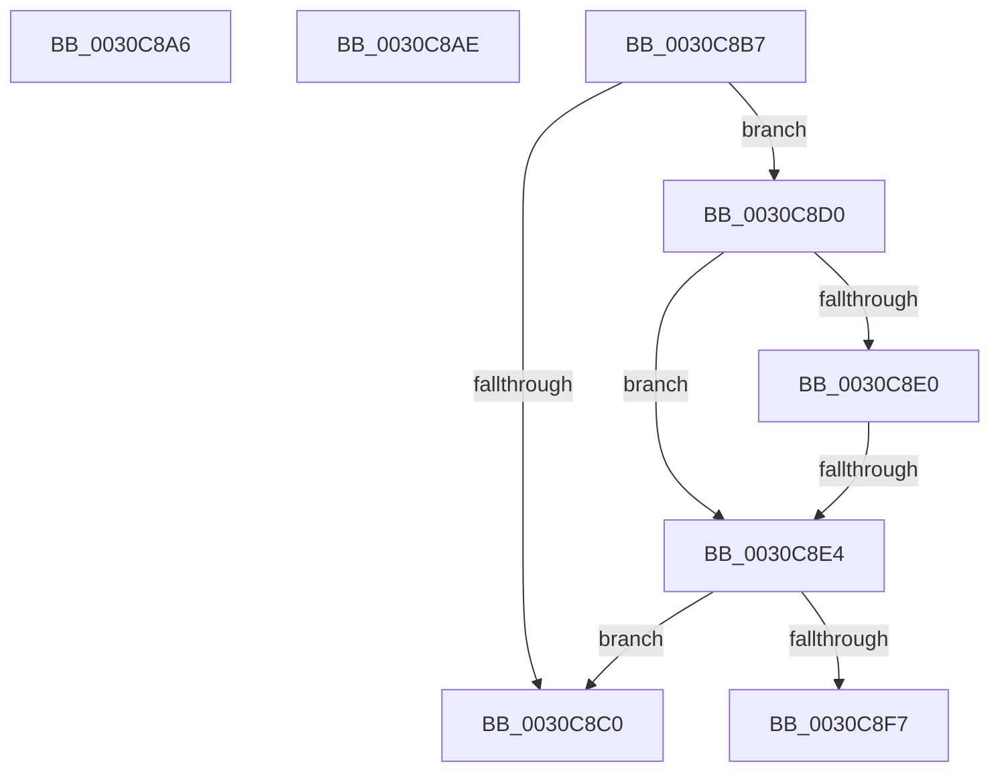

# sub_0030C8A6

- RVA: `0x0030C8A6`–`0x0030C8FC` (길이 `86` bytes)
- VA: `0x000000014030C8A6`
- 실행 섹션: `.text`
- PDB 이름 있음: `아니요`; PDB Function 태그: `아니요`
- unwind 정보 RVA: `0x00073DF4`
- 디코드: `21`개 명령, `86/86` bytes 표시
- 미해석 바이트: `0` (있으면 어셈블리에 `.byte`로 보존)

> 이 문서는 커널 이미지의 기계어와 PDB 기호를 분석해 생성했습니다. 4번과 5번은 함수 원형과 자료형을 바이너리 사용 방식에서 추정한 C 해석이며 원본 소스 복구 결과는 아닙니다.

## 1. Dependencies

- 직접 호출 지점: **0**; 고유 호출 대상: **0**
- 직접 호출자로 확인된 함수: **0**
- RIP 상대 이미지 참조: **1**

### Outgoing calls
- 직접 디코드된 call 명령이 없습니다.

### Direct callers
- 이 함수 시작 RVA로 연결되는 직접 call은 확인되지 않았습니다. 간접 호출은 완전히 역산할 수 없습니다.

### Static image references
- `0x0030C8D0` → RVA `0x00FC52E0` (`ALMOSTRO`; read)

## 2. Other-region calls and transfers

- 다른 실행 섹션으로 향하는 call: **0**
- call이 아닌 외부 분기/꼬리 이동: **5**
  - `0x0030C8A9` → [sub_0030C736 + 0x90](Unknown_function_0030C736.md) (`tail-transfer`)
  - `0x0030C8B2` → [sub_0030C736 + 0x93](Unknown_function_0030C736.md) (`tail-transfer`)
  - `0x0030C8CB` → [sub_0030C736 + 0x58](Unknown_function_0030C736.md) (`tail-transfer`)
  - `0x0030C8E2` → [sub_0030C95E](Unknown_function_0030C95E.md) (`tail-transfer`)
  - `0x0030C8F7` → [sub_0030C736 + 0x58](Unknown_function_0030C736.md) (`tail-transfer`)

## 3. Assembly (complete function range)

```asm
0030C8A6  80 C9 04                        or cl, 4
0030C8A9  E9 18 FF FF FF                  jmp 0x14030c7c6
0030C8AE  41 80 0F 04                     or byte ptr [r15], 4
0030C8B2  E9 12 FF FF FF                  jmp 0x14030c7c9
0030C8B7  41 0F B6 42 23                  movzx eax, byte ptr [r10 + 0x23]
0030C8BC  A8 10                           test al, 0x10
0030C8BE  75 10                           jne 0x14030c8d0
0030C8C0  49 8B 82 48 8E 00 00            mov rax, qword ptr [r10 + 0x8e48]
0030C8C7  49 89 47 E8                     mov qword ptr [r15 - 0x18], rax
0030C8CB  E9 BE FE FF FF                  jmp 0x14030c78e
0030C8D0  44 39 35 09 8A CB 00            cmp dword ptr [rip + 0xcb8a09], r14d
0030C8D7  49 8B 92 C0 00 00 00            mov rdx, qword ptr [r10 + 0xc0]
0030C8DE  74 04                           je 0x14030c8e4
0030C8E0  A8 20                           test al, 0x20
0030C8E2  75 7A                           jne 0x14030c95e
0030C8E4  48 8B 42 50                     mov rax, qword ptr [rdx + 0x50]
0030C8E8  48 8B 91 C8 02 00 00            mov rdx, qword ptr [rcx + 0x2c8]
0030C8EF  48 23 D0                        and rdx, rax
0030C8F2  48 85 D2                        test rdx, rdx
0030C8F5  74 C9                           je 0x14030c8c0
0030C8F7  E9 92 FE FF FF                  jmp 0x14030c78e
```

## 4. C-style interpretation (structured pseudocode)

```c
__int64 __fastcall sub_0030C8A6(unsigned __int8 a1)
{
    a1 = (unsigned __int8)((a1) | (4));
}
```

## 5. (Beta) C Style

```c
int64_t sub_0030C8A6(uint8_t Arg1)
{
    Arg1 = (uint8_t)((Arg1) | (4));
}
```

## 6. Execution-region graph

[열기: 2D/3D 그래프와 함수 탐색 컨트롤 패널](../../../control-panel.html?section=text&rva=0x0030C8A6&view=graph)

- 2D 그래프는 위에서 아래로 흐르고, 3D 그래프는 빈 공간을 드래그해 회전합니다. Shift+드래그는 이동, 휠은 확대·축소, 함수 노드 선택은 대상 보고서 이동입니다.

### Static fallback


