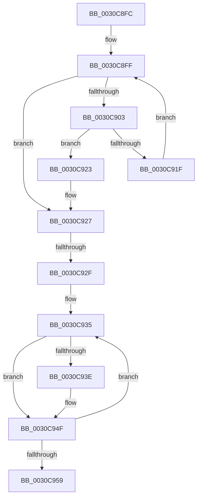

# sub_0030C8FC

- RVA: `0x0030C8FC`–`0x0030C95E` (길이 `98` bytes)
- VA: `0x000000014030C8FC`
- 실행 섹션: `.text`
- PDB 이름 있음: `아니요`; PDB Function 태그: `아니요`
- unwind 정보 RVA: `0x00073E18`
- 디코드: `29`개 명령, `98/98` bytes 표시
- 미해석 바이트: `0` (있으면 어셈블리에 `.byte`로 보존)

> 이 문서는 커널 이미지의 기계어와 PDB 기호를 분석해 생성했습니다. 4번과 5번은 함수 원형과 자료형을 바이너리 사용 방식에서 추정한 C 해석이며 원본 소스 복구 결과는 아닙니다.

## 1. Dependencies

- 직접 호출 지점: **0**; 고유 호출 대상: **0**
- 직접 호출자로 확인된 함수: **0**
- RIP 상대 이미지 참조: **0**

### Outgoing calls
- 직접 디코드된 call 명령이 없습니다.

### Direct callers
- 이 함수 시작 RVA로 연결되는 직접 call은 확인되지 않았습니다. 간접 호출은 완전히 역산할 수 없습니다.

### Static image references
- 디코드된 RIP-relative 메모리 참조가 없습니다.

## 2. Other-region calls and transfers

- 다른 실행 섹션으로 향하는 call: **0**
- call이 아닌 외부 분기/꼬리 이동: **2**
  - `0x0030C929` → [sub_0030C880](Unknown_function_0030C880.md) (`tail-transfer`)
  - `0x0030C959` → [sub_0030C880](Unknown_function_0030C880.md) (`tail-transfer`)

## 3. Assembly (complete function range)

```asm
0030C8FC  41 8B D6                        mov edx, r14d
0030C8FF  3B D6                           cmp edx, esi
0030C901  73 24                           jae 0x14030c927
0030C903  8B C2                           mov eax, edx
0030C905  48 8D 0C 80                     lea rcx, [rax + rax*4]
0030C909  48 8B 44 CF 10                  mov rax, qword ptr [rdi + rcx*8 + 0x10]
0030C90E  4C 8D 04 CF                     lea r8, [rdi + rcx*8]
0030C912  48 8B 88 80 8E 00 00            mov rcx, qword ptr [rax + 0x8e80]
0030C919  49 39 48 20                     cmp qword ptr [r8 + 0x20], rcx
0030C91D  75 04                           jne 0x14030c923
0030C91F  FF C2                           inc edx
0030C921  EB DC                           jmp 0x14030c8ff
0030C923  4D 8D 70 10                     lea r14, [r8 + 0x10]
0030C927  85 F6                           test esi, esi
0030C929  0F 84 51 FF FF FF               je 0x14030c880
0030C92F  48 83 C7 30                     add rdi, 0x30
0030C933  8B CE                           mov ecx, esi
0030C935  48 8D 47 E0                     lea rax, [rdi - 0x20]
0030C939  49 3B C6                        cmp rax, r14
0030C93C  74 11                           je 0x14030c94f
0030C93E  49 8B 46 10                     mov rax, qword ptr [r14 + 0x10]
0030C942  48 89 47 F0                     mov qword ptr [rdi - 0x10], rax
0030C946  41 0F B6 46 20                  movzx eax, byte ptr [r14 + 0x20]
0030C94B  0C 20                           or al, 0x20
0030C94D  88 07                           mov byte ptr [rdi], al
0030C94F  48 83 C7 28                     add rdi, 0x28
0030C953  48 83 E9 01                     sub rcx, 1
0030C957  75 DC                           jne 0x14030c935
0030C959  E9 22 FF FF FF                  jmp 0x14030c880
```

## 4. C-style interpretation (structured pseudocode)

```c
__int64 __fastcall sub_0030C8FC(void)
{
    __int64 result;
    __int64 v_rdi;

loc_0030C8FF:
    if (((unsigned int)((unsigned int)((unsigned int)(v_r14)))) >= ((unsigned int)(v_rsi))) goto loc_0030C927;
    if ((*(unsigned __int64 *)(v_rdi + (unsigned int)((unsigned int)((unsigned int)((unsigned int)(v_r14)))) + (unsigned int)((unsigned int)((unsigned int)((unsigned int)(v_r14)))) * 4 * 8 + 32)) != (*(unsigned __int64 *)(*(unsigned __int64 *)(v_rdi + (unsigned int)((unsigned int)((unsigned int)((unsigned int)(v_r14)))) + (unsigned int)((unsigned int)((unsigned int)((unsigned int)(v_r14)))) * 4 * 8 + 16) + 36480))) goto loc_0030C923;
    a2 = (unsigned int)(((unsigned int)((unsigned int)(v_r14))) + 1);
    goto loc_0030C8FF;
loc_0030C923:
loc_0030C927:
    v_rdi = (v_rdi) + (48);
loc_0030C935:
    result = v_rdi - 32;
    if ((v_rdi - 32) != (v_rdi + (unsigned int)((unsigned int)((unsigned int)((unsigned int)(v_r14)))) + (unsigned int)((unsigned int)((unsigned int)((unsigned int)(v_r14)))) * 4 * 8 + 16)) {
        result = *(unsigned __int64 *)(v_rdi + (unsigned int)((unsigned int)((unsigned int)((unsigned int)(v_r14)))) + (unsigned int)((unsigned int)((unsigned int)((unsigned int)(v_r14)))) * 4 * 8 + 16 + 16);
        *(unsigned __int64 *)(v_rdi - 16) = result;
        result = *(unsigned __int8 *)(v_rdi + (unsigned int)((unsigned int)((unsigned int)((unsigned int)(v_r14)))) + (unsigned int)((unsigned int)((unsigned int)((unsigned int)(v_r14)))) * 4 * 8 + 16 + 32);
        result = (unsigned __int8)((result) | (32));
        *(unsigned __int8 *)(v_rdi) = (unsigned __int8)(result);
    }
    v_rdi = (v_rdi) + (40);
    a1 = ((unsigned int)((unsigned int)(v_rsi))) - (1);
    if (condition_is_not_equal) goto loc_0030C935;
}
```

## 5. (Beta) C Style

```c
void sub_0030C8FC(void)
{
    int64_t result;
    int64_t local_rdi;

loc_0030C8FF:
    if (((uint32_t)((uint32_t)((uint32_t)(local_r14)))) >= ((uint32_t)(local_rsi))) goto loc_0030C927;
    if ((*(uint64_t *)(local_rdi + (uint32_t)((uint32_t)((uint32_t)((uint32_t)(local_r14)))) + (uint32_t)((uint32_t)((uint32_t)((uint32_t)(local_r14)))) * 4 * 8 + 0x20)) != (*(uint64_t *)(*(uint64_t *)(local_rdi + (uint32_t)((uint32_t)((uint32_t)((uint32_t)(local_r14)))) + (uint32_t)((uint32_t)((uint32_t)((uint32_t)(local_r14)))) * 4 * 8 + 0x10) + 0x8E80))) goto loc_0030C923;
    a2 = (uint32_t)(((uint32_t)((uint32_t)(local_r14))) + 1);
    goto loc_0030C8FF;
loc_0030C923:
loc_0030C927:
    local_rdi = (local_rdi) + (48);
loc_0030C935:
    result = local_rdi - 32;
    if ((local_rdi - 32) != (local_rdi + (uint32_t)((uint32_t)((uint32_t)((uint32_t)(local_r14)))) + (uint32_t)((uint32_t)((uint32_t)((uint32_t)(local_r14)))) * 4 * 8 + 16)) {
        result = *(uint64_t *)(local_rdi + (uint32_t)((uint32_t)((uint32_t)((uint32_t)(local_r14)))) + (uint32_t)((uint32_t)((uint32_t)((uint32_t)(local_r14)))) * 4 * 8 + 0x10 + 0x10);
        *(uint64_t *)(local_rdi - 0x10) = result;
        result = *(uint8_t *)(local_rdi + (uint32_t)((uint32_t)((uint32_t)((uint32_t)(local_r14)))) + (uint32_t)((uint32_t)((uint32_t)((uint32_t)(local_r14)))) * 4 * 8 + 0x10 + 0x20);
        result = (uint8_t)((result) | (32));
        *(uint8_t *)(local_rdi) = (uint8_t)(result);
    }
    local_rdi = (local_rdi) + (40);
    a1 = ((uint32_t)((uint32_t)(local_rsi))) - (1);
    if (condition_is_not_equal) goto loc_0030C935;
}
```

## 6. Execution-region graph

[열기: 2D/3D 그래프와 함수 탐색 컨트롤 패널](../../../control-panel.html?section=text&rva=0x0030C8FC&view=graph)

- 2D 그래프는 위에서 아래로 흐르고, 3D 그래프는 빈 공간을 드래그해 회전합니다. Shift+드래그는 이동, 휠은 확대·축소, 함수 노드 선택은 대상 보고서 이동입니다.

### Static fallback


