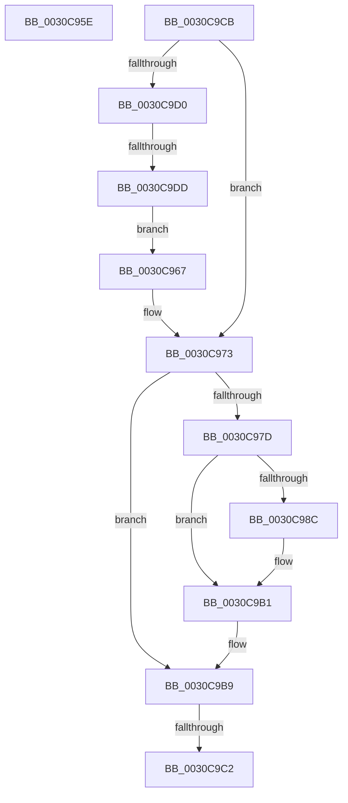

# sub_0030C95E

- RVA: `0x0030C95E`–`0x0030C9DF` (길이 `129` bytes)
- VA: `0x000000014030C95E`
- 실행 섹션: `.text`
- PDB 이름 있음: `아니요`; PDB Function 태그: `아니요`
- unwind 정보 RVA: `0x00073E28`
- 디코드: `29`개 명령, `129/129` bytes 표시
- 미해석 바이트: `0` (있으면 어셈블리에 `.byte`로 보존)

> 이 문서는 커널 이미지의 기계어와 PDB 기호를 분석해 생성했습니다. 4번과 5번은 함수 원형과 자료형을 바이너리 사용 방식에서 추정한 C 해석이며 원본 소스 복구 결과는 아닙니다.

## 1. Dependencies

- 직접 호출 지점: **2**; 고유 호출 대상: **2**
- 직접 호출자로 확인된 함수: **0**
- RIP 상대 이미지 참조: **0**

### Outgoing calls
- `0x0030C983` → [KiIsThreadStateControlledByProcessor](KiIsThreadStateControlledByProcessor_function_00306254.md) (function, `0x00306254`)
- `0x0030C996` → [KiUpdateVPBackingThreadPriority](KiUpdateVPBackingThreadPriority_function_00306040.md) (function, `0x00306040`)

### Direct callers
- 이 함수 시작 RVA로 연결되는 직접 call은 확인되지 않았습니다. 간접 호출은 완전히 역산할 수 없습니다.

### Static image references
- 디코드된 RIP-relative 메모리 참조가 없습니다.

## 2. Other-region calls and transfers

- 다른 실행 섹션으로 향하는 call: **0**
- call이 아닌 외부 분기/꼬리 이동: **4**
  - `0x0030C965` → [sub_0030C8A6 + 0x42](Unknown_function_0030C8A6.md) (`tail-transfer`)
  - `0x0030C9BC` → [sub_0030C736 + 0xAC](Unknown_function_0030C736.md) (`tail-transfer`)
  - `0x0030C9C6` → [sub_0030C736 + 0xAC](Unknown_function_0030C736.md) (`tail-transfer`)
  - `0x0030C9D7` → [sub_0030C736 + 0xAC](Unknown_function_0030C736.md) (`tail-transfer`)

## 3. Assembly (complete function range)

```asm
0030C95E  48 8B 42 68                     mov rax, qword ptr [rdx + 0x68]
0030C962  48 F7 D0                        not rax
0030C965  EB 81                           jmp 0x14030c8e8
0030C967  45 0F B6 CC                     movzx r9d, r12b
0030C96B  44 88 A4 24 90 00 00 00         mov byte ptr [rsp + 0x90], r12b
0030C973  41 F7 45 78 00 00 40 00         test dword ptr [r13 + 0x78], 0x400000
0030C97B  74 3C                           je 0x14030c9b9
0030C97D  49 8B D2                        mov rdx, r10
0030C980  49 8B CD                        mov rcx, r13
0030C983  E8 CC 98 FF FF                  call 0x140306254
0030C988  84 C0                           test al, al
0030C98A  74 25                           je 0x14030c9b1
0030C98C  45 0F B6 CC                     movzx r9d, r12b
0030C990  49 8B D2                        mov rdx, r10
0030C993  49 8B CD                        mov rcx, r13
0030C996  E8 A5 96 FF FF                  call 0x140306040
0030C99B  4C 8B 54 24 28                  mov r10, qword ptr [rsp + 0x28]
0030C9A0  44 0F B6 8C 24 90 00 00 00      movzx r9d, byte ptr [rsp + 0x90]
0030C9A9  4C 8B 9C 24 A8 00 00 00         mov r11, qword ptr [rsp + 0xa8]
0030C9B1  4C 8B 84 24 98 00 00 00         mov r8, qword ptr [rsp + 0x98]
0030C9B9  45 84 C9                        test r9b, r9b
0030C9BC  0F 84 20 FE FF FF               je 0x14030c7e2
0030C9C2  4D 89 75 40                     mov qword ptr [r13 + 0x40], r14
0030C9C6  E9 17 FE FF FF                  jmp 0x14030c7e2
0030C9CB  4C 3B EB                        cmp r13, rbx
0030C9CE  74 A3                           je 0x14030c973
0030C9D0  F0 49 0F BA 6D 40 00            lock bts qword ptr [r13 + 0x40], 0
0030C9D7  0F 82 05 FE FF FF               jb 0x14030c7e2
0030C9DD  EB 88                           jmp 0x14030c967
```

## 4. C-style interpretation (structured pseudocode)

```c
__int64 __fastcall sub_0030C95E(__int64 a1, __int64 a2)
{
    __int64 result;
    unsigned __int64 v_stack_p28;
    unsigned __int8 v_stack_p90;
    unsigned __int64 v_stack_p98;
    unsigned __int64 v_stack_pA8;

    result = ~(*(unsigned __int64 *)(a2 + 104));
}
```

## 5. (Beta) C Style

```c
int64_t sub_0030C95E(int64_t Arg1, void *Arg2)
{
    uint8_t *arg2 = (uint8_t *)Arg2;

    int64_t result;
    uint64_t v_stack_p28;
    uint8_t v_stack_p90;
    uint64_t v_stack_p98;
    uint64_t v_stack_pA8;

    result = ~(*(uint64_t *)(arg2 + 0x68));
}
```

### 관측된 메모리 오프셋

구조체 형식이 확인되지 않은 접근은 인자 기준의 오프셋으로만 기록했습니다.

| 기준 인자 | 오프셋 표현 | 폭 (bit) | 접근 |
|---|---:|---:|---|
| `Arg2` | `+ 0x68` | `64` | `R` |

## 6. Execution-region graph

[열기: 2D/3D 그래프와 함수 탐색 컨트롤 패널](../../../control-panel.html?section=text&rva=0x0030C95E&view=graph)

- 2D 그래프는 위에서 아래로 흐르고, 3D 그래프는 빈 공간을 드래그해 회전합니다. Shift+드래그는 이동, 휠은 확대·축소, 함수 노드 선택은 대상 보고서 이동입니다.

### Static fallback


