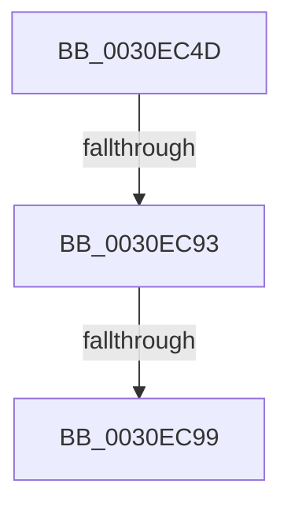

# sub_0030EC4D

- RVA: `0x0030EC4D`–`0x0030ECAB` (길이 `94` bytes)
- VA: `0x000000014030EC4D`
- 실행 섹션: `.text`
- PDB 이름 있음: `아니요`; PDB Function 태그: `아니요`
- unwind 정보 RVA: `0x00073F78`
- 디코드: `27`개 명령, `94/94` bytes 표시
- 미해석 바이트: `0` (있으면 어셈블리에 `.byte`로 보존)

> 이 문서는 커널 이미지의 기계어와 PDB 기호를 분석해 생성했습니다. 4번과 5번은 함수 원형과 자료형을 바이너리 사용 방식에서 추정한 C 해석이며 원본 소스 복구 결과는 아닙니다.

## 1. Dependencies

- 직접 호출 지점: **0**; 고유 호출 대상: **0**
- 직접 호출자로 확인된 함수: **0**
- RIP 상대 이미지 참조: **0**

### Outgoing calls
- 직접 디코드된 call 명령이 없습니다.

### Direct callers
- 이 함수 시작 RVA로 연결되는 직접 call은 확인되지 않았습니다. 간접 호출은 완전히 역산할 수 없습니다.

### Static image references
- 디코드된 RIP-relative 메모리 참조가 없습니다.

## 2. Other-region calls and transfers

- 다른 실행 섹션으로 향하는 call: **0**
- call이 아닌 외부 분기/꼬리 이동: **3**
  - `0x0030EC8D` → [sub_0030ED38](Unknown_function_0030ED38.md) (`tail-transfer`)
  - `0x0030EC97` → [sub_0030ECE7](Unknown_function_0030ECE7.md) (`tail-transfer`)
  - `0x0030ECA9` → [sub_0030ECE7](Unknown_function_0030ECE7.md) (`tail-transfer`)

## 3. Assembly (complete function range)

```asm
0030EC4D  48 89 5C 24 58                  mov qword ptr [rsp + 0x58], rbx
0030EC52  48 8B 59 38                     mov rbx, qword ptr [rcx + 0x38]
0030EC56  44 8B CA                        mov r9d, edx
0030EC59  4C 89 74 24 20                  mov qword ptr [rsp + 0x20], r14
0030EC5E  4D 8B E8                        mov r13, r8
0030EC61  44 8B E2                        mov r12d, edx
0030EC64  0F B6 1B                        movzx ebx, byte ptr [rbx]
0030EC67  48 89 4C 24 50                  mov qword ptr [rsp + 0x50], rcx
0030EC6C  8B C3                           mov eax, ebx
0030EC6E  C1 E8 07                        shr eax, 7
0030EC71  3B D0                           cmp edx, eax
0030EC73  44 0F 4C C8                     cmovl r9d, eax
0030EC77  49 63 C1                        movsxd rax, r9d
0030EC7A  48 8B C8                        mov rcx, rax
0030EC7D  49 33 CF                        xor rcx, r15
0030EC80  48 83 E1 FE                     and rcx, 0xfffffffffffffffe
0030EC84  48 33 C8                        xor rcx, rax
0030EC87  49 89 08                        mov qword ptr [r8], rcx
0030EC8A  45 85 C9                        test r9d, r9d
0030EC8D  0F 84 A5 00 00 00               je 0x14030ed38
0030EC93  41 83 F9 01                     cmp r9d, 1
0030EC97  75 4E                           jne 0x14030ece7
0030EC99  49 8B 87 58 8E 00 00            mov rax, qword ptr [r15 + 0x8e58]
0030ECA0  0F B6 08                        movzx ecx, byte ptr [rax]
0030ECA3  4C 8D 70 08                     lea r14, [rax + 8]
0030ECA7  85 C9                           test ecx, ecx
0030ECA9  74 3C                           je 0x14030ece7
```

## 4. C-style interpretation (structured pseudocode)

```c
__int64 __fastcall sub_0030EC4D(__int64 a1, int a2, __int64 a3)
{
    __int64 result;
    unsigned __int64 v_stack_p20;
    unsigned __int64 v_stack_p50;
    unsigned __int64 v_stack_p58;

    v_stack_p58 = v_rbx;
    v_stack_p20 = v_r14;
    v_stack_p50 = a1;
    result = (unsigned int)(((unsigned int)((unsigned int)(*(unsigned __int8 *)(*(unsigned __int64 *)(a1 + 56))))) >> (7));
    a4 = (unsigned int)(a2);
    if (a2 < ((unsigned int)(result))) { a4 = (unsigned int)(result); }
    a1 = ((int)((unsigned int)(a4))) ^ (v_r15);
    a1 = (a1) & (-2);
    a1 = (a1) ^ ((int)((unsigned int)(a4)));
    *(unsigned __int64 *)(a3) = a1;
}
```

## 5. (Beta) C Style

```c
int64_t sub_0030EC4D(void *Arg1, int32_t Arg2, void *Arg3)
{
    uint8_t *arg1 = (uint8_t *)Arg1;
    uint8_t *arg3 = (uint8_t *)Arg3;

    int64_t result;
    uint64_t v_stack_p20;
    uint64_t v_stack_p50;
    uint64_t v_stack_p58;

    v_stack_p58 = local_rbx;
    v_stack_p20 = local_r14;
    v_stack_p50 = Arg1;
    result = (uint32_t)(((uint32_t)((uint32_t)(*(uint8_t *)(*(uint64_t *)(arg1 + 0x38))))) >> (7));
    a4 = (uint32_t)(Arg2);
    if (Arg2 < ((uint32_t)(result))) { a4 = (uint32_t)(result); }
    Arg1 = ((int32_t)((uint32_t)(a4))) ^ (local_r15);
    Arg1 = (Arg1) & (-2);
    Arg1 = (Arg1) ^ ((int32_t)((uint32_t)(a4)));
    *(void **)(arg3) = Arg1;
}
```

### 관측된 메모리 오프셋

구조체 형식이 확인되지 않은 접근은 인자 기준의 오프셋으로만 기록했습니다.

| 기준 인자 | 오프셋 표현 | 폭 (bit) | 접근 |
|---|---:|---:|---|
| `Arg1` | `+ 0x38` | `64` | `R` |
| `Arg3` | `+ 0x0` | `64` | `W` |

## 6. Execution-region graph

[열기: 2D/3D 그래프와 함수 탐색 컨트롤 패널](../../../control-panel.html?section=text&rva=0x0030EC4D&view=graph)

- 2D 그래프는 위에서 아래로 흐르고, 3D 그래프는 빈 공간을 드래그해 회전합니다. Shift+드래그는 이동, 휠은 확대·축소, 함수 노드 선택은 대상 보고서 이동입니다.

### Static fallback


