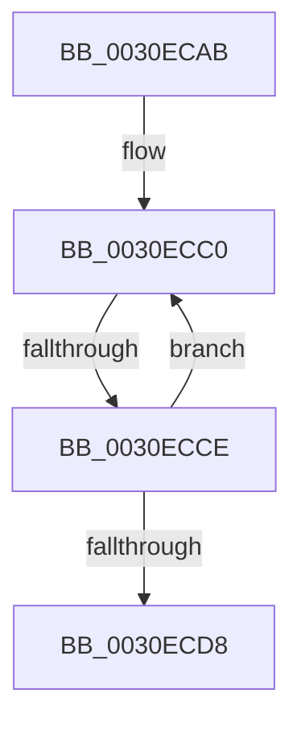

# sub_0030ECAB

- RVA: `0x0030ECAB`–`0x0030ECE7` (길이 `60` bytes)
- VA: `0x000000014030ECAB`
- 실행 섹션: `.text`
- PDB 이름 있음: `아니요`; PDB Function 태그: `아니요`
- unwind 정보 RVA: `0x00073F90`
- 디코드: `15`개 명령, `60/60` bytes 표시
- 미해석 바이트: `0` (있으면 어셈블리에 `.byte`로 보존)

> 이 문서는 커널 이미지의 기계어와 PDB 기호를 분석해 생성했습니다. 4번과 5번은 함수 원형과 자료형을 바이너리 사용 방식에서 추정한 C 해석이며 원본 소스 복구 결과는 아닙니다.

## 1. Dependencies

- 직접 호출 지점: **0**; 고유 호출 대상: **0**
- 직접 호출자로 확인된 함수: **0**
- RIP 상대 이미지 참조: **0**

### Outgoing calls
- 직접 디코드된 call 명령이 없습니다.

### Direct callers
- 이 함수 시작 RVA로 연결되는 직접 call은 확인되지 않았습니다. 간접 호출은 완전히 역산할 수 없습니다.

### Static image references
- 디코드된 RIP-relative 메모리 참조가 없습니다.

## 2. Other-region calls and transfers

- 다른 실행 섹션으로 향하는 call: **0**
- call이 아닌 외부 분기/꼬리 이동: **1**
  - `0x0030ECCC` → [sub_0030ED05](Unknown_function_0030ED05.md) (`tail-transfer`)

## 3. Assembly (complete function range)

```asm
0030ECAB  48 89 6C 24 60                  mov qword ptr [rsp + 0x60], rbp
0030ECB0  48 89 74 24 68                  mov qword ptr [rsp + 0x68], rsi
0030ECB5  48 89 7C 24 28                  mov qword ptr [rsp + 0x28], rdi
0030ECBA  8B E9                           mov ebp, ecx
0030ECBC  0F 1F 40 00                     nop dword ptr [rax]
0030ECC0  49 8B 3E                        mov rdi, qword ptr [r14]
0030ECC3  33 F6                           xor esi, esi
0030ECC5  F0 48 0F BA 6F 30 00            lock bts qword ptr [rdi + 0x30], 0
0030ECCC  72 37                           jb 0x14030ed05
0030ECCE  49 83 C6 08                     add r14, 8
0030ECD2  48 83 ED 01                     sub rbp, 1
0030ECD6  75 E8                           jne 0x14030ecc0
0030ECD8  48 8B 7C 24 28                  mov rdi, qword ptr [rsp + 0x28]
0030ECDD  48 8B 74 24 68                  mov rsi, qword ptr [rsp + 0x68]
0030ECE2  48 8B 6C 24 60                  mov rbp, qword ptr [rsp + 0x60]
```

## 4. C-style interpretation (structured pseudocode)

```c
void __fastcall sub_0030ECAB(int a1, __int64 a2, __int64 a3, __int64 a4, __int64 a5, __int64 a6, __int64 a7, __int64 a8, __int64 a9, __int64 a10, __int64 a11, __int64 a12, __int64 a13)
{
    __int64 v_r14;
    __int64 v_rbp;
    __int64 v_rsi;
    unsigned __int64 v_stack_p28;
    unsigned __int64 v_stack_p60;
    unsigned __int64 v_stack_p68;

    v_stack_p60 = v_rbp;
    v_stack_p68 = v_rsi;
    v_stack_p28 = v_rdi;
loc_0030ECC0:
    v_rsi = 0;
    v_r14 = (v_r14) + (8);
    v_rbp = ((unsigned int)(a1)) - (1);
    if (condition_is_not_equal) goto loc_0030ECC0;
    return;
}
```

## 5. (Beta) C Style

```c
void sub_0030ECAB(int32_t Arg1, int64_t Arg2, int64_t Arg3, int64_t Arg4, int64_t Arg5, uint64_t Arg6, uint64_t Arg7, uint64_t Arg8, uint64_t Arg9, uint64_t Arg10, uint64_t Arg11, int64_t Arg12, int64_t Arg13)
{
    int64_t local_r14;
    int64_t local_rbp;
    int64_t local_rsi;
    uint64_t v_stack_p28;
    uint64_t v_stack_p60;
    uint64_t v_stack_p68;

    v_stack_p60 = local_rbp;
    v_stack_p68 = local_rsi;
    v_stack_p28 = local_rdi;
loc_0030ECC0:
    local_rsi = 0;
    local_r14 = (local_r14) + (8);
    local_rbp = ((uint32_t)(Arg1)) - (1);
    if (condition_is_not_equal) goto loc_0030ECC0;
    return;
}
```

## 6. Execution-region graph

[열기: 2D/3D 그래프와 함수 탐색 컨트롤 패널](../../../control-panel.html?section=text&rva=0x0030ECAB&view=graph)

- 2D 그래프는 위에서 아래로 흐르고, 3D 그래프는 빈 공간을 드래그해 회전합니다. Shift+드래그는 이동, 휠은 확대·축소, 함수 노드 선택은 대상 보고서 이동입니다.

### Static fallback


