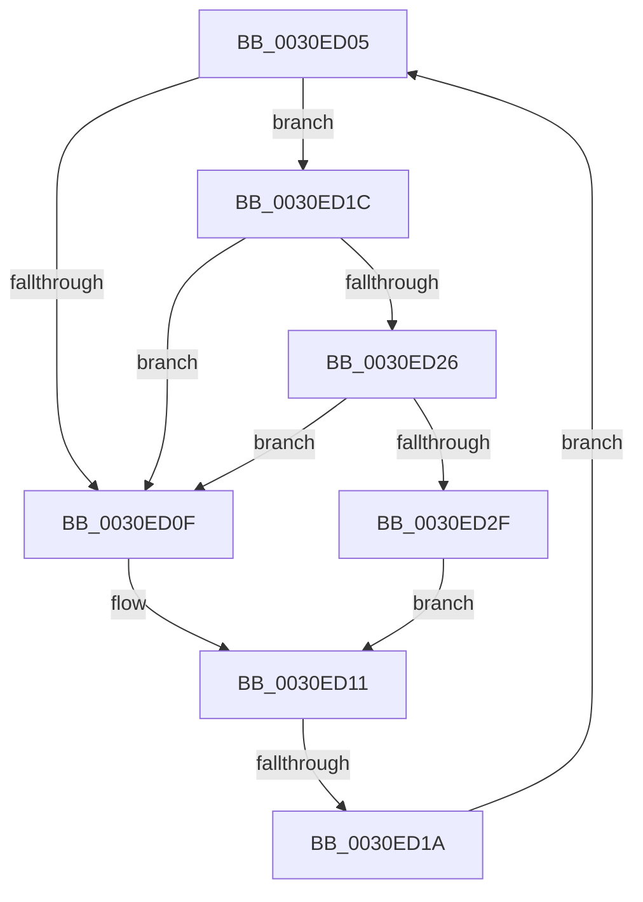

# sub_0030ED05

- RVA: `0x0030ED05`–`0x0030ED38` (길이 `51` bytes)
- VA: `0x000000014030ED05`
- 실행 섹션: `.text`
- PDB 이름 있음: `아니요`; PDB Function 태그: `아니요`
- unwind 정보 RVA: `0x00073FD0`
- 디코드: `17`개 명령, `51/51` bytes 표시
- 미해석 바이트: `0` (있으면 어셈블리에 `.byte`로 보존)

> 이 문서는 커널 이미지의 기계어와 PDB 기호를 분석해 생성했습니다. 4번과 5번은 함수 원형과 자료형을 바이너리 사용 방식에서 추정한 C 해석이며 원본 소스 복구 결과는 아닙니다.

## 1. Dependencies

- 직접 호출 지점: **2**; 고유 호출 대상: **2**
- 직접 호출자로 확인된 함수: **0**
- RIP 상대 이미지 참조: **2**

### Outgoing calls
- `0x0030ED26` → [KiCheckVpBackingLongSpinWaitHypercall](KiCheckVpBackingLongSpinWaitHypercall_function_0030F490.md) (function, `0x0030F490`)
- `0x0030ED31` → [HvlNotifyLongSpinWait](HvlNotifyLongSpinWait_function_0030F460.md) (function, `0x0030F460`)

### Direct callers
- 이 함수 시작 RVA로 연결되는 직접 call은 확인되지 않았습니다. 간접 호출은 완전히 역산할 수 없습니다.

### Static image references
- `0x0030ED07` → RVA `0x00FC52AC` (`ALMOSTRO`; reference)
- `0x0030ED1C` → RVA `0x00FC6AB8` (`ALMOSTRO`; read)

## 2. Other-region calls and transfers

- 다른 실행 섹션으로 향하는 call: **0**
- call이 아닌 외부 분기/꼬리 이동: **1**
  - `0x0030ED18` → [sub_0030ECAB + 0x1A](Unknown_function_0030ECAB.md) (`tail-transfer`)

## 3. Assembly (complete function range)

```asm
0030ED05  FF C6                           inc esi
0030ED07  85 35 9F 65 CB 00               test dword ptr [rip + 0xcb659f], esi
0030ED0D  74 0D                           je 0x14030ed1c
0030ED0F  F3 90                           pause
0030ED11  48 8B 47 30                     mov rax, qword ptr [rdi + 0x30]
0030ED15  48 85 C0                        test rax, rax
0030ED18  74 AB                           je 0x14030ecc5
0030ED1A  EB E9                           jmp 0x14030ed05
0030ED1C  8B 05 96 7D CB 00               mov eax, dword ptr [rip + 0xcb7d96]
0030ED22  A8 40                           test al, 0x40
0030ED24  74 E9                           je 0x14030ed0f
0030ED26  E8 65 07 00 00                  call 0x14030f490
0030ED2B  84 C0                           test al, al
0030ED2D  74 E0                           je 0x14030ed0f
0030ED2F  8B CE                           mov ecx, esi
0030ED31  E8 2A 07 00 00                  call 0x14030f460
0030ED36  EB D9                           jmp 0x14030ed11
```

## 4. C-style interpretation (structured pseudocode)

```c
__int64 __fastcall sub_0030ED05(void)
{
    __int64 result;
    __int64 v_rsi;

    v_rsi = (unsigned int)((v_rsi) + 1);
    if (((*(unsigned int *)(v_rip + 13329823)) & ((unsigned int)(v_rsi))) == 0) goto loc_0030ED1C;
loc_0030ED0F:
loc_0030ED11:
    goto loc_0030ED05;
loc_0030ED1C:
    if ((((unsigned __int8)((unsigned int)(*(unsigned int *)(v_rip + 13335958)))) & (64)) == 0) goto loc_0030ED0F;
    result = KiCheckVpBackingLongSpinWaitHypercall(a1, a2, a3, a4);
    if ((unsigned __int8)(result) == 0) goto loc_0030ED0F;
    result = HvlNotifyLongSpinWait((unsigned int)((unsigned int)(v_rsi)), a2, a3, a4);
    goto loc_0030ED11;
}
```

## 5. (Beta) C Style

```c
void sub_0030ED05(void)
{
    int64_t result;
    int64_t local_rsi;

    local_rsi = (uint32_t)((local_rsi) + 1);
    if (((*(uint32_t *)(v_rip + 0xCB659F)) & ((uint32_t)(local_rsi))) == 0) goto loc_0030ED1C;
loc_0030ED0F:
loc_0030ED11:
    goto loc_0030ED05;
loc_0030ED1C:
    if ((((uint8_t)((uint32_t)(*(uint32_t *)(v_rip + 0xCB7D96)))) & (64)) == 0) goto loc_0030ED0F;
    result = KiCheckVpBackingLongSpinWaitHypercall(a1, a2, a3, a4);
    if ((uint8_t)(result) == 0) goto loc_0030ED0F;
    result = HvlNotifyLongSpinWait((uint32_t)((uint32_t)(local_rsi)), a2, a3, a4);
    goto loc_0030ED11;
}
```

## 6. Execution-region graph

[열기: 2D/3D 그래프와 함수 탐색 컨트롤 패널](../../../control-panel.html?section=text&rva=0x0030ED05&view=graph)

- 2D 그래프는 위에서 아래로 흐르고, 3D 그래프는 빈 공간을 드래그해 회전합니다. Shift+드래그는 이동, 휠은 확대·축소, 함수 노드 선택은 대상 보고서 이동입니다.

### Static fallback


