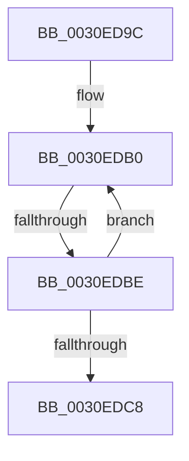

# sub_0030ED9C

- RVA: `0x0030ED9C`–`0x0030EDD7` (길이 `59` bytes)
- VA: `0x000000014030ED9C`
- 실행 섹션: `.text`
- PDB 이름 있음: `아니요`; PDB Function 태그: `아니요`
- unwind 정보 RVA: `0x00074024`
- 디코드: `15`개 명령, `59/59` bytes 표시
- 미해석 바이트: `0` (있으면 어셈블리에 `.byte`로 보존)

> 이 문서는 커널 이미지의 기계어와 PDB 기호를 분석해 생성했습니다. 4번과 5번은 함수 원형과 자료형을 바이너리 사용 방식에서 추정한 C 해석이며 원본 소스 복구 결과는 아닙니다.

## 1. Dependencies

- 직접 호출 지점: **0**; 고유 호출 대상: **0**
- 직접 호출자로 확인된 함수: **0**
- RIP 상대 이미지 참조: **0**

### Outgoing calls
- 직접 디코드된 call 명령이 없습니다.

### Direct callers
- 이 함수 시작 RVA로 연결되는 직접 call은 확인되지 않았습니다. 간접 호출은 완전히 역산할 수 없습니다.

### Static image references
- 디코드된 RIP-relative 메모리 참조가 없습니다.

## 2. Other-region calls and transfers

- 다른 실행 섹션으로 향하는 call: **0**
- call이 아닌 외부 분기/꼬리 이동: **1**
  - `0x0030EDBC` → [sub_0030EDE0](Unknown_function_0030EDE0.md) (`tail-transfer`)

## 3. Assembly (complete function range)

```asm
0030ED9C  48 89 5C 24 38                  mov qword ptr [rsp + 0x38], rbx
0030EDA1  48 89 6C 24 40                  mov qword ptr [rsp + 0x40], rbp
0030EDA6  48 89 7C 24 48                  mov qword ptr [rsp + 0x48], rdi
0030EDAB  8B E9                           mov ebp, ecx
0030EDAD  0F 1F 00                        nop dword ptr [rax]
0030EDB0  48 8B 1E                        mov rbx, qword ptr [rsi]
0030EDB3  33 FF                           xor edi, edi
0030EDB5  F0 48 0F BA 6B 30 00            lock bts qword ptr [rbx + 0x30], 0
0030EDBC  72 22                           jb 0x14030ede0
0030EDBE  48 83 C6 08                     add rsi, 8
0030EDC2  48 83 ED 01                     sub rbp, 1
0030EDC6  75 E8                           jne 0x14030edb0
0030EDC8  48 8B 7C 24 48                  mov rdi, qword ptr [rsp + 0x48]
0030EDCD  48 8B 6C 24 40                  mov rbp, qword ptr [rsp + 0x40]
0030EDD2  48 8B 5C 24 38                  mov rbx, qword ptr [rsp + 0x38]
```

## 4. C-style interpretation (structured pseudocode)

```c
void __fastcall sub_0030ED9C(int a1, __int64 a2, __int64 a3, __int64 a4, __int64 a5, __int64 a6, __int64 a7, __int64 a8, __int64 a9)
{
    __int64 v_rbp;
    __int64 v_rdi;
    __int64 v_rsi;
    unsigned __int64 v_stack_p38;
    unsigned __int64 v_stack_p40;
    unsigned __int64 v_stack_p48;

    v_stack_p38 = v_rbx;
    v_stack_p40 = v_rbp;
    v_stack_p48 = v_rdi;
loc_0030EDB0:
    v_rdi = 0;
    v_rsi = (v_rsi) + (8);
    v_rbp = ((unsigned int)(a1)) - (1);
    if (condition_is_not_equal) goto loc_0030EDB0;
    return;
}
```

## 5. (Beta) C Style

```c
void sub_0030ED9C(int32_t Arg1, int64_t Arg2, int64_t Arg3, int64_t Arg4, uint64_t Arg5, uint64_t Arg6, int64_t Arg7, int64_t Arg8, int64_t Arg9)
{
    int64_t local_rbp;
    int64_t local_rdi;
    int64_t local_rsi;
    uint64_t v_stack_p38;
    uint64_t v_stack_p40;
    uint64_t v_stack_p48;

    v_stack_p38 = local_rbx;
    v_stack_p40 = local_rbp;
    v_stack_p48 = local_rdi;
loc_0030EDB0:
    local_rdi = 0;
    local_rsi = (local_rsi) + (8);
    local_rbp = ((uint32_t)(Arg1)) - (1);
    if (condition_is_not_equal) goto loc_0030EDB0;
    return;
}
```

## 6. Execution-region graph

[열기: 2D/3D 그래프와 함수 탐색 컨트롤 패널](../../../control-panel.html?section=text&rva=0x0030ED9C&view=graph)

- 2D 그래프는 위에서 아래로 흐르고, 3D 그래프는 빈 공간을 드래그해 회전합니다. Shift+드래그는 이동, 휠은 확대·축소, 함수 노드 선택은 대상 보고서 이동입니다.

### Static fallback


