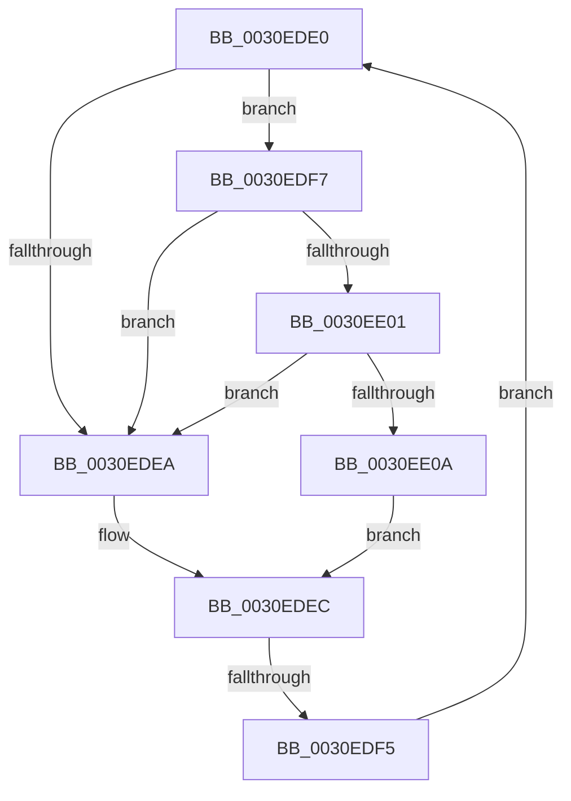

# sub_0030EDE0

- RVA: `0x0030EDE0`–`0x0030EE13` (길이 `51` bytes)
- VA: `0x000000014030EDE0`
- 실행 섹션: `.text`
- PDB 이름 있음: `아니요`; PDB Function 태그: `아니요`
- unwind 정보 RVA: `0x00074054`
- 디코드: `17`개 명령, `51/51` bytes 표시
- 미해석 바이트: `0` (있으면 어셈블리에 `.byte`로 보존)

> 이 문서는 커널 이미지의 기계어와 PDB 기호를 분석해 생성했습니다. 4번과 5번은 함수 원형과 자료형을 바이너리 사용 방식에서 추정한 C 해석이며 원본 소스 복구 결과는 아닙니다.

## 1. Dependencies

- 직접 호출 지점: **2**; 고유 호출 대상: **2**
- 직접 호출자로 확인된 함수: **0**
- RIP 상대 이미지 참조: **2**

### Outgoing calls
- `0x0030EE01` → [KiCheckVpBackingLongSpinWaitHypercall](KiCheckVpBackingLongSpinWaitHypercall_function_0030F490.md) (function, `0x0030F490`)
- `0x0030EE0C` → [HvlNotifyLongSpinWait](HvlNotifyLongSpinWait_function_0030F460.md) (function, `0x0030F460`)

### Direct callers
- 이 함수 시작 RVA로 연결되는 직접 call은 확인되지 않았습니다. 간접 호출은 완전히 역산할 수 없습니다.

### Static image references
- `0x0030EDE2` → RVA `0x00FC52AC` (`ALMOSTRO`; reference)
- `0x0030EDF7` → RVA `0x00FC6AB8` (`ALMOSTRO`; read)

## 2. Other-region calls and transfers

- 다른 실행 섹션으로 향하는 call: **0**
- call이 아닌 외부 분기/꼬리 이동: **1**
  - `0x0030EDF3` → [sub_0030ED9C + 0x19](Unknown_function_0030ED9C.md) (`tail-transfer`)

## 3. Assembly (complete function range)

```asm
0030EDE0  FF C7                           inc edi
0030EDE2  85 3D C4 64 CB 00               test dword ptr [rip + 0xcb64c4], edi
0030EDE8  74 0D                           je 0x14030edf7
0030EDEA  F3 90                           pause
0030EDEC  48 8B 43 30                     mov rax, qword ptr [rbx + 0x30]
0030EDF0  48 85 C0                        test rax, rax
0030EDF3  74 C0                           je 0x14030edb5
0030EDF5  EB E9                           jmp 0x14030ede0
0030EDF7  8B 05 BB 7C CB 00               mov eax, dword ptr [rip + 0xcb7cbb]
0030EDFD  A8 40                           test al, 0x40
0030EDFF  74 E9                           je 0x14030edea
0030EE01  E8 8A 06 00 00                  call 0x14030f490
0030EE06  84 C0                           test al, al
0030EE08  74 E0                           je 0x14030edea
0030EE0A  8B CF                           mov ecx, edi
0030EE0C  E8 4F 06 00 00                  call 0x14030f460
0030EE11  EB D9                           jmp 0x14030edec
```

## 4. C-style interpretation (structured pseudocode)

```c
__int64 __fastcall sub_0030EDE0(void)
{
    __int64 result;
    __int64 v_rdi;

    v_rdi = (unsigned int)((v_rdi) + 1);
    if (((*(unsigned int *)(v_rip + 13329604)) & ((unsigned int)(v_rdi))) == 0) goto loc_0030EDF7;
loc_0030EDEA:
loc_0030EDEC:
    goto loc_0030EDE0;
loc_0030EDF7:
    if ((((unsigned __int8)((unsigned int)(*(unsigned int *)(v_rip + 13335739)))) & (64)) == 0) goto loc_0030EDEA;
    result = KiCheckVpBackingLongSpinWaitHypercall(a1, a2, a3, a4);
    if ((unsigned __int8)(result) == 0) goto loc_0030EDEA;
    result = HvlNotifyLongSpinWait((unsigned int)((unsigned int)(v_rdi)), a2, a3, a4);
    goto loc_0030EDEC;
}
```

## 5. (Beta) C Style

```c
void sub_0030EDE0(void)
{
    int64_t result;
    int64_t local_rdi;

    local_rdi = (uint32_t)((local_rdi) + 1);
    if (((*(uint32_t *)(v_rip + 0xCB64C4)) & ((uint32_t)(local_rdi))) == 0) goto loc_0030EDF7;
loc_0030EDEA:
loc_0030EDEC:
    goto loc_0030EDE0;
loc_0030EDF7:
    if ((((uint8_t)((uint32_t)(*(uint32_t *)(v_rip + 0xCB7CBB)))) & (64)) == 0) goto loc_0030EDEA;
    result = KiCheckVpBackingLongSpinWaitHypercall(a1, a2, a3, a4);
    if ((uint8_t)(result) == 0) goto loc_0030EDEA;
    result = HvlNotifyLongSpinWait((uint32_t)((uint32_t)(local_rdi)), a2, a3, a4);
    goto loc_0030EDEC;
}
```

## 6. Execution-region graph

[열기: 2D/3D 그래프와 함수 탐색 컨트롤 패널](../../../control-panel.html?section=text&rva=0x0030EDE0&view=graph)

- 2D 그래프는 위에서 아래로 흐르고, 3D 그래프는 빈 공간을 드래그해 회전합니다. Shift+드래그는 이동, 휠은 확대·축소, 함수 노드 선택은 대상 보고서 이동입니다.

### Static fallback


