# sub_0030EE9F

- RVA: `0x0030EE9F`–`0x0030F189` (길이 `746` bytes)
- VA: `0x000000014030EE9F`
- 실행 섹션: `.text`
- PDB 이름 있음: `아니요`; PDB Function 태그: `아니요`
- unwind 정보 RVA: `0x00074094`
- 디코드: `182`개 명령, `746/746` bytes 표시
- 미해석 바이트: `0` (있으면 어셈블리에 `.byte`로 보존)

> 이 문서는 커널 이미지의 기계어와 PDB 기호를 분석해 생성했습니다. 4번과 5번은 함수 원형과 자료형을 바이너리 사용 방식에서 추정한 C 해석이며 원본 소스 복구 결과는 아닙니다.

## 1. Dependencies

- 직접 호출 지점: **5**; 고유 호출 대상: **5**
- 직접 호출자로 확인된 함수: **0**
- RIP 상대 이미지 참조: **5**

### Outgoing calls
- `0x0030EEE4` → [KiLowerIrqlProcessIrqlFlags](../4F/KiLowerIrqlProcessIrqlFlags_function_004F5698.md) (function, `0x004F5698`)
- `0x0030EFBA` → [KiCheckVpBackingLongSpinWaitHypercall](KiCheckVpBackingLongSpinWaitHypercall_function_0030F490.md) (function, `0x0030F490`)
- `0x0030EFC5` → [HvlNotifyLongSpinWait](HvlNotifyLongSpinWait_function_0030F460.md) (function, `0x0030F460`)
- `0x0030F113` → [KxWaitForLockChainValid](../21/KxWaitForLockChainValid_function_00217AA0.md) (function, `0x00217AA0`)
- `0x0030F133` → [KeWakeAddressAll](../21/KeWakeAddressAll_function_00217C20.md) (function, `0x00217C20`)

### Direct callers
- 이 함수 시작 RVA로 연결되는 직접 call은 확인되지 않았습니다. 간접 호출은 완전히 역산할 수 없습니다.

### Static image references
- `0x0030EED3` → RVA `0x00FC6D20` (`ALMOSTRO`; read)
- `0x0030EF1B` → RVA `0x00FC8C40` (`ALMOSTRO`; read)
- `0x0030EF6B` → RVA `0x00FC52AC` (`ALMOSTRO`; reference)
- `0x0030EFB0` → RVA `0x00FC6AB8` (`ALMOSTRO`; read)
- `0x0030F0DC` → RVA `0x00FC6B38` (`ALMOSTRO`; read)

## 2. Other-region calls and transfers

- 다른 실행 섹션으로 향하는 call: **0**
- call이 아닌 외부 분기/꼬리 이동: **10**
  - `0x0030EF84` → [sub_0030F26B + 0x1E6](Unknown_function_0030F26B.md) (`tail-transfer`)
  - `0x0030EF94` → [sub_0030F26B + 0x78](Unknown_function_0030F26B.md) (`tail-transfer`)
  - `0x0030EFA3` → [sub_0030F26B + 0x78](Unknown_function_0030F26B.md) (`tail-transfer`)
  - `0x0030EFCF` → [sub_0030F26B + 0xF](Unknown_function_0030F26B.md) (`tail-transfer`)
  - `0x0030EFD8` → [sub_0030F19D + 0xD](Unknown_function_0030F19D.md) (`tail-transfer`)
  - `0x0030EFEC` → [sub_0030F19D](Unknown_function_0030F19D.md) (`tail-transfer`)
  - `0x0030F017` → [sub_0030F26B + 0x18E](Unknown_function_0030F26B.md) (`tail-transfer`)
  - `0x0030F01F` → [sub_0030F26B + 0x182](Unknown_function_0030F26B.md) (`tail-transfer`)
  - `0x0030F04C` → [sub_0030F26B](Unknown_function_0030F26B.md) (`tail-transfer`)
  - `0x0030F063` → [sub_0030F19D + 0x9F](Unknown_function_0030F19D.md) (`tail-transfer`)

## 3. Assembly (complete function range)

```asm
0030EE9F  4C 89 64 24 50                  mov qword ptr [rsp + 0x50], r12
0030EEA4  4C 89 6C 24 48                  mov qword ptr [rsp + 0x48], r13
0030EEA9  49 39 86 20 02 00 00            cmp qword ptr [r14 + 0x220], rax
0030EEB0  75 5F                           jne 0x14030ef11
0030EEB2  45 0F B6 A6 84 01 00 00         movzx r12d, byte ptr [r14 + 0x184]
0030EEBA  41 C6 47 0A 01                  mov byte ptr [r15 + 0xa], 1
0030EEBF  41 0F B6 86 33 02 00 00         movzx eax, byte ptr [r14 + 0x233]
0030EEC7  41 88 47 0B                     mov byte ptr [r15 + 0xb], al
0030EECB  49 C7 46 40 00 00 00 00         mov qword ptr [r14 + 0x40], 0
0030EED3  83 3D 46 7E CB 00 00            cmp dword ptr [rip + 0xcb7e46], 0
0030EEDA  74 0D                           je 0x14030eee9
0030EEDC  44 0F 20 C1                     mov rcx, cr8
0030EEE0  40 0F B6 D6                     movzx edx, sil
0030EEE4  E8 AF 67 1E 00                  call 0x1404f5698
0030EEE9  40 0F B6 C6                     movzx eax, sil
0030EEED  44 0F 22 C0                     mov cr8, rax
0030EEF1  4C 8B 6C 24 48                  mov r13, qword ptr [rsp + 0x48]
0030EEF6  45 88 67 08                     mov byte ptr [r15 + 8], r12b
0030EEFA  4C 8B 64 24 50                  mov r12, qword ptr [rsp + 0x50]
0030EEFF  41 88 7F 09                     mov byte ptr [r15 + 9], dil
0030EF03  48 83 C4 58                     add rsp, 0x58
0030EF07  41 5F                           pop r15
0030EF09  41 5E                           pop r14
0030EF0B  5F                              pop rdi
0030EF0C  5E                              pop rsi
0030EF0D  5B                              pop rbx
0030EF0E  5D                              pop rbp
0030EF0F  C3                              ret
0030EF10  CC                              int3
0030EF11  0F 57 C0                        xorps xmm0, xmm0
0030EF14  0F 11 45 D0                     movups xmmword ptr [rbp - 0x30], xmm0
0030EF18  45 33 D2                        xor r10d, r10d
0030EF1B  48 8D 15 1E 9D CB 00            lea rdx, [rip + 0xcb9d1e]
0030EF22  45 0F B6 A6 84 01 00 00         movzx r12d, byte ptr [r14 + 0x184]
0030EF2A  49 8B DA                        mov rbx, r10
0030EF2D  4D 8B EA                        mov r13, r10
0030EF30  41 8B CC                        mov ecx, r12d
0030EF33  41 83 FC 03                     cmp r12d, 3
0030EF37  0F 85 8F 00 00 00               jne 0x14030efcc
0030EF3D  41 8B B6 18 02 00 00            mov esi, dword ptr [r14 + 0x218]
0030EF44  85 F6                           test esi, esi
0030EF46  78 DA                           js 0x14030ef22
0030EF48  48 8B 1C F2                     mov rbx, qword ptr [rdx + rsi*8]
0030EF4C  41 8B FA                        mov edi, r10d
0030EF4F  48 8B C3                        mov rax, rbx
0030EF52  48 83 E0 FE                     and rax, 0xfffffffffffffffe
0030EF56  48 89 45 40                     mov qword ptr [rbp + 0x40], rax
0030EF5A  66 0F 1F 44 00 00               nop word ptr [rax + rax]
0030EF60  F0 48 0F BA 6B 30 00            lock bts qword ptr [rbx + 0x30], 0
0030EF67  73 17                           jae 0x14030ef80
0030EF69  FF C7                           inc edi
0030EF6B  85 3D 3B 63 CB 00               test dword ptr [rip + 0xcb633b], edi
0030EF71  74 3D                           je 0x14030efb0
0030EF73  F3 90                           pause
0030EF75  48 8B 43 30                     mov rax, qword ptr [rbx + 0x30]
0030EF79  48 85 C0                        test rax, rax
0030EF7C  74 E2                           je 0x14030ef60
0030EF7E  EB E9                           jmp 0x14030ef69
0030EF80  4C 3B 73 10                     cmp r14, qword ptr [rbx + 0x10]
0030EF84  0F 84 C7 04 00 00               je 0x14030f451
0030EF8A  41 0F B6 86 84 01 00 00         movzx eax, byte ptr [r14 + 0x184]
0030EF92  3C 03                           cmp al, 3
0030EF94  0F 85 49 03 00 00               jne 0x14030f2e3
0030EF9A  41 8B 86 18 02 00 00            mov eax, dword ptr [r14 + 0x218]
0030EFA1  3B C6                           cmp eax, esi
0030EFA3  0F 85 3A 03 00 00               jne 0x14030f2e3
0030EFA9  B9 1E 00 00 00                  mov ecx, 0x1e
0030EFAE  CD 29                           int 0x29
0030EFB0  8B 05 02 7B CB 00               mov eax, dword ptr [rip + 0xcb7b02]
0030EFB6  A8 40                           test al, 0x40
0030EFB8  74 B9                           je 0x14030ef73
0030EFBA  E8 D1 04 00 00                  call 0x14030f490
0030EFBF  84 C0                           test al, al
0030EFC1  74 B0                           je 0x14030ef73
0030EFC3  8B CF                           mov ecx, edi
0030EFC5  E8 96 04 00 00                  call 0x14030f460
0030EFCA  EB A9                           jmp 0x14030ef75
0030EFCC  83 E9 01                        sub ecx, 1
0030EFCF  0F 84 A5 02 00 00               je 0x14030f27a
0030EFD5  83 E9 01                        sub ecx, 1
0030EFD8  0F 84 CC 01 00 00               je 0x14030f1aa
0030EFDE  83 F9 03                        cmp ecx, 3
0030EFE1  75 0F                           jne 0x14030eff2
0030EFE3  41 0F B6 46 70                  movzx eax, byte ptr [r14 + 0x70]
0030EFE8  24 07                           and al, 7
0030EFEA  3C 01                           cmp al, 1
0030EFEC  0F 85 AB 01 00 00               jne 0x14030f19d
0030EFF2  41 8B 86 B4 01 00 00            mov eax, dword ptr [r14 + 0x1b4]
0030EFF9  48 BA 20 03 00 00 80 F7 FF FF   movabs rdx, 0xfffff78000000320
0030F003  41 89 07                        mov dword ptr [r15], eax
0030F006  41 0F B6 86 84 01 00 00         movzx eax, byte ptr [r14 + 0x184]
0030F00E  41 8B 8E 84 00 00 00            mov ecx, dword ptr [r14 + 0x84]
0030F015  3C 01                           cmp al, 1
0030F017  0F 84 DC 03 00 00               je 0x14030f3f9
0030F01D  3C 07                           cmp al, 7
0030F01F  0F 84 C8 03 00 00               je 0x14030f3ed
0030F025  41 89 4F 04                     mov dword ptr [r15 + 4], ecx
0030F029  41 0F B6 86 84 01 00 00         movzx eax, byte ptr [r14 + 0x184]
0030F031  4D 8B 86 E0 03 00 00            mov r8, qword ptr [r14 + 0x3e0]
0030F038  49 8B 8E E8 03 00 00            mov rcx, qword ptr [r14 + 0x3e8]
0030F03F  3C 05                           cmp al, 5
0030F041  75 29                           jne 0x14030f06c
0030F043  41 0F B6 46 70                  movzx eax, byte ptr [r14 + 0x70]
0030F048  24 07                           and al, 7
0030F04A  3C 01                           cmp al, 1
0030F04C  0F 85 19 02 00 00               jne 0x14030f26b
0030F052  8B 12                           mov edx, dword ptr [rdx]
0030F054  41 2B 96 B4 01 00 00            sub edx, dword ptr [r14 + 0x1b4]
0030F05B  41 80 BE 87 01 00 00 00         cmp byte ptr [r14 + 0x187], 0
0030F063  0F 84 D3 01 00 00               je 0x14030f23c
0030F069  48 03 CA                        add rcx, rdx
0030F06C  4D 89 47 10                     mov qword ptr [r15 + 0x10], r8
0030F070  49 89 4F 18                     mov qword ptr [r15 + 0x18], rcx
0030F074  48 85 DB                        test rbx, rbx
0030F077  74 5E                           je 0x14030f0d7
0030F079  48 8B 45 40                     mov rax, qword ptr [rbp + 0x40]
0030F07D  4D 8B C2                        mov r8, r10
0030F080  4C 8B C8                        mov r9, rax
0030F083  41 8B D2                        mov edx, r10d
0030F086  49 83 E1 FE                     and r9, 0xfffffffffffffffe
0030F08A  4C 89 4D C8                     mov qword ptr [rbp - 0x38], r9
0030F08E  83 E0 01                        and eax, 1
0030F091  0F 84 E4 00 00 00               je 0x14030f17b
0030F097  83 F8 01                        cmp eax, 1
0030F09A  75 15                           jne 0x14030f0b1
0030F09C  49 8B 81 58 8E 00 00            mov rax, qword ptr [r9 + 0x8e58]
0030F0A3  4D 8B 81 58 8E 00 00            mov r8, qword ptr [r9 + 0x8e58]
0030F0AA  49 83 C0 08                     add r8, 8
0030F0AE  0F B6 10                        movzx edx, byte ptr [rax]
0030F0B1  85 D2                           test edx, edx
0030F0B3  74 1E                           je 0x14030f0d3
0030F0B5  66 66 66 0F 1F 84 00 00 00 00 00  nop word ptr [rax + rax]
0030F0C0  8D 42 FF                        lea eax, [rdx - 1]
0030F0C3  49 8B 0C C0                     mov rcx, qword ptr [r8 + rax*8]
0030F0C7  8B D0                           mov edx, eax
0030F0C9  F0 48 83 61 30 00               lock and qword ptr [rcx + 0x30], 0
0030F0CF  85 C0                           test eax, eax
0030F0D1  75 ED                           jne 0x14030f0c0
0030F0D3  4C 89 55 40                     mov qword ptr [rbp + 0x40], r10
0030F0D7  4D 85 ED                        test r13, r13
0030F0DA  74 5C                           je 0x14030f138
0030F0DC  F7 05 52 7A CB 00 00 00 20 00   test dword ptr [rip + 0xcb7a52], 0x200000
0030F0E6  0F 84 87 00 00 00               je 0x14030f173
0030F0EC  0F 0D 4D D0                     prefetchw byte ptr [rbp - 0x30]
0030F0F0  48 8B 45 D0                     mov rax, qword ptr [rbp - 0x30]
0030F0F4  48 85 C0                        test rax, rax
0030F0F7  75 22                           jne 0x14030f11b
0030F0F9  48 8B 4D D8                     mov rcx, qword ptr [rbp - 0x28]
0030F0FD  48 8D 45 D0                     lea rax, [rbp - 0x30]
0030F101  F0 4C 0F B1 11                  lock cmpxchg qword ptr [rcx], r10
0030F106  48 8D 4D D0                     lea rcx, [rbp - 0x30]
0030F10A  48 3B C1                        cmp rax, rcx
0030F10D  74 29                           je 0x14030f138
0030F10F  48 8D 4D D0                     lea rcx, [rbp - 0x30]
0030F113  E8 88 89 F0 FF                  call 0x140217aa0
0030F118  45 33 D2                        xor r10d, r10d
0030F11B  48 8D 48 08                     lea rcx, [rax + 8]
0030F11F  4C 89 55 D0                     mov qword ptr [rbp - 0x30], r10
0030F123  48 8B 55 D8                     mov rdx, qword ptr [rbp - 0x28]
0030F127  48 8B C2                        mov rax, rdx
0030F12A  48 87 01                        xchg qword ptr [rcx], rax
0030F12D  32 C2                           xor al, dl
0030F12F  A8 04                           test al, 4
0030F131  74 05                           je 0x14030f138
0030F133  E8 E8 8A F0 FF                  call 0x140217c20
0030F138  41 0F B6 BE 83 02 00 00         movzx edi, byte ptr [r14 + 0x283]
0030F140  41 0F B6 86 C3 00 00 00         movzx eax, byte ptr [r14 + 0xc3]
0030F148  48 8B 75 48                     mov rsi, qword ptr [rbp + 0x48]
0030F14C  41 88 47 0A                     mov byte ptr [r15 + 0xa], al
0030F150  41 80 FC 05                     cmp r12b, 5
0030F154  0F 85 65 FD FF FF               jne 0x14030eebf
0030F15A  41 0F B6 46 70                  movzx eax, byte ptr [r14 + 0x70]
0030F15F  24 07                           and al, 7
0030F161  3C 04                           cmp al, 4
0030F163  0F 85 56 FD FF FF               jne 0x14030eebf
0030F169  BF 05 00 00 00                  mov edi, 5
0030F16E  E9 4C FD FF FF                  jmp 0x14030eebf
0030F173  F0 49 83 65 00 00               lock and qword ptr [r13], 0
0030F179  EB BD                           jmp 0x14030f138
0030F17B  4C 8D 45 C8                     lea r8, [rbp - 0x38]
0030F17F  BA 01 00 00 00                  mov edx, 1
0030F184  E9 37 FF FF FF                  jmp 0x14030f0c0
```

## 4. C-style interpretation (structured pseudocode)

```c
__int64 __fastcall sub_0030EE9F(__int64 a1, __int64 a2, __int64 a3, __int64 a4, __int64 a5, __int64 a6, __int64 a7, __int64 a8, __int64 a9, __int64 a10)
{
    __int64 result;
    __int64 v_r10;
    __int64 v_rdi;
    __int64 v_rsp;
    unsigned __int64 v_stack_p48;
    unsigned __int64 v_stack_p50;

    v_stack_p50 = v_r12;
    v_stack_p48 = v_r13;
    if ((*(unsigned __int64 *)(v_r14 + 544)) != result) goto loc_0030EF11;
    *(unsigned __int8 *)(v_r15 + 10) = 1;
loc_0030EEBF:
    *(unsigned __int8 *)(v_r15 + 11) = (unsigned __int8)(*(unsigned __int8 *)(v_r14 + 563));
    *(unsigned __int64 *)(v_r14 + 64) = 0;
    result = *(unsigned __int8 *)(v_r14 + 563);
    if ((*(unsigned int *)(v_rip + 13336134)) != 0) {
        a1 = v_cr8;
        a2 = (unsigned __int8)(v_rsi);
        result = KiLowerIrqlProcessIrqlFlags(a1, a2, a3, a4);
    }
    *(unsigned __int8 *)(v_r15 + 8) = (unsigned __int8)(*(unsigned __int8 *)(v_r14 + 388));
    *(unsigned __int8 *)(v_r15 + 9) = (unsigned __int8)(v_rdi);
    v_rsp = (v_rsp) + (88);
    return (unsigned __int8)(v_rsi);
loc_0030EF11:
    *(unsigned __int64 *)(v_rbp - 48) = v_xmm0;
    v_r10 = 0;
loc_0030EF22:
    if (((unsigned int)(*(unsigned __int8 *)(v_r14 + 388))) != 3) goto loc_0030EFCC;
    if (sign_flag) goto loc_0030EF22;
    result = (*(unsigned __int64 *)(v_rip + 13344030 + (unsigned int)(*(unsigned int *)(v_r14 + 536)) * 8)) & (-2);
    *(unsigned __int64 *)(v_rbp + 64) = result;
loc_0030EF60:
    if (condition_is_above_or_equal) goto loc_0030EF80;
loc_0030EF69:
    v_rdi = (unsigned int)((0) + 1);
    if (((*(unsigned int *)(v_rip + 13329211)) & ((unsigned int)(v_rdi))) == 0) goto loc_0030EFB0;
loc_0030EF73:
loc_0030EF75:
    if (*(unsigned __int64 *)(*(unsigned __int64 *)(v_rip + 13344030 + (unsigned int)(*(unsigned int *)(v_r14 + 536)) * 8) + 48) == 0) goto loc_0030EF60;
    goto loc_0030EF69;
loc_0030EF80:
loc_0030EFB0:
    if ((((unsigned __int8)((unsigned int)(*(unsigned int *)(v_rip + 13335298)))) & (64)) == 0) goto loc_0030EF73;
    result = KiCheckVpBackingLongSpinWaitHypercall(30, v_rip + 13344030, a3, a4);
    if ((unsigned __int8)(result) == 0) goto loc_0030EF73;
    result = HvlNotifyLongSpinWait((unsigned int)((unsigned int)(v_rdi)), v_rip + 13344030, a3, a4);
    goto loc_0030EF75;
loc_0030EFCC:
    a1 = (unsigned int)(((unsigned int)((unsigned int)(v_rdi))) - (1));
    a1 = (unsigned int)((a1) - (1));
    if (((unsigned int)(a1)) != 3) goto loc_0030EFF2;
    result = (unsigned __int8)((*(unsigned __int8 *)(v_r14 + 112)) & (7));
loc_0030EFF2:
    *(unsigned int *)(v_r15) = (unsigned int)((unsigned int)(*(unsigned int *)(v_r14 + 436)));
    *(unsigned int *)(v_r15 + 4) = (unsigned int)((unsigned int)(*(unsigned int *)(v_r14 + 132)));
    if (((unsigned __int8)(*(unsigned __int8 *)(v_r14 + 388))) != 5) goto loc_0030F06C;
    result = (unsigned __int8)((*(unsigned __int8 *)(v_r14 + 112)) & (7));
    a2 = (unsigned int)(((unsigned int)(*(unsigned int *)(v_rip + 13344030))) - (*(unsigned int *)(v_r14 + 436)));
    a1 = (*(unsigned __int64 *)(v_r14 + 1000)) + (a2);
loc_0030F06C:
    *(unsigned __int64 *)(v_r15 + 16) = *(unsigned __int64 *)(v_r14 + 992);
    *(unsigned __int64 *)(v_r15 + 24) = a1;
    if (*(unsigned __int64 *)(v_rip + 13344030 + (unsigned int)(*(unsigned int *)(v_r14 + 536)) * 8) == 0) goto loc_0030F0D7;
    a4 = (*(unsigned __int64 *)(v_rbp + 64)) & (-2);
    *(unsigned __int64 *)(v_rbp - 56) = a4;
    result = (unsigned int)((*(unsigned __int64 *)(v_rbp + 64)) & (1));
    if (condition_is_equal) goto loc_0030F17B;
    if (((unsigned int)(result)) == 1) {
        result = *(unsigned __int64 *)(a4 + 36440);
        a3 = *(unsigned __int64 *)(a4 + 36440);
        a3 = (a3) + (8);
        a2 = *(unsigned __int8 *)(result);
    }
    if ((unsigned int)(a2) == 0) goto loc_0030F0D3;
loc_0030F0C0:
    if ((unsigned int)(a2 - 1) != 0) goto loc_0030F0C0;
loc_0030F0D3:
    *(unsigned __int64 *)(v_rbp + 64) = 0;
loc_0030F0D7:
    if (0 == 0) goto loc_0030F138;
    if (((*(unsigned int *)(v_rip + 13335122)) & (0x200000ULL)) == 0) goto loc_0030F173;
    if (*(unsigned __int64 *)(v_rbp - 48) != 0) goto loc_0030F11B;
    if ((v_rbp - 48) == (v_rbp - 48)) goto loc_0030F138;
    result = KxWaitForLockChainValid(v_rbp - 48, (unsigned int)((unsigned int)(a2 - 1)), a3, a4);
    v_r10 = 0;
loc_0030F11B:
    *(unsigned __int64 *)(v_rbp - 48) = 0;
    result = (unsigned __int8)((*(unsigned __int64 *)(v_rbp - 40)) ^ ((unsigned __int8)(*(unsigned __int64 *)(v_rbp - 40))));
    if ((((unsigned __int8)(result)) & (4)) != 0) {
        result = KeWakeAddressAll(result + 8, *(unsigned __int64 *)(v_rbp - 40), a3, a4);
    }
    *(unsigned __int8 *)(v_r15 + 10) = (unsigned __int8)(*(unsigned __int8 *)(v_r14 + 195));
    if (((unsigned __int8)(*(unsigned __int8 *)(v_r14 + 388))) != 5) goto loc_0030EEBF;
    result = (unsigned __int8)((*(unsigned __int8 *)(v_r14 + 112)) & (7));
    if (((unsigned __int8)(result)) != 4) goto loc_0030EEBF;
    goto loc_0030EEBF;
loc_0030F173:
    goto loc_0030F138;
loc_0030F17B:
    goto loc_0030F0C0;
}
```

## 5. (Beta) C Style

```c
int64_t sub_0030EE9F(int64_t Arg1, int64_t Arg2, int64_t Arg3, int64_t Arg4, uint64_t Arg5, uint64_t Arg6, uint64_t Arg7, uint64_t Arg8, int64_t Arg9, int64_t Arg10)
{
    int64_t result;
    int64_t local_r10;
    int64_t local_rdi;
    int64_t local_rsp;
    uint64_t v_stack_p48;
    uint64_t v_stack_p50;

    v_stack_p50 = local_r12;
    v_stack_p48 = local_r13;
    if ((*(uint64_t *)(local_r14 + 0x220)) != result) goto loc_0030EF11;
    *(uint8_t *)(local_r15 + 0xA) = 1;
loc_0030EEBF:
    *(uint8_t *)(local_r15 + 0xB) = (uint8_t)(*(uint8_t *)(local_r14 + 0x233));
    *(uint64_t *)(local_r14 + 0x40) = 0;
    result = *(uint8_t *)(local_r14 + 0x233);
    if ((*(uint32_t *)(v_rip + 0xCB7E46)) != 0) {
        Arg1 = v_cr8;
        Arg2 = (uint8_t)(local_rsi);
        result = KiLowerIrqlProcessIrqlFlags(Arg1, Arg2, Arg3, Arg4);
    }
    *(uint8_t *)(local_r15 + 0x8) = (uint8_t)(*(uint8_t *)(local_r14 + 0x184));
    *(uint8_t *)(local_r15 + 0x9) = (uint8_t)(local_rdi);
    local_rsp = (local_rsp) + (88);
    return (uint8_t)(local_rsi);
loc_0030EF11:
    *(uint64_t *)(local_rbp - 0x30) = v_xmm0;
    local_r10 = 0;
loc_0030EF22:
    if (((uint32_t)(*(uint8_t *)(local_r14 + 0x184))) != 3) goto loc_0030EFCC;
    if (sign_flag) goto loc_0030EF22;
    result = (*(uint64_t *)(v_rip + 0xCB9D1E + (uint32_t)(*(uint32_t *)(local_r14 + 0x218)) * 8)) & (-2);
    *(uint64_t *)(local_rbp + 0x40) = result;
loc_0030EF60:
    if (condition_is_above_or_equal) goto loc_0030EF80;
loc_0030EF69:
    local_rdi = (uint32_t)((0) + 1);
    if (((*(uint32_t *)(v_rip + 0xCB633B)) & ((uint32_t)(local_rdi))) == 0) goto loc_0030EFB0;
loc_0030EF73:
loc_0030EF75:
    if (*(uint64_t *)(*(uint64_t *)(v_rip + 0xCB9D1E + (uint32_t)(*(uint32_t *)(local_r14 + 0x218)) * 8) + 0x30) == 0) goto loc_0030EF60;
    goto loc_0030EF69;
loc_0030EF80:
loc_0030EFB0:
    if ((((uint8_t)((uint32_t)(*(uint32_t *)(v_rip + 0xCB7B02)))) & (64)) == 0) goto loc_0030EF73;
    result = KiCheckVpBackingLongSpinWaitHypercall(30, v_rip + 13344030, Arg3, Arg4);
    if ((uint8_t)(result) == 0) goto loc_0030EF73;
    result = HvlNotifyLongSpinWait((uint32_t)((uint32_t)(local_rdi)), v_rip + 13344030, Arg3, Arg4);
    goto loc_0030EF75;
loc_0030EFCC:
    Arg1 = (uint32_t)(((uint32_t)((uint32_t)(local_rdi))) - (1));
    Arg1 = (uint32_t)((Arg1) - (1));
    if (((uint32_t)(Arg1)) != 3) goto loc_0030EFF2;
    result = (uint8_t)((*(uint8_t *)(local_r14 + 0x70)) & (7));
loc_0030EFF2:
    *(uint32_t *)(local_r15) = (uint32_t)((uint32_t)(*(uint32_t *)(local_r14 + 0x1B4)));
    *(uint32_t *)(local_r15 + 0x4) = (uint32_t)((uint32_t)(*(uint32_t *)(local_r14 + 0x84)));
    if (((uint8_t)(*(uint8_t *)(local_r14 + 0x184))) != 5) goto loc_0030F06C;
    result = (uint8_t)((*(uint8_t *)(local_r14 + 0x70)) & (7));
    Arg2 = (uint32_t)(((uint32_t)(*(uint32_t *)(v_rip + 0xCB9D1E))) - (*(uint32_t *)(local_r14 + 0x1B4)));
    Arg1 = (*(uint64_t *)(local_r14 + 0x3E8)) + (Arg2);
loc_0030F06C:
    *(uint64_t *)(local_r15 + 0x10) = *(uint64_t *)(local_r14 + 0x3E0);
    *(uint64_t *)(local_r15 + 0x18) = Arg1;
    if (*(uint64_t *)(v_rip + 0xCB9D1E + (uint32_t)(*(uint32_t *)(local_r14 + 0x218)) * 8) == 0) goto loc_0030F0D7;
    Arg4 = (*(uint64_t *)(local_rbp + 0x40)) & (-2);
    *(uint64_t *)(local_rbp - 0x38) = Arg4;
    result = (uint32_t)((*(uint64_t *)(local_rbp + 0x40)) & (1));
    if (condition_is_equal) goto loc_0030F17B;
    if (((uint32_t)(result)) == 1) {
        result = *(uint64_t *)(Arg4 + 0x8E58);
        Arg3 = *(uint64_t *)(Arg4 + 0x8E58);
        Arg3 = (Arg3) + (8);
        Arg2 = *(uint8_t *)(result);
    }
    if ((uint32_t)(Arg2) == 0) goto loc_0030F0D3;
loc_0030F0C0:
    if ((uint32_t)(Arg2 - 1) != 0) goto loc_0030F0C0;
loc_0030F0D3:
    *(uint64_t *)(local_rbp + 0x40) = 0;
loc_0030F0D7:
    if (0 == 0) goto loc_0030F138;
    if (((*(uint32_t *)(v_rip + 0xCB7A52)) & (0x200000ULL)) == 0) goto loc_0030F173;
    if (*(uint64_t *)(local_rbp - 0x30) != 0) goto loc_0030F11B;
    if ((local_rbp - 48) == (local_rbp - 48)) goto loc_0030F138;
    result = KxWaitForLockChainValid(local_rbp - 48, (uint32_t)((uint32_t)(Arg2 - 1)), Arg3, Arg4);
    local_r10 = 0;
loc_0030F11B:
    *(uint64_t *)(local_rbp - 0x30) = 0;
    result = (uint8_t)((*(uint64_t *)(local_rbp - 0x28)) ^ ((uint8_t)(*(uint64_t *)(local_rbp - 0x28))));
    if ((((uint8_t)(result)) & (4)) != 0) {
        result = KeWakeAddressAll(result + 8, *(uint64_t *)(local_rbp - 0x28), Arg3, Arg4);
    }
    *(uint8_t *)(local_r15 + 0xA) = (uint8_t)(*(uint8_t *)(local_r14 + 0xC3));
    if (((uint8_t)(*(uint8_t *)(local_r14 + 0x184))) != 5) goto loc_0030EEBF;
    result = (uint8_t)((*(uint8_t *)(local_r14 + 0x70)) & (7));
    if (((uint8_t)(result)) != 4) goto loc_0030EEBF;
    goto loc_0030EEBF;
loc_0030F173:
    goto loc_0030F138;
loc_0030F17B:
    goto loc_0030F0C0;
}
```

## 6. Execution-region graph

[열기: 2D/3D 그래프와 함수 탐색 컨트롤 패널](../../../control-panel.html?section=text&rva=0x0030EE9F&view=graph)

- 2D 그래프는 위에서 아래로 흐르고, 3D 그래프는 빈 공간을 드래그해 회전합니다. Shift+드래그는 이동, 휠은 확대·축소, 함수 노드 선택은 대상 보고서 이동입니다.

### Static fallback

```mermaid
flowchart TD
  bb_0030EE9F[BB_0030EE9F]
  bb_0030EEB2[BB_0030EEB2]
  bb_0030EEBF[BB_0030EEBF]
  bb_0030EEDC[BB_0030EEDC]
  bb_0030EEE9[BB_0030EEE9]
  bb_0030EF10[BB_0030EF10]
  bb_0030EF11[BB_0030EF11]
  bb_0030EF22[BB_0030EF22]
  bb_0030EF3D[BB_0030EF3D]
  bb_0030EF48[BB_0030EF48]
  bb_0030EF60[BB_0030EF60]
  bb_0030EF69[BB_0030EF69]
  bb_0030EF73[BB_0030EF73]
  bb_0030EF75[BB_0030EF75]
  bb_0030EF7E[BB_0030EF7E]
  bb_0030EF80[BB_0030EF80]
  bb_0030EF8A[BB_0030EF8A]
  bb_0030EF9A[BB_0030EF9A]
  bb_0030EFA9[BB_0030EFA9]
  bb_0030EFB0[BB_0030EFB0]
  bb_0030EFBA[BB_0030EFBA]
  bb_0030EFC3[BB_0030EFC3]
  bb_0030EFCC[BB_0030EFCC]
  bb_0030EFD5[BB_0030EFD5]
  bb_0030EFDE[BB_0030EFDE]
  bb_0030EFE3[BB_0030EFE3]
  bb_0030EFF2[BB_0030EFF2]
  bb_0030F01D[BB_0030F01D]
  bb_0030F025[BB_0030F025]
  bb_0030F043[BB_0030F043]
  bb_0030F052[BB_0030F052]
  bb_0030F069[BB_0030F069]
  bb_0030F06C[BB_0030F06C]
  bb_0030F079[BB_0030F079]
  bb_0030F097[BB_0030F097]
  bb_0030F09C[BB_0030F09C]
  bb_0030F0B1[BB_0030F0B1]
  bb_0030F0B5[BB_0030F0B5]
  bb_0030F0C0[BB_0030F0C0]
  bb_0030F0D3[BB_0030F0D3]
  bb_0030F0D7[BB_0030F0D7]
  bb_0030F0DC[BB_0030F0DC]
  bb_0030F0EC[BB_0030F0EC]
  bb_0030F0F9[BB_0030F0F9]
  bb_0030F10F[BB_0030F10F]
  bb_0030F11B[BB_0030F11B]
  bb_0030F133[BB_0030F133]
  bb_0030F138[BB_0030F138]
  bb_0030F15A[BB_0030F15A]
  bb_0030F169[BB_0030F169]
  bb_0030F173[BB_0030F173]
  bb_0030F17B[BB_0030F17B]
  bb_0030EE9F -->|branch| bb_0030EF11
  bb_0030EE9F -->|fallthrough| bb_0030EEB2
  bb_0030EEB2 -->|flow| bb_0030EEBF
  bb_0030EEBF -->|branch| bb_0030EEE9
  bb_0030EEBF -->|fallthrough| bb_0030EEDC
  bb_0030EEDC -->|flow| bb_0030EEE9
  bb_0030EF10 -->|flow| bb_0030EF11
  bb_0030EF11 -->|flow| bb_0030EF22
  bb_0030EF22 -->|branch| bb_0030EFCC
  bb_0030EF22 -->|fallthrough| bb_0030EF3D
  bb_0030EF3D -->|branch| bb_0030EF22
  bb_0030EF3D -->|fallthrough| bb_0030EF48
  bb_0030EF48 -->|flow| bb_0030EF60
  bb_0030EF60 -->|branch| bb_0030EF80
  bb_0030EF60 -->|fallthrough| bb_0030EF69
  bb_0030EF69 -->|branch| bb_0030EFB0
  bb_0030EF69 -->|fallthrough| bb_0030EF73
  bb_0030EF73 -->|flow| bb_0030EF75
  bb_0030EF75 -->|branch| bb_0030EF60
  bb_0030EF75 -->|fallthrough| bb_0030EF7E
  bb_0030EF7E -->|branch| bb_0030EF69
  bb_0030EF80 -->|fallthrough| bb_0030EF8A
  bb_0030EF8A -->|fallthrough| bb_0030EF9A
  bb_0030EF9A -->|fallthrough| bb_0030EFA9
  bb_0030EFA9 -->|flow| bb_0030EFB0
  bb_0030EFB0 -->|branch| bb_0030EF73
  bb_0030EFB0 -->|fallthrough| bb_0030EFBA
  bb_0030EFBA -->|branch| bb_0030EF73
  bb_0030EFBA -->|fallthrough| bb_0030EFC3
  bb_0030EFC3 -->|branch| bb_0030EF75
  bb_0030EFCC -->|fallthrough| bb_0030EFD5
  bb_0030EFD5 -->|fallthrough| bb_0030EFDE
  bb_0030EFDE -->|branch| bb_0030EFF2
  bb_0030EFDE -->|fallthrough| bb_0030EFE3
  bb_0030EFE3 -->|fallthrough| bb_0030EFF2
  bb_0030EFF2 -->|fallthrough| bb_0030F01D
  bb_0030F01D -->|fallthrough| bb_0030F025
  bb_0030F025 -->|branch| bb_0030F06C
  bb_0030F025 -->|fallthrough| bb_0030F043
  bb_0030F043 -->|fallthrough| bb_0030F052
  bb_0030F052 -->|fallthrough| bb_0030F069
  bb_0030F069 -->|flow| bb_0030F06C
  bb_0030F06C -->|branch| bb_0030F0D7
  bb_0030F06C -->|fallthrough| bb_0030F079
  bb_0030F079 -->|branch| bb_0030F17B
  bb_0030F079 -->|fallthrough| bb_0030F097
  bb_0030F097 -->|branch| bb_0030F0B1
  bb_0030F097 -->|fallthrough| bb_0030F09C
  bb_0030F09C -->|flow| bb_0030F0B1
  bb_0030F0B1 -->|branch| bb_0030F0D3
  bb_0030F0B1 -->|fallthrough| bb_0030F0B5
  bb_0030F0B5 -->|flow| bb_0030F0C0
  bb_0030F0C0 -->|branch| bb_0030F0C0
  bb_0030F0C0 -->|fallthrough| bb_0030F0D3
  bb_0030F0D3 -->|flow| bb_0030F0D7
  bb_0030F0D7 -->|branch| bb_0030F138
  bb_0030F0D7 -->|fallthrough| bb_0030F0DC
  bb_0030F0DC -->|branch| bb_0030F173
  bb_0030F0DC -->|fallthrough| bb_0030F0EC
  bb_0030F0EC -->|branch| bb_0030F11B
  bb_0030F0EC -->|fallthrough| bb_0030F0F9
  bb_0030F0F9 -->|branch| bb_0030F138
  bb_0030F0F9 -->|fallthrough| bb_0030F10F
  bb_0030F10F -->|flow| bb_0030F11B
  bb_0030F11B -->|branch| bb_0030F138
  bb_0030F11B -->|fallthrough| bb_0030F133
  bb_0030F133 -->|flow| bb_0030F138
  bb_0030F138 -->|branch| bb_0030EEBF
  bb_0030F138 -->|fallthrough| bb_0030F15A
  bb_0030F15A -->|branch| bb_0030EEBF
  bb_0030F15A -->|fallthrough| bb_0030F169
  bb_0030F169 -->|branch| bb_0030EEBF
  bb_0030F173 -->|branch| bb_0030F138
  bb_0030F17B -->|branch| bb_0030F0C0
```


