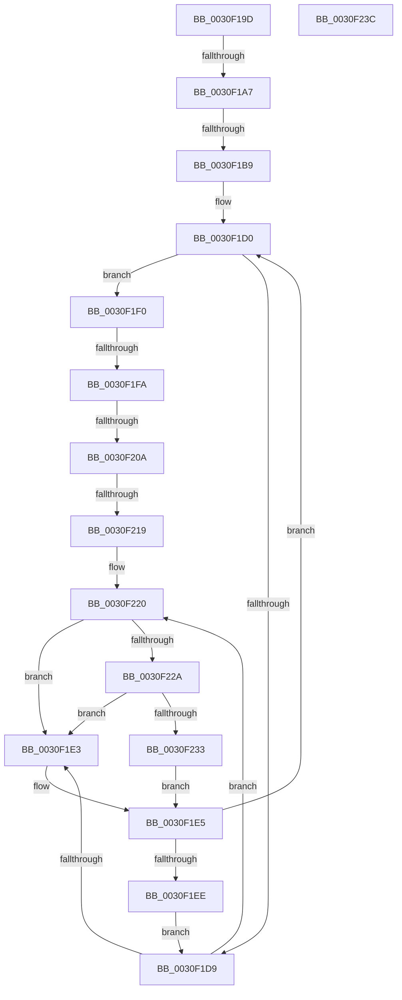

# sub_0030F19D

- RVA: `0x0030F19D`–`0x0030F244` (길이 `167` bytes)
- VA: `0x000000014030F19D`
- 실행 섹션: `.text`
- PDB 이름 있음: `아니요`; PDB Function 태그: `아니요`
- unwind 정보 RVA: `0x000740C0`
- 디코드: `44`개 명령, `167/167` bytes 표시
- 미해석 바이트: `0` (있으면 어셈블리에 `.byte`로 보존)

> 이 문서는 커널 이미지의 기계어와 PDB 기호를 분석해 생성했습니다. 4번과 5번은 함수 원형과 자료형을 바이너리 사용 방식에서 추정한 C 해석이며 원본 소스 복구 결과는 아닙니다.

## 1. Dependencies

- 직접 호출 지점: **2**; 고유 호출 대상: **2**
- 직접 호출자로 확인된 함수: **0**
- RIP 상대 이미지 참조: **2**

### Outgoing calls
- `0x0030F22A` → [KiCheckVpBackingLongSpinWaitHypercall](KiCheckVpBackingLongSpinWaitHypercall_function_0030F490.md) (function, `0x0030F490`)
- `0x0030F235` → [HvlNotifyLongSpinWait](HvlNotifyLongSpinWait_function_0030F460.md) (function, `0x0030F460`)

### Direct callers
- 이 함수 시작 RVA로 연결되는 직접 call은 확인되지 않았습니다. 간접 호출은 완전히 역산할 수 없습니다.

### Static image references
- `0x0030F1DB` → RVA `0x00FC52AC` (`ALMOSTRO`; reference)
- `0x0030F220` → RVA `0x00FC6AB8` (`ALMOSTRO`; read)

## 2. Other-region calls and transfers

- 다른 실행 섹션으로 향하는 call: **0**
- call이 아닌 외부 분기/꼬리 이동: **6**
  - `0x0030F1A1` → [sub_0030EE9F + 0x153](Unknown_function_0030EE9F.md) (`tail-transfer`)
  - `0x0030F1B3` → [sub_0030EE9F + 0x83](Unknown_function_0030EE9F.md) (`tail-transfer`)
  - `0x0030F1F4` → [sub_0030F26B + 0x1E6](Unknown_function_0030F26B.md) (`tail-transfer`)
  - `0x0030F204` → [sub_0030F26B + 0x1C7](Unknown_function_0030F26B.md) (`tail-transfer`)
  - `0x0030F213` → [sub_0030F26B + 0x1C7](Unknown_function_0030F26B.md) (`tail-transfer`)
  - `0x0030F23F` → [sub_0030EE9F + 0x1CD](Unknown_function_0030EE9F.md) (`tail-transfer`)

## 3. Assembly (complete function range)

```asm
0030F19D  2C 03                           sub al, 3
0030F19F  3C 03                           cmp al, 3
0030F1A1  0F 86 4B FE FF FF               jbe 0x14030eff2
0030F1A7  41 B4 02                        mov r12b, 2
0030F1AA  41 8B B6 18 02 00 00            mov esi, dword ptr [r14 + 0x218]
0030F1B1  85 F6                           test esi, esi
0030F1B3  0F 88 69 FD FF FF               js 0x14030ef22
0030F1B9  48 8B 1C F2                     mov rbx, qword ptr [rdx + rsi*8]
0030F1BD  41 8B FA                        mov edi, r10d
0030F1C0  48 8B C3                        mov rax, rbx
0030F1C3  48 83 E0 FE                     and rax, 0xfffffffffffffffe
0030F1C7  48 89 45 40                     mov qword ptr [rbp + 0x40], rax
0030F1CB  0F 1F 44 00 00                  nop dword ptr [rax + rax]
0030F1D0  F0 48 0F BA 6B 30 00            lock bts qword ptr [rbx + 0x30], 0
0030F1D7  73 17                           jae 0x14030f1f0
0030F1D9  FF C7                           inc edi
0030F1DB  85 3D CB 60 CB 00               test dword ptr [rip + 0xcb60cb], edi
0030F1E1  74 3D                           je 0x14030f220
0030F1E3  F3 90                           pause
0030F1E5  48 8B 43 30                     mov rax, qword ptr [rbx + 0x30]
0030F1E9  48 85 C0                        test rax, rax
0030F1EC  74 E2                           je 0x14030f1d0
0030F1EE  EB E9                           jmp 0x14030f1d9
0030F1F0  4C 3B 73 08                     cmp r14, qword ptr [rbx + 8]
0030F1F4  0F 84 57 02 00 00               je 0x14030f451
0030F1FA  41 0F B6 86 84 01 00 00         movzx eax, byte ptr [r14 + 0x184]
0030F202  3C 02                           cmp al, 2
0030F204  0F 85 28 02 00 00               jne 0x14030f432
0030F20A  41 8B 86 18 02 00 00            mov eax, dword ptr [r14 + 0x218]
0030F211  3B C6                           cmp eax, esi
0030F213  0F 85 19 02 00 00               jne 0x14030f432
0030F219  B9 4A 00 00 00                  mov ecx, 0x4a
0030F21E  CD 29                           int 0x29
0030F220  8B 05 92 78 CB 00               mov eax, dword ptr [rip + 0xcb7892]
0030F226  A8 40                           test al, 0x40
0030F228  74 B9                           je 0x14030f1e3
0030F22A  E8 61 02 00 00                  call 0x14030f490
0030F22F  84 C0                           test al, al
0030F231  74 B0                           je 0x14030f1e3
0030F233  8B CF                           mov ecx, edi
0030F235  E8 26 02 00 00                  call 0x14030f460
0030F23A  EB A9                           jmp 0x14030f1e5
0030F23C  4C 03 C2                        add r8, rdx
0030F23F  E9 28 FE FF FF                  jmp 0x14030f06c
```

## 4. C-style interpretation (structured pseudocode)

```c
__int64 __fastcall sub_0030F19D(__int64 a1, __int64 a2, __int64 a3)
{
    __int64 result;
    __int64 v_rdi;

    result = (unsigned __int8)((result) - (3));
    result = (*(unsigned __int64 *)(a2 + (unsigned int)(*(unsigned int *)(v_r14 + 536)) * 8)) & (-2);
    *(unsigned __int64 *)(v_rbp + 64) = result;
loc_0030F1D0:
    if (condition_is_above_or_equal) goto loc_0030F1F0;
loc_0030F1D9:
    v_rdi = (unsigned int)(((unsigned int)((unsigned int)(v_r10))) + 1);
    if (((*(unsigned int *)(v_rip + 13328587)) & ((unsigned int)(v_rdi))) == 0) goto loc_0030F220;
loc_0030F1E3:
loc_0030F1E5:
    if (*(unsigned __int64 *)(*(unsigned __int64 *)(a2 + (unsigned int)(*(unsigned int *)(v_r14 + 536)) * 8) + 48) == 0) goto loc_0030F1D0;
    goto loc_0030F1D9;
loc_0030F1F0:
loc_0030F220:
    if ((((unsigned __int8)((unsigned int)(*(unsigned int *)(v_rip + 13334674)))) & (64)) == 0) goto loc_0030F1E3;
    result = KiCheckVpBackingLongSpinWaitHypercall(74, a2, a3, a4);
    if ((unsigned __int8)(result) == 0) goto loc_0030F1E3;
    result = HvlNotifyLongSpinWait((unsigned int)((unsigned int)(v_rdi)), a2, a3, a4);
    goto loc_0030F1E5;
}
```

## 5. (Beta) C Style

```c
int64_t sub_0030F19D(int64_t Arg1, void *Arg2, int64_t Arg3)
{
    uint8_t *arg2 = (uint8_t *)Arg2;

    int64_t result;
    int64_t local_rdi;

    result = (uint8_t)((result) - (3));
    result = (*(uint64_t *)(arg2 + (uint32_t)(*(uint32_t *)(local_r14 + 0x218)) * 8)) & (-2);
    *(uint64_t *)(local_rbp + 0x40) = result;
loc_0030F1D0:
    if (condition_is_above_or_equal) goto loc_0030F1F0;
loc_0030F1D9:
    local_rdi = (uint32_t)(((uint32_t)((uint32_t)(local_r10))) + 1);
    if (((*(uint32_t *)(v_rip + 0xCB60CB)) & ((uint32_t)(local_rdi))) == 0) goto loc_0030F220;
loc_0030F1E3:
loc_0030F1E5:
    if (*(uint64_t *)(*(uint64_t *)(arg2 + (uint32_t)(*(uint32_t *)(local_r14 + 0x218)) * 8) + 0x30) == 0) goto loc_0030F1D0;
    goto loc_0030F1D9;
loc_0030F1F0:
loc_0030F220:
    if ((((uint8_t)((uint32_t)(*(uint32_t *)(v_rip + 0xCB7892)))) & (64)) == 0) goto loc_0030F1E3;
    result = KiCheckVpBackingLongSpinWaitHypercall(74, Arg2, Arg3, a4);
    if ((uint8_t)(result) == 0) goto loc_0030F1E3;
    result = HvlNotifyLongSpinWait((uint32_t)((uint32_t)(local_rdi)), Arg2, Arg3, a4);
    goto loc_0030F1E5;
}
```

### 관측된 메모리 오프셋

구조체 형식이 확인되지 않은 접근은 인자 기준의 오프셋으로만 기록했습니다.

| 기준 인자 | 오프셋 표현 | 폭 (bit) | 접근 |
|---|---:|---:|---|
| `Arg2` | `+ 0x0 + rsi*8` | `64` | `R` |

## 6. Execution-region graph

[열기: 2D/3D 그래프와 함수 탐색 컨트롤 패널](../../../control-panel.html?section=text&rva=0x0030F19D&view=graph)

- 2D 그래프는 위에서 아래로 흐르고, 3D 그래프는 빈 공간을 드래그해 회전합니다. Shift+드래그는 이동, 휠은 확대·축소, 함수 노드 선택은 대상 보고서 이동입니다.

### Static fallback


